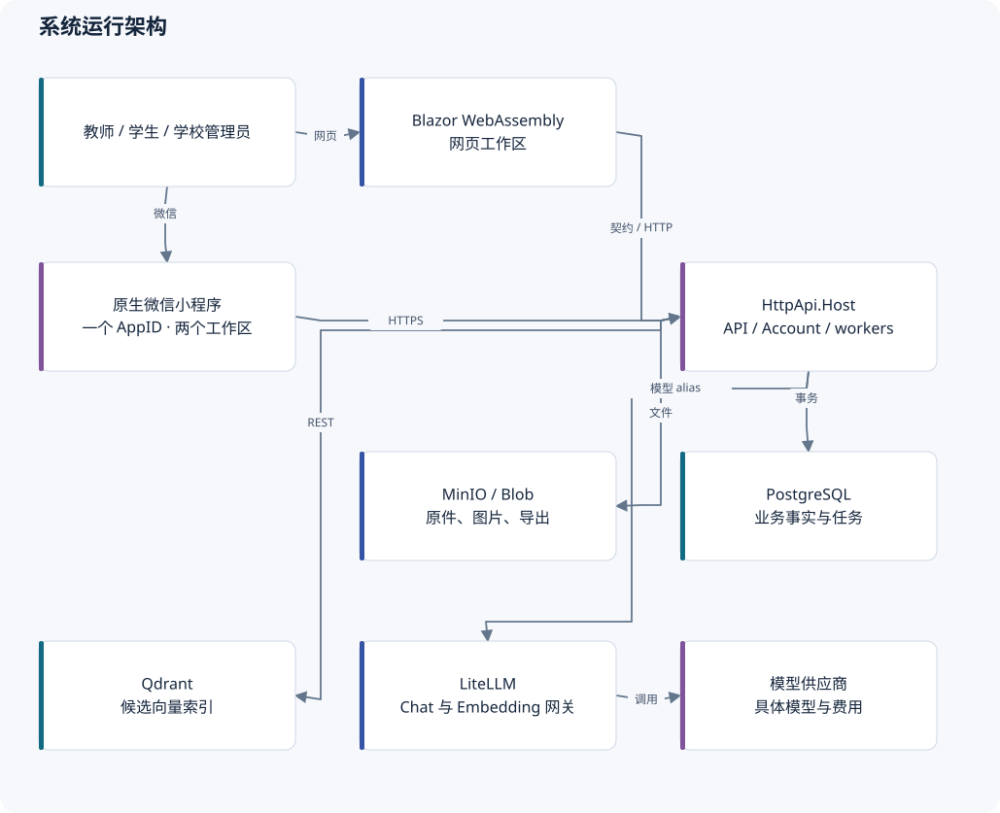

# KnowPulse 全仓库技术与架构审查

审查日期：2026-10-18（Asia/Shanghai）。范围：当前工作区中的服务端、Web、小程序、数据库模型、后台任务、测试与运维脚本。本文档描述**实际代码**，不是未来架构承诺，也不替代产品 PRD。

推荐打开 [离线图文阅读版](index.html)。它包含本目录全文、可放大的架构图和目录导航，无需联网。Markdown 是可编辑正文，`diagrams/` 同时保存 SVG 和 Mermaid 图源。

| 文档 | 主要内容 | 适合读者 |
| --- | --- | --- |
| [审计报告](audit-report.md) | 8 项经核对的问题、触发场景、最小修复与验证边界 | 技术负责人、维护者 |
| [技术架构](technical-architecture.md) | 系统边界、真实技术栈、分层、授权、外部适配、关键取舍 | 架构师、新成员 |
| [代码结构](code-map.md) | 项目引用图、模块入口、修改导航、源码体量、依赖清单 | 开发者 |
| [数据与核心流程](data-and-flows.md) | 知识、教材、考试、分析、方案、微信和通知的关系与时序 | 后端、前端、测试 |
| [部署、运行与验证](operations-and-validation.md) | 本地拓扑、六类消费者、一致性、配置、恢复与发布条件 | 运维、后端、测试 |
| [来源与覆盖范围](sources-and-coverage.md) | 证据索引、实际检查、未查区域、已确认产品决定 | 评审者 |
| [结构化清单](inventory.json) | 实际项目引用、直接包依赖与文件统计 | 工具、后续维护者 |

## 结论先读

项目适合继续采用 ABP 分层单体。PostgreSQL 保存事实、Blob 保存原件、Qdrant 保存可重建索引的职责划分清楚；教育路径已经具备冻结答卷、评分修订、统一成绩发布和教师确认方案的完整数据模型。没有证据支持现在拆成微服务或引入新的通用工作流平台。

优先处理审计报告的 **1–4 项**：旧考试答案覆盖、旧考试超时恢复、旧向量挤占召回、索引长事务。它们不等同于“教育闭环全部失效”；旧企业考试与教育测评必须分别评估。

本轮只新增审查文档和图，并同步已确认的账号支持决策文字。**没有修复业务代码，没有应用迁移，没有提交或部署。**

## 基线与阅读约定

- 当前 `.git` 指向的外部 worktree 元数据目录不存在，`git status` / `git rev-parse HEAD` 失败。因此不能给出可信的本轮 commit SHA 或干净 diff；审查对象是当时文件内容，不能套用此前回合的提交信息。
- 负载假设：单个学校可同时有多个教师和多个班级使用；默认共享 PostgreSQL 数据库，单 API Host 是最低部署；多 Host 只作为扩容边界检查，未假定已经通过压测。D09 尚无正式人数、吞吐和 P95 指标。
- “已实现”指找到对应调用与模型，不自动表示真机、真实教材、生产数据和并发场景已验收。
- 箭头含义在每张图标题说明中定义；项目引用图是编译依赖，系统图是运行调用，数据关系图是简化业务关系，不能互相替代。
- 不计入第三方库、构建产物；迁移及快照单列。检查没有把重复生成的 EF Designer 当作业务复杂度。

## 图目录

1. 系统运行架构：师生入口、API、事实库与外部服务。
2. .NET 项目引用：由当前 `.csproj` 生成的实际依赖方向。
3. 业务代码结构：主模块与代码位置。
4. 知识发布及索引：关系型提交与外部处理的边界。
5. 权限感知 RAG：候选召回与主库复核。
6. 教育测评生命周期：冻结、封存、批改和发布。
7. 知识与学校数据关系：账号所有权、成员、课程与共享。
8. 教育证据数据关系：答卷、修订、成绩、报告和方案。
9. 微信绑定及请求校验：原账号、微信证明、令牌与失效。
10. 学情与教学闭环：证据、规则、教师确认和新题复测。
11. 本地部署拓扑：实际进程、容器和端口。
12. 小程序会话与恢复：内存令牌、身份代次、回执和正文分离。
