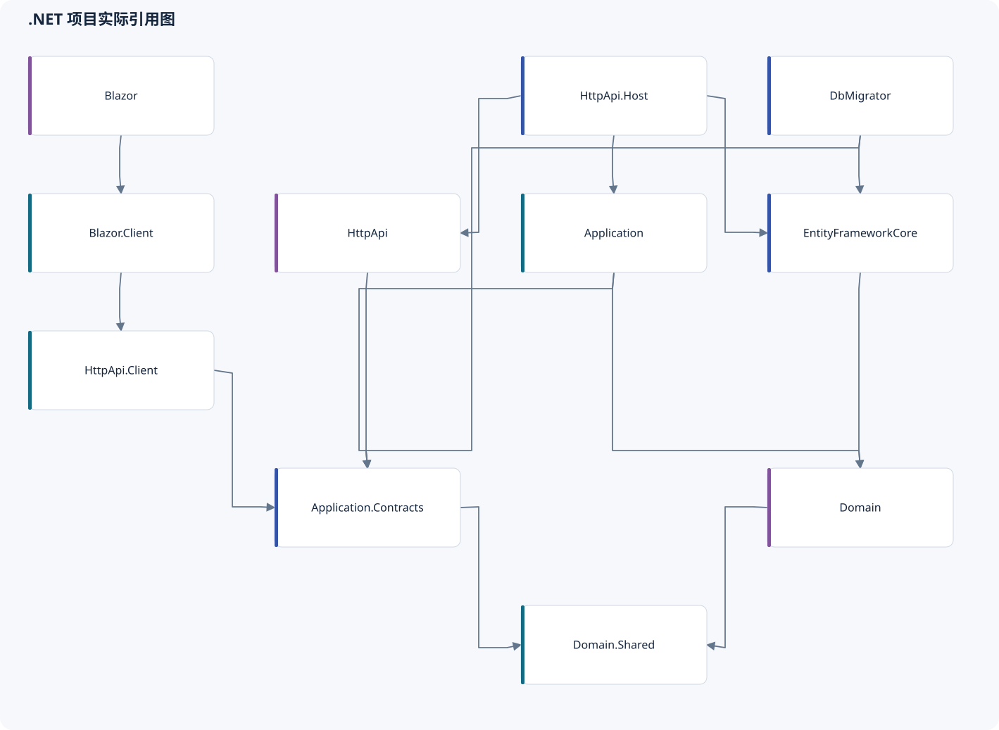
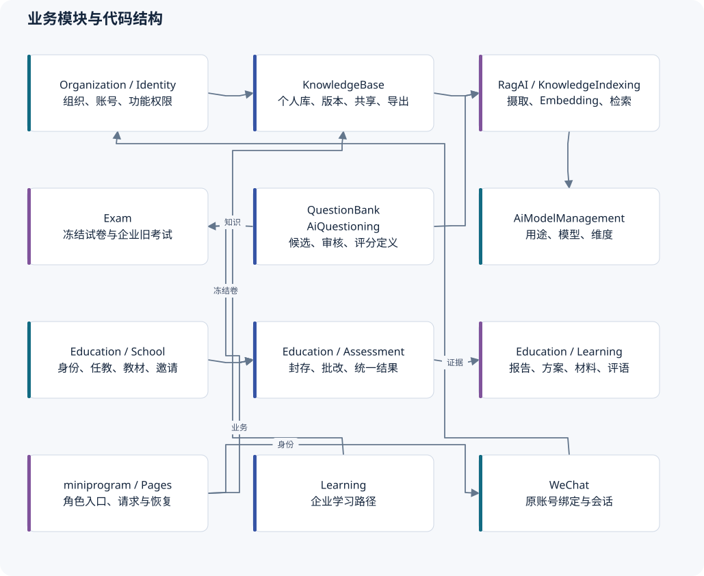

# 代码结构与开发导航

## 1. 实际项目组成

11 个生产项目、5 个测试／测试基础项目。下表来自当前项目文件；箭头是编译引用，不代表调用次数或网络边界。

| 项目 | 直接引用的本仓库项目 | 职责 |
| --- | --- | --- |
| [Application](../../src/KnowPulse.Application/KnowPulse.Application.csproj) | Domain, Application.Contracts | 用例编排、授权、仓储与外部适配 |
| [Application.Contracts](../../src/KnowPulse.Application.Contracts/KnowPulse.Application.Contracts.csproj) | Domain.Shared | DTO、应用接口和功能权限 |
| [Blazor](../../src/KnowPulse.Blazor/KnowPulse.Blazor.csproj) | Blazor.Client | Web 主机与资源承载 |
| [Blazor.Client](../../src/KnowPulse.Blazor.Client/KnowPulse.Blazor.Client.csproj) | HttpApi.Client | WebAssembly 页面和组件 |
| [DbMigrator](../../src/KnowPulse.DbMigrator/KnowPulse.DbMigrator.csproj) | Application.Contracts, EntityFrameworkCore | 迁移及种子程序 |
| [Domain](../../src/KnowPulse.Domain/KnowPulse.Domain.csproj) | Domain.Shared | 实体、状态与领域规则 |
| [Domain.Shared](../../src/KnowPulse.Domain.Shared/KnowPulse.Domain.Shared.csproj) | 无 | 共用枚举、错误码、本地化、值规则 |
| [EntityFrameworkCore](../../src/KnowPulse.EntityFrameworkCore/KnowPulse.EntityFrameworkCore.csproj) | Domain | 主 DbContext、映射、迁移与仓储 |
| [HttpApi](../../src/KnowPulse.HttpApi/KnowPulse.HttpApi.csproj) | Application.Contracts | 显式 HTTP 入口 |
| [HttpApi.Client](../../src/KnowPulse.HttpApi.Client/KnowPulse.HttpApi.Client.csproj) | Application.Contracts | ABP 动态客户端代理 |
| [HttpApi.Host](../../src/KnowPulse.HttpApi.Host/KnowPulse.HttpApi.Host.csproj) | Application, EntityFrameworkCore, HttpApi | 认证、API、服务组合与后台任务 |

## 2. 模块地图

| 业务 | 服务端入口 | 前端与相关位置 |
| --- | --- | --- |
| 组织与角色 | `Application/Organization`、Contracts/Permissions；ABP Identity 模块 | Web 组织页和权限菜单 |
| 知识生命周期与个人库 | `Application/KnowledgeBase`；Domain 同名目录 | `Pages/Knowledge`、个人库和笔记页 |
| 共享、附件与导出 | KnowledgeSchoolSharingAppService、KnowledgePersonalExportAppService、PersonalKnowledgeExportProcessor | 学校资料、个人库、原生笔记 |
| 摄取与 RAG | `Application/KnowledgeIndexing`、`Application/RagAI` | 知识状态、检索问答、运维日志页 |
| 模型配置 | `Application/AiModelManagement` | 模型目录、用途、版本配置页 |
| 题库与出题 | `Application/QuestionBank`、`Application/AiQuestioning` | `Pages/QuestionBank`、候选与规则编辑 |
| 企业旧考试 | `Application/Exam/ExamAppService.cs` | `Pages/Exam`；保留独立运行模型 |
| 企业学习路径 | `Application/Learning` | 学习路径与知识反馈页 |
| 学校与课程 | EducationSchoolAppService、EducationCurriculumAppService、EducationMaterialScope | 学校、教材、任教、邀请与更正页 |
| 教育测评 | EducationAssessmentAppService 的核心与 partial；Submission / GradingProcessor | 教师任务、批改、结果；原生作答与进度 |
| 学情与方案 | LearningReport、StudentGrowth、TeachingPlan 服务与 processor | 报告、趋势、教学方案及原生对应页 |
| 学习活动 | StudyTask、Correction、Practice、NotebookSource、Workload 服务 | 材料、订正、复练、笔记与日程 |
| 私有观察／评语／消息 | Feedback、StudentInbox、Reminder、PlanNotice 服务 | 教师评语编辑、学生阅读与收件箱 |
| 微信与账号帮助 | `Application/WeChat`、`HttpApi.Host/WeChat`、Contracts/AccountSupport | `Pages/Account`、原生 login/workspace/session |

Education 的 partial 文件按评分、结果、图片、通知、执行等用例拆分，仍组成同一个服务类型。修改时先从 Contracts 找操作，再查实现及全部 partial；只读主文件容易漏掉授权或返回投影。

## 3. 典型修改应触达的位置

| 修改 | 必查路径 | 验证重点 |
| --- | --- | --- |
| 新业务规则／状态 | Domain.Shared → Domain → Contracts → Application | 非法迁移、版本与旧回执 |
| 新 API／字段 | Contracts、服务实现、显式或常规路由、代理、Web、原生请求 | 字段裁剪、真实权限、旧客户端行为 |
| 新权限 | 权限常量／定义、服务显式检查、菜单／页、本地化 | 菜单可见不能代替后端检查 |
| 数据变更 | Domain、EF 映射、迁移和快照、DTO | 唯一约束、成对外键、时间、回滚 |
| 外部模型／存储 | 自有接口、Application 适配、Host DI、配置样例、替身 | 不泄漏 provider 类型、密钥或正文 |
| 原生恢复 | utils/session、业务 command helper、页面、测试 | 原操作查询、身份代次、版本与私有正文 |

实际入口包含 73 条 Web `@page` 声明、35 个原生注册页面、85 个显式 HTTP verb 特性；**85 不是 API 总数**，ABP 常规控制器还暴露应用服务。新增入口应核对运行时 API 定义和既有契约测试。

## 4. 代码体量

统计 `.cs/.razor/.js/.cjs/.wxml/.wxss/.ps1`；排除 bin、obj、node_modules、wwwroot、libs。行数包含注释与空行，不是复杂度指标。miniprogram 含逻辑测试；`wwwroot` 中的一方资源未计入，因此不是仓库所有手写文本总量。

| 位置 | 非迁移文件 | 非迁移行数 | 迁移／Designer／快照行数 |
| --- | ---: | ---: | ---: |
| `src/KnowPulse.Application` | 128 | 29,011 | 0 |
| `src/KnowPulse.Application.Contracts` | 114 | 10,316 | 0 |
| `src/KnowPulse.Blazor` | 4 | 164 | 0 |
| `src/KnowPulse.Blazor.Client` | 97 | 22,555 | 0 |
| `src/KnowPulse.DbMigrator` | 3 | 106 | 0 |
| `src/KnowPulse.Domain` | 119 | 12,485 | 0 |
| `src/KnowPulse.Domain.Shared` | 73 | 2,796 | 0 |
| `src/KnowPulse.HttpApi` | 20 | 1,328 | 0 |
| `src/KnowPulse.HttpApi.Client` | 1 | 38 | 0 |
| `src/KnowPulse.HttpApi.Host` | 17 | 1,225 | 0 |
| `src/KnowPulse.EntityFrameworkCore` | 32 | 3,351 | 584,234 |
| `test/KnowPulse.Application.Tests` | 44 | 2,521 | 0 |
| `test/KnowPulse.Domain.Tests` | 43 | 4,599 | 0 |
| `test/KnowPulse.HttpApi.Client.ConsoleTestApp` | 4 | 117 | 0 |
| `test/KnowPulse.TestBase` | 5 | 154 | 0 |
| `test/KnowPulse.EntityFrameworkCore.Tests` | 92 | 22,026 | 0 |
| `miniprogram` | 135 | 8,483 | 0 |
| `ops` | 17 | 5,030 | 0 |

49 个实际迁移对应的 Designer 和最终 Snapshot 合计占大量生成代码；不能据此认定 EF 层比整个业务复杂几十倍。主 DbContext 之外还有教育等模块的映射扩展文件。

## 5. 较大的手写文件

以下只是阅读导航，不是“因为长所以拆”的缺陷清单。应按业务职责和共同变更原因拆分，不应机械地按行数拆小函数。

| 文件 | 行数 |
| --- | ---: |
| [src/KnowPulse.Application/AiQuestioning/AiQuestionGenerationAppService.cs](../../src/KnowPulse.Application/AiQuestioning/AiQuestionGenerationAppService.cs) | 1,626 |
| [src/KnowPulse.Blazor.Client/Pages/Knowledge/Items.razor](../../src/KnowPulse.Blazor.Client/Pages/Knowledge/Items.razor) | 1,495 |
| [src/KnowPulse.Blazor.Client/Pages/Knowledge/Upload.razor](../../src/KnowPulse.Blazor.Client/Pages/Knowledge/Upload.razor) | 1,421 |
| [src/KnowPulse.Application/Exam/ExamAppService.cs](../../src/KnowPulse.Application/Exam/ExamAppService.cs) | 1,273 |
| [src/KnowPulse.Blazor.Client/Pages/QuestionBank/AiCandidates.razor](../../src/KnowPulse.Blazor.Client/Pages/QuestionBank/AiCandidates.razor) | 1,244 |
| [src/KnowPulse.Application/QuestionBank/QuestionAppService.cs](../../src/KnowPulse.Application/QuestionBank/QuestionAppService.cs) | 1,200 |
| [src/KnowPulse.EntityFrameworkCore/EntityFrameworkCore/KnowPulseDbContext.cs](../../src/KnowPulse.EntityFrameworkCore/EntityFrameworkCore/KnowPulseDbContext.cs) | 1,131 |
| [src/KnowPulse.Application.Contracts/RagAI/RagContracts.cs](../../src/KnowPulse.Application.Contracts/RagAI/RagContracts.cs) | 1,053 |
| [src/KnowPulse.Application/KnowledgeBase/KnowledgeItemAppService.cs](../../src/KnowPulse.Application/KnowledgeBase/KnowledgeItemAppService.cs) | 1,043 |
| [src/KnowPulse.Application/Learning/LearningPathAppService.cs](../../src/KnowPulse.Application/Learning/LearningPathAppService.cs) | 958 |
| [src/KnowPulse.Blazor.Client/Pages/QuestionBank/QuestionEditor.razor](../../src/KnowPulse.Blazor.Client/Pages/QuestionBank/QuestionEditor.razor) | 915 |
| [src/KnowPulse.Application/RagAI/QdrantKnowledgeVectorStore.cs](../../src/KnowPulse.Application/RagAI/QdrantKnowledgeVectorStore.cs) | 899 |

## 6. 当前直接包依赖

本表从项目文件读取，不含传递依赖，也未执行 CVE／许可证审查。ABP 同版本模块合并展示，完整逐项目引用保留在 `inventory.json`。

| 直接包 | 版本 |
| --- | --- |
| `Volo.Abp.*`（各项目按需引用） | 10.6.0, 5.6.0 |
| `Blazorise.Bootstrap5` | 2.2.1 |
| `Blazorise.Icons.FontAwesome` | 2.2.1 |
| `Microsoft.AspNetCore.Components.WebAssembly` | 10.0.9 |
| `Microsoft.AspNetCore.Components.WebAssembly.DevServer` | 10.0.9 |
| `Microsoft.AspNetCore.Components.WebAssembly.Server` | 10.0.13 |
| `Microsoft.EntityFrameworkCore.Tools` | 10.0.9 |
| `Microsoft.Extensions.DataIngestion.Abstractions` | 10.7.0-preview.1.26309.5 |
| `Microsoft.Extensions.DataIngestion.MarkItDown` | 10.7.0-preview.1.26309.5 |
| `Microsoft.Extensions.FileProviders.Embedded` | 10.0.9 |
| `Microsoft.Extensions.Hosting` | 10.0.9 |
| `Microsoft.Extensions.Http.Polly` | 10.0.9 |
| `Microsoft.NET.Test.Sdk` | 17.14.1 |
| `NSubstitute` | 5.3.0 |
| `NSubstitute.Analyzers.CSharp` | 1.0.17 |
| `SQLitePCLRaw.bundle_e_sqlite3` | 2.1.12 |
| `Serilog.AspNetCore` | 9.0.0 |
| `Serilog.Extensions.Logging` | 9.0.2 |
| `Serilog.Sinks.Async` | 2.1.0 |
| `Serilog.Sinks.Console` | 6.0.0 |
| `Serilog.Sinks.File` | 7.0.0 |
| `Shouldly` | 4.3.0 |
| `xunit` | 2.9.3 |
| `xunit.extensibility.execution` | 2.9.3 |
| `xunit.runner.visualstudio` | 3.1.4 |

## 7. 不应盲目合并或删除的部分

- 企业 Exam 与教育 Assessment：存在真实调用方，运行规则不同；先修旧路径或明确退役政策。
- `IKnowledgeVectorStore`、模型／转换接口：为供应商隔离和替身验证提供实际边界。
- 不可变修订与当前指针：支持历史解释和未知请求恢复，不能只为减少表数覆盖旧行。
- 本机草稿与云端操作回执：解决不同问题；前者不证明已经提交，后者不自动恢复未同步文字。

下一次修改应先全树查调用方，再决定合并；本轮没有认定可安全删除的生产模块或依赖。
