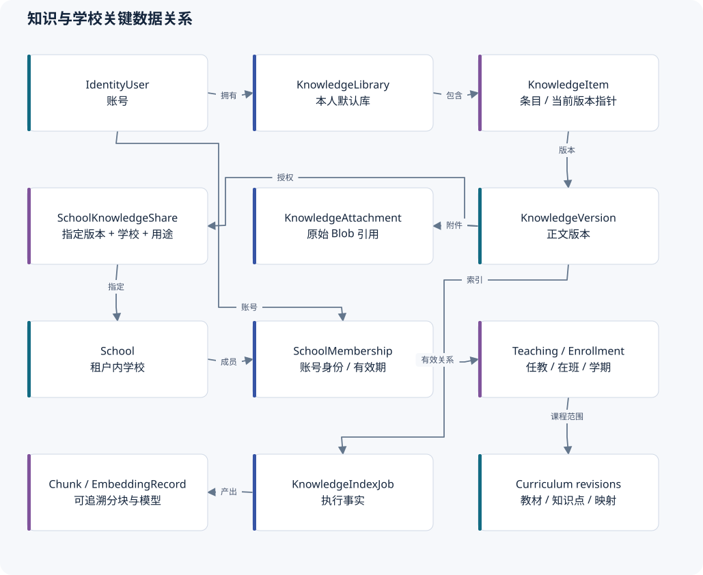
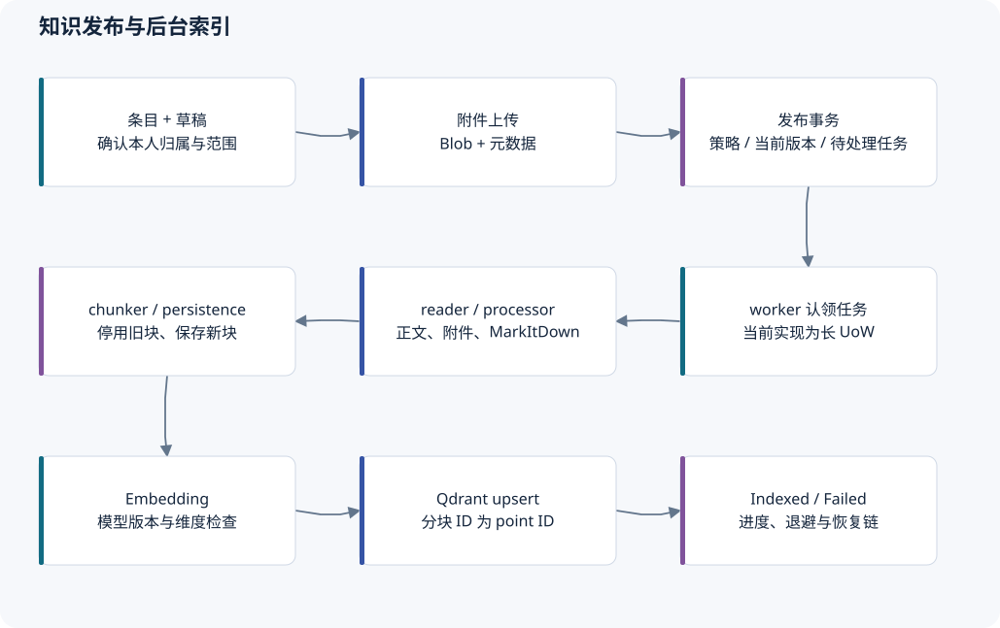
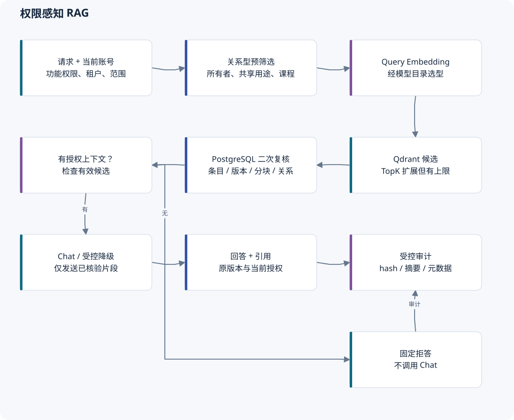
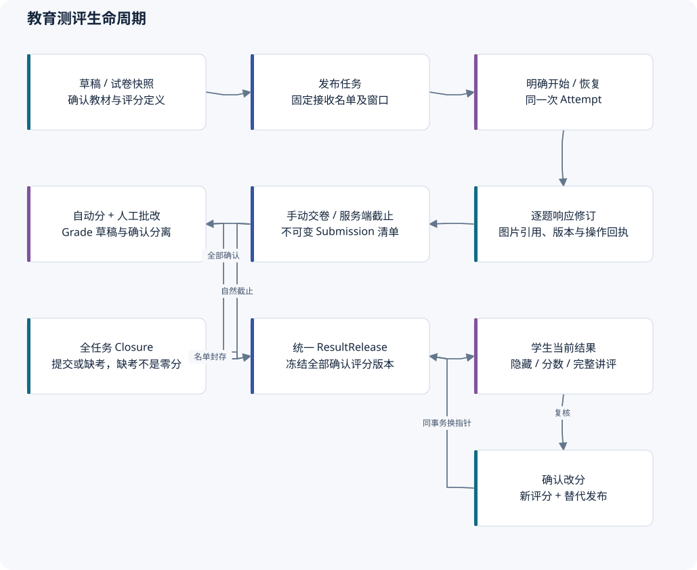
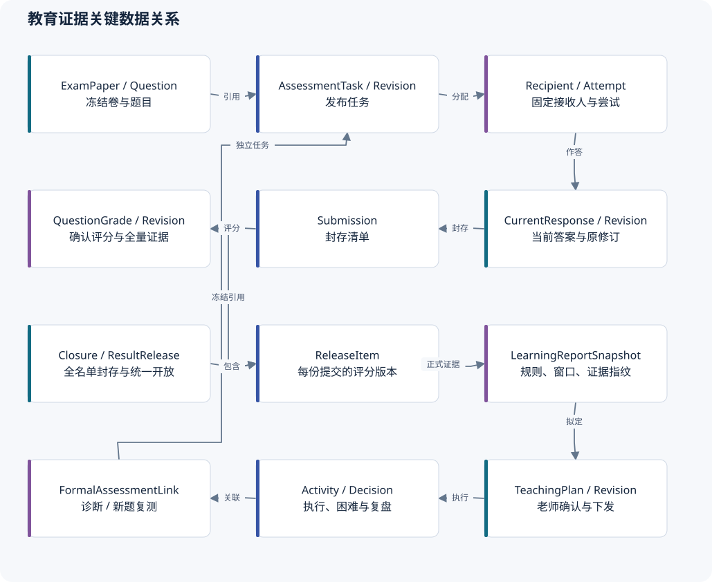
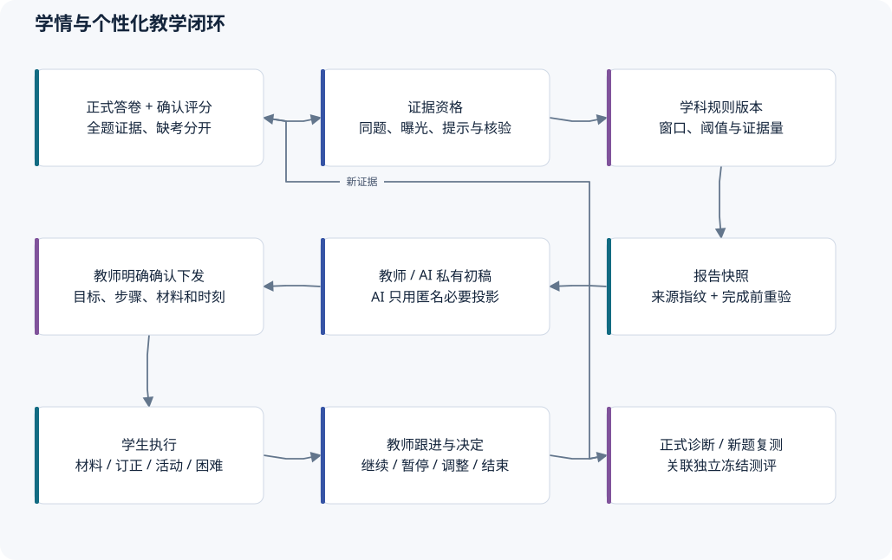
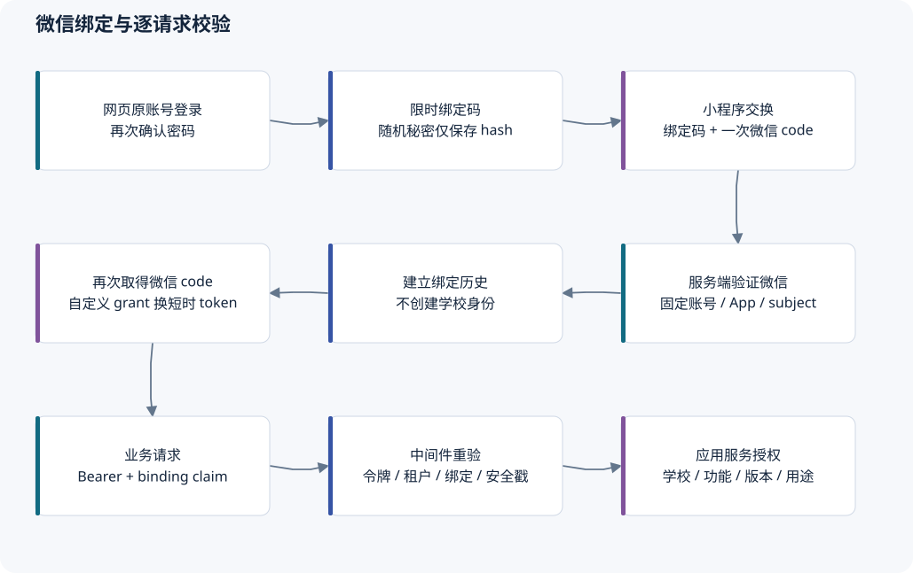
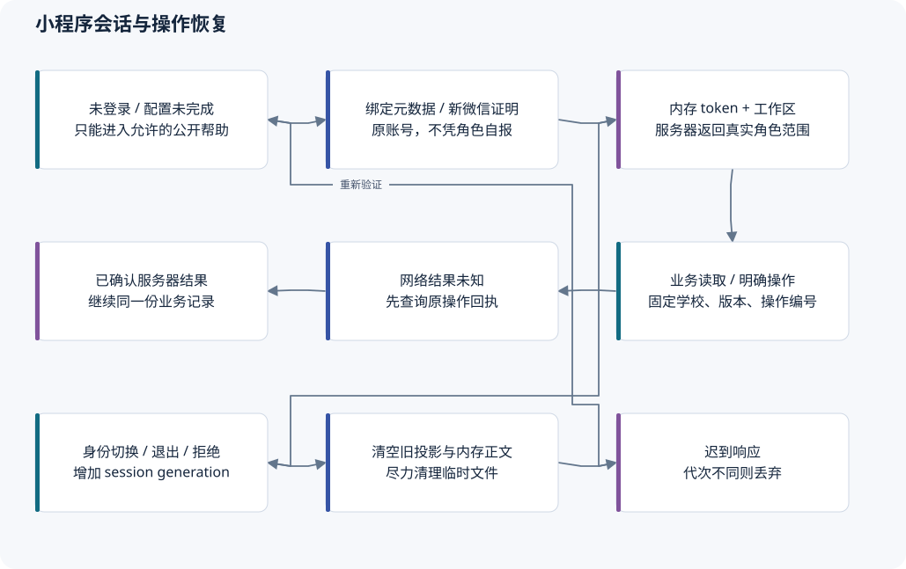

# 数据关系与核心流程

## 1. 数据模型的阅读方法

主 DbContext 声明 151 个 `DbSet`，包含 ABP 模块实体；这不是完整 SQL 表总数，导航实体与扩展配置也参与模型。当前有 49 个迁移文件，另有对应 Designer 与模型快照。下面画的是关键业务关系，省略审计列、租户列、并发戳及大量从表；它不是由数据库反向生成的完整物理 ERD。

所有权、当前指针和历史修订是三个不同概念。例如教师拥有试卷，不意味着拥有引用材料；成绩当前指针改变，不意味着旧评分或旧结果被删除。

## 2. 知识、学校与课程

| 聚合或事实 | 保存内容 | 不应被误解为 |
| --- | --- | --- |
| `IdentityUser` / `KnowledgeLibrary` | 原账号与默认个人库归属 | 学校拥有教师账号 |
| `KnowledgeItem` / `KnowledgeVersion` | 条目整理信息、正文版本与当前发布指针 | 分享后所有私人修订都公开 |
| `KnowledgeAttachment` | 版本附件元数据与 Blob 引用 | 独立于版本的永久公开 URL |
| `KnowledgePermissionScope` | 企业知识的显式访问策略 | 教育学校成员或任教关系 |
| `SchoolKnowledgeShare` | 指定版本、学校、用途与冻结共享元数据 | 所有者转移或任意衍生用途授权 |
| `KnowledgeIndexJob` / `KnowledgeChunk` / `KnowledgeEmbeddingRecord` | 索引执行、可追溯分块、模型及向量映射 | Qdrant 中存在就已完成或可读取 |
| `SchoolMembership` | 某账号在学校的 Teacher／Student／Manager 身份区间 | 当前具体任教或在班 |
| `TeachingAssignment` / `StudentEnrollment` | 学期、班级、学科与有效关系 | 允许跨校查看全部历史 |
| 教材、章节、知识点修订、映射 | 稳定结构和不可变课程引用 | 自由文本“数学”标签即可替代 |

成员和关系使用 UTC 半开时间区间，结束旧关系与建立新关系保留历史。资料的自由标签用于个人整理；教材范围需稳定编号、版本、章节和明确映射。

## 3. 资料上传、发布与索引

1. 用户创建条目和草稿，上传附件；服务端核对账号、版本归属、文件限制与草稿状态。附件实际写 Blob，主库保存引用。
2. 发布命令提交完整访问策略。服务端校验规则不混用、不重复，在一笔关系型事务中更新策略、当前版本、适用的旧索引状态并插入待处理任务。
3. 有效指定版本共享可以保留旧发布版的索引；私人新版本不扩大共享。是否保留索引和谁能读取是两次独立判断。
4. Host 轮询任务，调用 `KnowledgeIndexJobProcessor`，处理顺序是 reader → processor → chunker → persistence → embedding → vector-store。
5. reader 读取正文／Blob，非文本格式走 MarkItDown；转换后的正文和分页信息被处理和切块，分块保存业务编号与内容 hash。
6. Embedding 通过模型目录选择模型与维度，调用网关，保存追踪记录并 upsert Qdrant。成功完成全部阶段后才能标记 `Indexed`。
7. 自动重试留在同一任务并退避；人工重试／恢复创建关联原任务的新任务。旧任务仍用于追溯。

失败时不把 UI 的“发布成功”解释为可以检索。当前长事务与旧向量清理缺口详见审计 3、4；本图的功能顺序是现有实现，推荐的短事务执行方式尚未改入代码。

源码：[KnowledgeItemAppService](../../src/KnowPulse.Application/KnowledgeBase/KnowledgeItemAppService.cs)、[KnowledgeIndexJobProcessor](../../src/KnowPulse.Application/KnowledgeIndexing/KnowledgeIndexJobProcessor.cs)、[Ingestion](../../src/KnowPulse.Application/RagAI/KnowledgeIngestionPipeline.cs)、[Embedding](../../src/KnowPulse.Application/RagAI/KnowledgeEmbeddingPipeline.cs)。

## 4. 权限感知 RAG

`RagAnswerService` 首先验证问答功能权限并选择模型。检索器从当前服务器身份构造范围，检查请求中自报的 UserId／TenantId 不得冒充其他主体，再计算可用共享版和课程分块。

Qdrant 根据租户、所有者／组织、共享版本、课程候选、安全等级和发布标志缩小候选。返回的向量命中只提供候选编号和相似度；检索器批量回读条目、版本、分块、策略与索引事实，并重新检查当前学校共享和成员关系。

其中共享访问要求分块所属任务为 `Indexed`；当前发布版本的直接访问按分块有效性、版本生命周期和权限判断，没有同样的任务完成状态门槛。这是当前实现的路径差异，本轮未以真实故障注入验证部分索引写入时的表现。

只有通过检查的正文进入模型提示。无可用上下文时返回“知识库依据不足”；模型失败有受控降级。回答附引用，审计保存 hash、受控摘要、引用编号和模型信息，不以日志保存完整 prompt 作为调试方法。

共享撤回后数据库复核阻止新的使用，但已经看过、下载过或正在处理的内容不能被承诺“从用户记忆中收回”。D03 已明确学生材料停止后续在线读取，历史答卷与已上交副本由独立授权保留。

源码：[KnowledgeRetriever](../../src/KnowPulse.Application/RagAI/KnowledgeRetriever.cs)、[RagAnswerService](../../src/KnowPulse.Application/RagAI/RagAnswerService.cs)、[KnowledgeSourceAccessGuard](../../src/KnowPulse.Application/RagAI/KnowledgeSourceAccessGuard.cs)。

## 5. 备课、出题、审核与试卷

教师先选择有效任教和教材范围，关联允许使用的本人资料或学校共享版本。`LessonPreparation` 保存目标、教材映射、资料版本和题卷引用的修订；备课反思必须经明确动作才复制为本人知识草稿。

AI 出题保存独立生成任务，worker 认领并恢复记录的账号上下文，重新检查权限和来源。调用模型产生候选；教师编辑、采纳、评分规则确认和审核均不被生成完成代替。候选或来源变动会触发相应的重新核验。

`ExamPaper`／`ExamPaperQuestion` 冻结题干、选项、评分定义、知识点和来源快照。教育任务引用这个冻结试卷，学生作答与评分不跟随教师后来的题库编辑。

企业旧 `ExamPlan` 与教育 `EducationAssessmentTask` **是两套运行模型**。它们共享部分试卷数据，但发布、名单、答卷、评分和开放规则不同；不能将旧企业考试的分数直接当成教育统一成绩发布结果。

## 6. 正式测评、批改与统一结果

| 阶段 | 关键事实 | 一致性与权限要求 |
| --- | --- | --- |
| 草稿／发布 | Task、Revision、Recipient | 教师当前任教；发布固定试卷和实际名单，不依赖日后班级名单漂移 |
| 开始／恢复 | Attempt、Recipient 当前尝试 | 学生当前有效关系；服务端时刻；原答卷恢复不重置计时 |
| 保存 | ResponseRevision、CurrentResponse | 题目属于冻结卷；原操作回执；答卷版本冲突；图片引用属于本次作答 |
| 交卷／截止 | Submission manifest | 列出所有题，包括未答；固定确切响应修订及 hash，不读取后续答案 |
| 初始化／批改 | QuestionGrade、GradeRevision | 自动分与人工分分开；老师草稿与确认指针分开；不覆盖人工处理 |
| 全任务封存 | Closure | 所有固定接收人分别是已封存提交或缺考；缺考不是 0 分答卷 |
| 最终发布 | ResultRelease、ReleaseItem | 全部有效提交的每题完成确认评分；冻结每份答卷对应的确切评分修订 |
| 学生查看 | 当前结果发布投影 | 隐藏／仅分数／完整讲评，分别裁剪字段；到开放时间且当前关系有效 |
| 改分／复核 | 新评分、替代发布、ReviewRequest | 原因留存，结果指针与新分数一起切换，保留原版本 |

教育写入遵循学校 → 当前账号 → 任务／答卷／评分根的约束顺序，避免撤权与写入各自成功。后台评分按已记录的租户与封存事实计算，不凭后台身份授予阅读权。

学生明确提交前看到的是已保存答案和上传事实的预览；预览指纹用于发现之后的变化。只在有明确排除／确认时处理未同步或未答部分，不能由客户端显示状态假报服务器保存。

源码：[测评服务](../../src/KnowPulse.Application/Education/EducationAssessmentAppService.cs)、[封存处理器](../../src/KnowPulse.Application/Education/EducationAssessmentSubmissionProcessor.cs)、[评分处理器](../../src/KnowPulse.Application/Education/EducationAssessmentGradingProcessor.cs)、[结果发布](../../src/KnowPulse.Application/Education/EducationAssessmentAppService.Results.cs)、[ADR 0017](../adr/0017-confirmed-question-grades-and-task-wide-result-release.md)。

## 7. 学情、成长与个性化教学

评分证据覆盖所有题目，不能只收集错题。知识点得分分配保持总量一致；同题练习、答案提示、实际材料提供和教师核验都影响证据资格，不能直接把“做对了”解释为独立掌握。

学校学科规则有明确版本；报告固定任务、窗口、课程、学生和来源指纹。worker 计算时保存租约与运行编号，完成前重新捕获来源，变化则停止旧计算或等待重算，不将过期结果冒作最新事实。学生成长只使用本人已经开放的正式结果。

人工或 AI 生成方案都是老师私有初稿。AI 请求投影移除学生身份和原始答卷／私有观察，仅传必要的学科、知识点状态与时间安排；返回 JSON 经结构和业务限制检查。教师明确保存、确认和下发后，学生才看到公开版本。

方案正文、执行决定、活动进度、材料读取、正式测评、困难反馈和教师私有处理分别建模。暂停阻止新的活动执行；已开始的正式考试仍按其原窗口封存。新题复测有正式任务关联，活动自报“完成”不能自动生成掌握证据。

源码：[报告处理器](../../src/KnowPulse.Application/Education/EducationLearningReportProcessor.cs)、[AI 方案执行](../../src/KnowPulse.Application/Education/EducationTeachingPlanAppService.GenerationExecution.cs)、[方案执行控制](../../src/KnowPulse.Application/Education/EducationTeachingPlanAppService.Execution.cs)。

## 8. 微信身份与客户端恢复

网页先验证原账号密码，签发随机、短时、服务端只保存 hash 的绑定码。小程序将绑定码和一次性微信证明交给服务端核验后建立绑定；登录再使用新微信证明取得短时 token。绑定本身不创建账号、学校身份或私人资料归属。

每次带微信绑定 claim 的业务请求核对 token 有效性、账号、租户、绑定、应用配置及账号安全戳。本人解绑释放活跃唯一键，保留历史，后续请求会被拒绝；不承诺召回已经在执行中的请求。

原生 `session.js` 管理登录和身份代次，迟到响应不能恢复旧账号投影。token 保存在内存；本地绑定元数据不是授权凭证。不同业务的恢复状态有区别：

- 私有评语、关系申请等通常只持久化操作编号和必要范围，正文留在内存。
- 正式作答、订正、复练等可在用户知情后保存本机草稿，按身份和确切版本隔离。
- 网络失败是“结果未确认”，先查询同一操作的回执；不自动创建新业务事实。
- 临时文件按当前身份跟踪，退出和拒绝尽力清理；共享设备上系统级副本、相册和无法清理的文件仍需真机政策验收。

源码：[绑定服务](../../src/KnowPulse.Application/WeChat/WeChatAccountAppService.cs)、[证明核验](../../src/KnowPulse.Application/WeChat/WeChatBindingAuthenticationService.cs)、[请求中间件](../../src/KnowPulse.HttpApi.Host/WeChat/WeChatBindingSessionMiddleware.cs)、[session.js](../../miniprogram/utils/session.js)。

## 9. 通知、正文、私有观察

学生统一收件箱接入测评、评语、方案来源，按当前学校和来源权限查询。消息仅携带通用种类、公开编号、确切版本、可用时间与首次消息已读；不放分数、答案或教师私有原因。

打开消息不自动开考或读取正文。真正进入来源时再次检查当前版本和权限；旧版、撤回或失效的来源不能悄悄换成新版本。评语的消息已读与实际正文已读分别记录。真实微信投递尚未配置，站内记录成功不能显示为微信发送成功。

教师观察与对学生评语分开保存。把一条观察用于评语需明确选取或复制；学校管理员和学生不会因能看到评语而读取教师观察原文。
