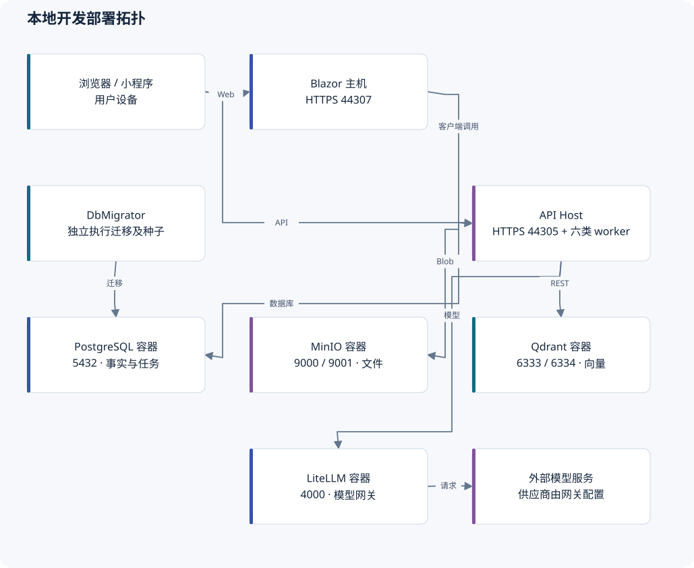

# 部署、运行与验证

## 1. 当前部署拓扑

| 组件 | 默认本地入口 | 状态与用途 |
| --- | --- | --- |
| API / Account / OpenIddict | `https://localhost:44305` | ASP.NET Core Host，同时运行六类业务 worker |
| Web | `https://localhost:44307` | 独立 ASP.NET Core 主机承载 Blazor WebAssembly |
| PostgreSQL | 5432 | Compose 服务 `postgres`，业务库事实 |
| MinIO API / Console | 9000 / 9001 | 私有 Blob 原件与管理入口 |
| Qdrant HTTP / gRPC | 6333 / 6334 | 应用主要使用 REST；可重建索引 |
| LiteLLM | 4000 | Chat／Embedding 的兼容网关 |
| DbMigrator | 一次性命令进程 | 迁移及种子；不是 API 启动的一部分 |

以上来自仓库开发配置，不是生产地址。`ops/start-local.ps1` 启动依赖、健康检查和迁移器，不启动 API 和 Web。Compose 默认端口绑定及开发凭据不能直接作为生产配置；生产入口、TLS、代理、密钥管理与网络访问边界需要单独配置。

本仓库 `deploy/` 当前主要提供 LiteLLM 配置样例，没有发现完整生产部署编排或 `.github/workflows`。这说明仓库内的发布自动化尚不完整，不代表外部平台一定没有 CI。

## 2. 六类后台消费者

| Host worker | 业务处理器／事实 | 认领、失败与恢复 |
| --- | --- | --- |
| KnowledgeIndexJobBackgroundWorker | KnowledgeIndexJobProcessor / KnowledgeIndexJob | 状态、阶段、心跳、指数退避、人工 RetryOfJobId；长事务缺口见审计 4 |
| PersonalKnowledgeExportBackgroundWorker | PersonalKnowledgeExportProcessor | RunId、租约、归属复核、临时文件与 Blob、退役运行清理、取消和过期 |
| AiQuestionGenerationBackgroundWorker | AiQuestionGenerationProcessor | 短事务认领、独立心跳、恢复账号、运行编号、退避和完成前授权复核 |
| EducationAssessmentDeadlineBackgroundWorker | SubmissionProcessor / GradingProcessor | 服务端到期封存；唯一提交和根写竞争；初始化评分不覆盖人工修订 |
| EducationLearningReportBackgroundWorker | EducationLearningReportProcessor | 来源指纹、运行编号、租约、容量限制、完成前来源重验与重算 |
| EducationTeachingPlanGenerationBackgroundWorker | EducationTeachingPlanGenerationProcessor | 认领、独立心跳、账号权限恢复、结构化输出；结果仍是待教师采用的初稿 |

这些不是六个独立服务，也没有外部消息队列提供恰好一次执行。数据库任务、唯一约束、运行编号和回执共同保证可恢复。重复触发不应被表述为“绝不会再次调用模型”；外部请求已经发生、进程尚未记账就中断时，仍须按相应任务语义解释成本与恢复。

多个 Host 都会注册 worker。已有运行编号的消费者可以拒绝过期执行者写回；不应据此推断所有消费者均已完成多 Host 压测。共享库发现方式不能直接支持租户独立数据库。

## 3. 配置的归属

| 配置／资产 | 位置或入口 | 运维注意点 |
| --- | --- | --- |
| SDK | 根 `global.json` | 区分基线与实际 SDK；构建日志记录实际环境 |
| NuGet 与项目引用 | 各 `.csproj`、`common.props` | 本轮未升级依赖；直接引用清单不是完整 SBOM |
| 数据库／外部服务 | Host、DbMigrator 配置及环境变量 | 不复制真实连接串进入文档或 issue |
| Blob | Host `ConfigureBlobStoring` | 原件与元数据需要一致恢复策略 |
| 模型 alias／用途 | 模型目录 + LiteLLM 样例 | 模型维度变化不能混写旧 collection |
| 微信 | WeChatLoginOptions、小程序配置 | 一个 AppID 两个工作区；AppSecret 只在服务端 |
| 日志 | Host Serilog、ABP 审计、业务审计表 | 排除正文、答案、绑定码、私有评语和密钥 |
| 邮件 | ABP IEmailSender | DEBUG 明确替换成 NullEmailSender；看到找回页面不证明邮件发送成功 |
| 证书 | OpenIddict / HTTPS 部署配置 | 开发证书与生产签名、加密证书分开管理 |

## 4. 恢复顺序

1. 恢复 PostgreSQL 事实和对应 Blob 备份，核对附件引用、版本、提交和结果指针。
2. 根据原任务与操作编号处理未完成状态，避免把未知响应当成未执行而重复发布或生成。
3. Qdrant 可重建，但模型维度、collection、当前版本、有效学校共享和权限必须重新核对。
4. 已有正式考试保存、交卷、人工批改应能独立于模型服务继续执行。停止模型不等于停止数据库或 Blob。
5. 多 Host 上对未知旧执行者的产物清理需要运行隔离；不能为了删临时文件而误删仍在写入的产物。

仓库目前不应承诺任意 RPO／RTO。D09 尚待确定备份恢复点、恢复时间、同时开考人数和图片负载；图中的恢复顺序是架构说明，本轮没有执行备份恢复演练。

## 5. 本轮实际验证

| 检查 | 本轮结果 | 能证明什么／不能证明什么 |
| --- | --- | --- |
| 完整解决方案构建 | 通过，0 警告、0 错误，39.10 秒 | 当前代码可以构建；不代表登录后业务可用 |
| 领域探针 | 2 个问题均复现 | 实际调用旧 ExamAnswer 和 ExamAttempt；没有真实 PostgreSQL 竞争 |
| 选择性 EF 服务测试 | 3/3 通过，9 秒 | 已有管道幂等、分块重建、旧答卷超时拒绝；SQLite 关闭事务 |
| 小程序选择性 Node 测试 | 2/2 通过 | 退出后迟到 token 不恢复身份；未配置和任意目的地址不能发凭据 |
| Provider 边界脚本 | 失败 | 与 ADR 0003 冲突的已知检查错误，本轮确实重现 |
| 图文校验 | 7 份正文、109 个本地链接、12 张 SVG 与 Mermaid 节点引用通过；桌面和 390px 窄屏无横向溢出，筛选与放大通过 | SVG 已实际渲染；Mermaid 仅做结构检查，未通过 Mermaid 引擎渲染；不等于业务 UI 测试 |

构建与验证日志保存在忽略目录 `TestResults/repository-audit-*`，不将其作为生产代码提交。本轮没有运行全量 .NET／Node 回归，没有改数据库或向外部用户发送消息。

## 6. 最小后续验证建议

修复答案覆盖后，用两条乱序保存验证新答案保留；修复超时恢复后，验证计划仍开放且允许两次时能得到新的有效尝试。修复向量回收后，用多个历史代次高分旧块挤占候选的场景验证有效召回。

索引事务修复应使用两个数据库连接：一个让模型替身阻塞，另一个查询已提交心跳并尝试恢复／撤回；随后确认失效执行者不能完成任务。此用例比再增加很多只检查状态字符串的单元测试更有价值。

## 7. 尚未具备的上线证据

- 真实微信认证、合法域名、登录绑定和订阅消息投递。
- 真机图片、文档、相册／相机、共享设备、退出清理、弱网和换设备恢复。
- 获准的多学科教材和真实题型，以及至少两学科完整教学周期。
- 真实旧库升级、生产并发、反向代理、横向扩容与备份恢复。
- 学校的留存、删除、离校历史访问、考试例外、分析阈值与容量指标。

这些是上线门槛或产品参数，不与本报告已确认的 8 项代码／验证问题混为一谈。
