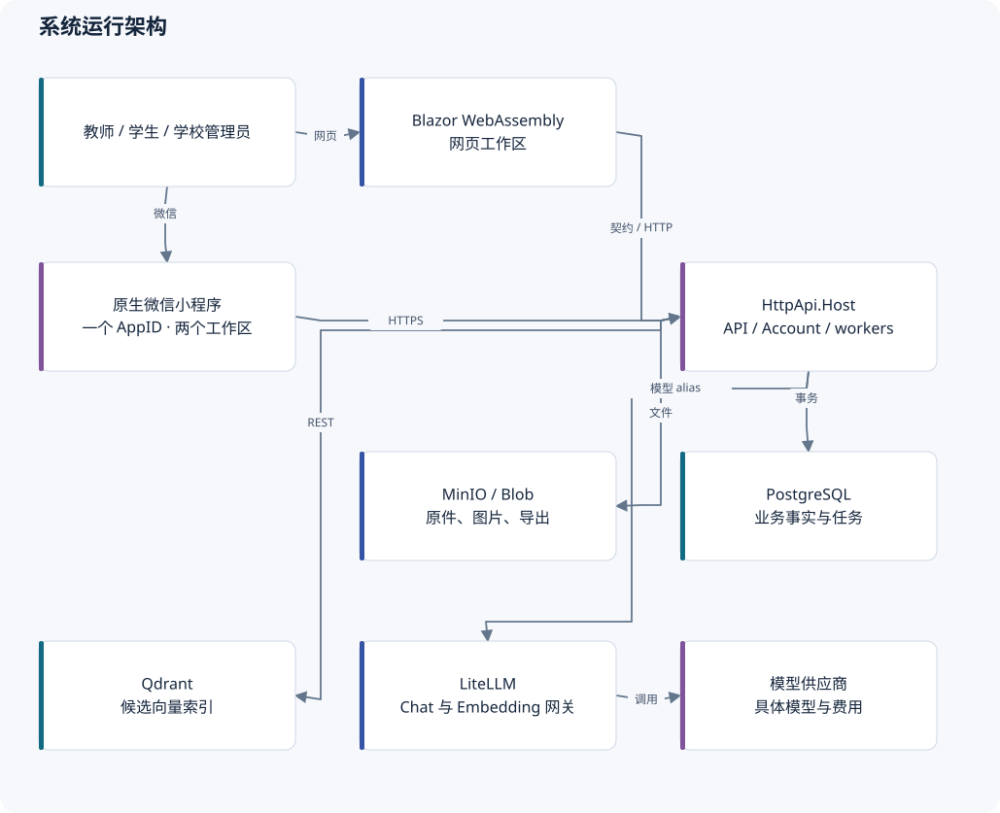
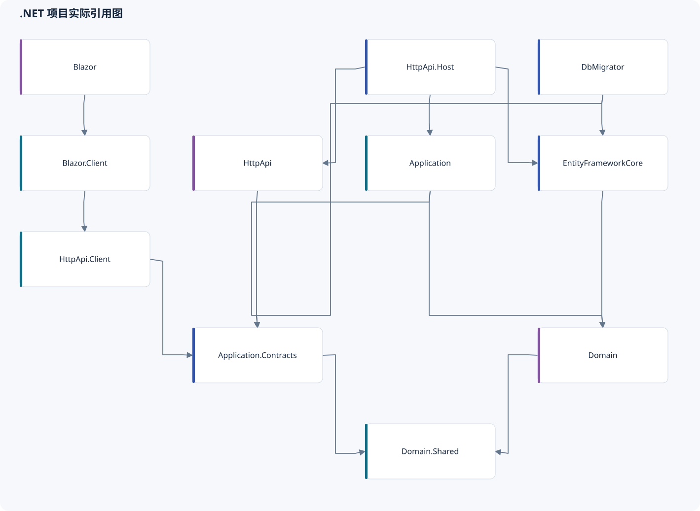

# 技术架构：当前实现

## 1. 系统定位和边界

KnowPulse 是一个 **ABP 分层单体**：业务模块共享部署单元和关系型数据库，代码在多个 .NET 项目中分层。多个 `.csproj` 不意味着多个微服务。运行时至少有 API Host、Blazor Web 主机、DbMigrator 三类进程；后台消费者寄宿于 API Host。

产品包含两个相邻领域：企业知识／学习／考试，以及围绕教师个人资料、学校关系和学生学习的教育业务。教育复用身份、存储、题库、冻结试卷和模型适配，但使用独立的正式测评、评分、结果、学情和方案事实。

## 2. 当前技术栈

| 部分 | 当前依据 | 作用与边界 |
| --- | --- | --- |
| .NET | `global.json` 基线 10.0.301、`latestFeature`；项目 `net10.0` | 允许同大版本较新 feature SDK；不要把基线当作本机安装版本 |
| ABP | 直接 `Volo.Abp.*` 引用 10.6.0 | 模块、DI、应用服务、授权、UoW、审计、租户与 Identity |
| Web | Blazor WebAssembly、Blazorise／Bootstrap、LeptonX Lite | 客户端页面和交互；服务器承载资源与 WebAssembly 渲染入口，并非每次业务操作都在 Blazor Server 执行 |
| API 与登录 | ASP.NET Core、OpenIddict、ABP Account | Web OIDC；微信自定义授权类型；API 内服务端授权 |
| 数据库 | EF Core、PostgreSQL；开发 Compose 为 PostgreSQL 18 | 保存业务事实、审计、任务、身份和配置；具体兼容以迁移验证为准 |
| 原始文件 | ABP BlobStoring + MinIO | 正文附件、答题图片、导出物；数据库保存引用和状态 |
| 向量 | 自有 `IKnowledgeVectorStore` + Qdrant REST | 只召回候选；不是授权源或业务主库 |
| 模型 | 自有 Embedding／Chat 接口 + LiteLLM | 模型 alias、用途和版本由目录管理；供应商配置在网关侧 |
| 文档转换 | MarkItDown + DataIngestion preview 适配器 | 仅 Application 实现接触 preview 类型；失败归 reader 阶段 |
| 微信 | 原生 JS、WXML、WXSS，35 个注册页面 | 一个 AppID、师生两个工作区；未完成真实认证与域名配置 |
| 测试 | xUnit、Shouldly、NSubstitute、SQLite、Node 内置 test | 领域、契约、服务和小程序逻辑；不等于真实基础设施验收 |

版本来源为本仓库项目和 Compose 文件；不声明这些版本没有公开漏洞。本轮未做依赖漏洞数据库审查。完整直接包清单见[代码结构](code-map.md)和[清单](inventory.json)。

## 3. 分层和依赖规则

1. **Domain.Shared** 保存跨层共用的枚举、错误码、常量和本地化。部分纯业务值规则在这里供客户端和服务端共同使用。
2. **Domain** 保存实体、状态迁移、不可变值和访问判断。它不依赖 Application 或 EF Core；涉及数据库的条件由应用层加载后交给领域规则。
3. **Application.Contracts** 保存服务接口、DTO、参数验证、功能权限和部分传输配置，不传 EF 或供应商对象。
4. **Application** 编排授权、仓储、领域操作、事务和外部适配。复杂教育用例使用明确新事务、请求指纹及回执恢复。
5. **EntityFrameworkCore** 保存一个主 DbContext、模块映射、索引／检查／外键、迁移及少量自定义仓储。
6. **HttpApi** 提供显式控制器；Host 同时注册 ABP 常规控制器，很多 `IApplicationService` 通过 `/api/app/...` 暴露。仅数控制器文件会漏掉大量 API。
7. **HttpApi.Client** 注册 ABP 动态 HTTP 代理；Web 通过契约和代理调用，不直接引用业务实现或 EF。
8. **HttpApi.Host** 组合 Application、EF 和 HttpApi；配置身份、审计、Blob、CORS、worker 和中间件。

这种布局已经足够隔离供应商。新增业务优先延续现有模块和规则；拆出服务应以独立扩缩容、故障域或组织边界为依据，不能由文件长度决定。

## 4. 权限不是单一角色判断

| 检查层 | 必须回答的问题 | 主要实现 |
| --- | --- | --- |
| 登录会话 | 当前请求是谁，租户是否一致，令牌／绑定是否仍有效 | OpenIddict、`WeChatBindingSessionMiddleware` |
| 功能权限 | 是否有批改、共享、分析等操作权限 | Contracts 权限、`CheckMvpPermissionAsync` |
| 所有权 | 私人资料／草稿／观察是否属于当前账号 | `EnsurePersonalKnowledgeOwnerAsync`、各 owner 查询 |
| 学校关系 | 当前是否属于该学校，任教／在班／学期是否有效 | `EducationAssessmentAccessGuard`、学校服务 |
| 版本与用途 | 读取的是哪个版本，是否允许检索、出题、下载、布置 | `SchoolKnowledgeShare`、`KnowledgeSourceAccessGuard` |
| 当前开放状态 | 此刻能否看成绩、答案、反馈或执行活动 | 结果发布投影、方案执行与材料读取服务 |

前端按钮隐藏只改善体验，不能替代上述检查。平台功能管理员不自动拥有全校学生数据或教师私有观察；学校 Manager 也不会取得个人库所有权。

普通企业知识保留历史的空访问范围兼容规则。个人资料先检查明确库归属和 owner，因此不会因空范围变成公开。将来迁移旧资料归属时必须保留这一差异。

## 5. 四类状态必须分开

- **正文版本与对外发布**：草稿保存不等于发布，后续私人编辑不改变已共享的指定版本。
- **执行状态与内容状态**：教学方案可以暂停，但原正式考试计时不因此重置；换正文版本也不自动恢复执行。
- **业务事实与派生结果**：原答卷、确认评分是事实；学情快照、向量是可重建派生物。
- **消息与真实行为**：收到提醒、读消息、打开正文、开始任务、上交、掌握知识点分别记录，不能用消息已读代替学习完成。

设计上的成本是实体、修订和请求参数较多；收益是能够解释历史、避免改分覆盖和丢响应后的重复操作。应通过模块接口与文档减轻理解成本，而不是把历史事实合回一张可随意修改的表。

## 6. 存储与事务边界

**PostgreSQL** 是唯一业务事实源。知识发布的策略、版本指针和待索引任务在同一事务；教育发布、固定名单、答卷封存、评分确认和当前成绩指针分别具有明确事务边界。

**Blob** 不加入关系型事务。上传可能先成功、后续数据库提交失败；系统优先保留可恢复草稿或不可访问的孤儿文件，不能反过来先删文件再期待数据库一定提交。导出任务有独立运行编号、过期、取消和清理追踪。

**Qdrant** 不加入 PostgreSQL 事务。检索回到主库核对分块、发布版本和访问范围；学校共享路径额外要求所属任务为 `Indexed`，当前发布版本的直接访问路径没有相同的任务状态检查，不能把两条路径写成统一的完成状态屏障。对向量写入成功、主库未提交的情况不能声称跨系统原子提交；清理和重建仍有审计报告第 3、4 项需要完善。

**模型请求** 有外部费用且不能数据库回滚。AI 出题和 AI 方案采用后台任务、执行编号、心跳和明确采用；不能把“自动重试 HTTP”当成安全的业务重试。

## 7. 租户、学校和账号

租户是 ABP 的隔离上下文；学校是租户内的业务实体，二者不是一一对应。一个账号可以在同租户的多个学校拥有不同的有效身份，个人库仍归该账号。邀请只增加经确认的学校身份，不自动增加任教、在班、功能权限或资产归属。

当前多类 worker 通过共享库取消租户过滤发现任务，再切回任务租户执行。**禁用行过滤不能发现另一个数据库中的任务**；若将来启用每租户独立数据库，任务发现和无租户绑定查询需要相应设计。这是部署边界，并非当前共享库配置下的缺陷。

2026-10-18 已确认账号支持采用“本人验证原账号后自助处理；无法验证时平台人工复核”。学校不接管原账号或个人资料。当前已有自助帮助、密码找回入口及本人微信解绑；异常申请和平台复核执行仍未实现。

## 8. 保留与改进

保留分层单体、项目自有外部接口、固定版本、短事务任务和服务端二次授权。首先把旧考试和知识索引的薄弱路径补到已有教育路径的可靠性水平，再处理分页成本与连接复用。

暂不引入微服务、消息中间件、通用工作流引擎或统一“大基类”。若需要抽取公共代码，应先证明重复处拥有同一业务规则和失败语义；相似的 DTO 或状态枚举不够。

主要依据：[Host](../../src/KnowPulse.HttpApi.Host/KnowPulseHttpApiHostModule.cs)、[Application 组合](../../src/KnowPulse.Application/KnowPulseApplicationModule.cs)、[Web 主机](../../src/KnowPulse.Blazor/KnowPulseBlazorModule.cs)、[领域词汇表](../../CONTEXT.md)、[ADR 目录](../adr/)。
