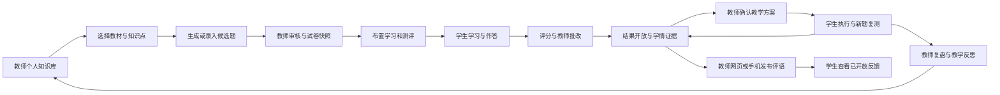

# KnowPulse 初中教育产品 PRD

版本：1.5 完整评审稿（2026-10-18 补充已确认的 D02）。日期：2026-10-07。产品范围：初中多学科，教师网页端、教师微信工作区、学生微信工作区及必要的学校管理。产品状态：教育新增能力尚未完成集成验收；本文规定目标行为，不代表相关能力已经上线。

本产品帮助教师把多年教学成果沉淀为本人知识库，围绕实际采用的教材形成经过审核的试题和学习材料；学生通过微信完成学习与测评，教师据有效作答分析成绩和知识点掌握情况，确认个性化教学方案，通过新题复测持续调整教学。

本文是产品评审、交互设计、开发拆分与验收的主规格。功能与验收采用统一编号；各端体验文档补充页面细节。用户已确认范围、本版设计默认和待决策项分别列示，评审稿不等于功能已上线或全部技术方案已批准。

## 1 文档依据与需求状态

| 内容 | 状态 | 对本版的约束 |
| --- | --- | --- |
| 面向初中，覆盖多门学科 | 用户已确认 | 验收须覆盖多学科，不能只实现一种学科的演示 |
| 每个用户有个人知识库 | 用户已确认 | 教师教学成果和学生个人积累都有明确个人归属 |
| 教师资料默认私有，可主动共享到学校 | 用户已确认，ADR 0007 已记录 | 学校身份不自动开放个人资料，共享不改变所有权 |
| 共享撤回后停止学生后续在线材料读取，保留历史答卷和已上交记录 | 用户已确认（2026-10-17），ADR 0029 已记录 | 已布置材料也须停止后续正文/附件读取；追溯记录不重新授予原资料阅读权 |
| 账号拥有默认个人库，学校为既有租户内独立实体 | ADR 0008 已记录的架构决策 | 不以学校部门或资料创建人推定归属；跨租户迁移及离校历史访问另行确定 |
| 学生使用微信小程序学习与考试 | 用户已确认 | 需要实际微信客户端与真实设备流程验收 |
| 教师也使用微信小程序 | 用户已确认 | 首期包含简单工作、数据分析查看和学生评语 |
| 一个微信小程序、一个 AppID、教师与学生两个独立工作区 | 用户已确认（2026-10-18） | 统一账号绑定与业务服务，工作区和返回数据按服务端已核验身份隔离；本阶段先完成代码与本地验证，实际微信认证、域名与发布配置尚未配置 |
| 教师网页承接复杂整理、组卷、集中批改和方案编辑 | 本版设计默认 | 与手机操作同一业务记录及权限，手机保留继续处理入口 |
| 题型、评分、结果开放、分析与方案规则 | 本版产品规格 | 经产品与教研评审后作为开发基线；待配置参数见第 17 节 |

配套资料：[产品总规划](education-product-plan.md)、[教师网页体验](product/education-teacher-experience.md)、[教师小程序体验](product/education-teacher-miniapp-experience.md)、[学生小程序体验](product/education-student-experience.md)、[需求与代码依据](education-personal-knowledge-requirements.md)、[领域词汇表](../CONTEXT.md)、[个人知识库隐私决策](adr/0007-private-personal-knowledge-with-explicit-school-sharing.md)、[个人归属与学校事实决策](adr/0008-account-owned-libraries-and-tenant-scoped-school-facts.md)、[指定版本共享与来源授权决策](adr/0009-version-bound-school-sharing-and-source-provenance.md)。

现有企业知识、学习、考试能力是可复用基础。本文使用 **EDU-M1 至 EDU-M4** 表示教育交付阶段，对应既有规划中的 M1 至 M4，与企业 MVP-0 至 MVP-3 的实现状态分别管理。

## 2 问题与产品目标

### 2.1 用户问题

教师已有的教案、课件、试题、教学案例和反思分散在多个位置，难以长期积累、按教材找回与复用。临时搜题、改题和核对答案耗时，通用生成结果缺少适用教材和评分依据。考试总分不能充分解释学生在哪些知识点上需要帮助，分析结果也容易停留在报告，未形成实际教学安排。

学生需要统一入口知道要学什么、何时完成、答卷是否保存，以及老师给出了哪些反馈。学习材料、订正和复测应衔接，个人笔记与提交给老师的内容需要清楚区分。

上述问题是产品需求依据，试点需验证具体工作量和使用频率；本版不承诺未经验证的提分幅度或节省时长。

### 2.2 首期目标与成功依据

| 目标 | 首期成功依据 |
| --- | --- |
| 持续积累教学成果 | 教师能保存、检索、修订本人资料，并自主共享选定版本 |
| 基于当前教材快速出题 | 教师选择明确教材范围，审核可追溯候选，形成可发布试卷 |
| 完成真实微信教学 | 师生完成任务跟进、学习、作答、保存恢复、批改和反馈 |
| 形成可解释学情 | 知识点估计能回到有效题目、作答与评分依据 |
| 支持个性化教学 | 教师确认具体教学动作和学生任务，执行后用新题复测与复核修订 |
| 支持教师移动办公 | 手机上能查进度和学生情况、催办、写评语，网页能继续同一记录 |

完整首期须接通 EDU-M1 至 EDU-M4。仅完成资料上传、生成试卷或返回 AI 报告，均不代表完成本 PRD。

### 2.3 首期之外

后续增强包括小学或高中、家长端、公开内容交易、跨校资源市场、直播课堂、完整 BI、复杂认知诊断、手写/OCR 增强、作文及步骤全自动评分、AI 评语、语音评语、批量个性化评语、移动深度组卷与集中批改。

首期不提供公开排名、陌生人社交、广告激励、强制分享个人资料、开放式学生 AI 代答。英语听力等特殊题型和音视频能力，须根据首批学科另外确认，不能因“多学科”自动视为已承诺。

## 3 用户与工作空间

| 用户 | 主要工作 | 使用入口 |
| --- | --- | --- |
| 教师 | 个人积累、备课、出题审核、布置、批改、学情判断、教学方案 | 网页工作台及教师微信工作区 |
| 学生 | 查看任务、学习、考试、订正、私有笔记、方案执行、查看反馈 | 学生微信工作区 |
| 学校管理人员 | 成员、学期班级、任教和在班关系、账号支持、异常教学支持 | 受权管理页面 |
| 教研负责人 | 教材目录、知识点映射、共享内容与评分规则维护 | 学校管理中的权限组合 |
| 平台运维 | 故障、任务健康、容量、模型配置和成本 | 现有系统管理与运维入口 |

教师和学生身份可组合。身份由服务端确认，用户选择入口不能授予权限。单一身份直接进入对应工作区；同时具备两种有效身份的账号才显示切换。

### 3.1 多端分工

| 场景 | 教师网页 | 教师微信 | 学生微信 |
| --- | --- | --- | --- |
| 个人知识积累 | 批量上传、完整整理、版本与共享、导出 | 资料查阅、简短教学随记 | 私有笔记、学习资料整理 |
| 教材备课与出卷 | 教材确认、生成、审核、组卷、预览 | 查看相关待办，转网页继续 | 查看教师布置的任务范围 |
| 教学任务 | 创建、规则调整、异常处理 | 进度、催办、困难反馈跟进 | 查看、开始或继续、完成与反馈 |
| 评分与结果 | 人工批改、复核、最终发布 | 已确认成绩与批改进度查看 | 按开放规则查看本人结果 |
| 学情与方案 | 完整证据、深度分析、确认调整方案 | 班级/个人摘要、证据钻取、执行查看 | 本人成长、方案、学习与复测 |
| 学生反馈 | 评语编辑、发布和修订 | 同一评语的草稿、预览、发布和修订 | 已开放评语阅读、困难反馈 |

网页和手机共享草稿、任务、评语、评分及报告版本。桌面复杂操作的移动接续只定位同一记录，重新核验身份，链接不得携带凭据、答案或学生报告正文。

### 3.2 导航与页面引用

教师网页导航：工作台、我的知识库、教材与备课、题库与出卷、教学任务、班级与学情、教学方案。教师微信导航：工作台、学情、评语、我的。学生微信导航：今日、学习、成长、我的；正式作答进入专注页面。

| 工作区 | 页面清单 |
| --- | --- |
| 教师网页资料与身份 | T01 工作台；T02 个人库列表；T03 上传与整理；T04 资料详情；T05 学校共享管理；T06 检索与问答；T23 我的班级与任教；T24 个人设置与导出 |
| 教师网页教材与题库 | T07 当前教材与目录；T08 课程知识点；T09 出题要求；T10 候选审阅；T11 题目编辑与审核；T12 正式题库；T13 试卷编辑与预览 |
| 教师网页教学闭环 | T14 任务发布；T15 跟进；T16 批改；T17 成绩复核与发布；T18 班级学情；T19 学生报告；T20 证据详情；T21 方案编辑；T22 执行与复测；T25 学生评语中心 |
| 教师微信 | TM01 登录与身份；TM02 工作台；TM03 任务进度；TM04 资料查阅；TM05 随记；TM06 班级概览；TM07 学生详情；TM08 知识点证据；TM09 评语中心；TM10 评语编辑；TM11 方案执行；TM12 我的 |
| 学生微信任务 | S01 登录与绑定；S02 今日；S03 任务详情；S04 考前确认；S05 答题；S06 交卷回执；S07 成绩与回顾 |
| 学生微信学习 | S08 学习；S09 材料；S10 练习与订正；S11 个人库；S12 笔记编辑；S13 成长；S14 学习方案；S15 复测与回顾；S16 我的与消息；S17 教师评语 |

上述共 25 个教师网页页面、12 个教师移动页面、17 个学生页面，是设计引用，不是现有路由。学校管理可复用现有管理入口，增加教育业务页面，不要求新增独立学校门户。

### 3.3 已确认的微信小程序形态

首期采用一个微信小程序、一个 AppID、教师与学生两个独立工作区（用户于 2026-10-18 确认）。教师与学生使用独立首页、导航、功能及返回数据；服务端按已核验身份进入对应工作区，同时具备两种有效身份时才提供切换。教师网页与小程序共用同一业务事实，查看和编辑同一任务、评语及报告版本。

采用这一方案便于统一学校邀请、账号绑定与教学消息入口，同时分别验证师生体验。角色切换不改变任教范围或结果开放条件，客户端缓存按身份隔离。当前先完成代码和本地验证，不等待真实 AppID 或域名配置，也不使用模拟证明作为正式微信接入验收。后续如需分别上架，应另行调整产品决策；实际接入主体、认证、合法域名及发布条件仍须在上线前核验。

## 4 核心流程与用户故事

### 4.1 教学闭环

学校共享资料是可选择的补充来源。教师资料的检索、学校共享及学生材料访问分别授权。学生个体报告和内部观察不能自动沉淀到学校共享知识库。

### 4.2 用户故事与需求映射

| 编号 | 用户故事 | 需求 |
| --- | --- | --- |
| US01 | 作为教师，我要在未加入学校前整理自己的资料，以持续积累教学成果。 | FR01、FR03–FR05 |
| US02 | 作为教师，我要共享指定版本并知道撤回影响，以自主控制资料使用。 | FR06、FR07 |
| US03 | 作为教师，我要选择当前实际使用的教材，以避免跨版本混题。 | FR08、FR10、FR11 |
| US04 | 作为教师，我要核对知识点、答案和评分依据，以保证正式使用题目经过审核。 | FR09、FR12、FR13 |
| US05 | 作为教师，我要把任务布置给任教范围内的班级或学生，以避免错发和越权。 | FR02、FR14 |
| US06 | 作为教师，我要在手机查看未完成学生并催办，以及时跟进日常教学。 | FR15、FR18、FR34 |
| US07 | 作为教师，我要看原始图片并按评分点批改，以保留学生解题证据。 | FR16、FR29 |
| US08 | 作为教师，我要复核成绩并留下原因，以让争议处理可追溯。 | FR17、FR29、FR30 |
| US09 | 作为教师，我要从知识点指标下钻到作答，以决定下一步怎么教。 | FR30、FR31 |
| US10 | 作为教师，我要确认和调整个性化方案，以保留教学决定权。 | FR32、FR33 |
| US11 | 作为教师，我要在网页或手机写指定学生的评语，以给出及时具体反馈。 | FR19、FR20 |
| US12 | 作为教师，我要把内部观察与公开评语分开，以避免误发待确认判断。 | FR19、FR20 |
| US13 | 作为学生，我要看到任务要求和截止时间，以知道先完成什么。 | FR21 |
| US14 | 作为学生，我要区分本机暂存和服务端保存，以判断答案是否可靠保存。 | FR23、FR24 |
| US15 | 作为学生，我要在重新登录或弱网恢复后继续同一次考试，以避免重复作答。 | FR01、FR22–FR24 |
| US16 | 作为学生，我要在老师开放后查看结果、解析并订正，以理解错误。 | FR17、FR27、FR28 |
| US17 | 作为学生，我要保留私人笔记，并主动选择提交给老师的内容。 | FR25、FR26 |
| US18 | 作为学生，我要理解学习安排、反馈困难并完成复测，以知道下一步行动。 | FR28、FR32、FR33 |
| US19 | 作为学生，我要查看发给我的评语和更正，以获得清晰反馈。 | FR20、FR28、FR34 |
| US20 | 作为学校管理人员，我要核验关系、处理错绑及教学异常，以支持学校实际使用。 | FR02、FR35 |
| US21 | 作为教研负责人，我要维护教材、映射和评分配置，以保持多学科口径一致。 | FR08、FR09、FR30、FR35 |
| US22 | 作为运维人员，我要定位索引、生成、保存与重算失败，以恢复服务而无需日常浏览业务正文。 | FR36、NFR04–NFR06 |

## 5 功能需求

下列 FR01–FR36 均为完整首期必需，分阶段交付。后续增强不作为这些需求的完成条件。每项写明入口、行为和异常；第 15 节 AC 场景用于跨功能验收。

### 5.1 身份与教学范围

**FR01 身份核验与个人库初始化｜EDU-M1 基础，EDU-M3 移动入口｜T01/T24、TM01/TM12、S01/S16**

- 账号确认后幂等创建或恢复一个默认个人知识库；重复登录、重复邀请确认不能建重复库。
- 教师或学生微信身份关联已核验账号和业务档案，不能仅按姓名、班级码或“我是教师”选择获得身份。
- 支持绑定待确认、邀请过期、信息不符、重复绑定、登录失效及账号恢复入口；账号恢复后继续原记录。
- 角色、学校切换或退出前检查未同步内容，优先同步；保留内容按身份隔离，展示风险及处理选择，不静默丢失。考试计时持续。
- 核心验收：同名身份不被冒认；重复确认只有一个库；换角色不能获取另一角色的受限缓存。

**FR02 学校与教学关系｜EDU-M1｜T23、学校管理**

- 管理学校、学年学期、年级、班级、学科；记录教师任教与学生在班关系的生效、结束时间及变更人。
- 学校受权人员确认关系，教师可查看和申请更正。任务对象、学情和评语按有效学校、学期、班级、学科检查。
- 无任教关系可使用本人资料，不能布置班级任务或读取学生学情。学生转班、教师换班后刷新授权，旧链接不能扩大范围。
- 历史教学归属保留；离校、跨校与交接的历史查阅政策须先落实 D01/D06，不自动转移个人资产或授予原班访问权。
- 核心验收：伪造班级、学生、学校或学科标识被拒绝；关系变更可追溯，不能用通用教师角色获得全校权限。

### 5.2 个人知识库与学校共享

**FR03 个人资料组织｜EDU-M1 基础，师生移动入口 EDU-M3｜T02/T04、TM04/TM05、S11/S12**

- 每份资料具有个人库、所有者、类型、标题、正文/附件、标签、创建与修订时间；支持按学科、年份、类型和关键词查找，EDU-M2 补充教材与知识点。
- 默认本人可见。个人归属、生命周期、索引状态和共享状态分别显示，不以“已上传”代替“可检索”。
- 教师教学随记存入本人库；含可识别学生的观察按 FR19 独立保存。学生私人笔记按 FR26 管理。
- 核心验收：他人及学校管理身份不能读取未授权个人正文、附件、列表摘要或引用。

**FR04 录入、上传与版本｜EDU-M1｜T03/T04**

- 支持正文录入、附件上传、来源与适用范围登记；教师可以检查转换内容，补正文、修订并保留版本。
- 沿用文本/Markdown 及经转换可索引的文档类型；图片、音视频等未启用解析的文件明确标为仅附件。扫描教材、公式转换质量由真实样本确认。
- 保存或上传失败保留已成功附件与可修复草稿；后续修订形成新版本，不静默替换已经共享或用于任务的版本。
- 上传格式、数量、容量在 D04 确认后以界面和服务端一致规则限制；超限不清空其他输入。
- 核心验收：上传失败可恢复；教师可区分原文件、转换结果、仅附件与有效版本。

**FR05 私有索引、检索与知识问答｜EDU-M1，教材过滤 EDU-M2｜T04/T06、TM04**

- 本人私有资料可完成索引并检索，不以学校共享为前提。检索可明确选择本人库与当前获授权的共享资料。
- 完整索引成功才显示可检索；处理中、失败、过时和仅附件分别提供说明与修复入口，已有活动任务不重复创建。
- 检索和模型上下文先过滤候选，再依据业务事实检查权限、版本及有效性；结果保留可访问的引用、来源版本和适用范围。
- 无匹配或依据不足时说明缺口。教师问答嵌入备课资料场景；学生正式考试无答案生成助手。
- 核心验收：两个教师相同关键词仅命中各自授权内容；撤回来源即使仍有向量也不能被重新读出。

**FR06 选定版本学校共享与撤回｜EDU-M1｜T05**

- 作者主动选择具体版本、指定学校与允许用途，确认“谁能使用什么”后共享；本版默认学校共享面向获授权教师，学生材料另按任务授权。
- 阅读、检索与知识问答、用于出题、原附件下载、导出分别授权。默认只勾选阅读和检索；出题、下载、导出需作者另行选择。出题用途同时要求阅读与检索授权；下载不自动授予导出或出题用途。未交付的用途不显示可选或可执行。
- 布置给学生是独立的作者授权用途，默认不勾选；获授权教师仍须通过指定活动授予确切版本，附件还需独立下载授权。既有阅读/检索/出题权限不自动扩大为学生交付权限，旧共享不自动升级。
- 共享不转移所有权，个人新版本不自动更新共享版本；未共享内容不随学校成员关系开放。
- 撤回停止他人新检索、下载、新出题及新任务复用；再次发布衍生草稿时重新检查来源权限。
- 衍生题保留建立授权时的实际来源引用；编辑题干、清空可编辑引用或增加手工说明不能移除原来源授权链。审核、组卷和新复用仍检查这些来源。
- 历史快照保留追溯。D03 已确认：共享撤回后，即使资料已经布置给学生，也停止后续在线读取正文和附件；保留历史答卷及已上交记录，按各自权限追溯，历史记录不重新授予资料正文权。下载副本和衍生作品其余规则仍待确认，不承诺收回他人已见内容（ADR 0029）。
- 核心验收：共享一版不开放其他版本；撤回后新使用被拒绝，所有者本人仍可用。

**FR07 归档、导出与删除说明｜EDU-M1｜T04/T24，S12 移动入口 EDU-M3**

- 个人可归档和导出自有资料；授权素材仅在允许导出时纳入，引用入口不自动产生永久副本。
- 删除前说明影响的资料、共享、备课或历史记录；不得同时删除已提交考试、评分和学校教学事实。
- 导出异步状态、失败恢复、下载权限与文件有效期可查询；留存、账号停用和离校处理依 D06 配置。
- 核心验收：导出不能夹带他人库、受限题源或未获导出授权素材；失败不改变原资料归属。

### 5.3 教材、知识点与备课

**FR08 当前教材与章节｜EDU-M2｜T07**

- 教材记录学段、学科、年级、出版社、版次、册次及章节，教师针对本人有效任教的班级、学科和学年学期明确选定当前教材；教材年级和学科须与任教范围一致。
- 教研维护目录和有效版本；“当前”由教师确认，不按文件时间猜测，不自动等同最新版教材。
- 教材出版版次与学校整理的目录修订分别记录。已发布目录不可直接改写，修订形成新目录；更换教材结束原选用记录并保留历史，不覆盖原选择。
- 切换教材后重新核对资料和出题范围；目录不足提示补充，允许先整理个人资料。
- 核心验收：同名章节的不同教材不会混用；目录更新不改写历史试卷和证据快照。

**FR09 稳定知识点与教材映射｜EDU-M2｜T08**

- 每个课程知识点有稳定标识、所属学科、名称、层级与版本；章节和知识点允许多对多映射。
- 不同学科同名概念分别维护；建议映射需确认，冲突或缺失明确展示，历史使用保留当时映射。
- 资料所有者明确确认具体资料版本或段落与某个教材章节、知识点的关联，名称相似或模型建议不直接形成有效关联。确认整份资料时须说明整份均适用于该范围；段落的具体关联优先，结束该关联不能因整份关联而再次隐式用于原范围。
- 资料整理关联不授予教学权限。备课、课程检索与出题须另外核对当前任教、教材选用、来源版本及使用授权；共享时保留作者当次确认的关联，作者后续私有整理不自动更新学校共享范围。
- 多知识点题目必须由教师确认评分点对应关系或分配权重，不能把整道题满分重复归到每个知识点。
- 核心验收：同名跨学科知识点分开检索统计，变更映射不篡改已评分历史事实。

**FR10 章节备课与反思｜EDU-M2｜T07/T04**

- 备课记录连接本次目标、教材章节、选用资料版本、题目/试卷和课后反思；支持从历史记录复用后重新确认适用范围。
- 每次保存形成可追溯修订，保留当时教材、知识点、资料版本及题卷依据；后续改名、换教材或修订源资料不改写原备课记录。
- 历史本人查阅与新使用分开处理。复制或再次使用须重新确认当前教材、任教关系和引用授权；失效来源提示替换或移除，不能从旧记录取得新的使用权限。
- 教学反思仅经教师主动选择复制为本人资料草稿；学生个体报告、未公开观察不自动复制到个人成果或学校共享库。
- 核心验收：能从章节找到备课记录，从资料回到其使用记录，切换教材后保留旧记录而明确提示核对。

### 5.4 出题审核与试卷

**FR11 教材约束的 AI 候选生成｜EDU-M2｜T09/T10**

- 教师确认教材/章节/知识点、资料范围、题型、数量、难度、分值、用途；使用结构化范围约束检索和候选，不只拼一段提示词。
- 默认本人资料，可明确加入获授权共享；每个候选保留来源版本、依据、建议知识点、答案与评分要点。
- 本版默认生成者管理其生成任务和候选；从获准用于出题的学校共享资料生成，仍不改变原资料所有权，也不开放作者的其他版本或整个个人库。采纳候选、正式发布题卷和新任务复用时重新检查来源授权。
- 异步任务可离开后恢复；材料不足列出缺口，支持补材料、减题量或人工录题，不用无依据结果凑数。
- 重新生成保留已编辑候选；重试不重复成功结果；模型故障或额度受限时保留人工路径。
- 核心验收：每个可采纳候选可核对依据，越教材或无授权来源不能静默进入正式使用。

**FR12 人工录题、编辑、审核与停用｜EDU-M2｜T10–T12**

- 教师核对题干、选项、正确答案、解析、教材适用性、知识点及评分依据；人工录题走同样审核规则。
- 完整首期覆盖经确认学科的单选、多选、判断、按空位评分填空、文本/图片人工评分简答或解答题。
- 未审核题不能用于正式发布；结构不完整、来源失效、空位规则或主观评分点缺失时阻断并给修订入口。
- 本版推荐本人资料生成或录入的题目由本人显式人工审核；生成成功不自动视为审核通过。学校可要求第二人审核或授权代审，实行时须有对应审核人及数据范围。学校共享题库维护另行授权，不凭教师身份获得。
- 正式题保留审核人与修订版本；停用阻止新入卷，历史考试沿用原快照。D05 确认学校是否采用默认自审及其代审规则。
- 核心验收：审核门槛服务端生效；未审/停用题不能绕过选题入口正式使用。

**FR13 组卷、双视角预览与冻结｜EDU-M2，任务交付 EDU-M3｜T13**

- 支持题序、分值、总分、知识点覆盖、预计用时检查；教师视角核对答案，学生视角只呈现题目和作答控件。
- 确认保存试卷形成不可变试卷版本及评分依据快照；保存试卷与发布教学任务是两个动作。发布任务时选择并确认已冻结且仍允许正式使用的试卷。开考前改题形成新版本并再次确认；已经开始的答卷沿用原快照。
- 本版默认题目由录入或采纳它的教师管理，试卷由组卷教师管理；共享题目或试卷须独立授权。引用他人共享材料不转移该材料归属，学生分配只授予本次安全快照及已开放反馈。
- 已开考的错误题按说明、作废和评分修订处理，不直接替换学生正在回答的题目。
- 核心验收：公式、长文、图表和图片可读，总分准确，修改源题不改变已开始答卷。

### 5.5 教学任务、批改与成绩

**FR14 教学任务与分配｜EDU-M3｜T14，S03**

- 创建正式测评、练习、材料学习、订正或复测任务；每种任务显示学科、教材范围、要求、对象、截止及完成依据。
- 仅选本人有效任教范围内的班级或指定学生，发布前预览最终名单及人数；固定分配与规则版本，名单变化需重新核对。
- 测评设置窗口、时长、次数、成绩与讲评开放规则、错题收藏授权；学习任务指定材料版本及要求。
- 发布检查未审题、时间、评分规则、材料权限；重复请求只创建一份有效任务。通知失败不回滚任务事实。
- 已发布且未开考的时间或名单调整须预览受影响对象、再次确认并提供站内变更提示；已开始的答卷保持原试卷快照，时间例外按 D07 留痕。
- 核心验收：学生只收到本人的分配，题源不会因任务交付而整体开放，名单与发布版本可追溯。

**FR15 任务跟进、异常与催办｜EDU-M3｜T15、TM02/TM03**

- 按分配、开始、交卷、批改事实显示未开始、作答中、未提交、缺考、待批改与完成数量，页面标明统计范围。
- 支持查看学生困难反馈；指定未完成学生催办前预览对象和任务，确认时再次校验任教及分配。
- 催办按任务、学生和操作去重及频控；已完成或范围失效不得催办，微信投递失败单列，不重复生成站内提醒。
- 加时、补交、补考、取消、豁免和题目作废须有受权动作、原因与受影响名单；补考独立记录，不覆盖首测。具体例外见 D07。
- 核心验收：手机和网页同口径；待批改不显示零分；重复催办无重复提醒，提醒无成绩和薄弱项正文。

**FR16 客观评分与主观人工批改｜EDU-M3｜T16**

- 保存原始作答；客观题按已冻结规则评分，主观题人工按题/评分点批改，文本与图片可查阅、放大。
- 评分草稿与确认分开，确认时校验分值边界和必要评分点；并发编辑检测版本。主观题未确认不计零，不产生伪完整总分。
- 教师可保存逐题文字反馈，草稿与确认分开，随评分保留版本；是否必填由评分规则明确，面向学生的评分反馈随完整讲评开放。
- 为正确和错误题均保存完整逐题评分事实；评分失败可恢复，不重复累计成绩。题型规则见第 7 节。
- 核心验收：有主观题的答卷进入待批改，原始内容不被评分覆盖，确认结果可追溯题目和评分版本。

**FR17 最终成绩发布、讲评与复核｜EDU-M3｜T17、S07**

- 每份答卷全部应评分项确认后形成最终分。正式测评按任务统一发布：先结束提交窗口，封存全部进行中答卷、明确未参与者终态，固定有效提交集合且不再允许开始或追加尝试，再确认全部有效提交评分完整；缺考、取消和正式豁免不算待批改，分别记录。
- 满足评分完整性仍须满足教师确认、设定时间及任务有效性。首期不向学生逐人发布临时客观题分或部分总分；补考采用独立任务，不隐式阻塞原任务。
- 采用隐藏、仅成绩、完整讲评三档，成绩与讲评时间独立；答案、解析、评分要点随完整讲评开放，错题收藏另设授权。
- 正式测评完整讲评不得在仍有人可开始、继续或追加尝试时开放；提前结束须受权及留痕，例外由 D07 明确。答案已开放的试卷不能重新开启正式测评尝试，补测采用独立任务和未曝光试卷。
- 学生可申请题目反馈或分数复核；申请时显示处理中并保留原正式分。改分填写原因，保留新旧版本，更新错题、评分证据及分析投影。
- 核心验收：任何学生入口及嵌套返回均遵守开放规则；改分后不把新成绩与旧分析当同一最新结果。

### 5.6 教师移动办公与评语

**FR18 教师微信工作台与学情查看｜EDU-M3 基础，EDU-M4 分析｜TM02–TM08/TM11**

- 工作台展示有效任教范围待办、近期任务、困难反馈和速记入口；跨学科聚合待办，不混算学科能力。
- EDU-M3 查看任务进度、评分完整度、已确认成绩摘要与学生详情；EDU-M4 下钻知识点证据并查看方案执行。
- 摘要显示学科、任务、时间、有效人数、未提交/缺考/待批改、报告版本及更新时间，数据不完整时标明范围。
- 复杂组卷、评分修订和方案正式调整首期由网页承接；手机查看与网页同一版本、范围及口径。
- 核心验收：教师从手机找到任务、学生与结果，不靠缩小桌面表格完成主操作，图表可展开文字与明细。

**FR19 私有教师观察与评语草稿｜EDU-M3｜T25、TM07/TM09/TM10**

- 观察默认仅记录教师本人可见；公开学生反馈创建独立评语草稿，明确选择内容，不通过改标签自动公开观察。
- 评语分日常、任务、阶段，具有教师、单个学生、学科、时间或任务背景；首期文本及个人常用语，逐人处理。
- 草稿同步有版本和保存状态；对象同名时显示班级等必要识别信息。切换学生或关联任务重新核对，不复用错误收件人。
- AI 评语、语音和批量个性化发送为首期之后增强；不影响手工评语可用性。
- 核心验收：其他教师、学生、学校共享检索和通知中不存在作者私有观察；转评语只带明确选择且获准公开内容。

**FR20 评语发布、阅读、更正与撤回｜EDU-M3｜T25、TM09/TM10、S17**

- 发布前预览学生、班级、学科、背景、正文及开放条件；服务端检查当前任教、对象和证据可见性，使用已保存的当前版本。
- 测评绑定评语正文及证据入口等到完整讲评。日常/阶段评语可独立开放，但引用未开放测评事实时必须关联并等待；多个关联测评全部满足条件后开放。
- 保存草稿、待开放、已发布、已更正、已撤回分别管理；通知与按版本已读是独立事实，学生实际打开该版本才计读。
- 发布超时查询同一操作结果，重试不重复发布。更正保留版本、原因和操作者；撤回停止后续正文展示，保留必要操作记录，不承诺消除已见内容。
- 核心验收：只向本人显示获准版本；未开放正文不在卡片/通知泄露；网页手机冲突不静默覆盖，旧版已读不等于新版已读。

### 5.7 学生微信学习与考试

**FR21 今日任务与详情｜EDU-M3｜S02/S03**

- 卡片展示任务类型、教师、学科、范围、标题、截止、状态和主动作；优先进行中考试，其次当天到期和教师指定事项。
- 学科筛选保留其他科目待办数量；任务详情不启动考试计时。无需微信提醒授权也可完成全部任务。
- 逾期显示需要处理及补救入口；撤回或替换说明原因和新安排，已提交回执可追溯；无任务不制造学习欠缺。
- 核心验收：学生独立找到当前任务，反复打开详情不创建考试或消耗次数。

**FR22 考前确认、作答与恢复｜EDU-M3｜S04/S05**

- 开始前展示题型、次数、时限及结果开放规则；明确确认开始后由服务端创建或恢复同一次作答。
- 本次截止为任务截止与服务端开始时间加时长中较早者；未到开始、已截止、次数不足或无分配时拒绝。
- 提供答题卡、题号、上一题/下一题、待检查标记、剩余时间和保存状态；离开、重新认证、换角色不重新计时或消耗恢复次数。
- 首期按已确认学科支持基本文本及图片主观作答；真实公式、图表、长文在手机可读，控件按题型显示。
- 核心验收：重复开始只恢复一份有效进行中答卷；设备时间变化不延长考试，源题修订不影响当前快照。

**FR23 文字与图片保存、弱网及冲突｜EDU-M3｜S05**

- 显示本机暂存、同步中、服务端已保存及时间、失败重试；无确认不得显示已保存。恢复以服务器确认版本为准，本机待同步项单列。
- 保存携带作答/题目版本和操作去重信息；旧设备版本冲突显示差异与恢复选择，不能静默覆盖较新答案。
- 图片支持预览、重拍/旋转、替换、排序、逐张重试；上传成功及关联到有效作答分别反馈，临时附件按用户和答卷隔离。
- 弱网保留可恢复暂存；本产品内主动退出、切换身份或清缓存前检查并提示未同步风险。外部系统清缓存或直接换设备无法拦截，通过首次离线暂存说明及持续未同步标记告知恢复边界：仅保证服务端已确认内容。未确认内容不计入教师收到的有效答案。
- 核心验收：单图失败不清空全题；断网输入不伪装服务端保存；伪造他人附件引用被拒绝。

**FR24 交卷、截止封存与回执｜EDU-M3｜S06**

- 交卷前列出漏答、未同步、未上传项并优先同步；选择只交已保存部分须显示排除项并再次确认。
- 核对后若已保存答案或图片上传事实变化，须重新核对排除项；不能沿用旧确认封存不同内容。本机草稿不因选择只交已保存部分而被自动删除。
- 提交后本次内容不可改，服务端返回有效提交时间和回执。超时显示正在确认，查询同一答卷状态，不直接新建作答。
- 到时服务端封存截止前已成功确认的答案；客户端离线/关闭不阻止封存，后续评分和批改流程可重试。
- 迟到本机暂存不得被标为按时保存；加时、补考或重新开放必须是受权例外并留痕，不信任客户端自行改截止。
- 核心验收：手动提交、重复点击和到时封存并发最终只有一次有效提交；截止后旧客户端不能修改已封存答卷。

**FR25 材料学习、活动进度与困难反馈｜EDU-M3｜S08/S09**

- 老师安排与私人积累分区，任务仅授予指定材料版本及必要附件读取权，不扩大为教师个人库访问。
- 方案活动的资料版本及所选附件随方案修订固定；保存、确认、下发与后续读取复核来源，换材料需新方案版本。学生界面不暴露资料库、共享或存储标识；读取或下载本身不写完成、成绩或掌握度。
- 独立材料任务不依赖测评、分析报告或个人方案，按当前教材知识点保存草稿、预览并确认固定名单后发布；后来入班学生不自动加入旧版本。替换或撤回保留原上交记录，并向原接收人显示明确原因。Web/service 切片见 ADR 0031，真实微信与完整运行验收仍待完成。
- 任务列表不写首次提供或开始，实际授权提供正文才记接触；教师私有跟进与学生上交分别保留修订。相关材料接触默认未核验，不冒充独立掌握证据；受权教师可对照确切任务发布版本、材料及所选附件和冻结试题做有版本的提示复核（ADR 0032）。无提示确认只清除此冻结试题的这一份材料上下文，不清除其他真实接触或既有作答；材料不可读时不新增无提示判断，复核不自动生成独立成绩。
- 学校共享撤回后，即使材料已布置或曾打开，仍停止后续在线正文/附件读取，显示受阻并允许反馈；保留历史答卷和已上交记录供各自授权下追溯（D03、ADR 0029）。
- 阅读进度、完成和反馈是活动事实；点击完成、停留时长、收藏不直接增加知识点掌握度。
- 学生可反馈看不懂、时间不足、材料打不开；失效材料标记受阻，教师查看并记录处理，不要求虚假完成。
- 统一学习安排汇总当前有权查看的方案活动、独立材料、订正和正式测评，区分可安排、未开始、受阻和已截止。已关联测评按实际测评时长/截止只计一次，订正待复核不计待做、确切副本需再订正时恢复预计。未开放方案不经日历推断隐藏日期或步骤时长；无法估算及权限缺项须明确提示，合计为零不代表没有待处理安排。当前 UTC 半开窗口最多 31 天，详见 ADR 0034。
- 核心验收：学生能读被布置材料但不能搜索教师私有库；阅读完成后掌握估计不自动改变。

**FR26 学生个人库与私存/上交区别｜EDU-M1 基础，EDU-M3 入口｜S11/S12**

- 支持私有文本、首期支持图片/附件、版本、学科/章节/知识点/自定义标签、搜索与获准导出。
- 教师任教和学校管理身份不赋予私人笔记访问权；上交订正或反思创建独立教学记录，提交前展示具体内容。
- 私存与提交老师使用不同动作；受限材料保留引用及授权状态，不自动永久复制，删除笔记不删除答卷和成绩。
- 核心验收：老师只收到明确上交内容；另一学生不能读私人笔记，导出不带未获授权素材。

当前 Web 入口 `/education/notebook` 复用账号本人个人库，默认显示/新建笔记，提供自写文本、图片/附件、历史版本、正文搜索、本人学科及私有标签和个人库导出。成绩、材料学习、订正及方案活动页提供有权限的入口。学生需被授予个人库功能权限；任教/学校管理身份不授予私人内容权限。章节、知识点目前按私人标签整理，不冒充正式教材映射；本机未保存输入仍可能丢失。完整讲评中的本人冻结题目和已实际提供的独立材料任务可显式关联到某笔记版本，只保存确切来源标识；列表/预览不产生接触或上交事实，每次打开重新核验原任务权限。共享撤回后引用不再开放原材料，自写笔记和已上交记录独立保留；导出只附受控引用标识，不能导出原来源正文。每版本最多 20 个有效引用，每条笔记含移除回执最多 200 个，详见 ADR 0035。该入口不自动复制受限题材，也不将私存变成上交；同题复练见 FR27 与 ADR 0036，完整微信与设备体验仍待完成，不能将此入口视为全部 FR26/FR27 已验收。

**FR27 错题回顾、订正和复练｜EDU-M3｜S07/S10/S11**

- 错题回顾遵守完整讲评，收藏另有授权；未开放标准答案/解析不能经错题本补全。
- 订正支持原思路、当前解法和检查策略；首答、订正、同题复练分别记录，不以人格标签强迫归因。
- 教师要求上交的订正按独立任务记录；重复同题不制造多道独立测评证据。
- 核心验收：收藏不能扩大讲评或素材权限；订正不覆盖首答，也不夹带私人笔记。

当前人工 Web/服务切片：教师从真实逐题评分布置固定单人的订正任务，草稿/发布/换版/撤回留修订；学生按完整讲评及原确认评分门槛查看确切原题，核对本机草稿文字和已确认图片后明确上交；教师针对确切上交版本发布需完善/通过及学生可见建议。原思路可选，上交不改原答卷、评分或掌握证据。另有独立同题复练：从当前完整讲评的冻结题目开始，开始/列表/回执不返回答案；文字、选择、填空和所选图片核对并明确提交后，教师才可查看独立副本。客观题按冻结规则给参考自动分，含人工判断的总分保留空值；读取提交后反馈才记录实际讲评接触。复练不增加正式尝试、正式成绩或独立掌握证据。讲评关闭或来源版本变化停止该轮新执行及反馈读取，本人已上交副本按当前身份保留；来源引用与已上交副本不重新授权资料正文。浏览器草稿不是云端私有笔记；统一工作量见 ADR 0034，复练边界见 ADR 0036。完整网页、微信、真机及全套长期运营验收仍待，不能将该切片视为全部 FR27 已验收。

**FR28 学生成绩、成长与评语阅读｜EDU-M3 结果及评语，EDU-M4 成长｜S07/S13/S17**

- 隐藏显示已交、待批改/待开放等状态；仅成绩显示获准最终分；完整讲评显示本人逐题结果、标准答案、解析和获准反馈。
- 成长按学科组织目标与证据；仅纳入向学生开放成绩的有效测评，逐题依据仍需完整讲评，未公布结果不能通过趋势或标签泄露。
- S17 显示本人已开放评语的教师、学科、背景、时间和最新有效版本，处理更正、撤回和按版本已读。
- 不混成跨学科学习能力总分，不显示同学成绩或默认公开排名；图表有文字摘要与依据入口。
- 核心验收：待评分不出现伪完整分数；隐藏测评不引发成长变化，评语只针对本人且不含草稿和内部观察。

### 5.8 学情证据与个性化教学

**FR29 全量逐题评分证据｜EDU-M3｜T16/T20、分析基础**

- 每道确认评分题记录学生、任务、答卷、试卷与题目快照、知识点映射、满分/实得分、方式、评分时间、规则与修订版本，正确题也保存。
- 多知识点题按评分点或确认权重分配，未评分、作废、撤销的证据不当零分使用；保留原始记录及失效原因。
- 改分、无效题和考试撤销触发幂等失效/重算，同一事件重放不重复计数。
- 核心验收：任一汇总指标可找到全部有效依据，不能靠错题记录反推缺失的正确题证据。

**FR30 知识点掌握估计｜EDU-M4｜T18/T19、TM06–TM08、S13**

- 使用可解释的得分证据比例，附独立题数、测评次数、最近时间、教材范围、计算窗口和规则版本；公式见第 8 节。
- 展示未测评、证据不足、需要巩固、达到当前目标；阈值与最低证据量由学科配置并在试点校准。
- 同题重练独立展示，不能累计为不同题；教材映射、改分与无效证据重算保留版本和更新时间。
- 模型可解释已有证据，不能直接编造百分比或把粗心、能力、努力程度推断为事实。
- 核心验收：没有证据不显示零分；阅读和收到评语不影响估计；每项结论可钻取依据。

**FR31 班级、个人报告及趋势｜EDU-M4｜T18–T20、TM06–TM08**

- 教师仅查看任教范围和对应学科；展示成绩、共同薄弱信号、需关注学生、证据覆盖及失效/重算状态。
- 报告明确分配人数、有效作答、缺考、未提交、待批改、有效评分人数和统计窗口，不能把缺失当零分。
- 同学科、范围和评分口径可比时展示趋势；覆盖、难度或满分变化标明限制，不把涨分直接解释为干预效果。
- 核心验收：相同总分可以展示不同证据，手机摘要与网页明细同版本、同口径，无越学科学生细节。

**FR32 人工或 AI 起草与教师确认方案｜EDU-M4｜T19/T21，学生 S14**

- 从具体学生、学科、证据区间和目标知识点起草，包含依据、目标、教师讲解动作、例题/材料、练习、预计负担、周期、复测及达标条件。
- 可人工或 AI 起草；证据不足优先补诊断。教师编辑并确认后下发，每个学生有明确版本，即使共同问题批量起草也分别确认对象和内容。
- 下发检查任教、材料及学生可见性，不将私有来源、他人信息、内部诊断备注或未开放测评事实送给学生。
- 核心验收：未经教师确认的草稿学生不可见；模型不可用仍可人工创建具体任务。

**FR33 执行、调整、新题复测与复盘｜EDU-M4｜T22、TM11、S14/S15**

- 学生看到已确认目标、分步任务、工作量、截止及复测安排；多学科任务汇总时间负担，困难反馈交教师协调。
- 教师手机查看完成/受阻和反馈并记录跟进；正式改目标、任务或结束首期在网页确认，保留版本、调整原因及已完成事实。
- 用于更新独立测评证据与完成教学闭环的复测使用同知识点新题，关联原方案；原题可复练但单列，不作为新的独立证据。展示首答、原题订正与新题证据；暂停/终止停止未执行安排及相应提醒。
- 教师依据前后证据与观察决定继续、调整或结束；反思可私存或明确提交，复盘教学方法不自动带可识别学生数据入共享库。
- 核心验收：完整教学周期能反复完成，阅读不自动达标，范围不可比时不输出确定提升结论。

### 5.9 消息、学校管理与服务支持

**FR34 站内消息与微信提醒｜EDU-M3｜T/ TM 消息，S02/S16**

- 任务、成绩开放、评语、方案变更及困难处理提供站内入口；微信提醒是辅助，未授权通知不影响教学主流程。
- 发布成功、站内可访问、微信投递、已读分别记录；重复或失败重试按同一业务操作去重。
- 通知只提示有任务或反馈，不携带成绩、薄弱项、答案、内部观察或待开放正文；深链每次重新检查权限。
- 核心验收：消息不能扩大访问或绕过开放时间；推送失败不导致重复任务或评语。

**FR35 学校管理、教研与账号支持｜EDU-M1 起，随阶段补齐**

- 支持成员邀请/导入、去重与错误报告、学校学期班级、任教/在班核验、账号恢复及解绑申请。
- 教研维护教材、知识点映射与评分/分析配置；学校管理共享处置、任务异常与争议支持，按具体权限操作并记录原因。
- 同名、错绑、转班、成员失效与学校停用有处理流程；管理处置不自动打开私有资料或全校学情。
- 核心验收：导入重试不重复成员或关系，支持人员需业务授权，停用前说明未完任务和资料处理。

**FR36 运行恢复、用量与人工降级｜EDU-M1 起**

- 索引、生成、评分、分析重算、导出和通知有可查询任务状态、失败阶段、恢复动作及必要操作关联。
- 模型/解析故障或额度耗尽影响新生成时提供明确说明和人工路径；既有考试保存、交卷、已保存记录及必要批改应独立可用。
- 运行概览记录任务健康、模型用量、错误与成本；运维权限不自动授予业务正文访问，日志遵守 NFR05。
- 核心验收：依赖故障可以定位恢复，重复执行不重复产生成绩或证据，用户错误页不暴露内部凭据和完整正文。

## 6 权限与结果开放矩阵

### 6.1 业务权限

功能权限与数据范围共同生效。列表、详情、搜索、附件、导出、模型输入、候选、报告、后台任务和缓存均采用同一边界。

| 对象 | 本人所有者 | 有效任教教师 | 对应学生 | 学校管理/教研 | 运维 |
| --- | --- | --- | --- | --- | --- |
| 个人库与私有附件 | 自有读写、检索、获准导出 | 他人库无默认权 | 本人库可操作 | 无默认正文权 | 技术权限不等于正文权 |
| 学校共享资料版本 | 管理共享与撤回 | 在明确共享范围和用途内使用 | 仅任务授予的指定材料 | 明确内容维护/处置权限 | 无默认正文权 |
| 题目、候选、试卷 | 作者/受权审核者按归属管理 | 不凭任教关系管理他人的候选或试卷 | 仅分配快照及可见字段 | 须另有审核/题库授权 | 无默认答案阅读权 |
| 学生任务、作答、成绩 | 教学事实按业务范围 | 对应有效任教与学科范围 | 本人分配、本人作答及开放结果 | 支持/分析权限需另授范围 | 日常仅技术状态 |
| 学生私人笔记 | 学生本人 | 无默认权 | 本人私有读写 | 无默认权 | 无默认权 |
| 教师观察 | 记录作者本人 | 同班教师无默认权 | 不返回 | 无默认权 | 无默认权 |
| 学生评语 | 作者在有效范围内管理 | 他人评语无默认编辑权 | 本人已开放版本 | 处置权与正文权单独授权 | 无默认权 |
| 学情与教学方案 | 按学生教学记录范围 | 本学科受权证据和方案 | 本人已下发/已开放内容 | 跨班/跨学科明细另授范围 | 无默认权 |

个人资料的访问不以任教关系为前提；学生相关记录的进一步读写必须验证教学范围。关系结束后的历史读取遵守 D06，不因过去打开过页面继续授权。

学校共享的用途以作者确认的授权为准。默认阅读与检索不包含出题、原附件下载或导出；未获用途授权时，相关入口和服务端操作均拒绝。共享用途不授予其他个人版本、学生数据、候选或试卷的访问权。

### 6.2 学生结果可见性

| 内容 | Hidden 隐藏 | ScoreOnly 仅成绩 | FullReview 完整讲评 |
| --- | --- | --- | --- |
| 任务要求、本人提交状态与回执 | 可见 | 可见 | 可见 |
| 最终总分与满分 | 不返回 | 满足发布条件后返回 | 满足发布条件后返回 |
| 临时客观分、未确认主观分 | 不返回 | 不返回 | 不返回 |
| 逐题评分、标准答案、解析、评分要点 | 不返回 | 不返回 | 本人获准范围内返回 |
| 成长中的测评分项与掌握概览 | 不纳入此测评 | 可纳入已开放成绩的有效证据 | 可纳入，逐题依据可查看 |
| 测评绑定评语正文与证据 | 不返回 | 不返回 | 达到条件后返回 |
| 错题收藏 | 不因该状态授权 | 不因该状态授权 | 仍检查独立收藏/导出规则 |
| 教师私有题源、内部观察、他人作答 | 不返回 | 不返回 | 不返回 |

本节三档矩阵及任务结束门槛适用于正式测评；用于独立测评证据的新题复测遵守同样规则。正式作答期间客户端只获得作答必需题干、控件信息和学生本人输入，不能返回标准答案、受限解析或私有来源。ResultVisibility 状态必须改变服务端返回字段，前端隐藏无效。

日常练习与订正按教师确认的逐题或整份提交后规则开放反馈，不套用正式测评全任务结束门槛。已看提示、答案或解析后的作答，以及同题复练，与无提示独立测评证据分开记录；教师私有题源和他人作答始终不返回。

时间到达不能越过未完成评分、任务撤销或关系失效。正式测评的统一成绩和讲评还要求提交集合固定、窗口结束且不再允许开始或追加尝试；有人仍作答时不开放答案。日常/阶段评语与任务讲评分别判断；引用受限测评事实时遵循测评条件。缓存、消息、导出、错题与成长不能作为绕过路径。

## 7 测评与评分规则

### 7.1 题型规则

| 题型 | 作答 | 评分要求 |
| --- | --- | --- |
| 单选 | 一个选项 | 唯一有效答案，使用题目快照规则 |
| 多选 | 多个选项 | 精确/部分给分、漏选/错选规则由题目明确；未配置不能正式发布 |
| 判断 | 明确的对/错选择 | 固定快照答案，未作答与错误分别记录 |
| 填空 | 按顺序多个空位 | 每空分值、允许答案、格式/单位、大小写及等价规则须明确，不按无序答案集合替代 |
| 简答/解答 | 文本及获准图片 | 人工按评分点批改，分值和知识点归属明确，原始答卷保留 |

学科的公式等价、语文表达、英语大小写与主观题标准由教研在 D04 确认。无法自动判定的答案进入人工处理，不能直接假设错误。正式发布前同一试卷总分、每题分值及评分点总分须一致。

### 7.2 开始、保存和提交

1. 查看任务不启动计时；明确开始后使用服务端开始时间和截止时刻。
2. 实际截止取任务结束时间与本次时长截止的较早者；加时是受权操作的新事实，不能依赖设备时间。
3. 保存确认包含作答、题目、服务端版本和保存时间；图片还须完成有效答案关联。
4. 交卷/到时封存原子地关闭本次编辑；并发保存、手动提交和后台封存只形成一个有效提交事实。
5. 本机尚未确认的内容不属于有效已保存答案，截止后迟到数据不写回原答卷；异常申诉通过明确流程处理。
6. 补考/复测保留独立记录与关联，恢复同一次作答不新增次数。

### 7.3 评分与发布单位

“答卷评分完整”表示该答卷所有有效应评分项已确认。“任务可发布”表示提交窗口自然截止或经受权操作提前结束，全部进行中答卷已封存、未参与者终态明确且不可再开始/追加尝试，在该固定集合内所有有效提交评分完整，同时缺考、取消、豁免有明确状态。未提交学生不被伪造为待批改零分答卷。

本版正式测评采用任务统一发布最终成绩，完整讲评必须同时满足上述任务结束条件。甲已提交并完成批改、乙仍可开始或正在作答时，不能据“当前提交都批完”提前发布成绩或答案。迟交、豁免或特殊成绩发布例外在 D07 明确后再实现；答案曝光后不得在同一试卷重新开放正式尝试。练习可按任务允许即时或提交后反馈，但需明确区别于正式测评规则。

复核申请不直接改原成绩；正式改判保留原因、操作者、旧分、新分和版本，触发派生结果更新。作废题后的总分、满分和证据处理按冻结的调整规则执行，规则须在 D07 确认。

## 8 学情分析口径

### 8.1 基础指标

本版默认采用可解释的得分证据比例。对学生 s、学科内知识点 k、选定窗口 W，基础比例为：**有效归属实得分之和 / 有效归属满分之和**。分母为零显示未测评。

按评分点映射时，使用该评分点的实得分与满分；按题目权重映射时，为同题各知识点分配比例，权重总和为 1，不能重复分配整题分数。未批改、作废、撤销及不符合独立测评规则的证据不进入该集合。该比例是阶段性得分证据，不是经校准的能力概率。

### 8.2 证据和状态

| 状态 | 判断与展示 |
| --- | --- |
| 未测评 | 没有有效证据，不显示 0% 或错误的薄弱结论 |
| 证据不足 | 有证据但未达学科配置的独立题数、覆盖或时效要求，展示缺口 |
| 需要巩固 | 证据满足要求且未达到当前目标阈值，保留依据 |
| 达到当前目标 | 证据满足要求且达到当前目标，说明窗口与范围，不声称永久掌握 |

窗口、阈值、最低独立题数、测评覆盖、提示后作答和同题复练的有效性规则由 D08 确认并版本化。未配置时可显示基础比例及证据不足，不输出未经配置的确定分类。

独立题以原题关系和学生曝光记录判断。同一道题的版本修订、复制，以及已知仅替换数字、选项顺序或表面表述的变式，归入同一原题组，不增加独立题数。教师为复测确认未向该学生曝光答案、解析或提示，且具有新的作答要求；存在已知同题关系或无法确认时，标为复练或待核验，不作为新增独立证据。首期使用题目来源关系、曝光记录和教师确认，不要求自动识别所有语义相似题。

教师分析可使用当前受权、已确认评分证据；学生概览只使用本人已开放成绩的测评，逐题依据须完整讲评。同一报告记录证据截止、评分/映射/计算规则版本和计算状态。

### 8.3 重算和趋势

- 改分、题目作废、考试撤销和证据失效触发可重试、幂等重算；不改写原始作答和历史评分事实。
- 计算中显示原报告版本及其过时状态，不能与新分数拼接成“最新报告”；完成后统一切换一致版本。
- 首答、订正、同题复练和新题复测分别呈现；同题重复不能增加独立题目数。
- 趋势注明学科、教材范围、满分与评分口径；覆盖或难度不同提示不可直接比较。
- AI 解释引用可访问证据，证据不足明确说明；不输出由分数无法支持的人格、动机或能力定性。

## 9 状态与跨端一致性

### 9.1 业务状态维度

| 对象 | 状态/维度 | 关键限制 |
| --- | --- | --- |
| 资料生命周期 | 草稿、可用版本、归档、停用/撤回 | 与索引和共享状态独立，具体领域实现沿用 ADR |
| 索引 | 未准备、等待、处理中、完成、失败、过时 | 完整持久化与向量写入完成才算可检索 |
| 学校共享 | 未共享、有效、已撤回 | 针对版本与学校，不改变个人归属 |
| 教学任务 | 草稿、待开始、进行中、截止/结束、取消 | 分配与规则版本可追溯；已开始不直接改试卷 |
| 学生一次作答 | 未开始、作答中、已提交/到时封存 | 一次有效提交后不可编辑；恢复不建新作答 |
| 评分 | 待评分、部分已确认、完整、复核、已修订 | 不与学生开放层级混为一个状态 |
| 结果可见性 | 隐藏、仅成绩、完整讲评 | 另受完整评分、时间、任务与授权条件限制 |
| 评语 | 草稿、待开放、已发布、已更正、已撤回 | 阅读与投递独立；更正形成版本 |
| 掌握估计 | 未测评、证据不足、需巩固、达当前目标 | 重算中/过时是附加计算状态 |
| 教学方案 | 草稿、教师确认、下发、执行、待复测、待评估、结束；可暂停/终止 | 方案版本与各任务执行状态独立 |

以上是产品可观察行为，不要求新增一个持久化 UI 状态字段。资料管理状态继续由生命周期与索引事实计算，符合 ADR 0004。

### 9.2 跨端交接约定

| 操作 | 返回/交接必须包含 | 一致性要求 |
| --- | --- | --- |
| 保存资料、笔记、评语草稿 | 记录标识、服务端版本、保存状态与时间 | 旧版本冲突不能静默覆盖，暂存与确认分开 |
| 发布任务 | 任务/试卷/规则版本、分配快照、有效状态 | 幂等发布，学生按本人分配查任务 |
| 开始/恢复作答 | 同一作答标识、截止、学生安全题目、答案保存版本 | 不新增恢复次数，不携带受限答案或来源 |
| 保存答案/关联图片 | 本题确认版本、时间及附件关联状态 | 去重且受截止限制，临时附件不算有效答案 |
| 交卷/封存 | 同一提交回执、有效时间、当前评分状态 | 超时先查结果，手工与后台操作不重复提交 |
| 成绩/报告查询 | 当前可见层级、评分版本、计算版本与时间 | 服务端裁剪所有嵌套字段，过时报告可识别 |
| 评语发布/更正 | 评语版本、接收人、可见条件、状态 | 发布/通知/已读分开，网页手机同记录 |
| 方案下发/调整 | 教师确认版本、学生任务、材料访问与变化说明 | 不下发 AI 草稿或内部备注，已完成历史保留 |
| 消息深链 | 对象定位与类型 | 重新检查权限，链接不等于授权 |

所有写操作须有明确的版本冲突与重试语义。客户端拒绝或故障保留可恢复输入；权限错误不给出其他用户内容摘要。离线只能暂存，不能显示发布/交卷已经服务端成功。

## 10 数据需求与现有能力衔接

### 10.1 核心业务对象

| 对象 | 必需信息 | 历史与权限要求 |
| --- | --- | --- |
| 个人知识库 | 所有者、默认库标识、创建与状态 | 初始化幂等，归属独立于学校与共享 |
| 资料与版本 | 所属库、内容/附件、类型、来源、标签、版本 | 原附件与版本可追溯，私有边界覆盖衍生物 |
| 学校共享授权 | 作者、资料版本、学校、用途、有效期/撤回 | 版本明确，授权重查，不转移所有权 |
| 学校与教学关系 | 学期、年级、班级、学科、教师/学生、生效区间 | 变更记录，不以部门或 CreatorId 替代 |
| 教材与章节 | 学段、学科、年级、出版社、版次、册次、目录 | 当前选择与历史版本分开 |
| 课程知识点与映射 | 稳定标识、学科、层级、章节关系、版本 | 不同学科同名分开，已用映射有快照 |
| 教师教材选用 | 教师、有效任教关系、教材目录版本、确认与结束时间 | 更换另行确认，历史选用不覆盖 |
| 资料课程关联 | 所有者、明确资料版本/段落、教材映射、确认与结束记录 | 整理不授予教学权，共享关联以确认时范围为准 |
| 备课记录与修订 | 教师、教材目标、知识点、资料版本、题卷、反思 | 修订保留原依据，新用重新确认，学生个体数据不自动进入共享成果 |
| 生成任务与候选 | 所有者、结构化范围、模型任务状态、来源/引用 | 本人范围、失败恢复、候选编辑不被重试覆盖 |
| 题目与试卷快照 | 题型、控件、答案、评分点、分值、映射与来源 | 教师/学生返回模型分别裁剪，快照不变 |
| 原题关系与曝光记录 | 原题关联、修订/复制关系、学生、提示/答案开放时间、教师确认 | 同题不增加独立证据，未知关系不假定为新题 |
| 教学任务与分配 | 教师、学科、对象快照、材料、时间、规则版本 | 分配事实与通知独立，例外记录原因 |
| 作答与附件 | 学生、任务/快照、开始/截止、答案版本、确认时间 | 原始作答保留，临时附件独立，提交幂等 |
| 逐题评分证据 | 评分点、实得/满分、逐题反馈、方式、确认人、版本、映射 | 全量记录，改判/失效不覆写历史，学生反馈遵守讲评权限 |
| 分析投影 | 学生/班级、学科、窗口、证据版本、规则、更新时间 | 可重建，学生与教师可见证据集合分别控制 |
| 教学方案 | 学生、学科、目标、证据、任务、负担、复测、确认版本 | 内部与学生内容分开，调整/结束可追溯 |
| 教师观察 | 作者、学生教学背景、正文、版本 | 默认仅作者，留存与交接另有政策 |
| 学生评语与阅读 | 作者、学生、学科、类型、关联证据、正文、版本、状态 | 按接收人和开放条件；按版本实际打开计读 |
| 业务任务与操作记录 | 操作标识、状态、版本、失败阶段、必要摘要 | 重试幂等，审计不记录完整正文与凭据 |

表中描述业务信息，不规定数据库列名或接口实现类型；实体映射、迁移及 API 契约由实现设计补充，并保持现有分层方向。

### 10.2 可复用基础与具体缺口

本表说明复用方向与教育目标要求。具体实现与验证状态见[教育实施记录](education-implementation-progress.md)，不将早期规划中的占位或暂缓说明视为当前代码状态。

| 能力 | 可复用 | 教育扩展要求 |
| --- | --- | --- |
| 知识管理 | 条目版本、Blob、显式发布策略、异步可恢复索引 | 个人库所有权、私有可检索、共享授权及衍生隔离 |
| 检索与 AI | 项目接口隔离、候选过滤与数据库复核、引用和模型管理 | 教材/个人范围硬约束、生成任务归属与安全模型输入 |
| 题库 | 编辑审核、候选与试卷基础 | 稳定知识点、学科表达、逐空规则、主观题与教育归属 |
| 考试 | 计划、快照、作答、客观评分与错题基础 | 学生专用返回、班级/本人范围、保存冲突、离线截止封存、人工评分及全量证据 |
| 学习路径 | 资料与考试编排、阅读记录 | 班级/指定学生分配、方案版本、困难反馈与复测 |
| 客户端 | Blazor 分层及组件体系 | 教师任务式网页、真实微信双工作区、移动评语与安全作答 |

进入学生试点前须完成的阻断项验收：学生计划及作答的全部嵌套返回不得提前携带标准答案、解析或私有题源；成绩和 AI 出题查询须同时验证所有者、任教或本人范围。初步代码修改不能替代这些验收。答案保存不能据旧客户端版本属性就认定已保证冲突安全，超时异常也不等于后台截止封存已具备。

知识空范围可见是存量组织兼容规则，新个人内容不能使用该规则。存量题目的知识点名称、总分与错题、无序填空匹配和组织学习分配，均不能直接替代课程映射、全量评分证据、逐空规则和教育分配。原始差异依据见[原始需求草案](education-personal-knowledge-requirements.md#代码依据)，当前实现状态按教育实施记录核对。

### 10.3 架构约束

- 保持 ABP 分层单体与现有依赖方向；教育需求不自动导致拆分微服务。
- 按 ADR 0008，每个现有账号在其租户内拥有一个默认个人库，学校是租户内独立实体；成员、任教与在班关系单独记录。跨租户迁移及离校历史访问依 D01/D06，不静默重归属。
- PostgreSQL 保存业务事实，Blob 保存原附件，Qdrant 是可重建索引；检索与授权以数据库业务事实复核。
- 私有可检索、共享和学生投放分别表达；与 ADR 0002 的冲突已由 ADR 0007 限定在新个人库流程，存量组织资料不静默重分类。
- 沿用 ADR 0003 的文档转换接口隔离、ADR 0005 的原子发布、ADR 0006 的恢复执行；个人库索引准备须遵守同等持久化、幂等和完整完成边界。
- 指定版本共享按 ADR 0009 保留符合条件的旧版索引，并维护衍生来源授权链；索引保留与当前读者及用途权限分别校验。
- 学校教材目录、不可变章节及知识点修订映射、本人任教教材选用按 [ADR 0011](adr/0011-school-curriculum-and-immutable-version-mappings.md) 保留版本与选用历史；旧题库名称不自动迁移为稳定知识点身份。
- 资料课程关联、备课修订和异步生成按 [ADR 0012](adr/0012-confirmed-material-mappings-and-recoverable-curriculum-generation.md) 保留明确确认与来源依据；已保存试卷不自动成为教学任务。
- 逐空及主观评分规则、正式审核定义和学生安全题目按 [ADR 0013](adr/0013-explicit-question-scoring-and-approved-definition-revisions.md) 分别保存与裁剪；后续改题不改写原正式快照。
- 教学测评的不可变修订、固定学生名单和明确开始/恢复按 [ADR 0014](adr/0014-education-assessment-revisions-and-fixed-student-recipients.md) 与企业考试计划分别表达；该基础切片不替代作答保存、提交封存、评分、成绩开放和真实微信验收。
- 结构化响应、图片上传与关联、手动交卷和后台截止封存按 [ADR 0015](adr/0015-structured-response-revisions-and-single-assessment-submission.md) 保留原始修订、确认状态和唯一提交；本机暂存不成为有效答案，提交不自动开放成绩。
- 自有资料异步导出按 [ADR 0010](adr/0010-recoverable-owner-only-personal-material-exports.md) 保留源快照及运行清理目标；取消和租约到期不等于外部写入已停止，重试不能遗忘旧运行文件。
- 外部模型、向量或转换 provider 类型不进入领域、DTO 或 UI；调用和日志只使用必要授权数据。
- 存量组织知识、题库考试和学习流程随教育扩展做兼容回归；存量资料的归属迁移须显式确认，不按 CreatorId 推定个人所有者。

## 11 非功能需求

| 编号 | 要求 | 可验证依据 |
| --- | --- | --- |
| NFR01 授权与隔离 | 所有服务入口、嵌套返回、下载、导出、缓存和模型上下文一致授权 | 负向跨用户/跨学校/跨班/跨学科测试通过；未开放答案字段不存在 |
| NFR02 一致性与幂等 | 初始化、发布、保存、交卷、封存、评分、重算、评语与通知重试结果一致 | 并发和超时重试只生成一次有效事实，旧版本不能静默覆盖 |
| NFR03 承载与响应 | 学校确认的同时开考、查询、文字保存、图片负载与后台任务分别验收 | D09 给定人数、负载、P95 延迟/错误率/任务时长目标后执行；无参数不得宣称承载达标 |
| NFR04 可靠性与恢复 | 服务端已确认资料和答卷可恢复；后台任务可定位失败并重试 | 故障演练保留已确认内容，恢复链路不重复评分；模型故障不阻断已有考试 |
| NFR05 日志与审计 | 记录受控摘要、标识、hash、版本、模型元数据和失败阶段 | 无完整私有正文、完整作答、完整 prompt、附件流、密钥进入通用日志/分析事件 |
| NFR06 备份与重建 | 业务库及 Blob 备份恢复；向量与投影能由事实重建 | D09 确认恢复点/恢复时间后演练 PostgreSQL、附件、索引及分析恢复 |
| NFR07 可用性与辅助阅读 | 支持真实设备、字体调整、明确输入标签、文字状态、图片放大、图表摘要 | 关键流程在选定手机/小屏/大字号/弱网完成；桌面键盘可操作 |
| NFR08 数据留存与退出 | 私人资料、学校共享、观察、评语、作答和成绩分类处理 | D06 确认规则后演练导出、离校、停用、授权撤回与删除申请，不混删教学事实 |
| NFR09 成本与降级 | 模型/解析/存储用量可追溯，失败及额度不足有人工路径 | 能计算生成与教学周期成本；额度不足不影响已布置考试作答及必要批改 |

产品界面使用教学语言，不把索引/provider/内部任务类型作为日常决策负担。空态区分未创建、无匹配、无授权；错误保留输入并给恢复路径；状态使用文字和图标，不仅颜色。默认不公开学生排名或人格标签，不以强制点赞、负面打卡机制换取指标。

## 12 产品指标与事件

### 12.1 核心结果指标

教学周期内有效教学闭环覆盖率以“学生—学科”为单位，每周期去重。分子为完成有效测评和评分、教师确认学习安排、执行记录、新题复测及教师复核的学生—学科数；分母为周期开始前确定的目标学生—学科数。退出或豁免记录原因，分母为零显示不适用，不事后只选完成者。

无需补弱的学生可由教师安排巩固，不为指标制造薄弱项或多余方案；分别报告巩固和个别干预。一个学生一门学科完成不能替代其他学科。

### 12.2 过程与质量指标

| 指标 | 口径 | 限制 |
| --- | --- | --- |
| 首次价值达成率 | 资料可检索且产出审核试卷的教师 / 开始引导教师 | 分失败步骤与耗时 |
| 备课出卷耗时 | 从开始到可发布的有效操作时间，中位数及分布 | 包含教师审核修改，与同教师相近任务基线比较 |
| 历史成果复用率 | 引用周期前资料的审核试卷 / 全部审核试卷，按版本去重 | 备课复用另算，不混分母 |
| AI 候选可用率 | 教师确认可用候选 / 完成审核候选 | 未审题不入分母，分学科/题型/大量改写 |
| 学生有效提交率 | 有效提交的学生—任务分配 / 到期应参与分配 | 缺考/未完成保留，取消和正式豁免单列 |
| 批改反馈时效 | 有效提交至反馈开放时间分布 | 区分客观题与含主观题任务 |
| 移动操作完成率 | 成功完成操作 / 发起操作，按操作去重 | 查学情、催办、评语分开，网页接续另报 |
| 评语实际阅读率 | 实际打开的开放评语版本 / 已开放评语版本 | 待开放、撤回单列，不把投递当阅读 |
| 方案执行率 | 完成的到期必做分配 / 到期应完成分配 | 阅读活动与测评分别算，未完成保留 |
| 复测完成率 | 有有效复测提交的分配 / 到期应参与复测分配 | 去重，取消/豁免单列 |
| 学习变化信号 | 可比知识点窗口中的前后有效证据变化 | 覆盖/难度变化标明，不宣称因果提分 |
| 运行与成本 | 保存失败、重试、重算延迟、权限拒绝、故障和单位成本 | 按原因统计，不当作学生能力指标 |

### 12.3 事件要求

关键事件包括个人库初始化、资料可检索、共享/撤回、生成完成、候选审核、任务发布、作答保存确认、提交/封存确认、批改完成、成绩开放、评语开放/阅读、方案确认、活动完成、复测提交、教师复核及恢复失败。

每个事件带必要的业务操作标识、对象与版本、状态、阶段、耗时和错误类别，按操作去重；不把正文、标准答案、完整作答、私有教案或 prompt 放进通用产品分析系统。阅读只计实际打开版本，通知单列投递事件。指标目标经试点基线确定，不能预设提分或效率收益。

## 13 分阶段交付与依赖

| 阶段 | 必须交付 | 主要需求 | 阶段出口 |
| --- | --- | --- | --- |
| EDU-M1 归属与教学关系 | 个人库所有权、私有索引、版本共享/撤回、学校成员与任教/在班基础 | FR01–FR07、FR35/FR36 基础 | AC01–AC05、AC25、AC26 基础恢复，D01/D03/D04/D06 对应规则明确，存量组织权限回归 |
| EDU-M2 教材与出题 | 多学科教材与映射、备课、生成、审核、正式题库与试卷 | FR08–FR13 | AC06–AC08、AC09 快照冻结部分，D04/D05 样本与规则确认 |
| EDU-M3 微信教学与测评 | 师生入口、任务学习、答题恢复/封存、人工批改、最终开放、全量证据、教师移动基础及评语 | FR14–FR29、FR34–FR36 | AC09 开考后作废/改分部分、AC10–AC18、AC22/AC23、AC25/AC26 当阶段支持与恢复；答案隔离、范围、真机和异常流程通过 |
| EDU-M4 分析与教学方案 | 知识点估计、班级/个人报告、教师确认方案、执行与新题复测、移动证据查看 | FR30–FR33，FR18/FR28 增强 | AC19–AC21、AC24、AC26 分析重算及投影恢复；D08 口径确认，完整教学周期可复盘 |

身份、个人归属、教材标识、评分证据和开放规则前期共同设计，按依赖逐步交付。EDU-M1 建立学生库后端基础，学生实际移动入口在 EDU-M3；EDU-M3 建立评分证据，EDU-M4 展示完整分析。

排期在学校教材样本、核心原型、关系授权和投入人数明确后估算，本版不承诺周数。业务负责人角色可兼任，需落实产品、教研、设计、后端、教师前端、小程序、测试及学校支持责任。

## 14 试点与运营

建议一所合作学校、至少两门学科、三至六位教师、两个班级、至少两个测评反馈周期。这是试点组织建议，不是容量承诺或已确定客户。

| 阶段 | 活动 | 完成依据 |
| --- | --- | --- |
| 样本准备 | 获准教材、旧教案、知识点映射、题型与评分样本 | 教研确认适用范围及内容使用条件 |
| 原型走查 | 教师整理与出题、手机查学情写评语、学生作答与查看反馈 | 用户独立完成，记录中断、错发风险与理解问题 |
| 内部演练 | 错绑、弱网、图片失败、重复提交、封存、改分、撤回、关系失效 | 发布硬门槛及恢复场景通过 |
| 真实教学 | 完成学习、测评、反馈、方案与复测 | 保存有效证据、教师工作量与学生反馈，不只统计登录 |
| 复盘 | 检查体验、证据可信度、成本与支持负担 | 决定扩大学科/教材/班级或修订范围 |

准备学校联络与账号支持人、多端操作指引、异常响应和停用流程。学校组织教学关系，教师保留个人积累价值；共享保持主动选择。后续商业方案可按教师席位、服务能力及模型用量评估，定价前核算成本，学生核心任务不设置单次答题付费。

## 15 验收与测试要求

以下是开发验收规格，尚未完成全量验收。自动化主要从应用服务跨角色行为及学生契约验证，领域规则用针对性测试，原子事务和截止并发用真实持久化验证，界面与微信用真实设备流程补充。

| 编号 | 场景与预期 | 需求 |
| --- | --- | --- |
| AC01 | 重复注册/绑定/邀请确认仅一个默认个人库；同名学生无法凭姓名认领，错绑有支持流程。 | FR01/FR02 |
| AC02 | 同校两教师私有资料、附件、索引、生成任务、候选和引用互不可读；新内容不因空范围变公开。 | FR03–FR05/FR11 |
| AC03 | 无任教教师能整理和检索自己的资料，不能创建班级任务或读取学生；关系失效后旧链接仍拒绝。 | FR01/FR02/FR14/FR31 |
| AC04 | 只共享一个版本；共享 v1 后作者形成私有 v2，学校仍只读取有效 v1，不能读取 v2；撤回后向量仍在也不能新检索、下载、生成或新任务复用；衍生题清空可编辑来源仍保留实际授权链，不能绕过新审核或组卷检查；原资料归属和作者自有访问不改变。 | FR06 |
| AC05 | 学生私人笔记与他人、教师及学校管理隔离；私存、上交与删除笔记不混删教学事实；受限素材不被导出。 | FR07/FR26 |
| AC06 | 至少多学科真实教材、同名不同版本章节与同名知识点分别检索生成；未确认资料关联不能凭名称进入课程范围，结束段落关联不回落整份而重新使用；切换教材和复用备课重新确认，历史选用、映射及备课依据保留。 | FR08–FR11 |
| AC07 | 材料不足不凑无依据题；候选可追溯，离开恢复同一生成任务，重试不覆盖教师编辑。 | FR11 |
| AC08 | 未审题/停用题不能正式使用，填空按空位规则，多选和主观规则缺失阻断审核；教师/学生双视角预览准确。真机作答在 AC23/EDU-M3 验收。 | FR12/FR13 |
| AC09 | EDU-M2 验证试卷快照冻结、修改源题不改变已冻结试卷、正式使用前修改需新版本；EDU-M3 验证已开始答卷沿用原快照，已开考错误题按作废/改分处理。 | FR13/FR17 |
| AC10 | 伪造学生、班级、题卷、附件、任务或学校标识不扩权；分配按名单版本，通知失败不重建任务。 | FR02/FR14/FR34 |
| AC11 | 重复开始、换角色或重新认证恢复同一次作答；设备时间不改截止，切换前发现未同步数据并按身份隔离。 | FR01/FR22/FR23 |
| AC12 | 弱网文字/图片保存状态真实；单图失败逐张重试；旧设备不能覆盖新版本，未确认附件不进入有效答案。 | FR23 |
| AC13 | 手动提交、超时重试与服务端封存并发只有一次回执；关闭客户端仍封存；截止后迟到保存被拒绝。 | FR24 |
| AC14 | 含主观题时未评分不计零，不出现临时学生总分；窗口结束、进行中答卷封存且提交集合固定后，全任务有效提交完整批改并满足规则才统一开放。甲已批完而乙仍作答不能开放。 | FR16/FR17 |
| AC15 | 三档开放下逐一检查学生列表、开考、恢复、保存、交卷、结果、错题、成长、消息和导出及全部嵌套对象；非讲评无受限答案/解析/评分要点，私有题源始终不返回。仍有可开始/进行中/追加尝试时完整讲评不得生效。 | FR17/FR27/FR28 |
| AC16 | 手机网页进度与版本一致，催办预览正确学生；重复催办去重/频控，完成任务不能催办，通知无敏感正文。 | FR15/FR18/FR34 |
| AC17 | 观察仅作者私有；评语目标确认、关联测评完整讲评门槛生效；甲评语乙不可读，多测评须全部满足。 | FR19/FR20 |
| AC18 | 手机网页草稿冲突不静默覆盖，发布超时/重复点击不重复；更正和撤回各入口一致，旧版已读不等于新版。 | FR20/FR34 |
| AC19 | 正确题也有评分证据；多知识点不重复整分，同题及其修订/复制/已知表面变式不增独立题数；已曝光题标为复练，未核验题不作为新增独立证据；改分/无效题/撤销重算不重复累计。 | FR29/FR30/FR33 |
| AC20 | 未测评、证据不足、需巩固、达目标可解释；教师/学生证据集合按开放分开，手机网页同口径，趋势不可比有提示。 | FR28/FR30/FR31 |
| AC21 | 未确认方案学生不可见；材料/关系失效不越权下发，模型故障可人工起草；复测用新题且教师决定继续/调整/结束。 | FR32/FR33 |
| AC22 | 阅读和已读评语不直接改变掌握度，材料受阻可反馈，私存与提交反思明确，不强迫虚假完成。 | FR25–FR28/FR33 |
| AC23 | 大字号、小屏、弱网、图片失败与辅助阅读下完成查进度、写评语、答题交卷；无通知授权仍可完成主流程。 | FR18/FR21–FR24/FR34/NFR07 |
| AC24 | 至少两学科完成资料→出题审核→学习测评→评分开放→证据分析→教师方案→新题复测→复盘；权限、留存、成本与恢复规则可执行。 | 全部需求 |
| AC25 | 成员/关系导入重试不重复；错误绑定与无效任教有恢复路径；受权支持操作留原因，学校停用前说明未完任务和个人资料，管理身份不扩权。 | FR01/FR02/FR35/NFR08 |
| AC26 | 按已交付能力分阶段验收：注入索引/模型/评分/重算/通知失败，恢复同一业务事实且无重复结果；模型停用不阻断已有考试保存交卷及人工批改。按 D09 演练业务库和附件恢复、向量重建，达到已确认响应与恢复目标；分析重算及投影重建在 EDU-M4 验收。 | FR36/NFR03–NFR06/NFR09 |

现有 EF 测试默认放行授权且禁用事务，权限用例必须显式设置受限/拒绝身份；不能将默认管理员测试通过视为授权已验收。原子发布、截止封存和 PostgreSQL 特有行为另行验证；运维脚本需区分只读与写数据库验收。

发布硬门槛：跨角色范围与答案隔离通过、服务端确认内容可恢复、重复/并发结果一致、所选学科真机可用、评分与重算可追溯、完整教学闭环完成。页面返回成功或模型生成文本不能替代上述验收。

## 16 风险与处理

| 风险 | 产品处理 | 发布限制 |
| --- | --- | --- |
| 教师资料意外公开 | 所有者边界、共享预览、衍生隔离、数据库复核 | AC02/AC04 不通过不得开放个人库共享 |
| 学生提前获得答案或他人数据 | 专用返回模型、所有嵌套裁剪、开放及范围统一验证 | AC10/AC15 是学生试点阻断项 |
| 弱网丢答案或重复成绩 | 保存回执、版本冲突、幂等提交及后台封存 | AC11–AC14 不通过不得正式测评 |
| AI 题目不适用或错误 | 教材硬约束、依据不足提示、教师审核、人工路径 | 不允许未经审核题正式发布 |
| 学情结论误导 | 全量有效证据、版本、不足状态、教研口径、可比性限制 | D08 未确认不输出确定掌握分类 |
| 方案增加无效负担 | 教师确认、工作量、困难反馈、新题复测与复盘 | 不自动下发或宣告教学有效 |
| 评语错发或提前泄露 | 单人预览、任教再校验、测评绑定门槛、草稿冲突保护 | AC17/AC18 不通过不得发布评语 |
| 共享撤回承诺过大 | 新使用即时拒绝，历史快照和衍生规则明确 | D03 未解决不能宣传完整历史收回 |
| 学校接入和设备受限 | 明确核验责任、真机范围、当前平台条件核验 | EDU-M3 前落实 D02/D09/D10 |

## 17 待决策事项与配置参数

下面事项不妨碍 PRD 评审，但影响对应功能上线。负责人为责任角色，具体人选由项目落实；结论应回写 PRD、相关体验规划及需要更新的 ADR。

| 编号 | 决策/参数 | 责任角色 | 最迟节点 |
| --- | --- | --- | --- |
| D01 | ADR 0008 已确定账号个人库与租户内独立学校；待确认多校接入、跨租户迁移、存量资料归属迁移及账号支持政策 | 产品、架构、学校代表 | 相应接入或迁移实施前，EDU-M1 试点前确认适用范围 |
| D02 | 已确认一个 AppID、师生两个独立工作区；先代码与本地验证。实际认证/域名尚未配置，接入主体、合法域名、发布与隐私条件仍须按官方资料核验 | 产品、小程序负责人、学校支持 | 形态已确认；真实微信接入/发布前完成平台配置核验 |
| D03 | 已确认（2026-10-17）：撤回后停止已布置学生材料的后续在线正文/附件读取，保留历史答卷与已上交记录，见 ADR 0029；尚需验收各用途授权方案及其余下载副本、衍生作品/学校留存规则 | 产品、学校/内容负责人 | 学生材料读取实施时落实已确认规则，其余共享上线前确认 |
| D04 | 首批学科/教材版本和内容来源；真实题型、公式/图表/长文样本；填空/多选/主观规则；附件与图片格式、大小、数量、长度 | 教研、产品、开发 | 个人资料上传限制 EDU-M1 上线前；教材/题型 EDU-M2 评审前；作答图片限制 EDU-M3 前 |
| D05 | 确认个人生成/采纳/组卷者管理与显式自审的推荐；是否要求第二人审核、代审及学校共享题库维护范围 | 产品、教研、授权负责人 | EDU-M2 审核实现前 |
| D06 | 2026-10-18 已确认账号恢复/解绑责任：本人验证原账号后自助处理，无法验证时平台人工复核，学校不接管；既有自助入口见 ADR 0053，异常申请及受控执行仍待实现。离校/转班历史访问、个人导出、观察/评语/答卷/成绩留存与删除、学校停用仍待明确 | 产品、平台支持、学校支持、数据负责人 | 账号核验责任已确认；其余规则在 EDU-M1 归属及 EDU-M3 试点前落实 |
| D07 | 加时、缺考、迟交、豁免、补考、取消、作废题计分；任务统一最终发布例外 | 产品、教研、学校代表 | EDU-M3 测评发布前 |
| D08 | 各学科窗口、阈值、最低独立证据量、同题与提示规则、权重、规则版本及重算时效 | 教研、产品、分析负责人 | EDU-M4 分析上线前 |
| D09 | 同时开考人数、图片并发、P95 响应、失败率、索引/生成/重算时长、容量、备份恢复点与恢复时间、设备/网络清单 | 架构、开发、测试、运维 | EDU-M3 性能验收前，基础容量 EDU-M1 前 |
| D10 | 账号支持责任已按 D06 确认为本人自助、异常由平台人工复核；真实学生核验、设备可用性、必要告知及监护人协助安排仍待明确 | 学校代表、产品、平台支持 | EDU-M3 学生试点前 |
| D11 | 评语字数、常用语管理、催办频控、草稿冲突交互、消息保存/投递策略 | 产品、设计、开发 | EDU-M3 移动反馈评审前 |
| D12 | 试点学校、教师和班级、投入人数、成本预算与指标目标 | 产品、项目负责人、学校代表 | 排期和试点启动前 |

## 18 交付与评审清单

- 产品：本 PRD、FR/US/AC 追踪、权限与开放矩阵、D 决策记录、用户操作说明。
- 设计：教师网页、师生工作区关键流程原型，题型控件，保存/冲突/待批改/待开放/受阻/更正状态及真实手机验证。
- 教研：教材目录、知识点映射、题型与评分样本、分析阈值、方案模板和审核准则。
- 开发：领域与应用用例、按角色裁剪契约、关系授权、迁移、索引/封存/重算任务、审计与必要产品事件。
- 测试：负向权限、字段裁剪、并发幂等、弱网/图片/时间、改分重算、真机完整闭环和存量企业回归记录。
- 运营：学校绑定/恢复支持、试点指引、异常责任、容量成本、资料导出与停用安排。

PRD 进入开发基线前，评审须确认本版功能与默认规则，并为影响当前里程碑的 D 事项留下明确结论。上线以第 15 节验收及阶段出口为依据，不以文档完成度替代产品完成度。
