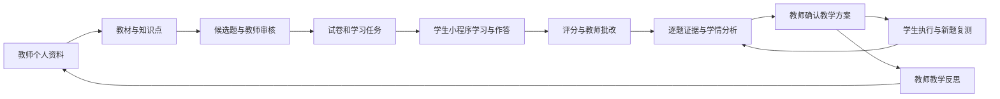

# KnowPulse 初中教育产品规划

> **历史文档／已退役（2026-11-01）**：本文记录早期学校教育方案或当时的实现与验证，学校管理、学校身份核验和旧 `/education/*` 工作区已退出当前产品。文中的“已确认”“当前”及验收结果仅指原记录时点，不作为现行需求或可用功能承诺。当前方向以[教师出题与学生答题业务需求](business-requirements.md)及[项目改造计划](project-refactoring-plan.md)为准：教师使用 `/teacher/*`，学生使用平级独立 `KnowPulse.MiniProgram`。

版本：v1.1 规划稿。日期：2026-10-06。适用范围：初中多学科，教师网页端、教师微信小程序与学生微信小程序。

KnowPulse 帮助教师将多年教学成果整理为可持续复用的个人知识库，围绕实际采用的教材完成备课出题、学生测评、学情分析和个性化教学。产品价值最终体现在教师能更快作出有依据的教学安排，学生能知道下一步学什么、练什么，以及复测后发生了什么变化。

本规划用于产品评审、交互设计和开发拆分。已确认的是初中、多学科、师生均有微信小程序入口、每个用户拥有个人知识库，以及教师资料默认私有并可主动共享到学校。教师小程序覆盖简单工作、数据分析查看与学生评语；页面组织、首期题型、运营方式和指标目标是本版提出的设计建议，不表示功能已经上线。

## 阅读入口

功能需求、统一编号、结果开放矩阵、异常规则与验收规格见[完整产品 PRD](education-prd.md)。本规划保留产品方向和体验设计依据，与 PRD 共同维护。

| 文档 | 解决的问题 |
| --- | --- |
| 本规划 | 产品定位、多端协同、核心规则、版本范围、运营指标和上线条件 |
| [教师端体验规划](product/education-teacher-experience.md) | 教师网页端导航、页面清单、操作流程与移动端协同 |
| [教师小程序体验规划](product/education-teacher-miniapp-experience.md) | 移动待办、学情查看、学生评语、跨端同步与验收 |
| [学生端体验规划](product/education-student-experience.md) | 微信小程序导航、页面清单、学习考试流程、异常恢复与验收 |
| [原始需求草案](education-personal-knowledge-requirements.md) | 用户已确认范围、业务背景及现有代码缺口 |
| [领域词汇表](../CONTEXT.md)与[个人库隐私决策](adr/0007-private-personal-knowledge-with-explicit-school-sharing.md) | 统一术语、资料归属和共享边界 |

本规划补充原需求草案的产品体验与交付范围；若后续细节调整，总规划与各端规划应同步，不能将本版建议自动当成已接受的架构决策。

## 产品定位与价值

教师网页端是围绕教学任务组织的工作台：从自己的教材和经验开始，形成课堂活动、测评和学生干预方案。教师小程序支持课间、课堂巡视和离开电脑后的轻量处理：看待办、查进度与学情、写观察和学生评语。学生端是有明确任务与反馈的学习入口：用较少步骤完成学习、作答、订正和复测。学校管理提供统一身份与教学关系，不要求教师先学会一套复杂企业后台。

| 用户需要完成的工作 | 当前障碍假设 | 产品应提供的帮助 | 验证方式 |
| --- | --- | --- | --- |
| 教师找回以往有效资料 | 文件分散，适用教材不清楚 | 私有归档、版本与知识点检索、使用记录 | 观察教师用真实旧资料完成一次新备课 |
| 教师快速准备合适试题 | 搜题改题耗时，生成内容不一定贴合教材 | 教材约束、来源检查、教师审核与组卷 | 记录完成可发布试卷所需总时间与修订量 |
| 教师了解具体学生 | 总分不能指出下一步教学动作 | 逐题证据、知识点估计、可调整的方案 | 教师能从报告找到证据并布置具体任务 |
| 学生完成学习任务 | 入口分散，不清楚先做什么 | 今日任务、清晰截止时间、继续上次进度 | 学生独立找到并完成当前任务 |
| 学生从错误中改进 | 只看到分数或标准答案 | 解析、订正、针对性练习与新题复测 | 对比首答、订正和后续新题的证据 |

这些问题来自本次产品目标，尚需试点访谈与观察验证。首期优先验证“能否帮助教师完成一次真实教学闭环”，不以生成数量或在线时长替代价值。

## 产品范围与原则

1. 个人积累属于个人。学校共享、学生任务投放和个人归属分别表达。
2. 当前教材由教师明确选择。系统保留版本与来源，跨教材复用需要确认。
3. 教师掌握教学决定权。AI 起草、检索和解释，教师确认题目、评分争议与教学方案。
4. 学情结论可追溯。每个知识点判断可以回到有效作答与评分；没有测评时显示待评估。
5. 学生先看到行动。首页突出下一项任务和保存状态，不堆满分数、排名与系统指标。
6. 初中多学科共享同一基础模型，同时允许学科特定的题型、展示、评分和知识点口径。
7. 先复用已有分层单体、知识版本、检索、题库审核和考试链路，教育界面按真实任务重新组织。

首期完整版本包含私人积累、教材出题、微信考试学习、教师批改、教师移动办公与学生评语、学情分析和方案复测。个人库与出题先行交付属于阶段成果，不能代表整个教育产品已经完成。

## 用户与组织模型

| 身份 | 默认可做 | 默认不能做 |
| --- | --- | --- |
| 教师 | 管理个人资料；使用获授权共享资料；管理任教范围内的教学活动 | 浏览其他用户私有库；仅凭教师角色访问全校学生；修改他人已发布考试 |
| 学生 | 管理个人笔记；完成分配给自己的任务；查看已开放的本人结果 | 浏览其他学生学情；提前获取答案；访问教师私有来源资料 |
| 学校管理人员 | 管理学校成员、班级、学期、任教关系及学校共享区 | 因管理身份自动获得所有个人资料或个人笔记 |
| 教研负责人 | 按学校明确授权维护教材目录、知识点与共享内容 | 未经授权查看跨学科学生明细；代替资料作者扩展共享范围 |
| 平台运维 | 管理运行状态、故障和容量 | 日常直接浏览教学正文及学生作答；将运维权限当作业务访问权 |

教研负责人可作为学校管理中的权限组合，首期不必新增独立门户。教师和学生是可组合的业务身份，归属与访问由具体关系决定。

学校、学年学期、年级、班级、学科、教师任教关系和学生在班记录构成教育范围。教师更换任课班级或学生转班，应按生效时间调整后续任务和学情访问；历史记录保留原归属并按既定政策查阅。学校与现有 ABP 租户如何对应仍是实现前的设计项，不能直接用部门或创建者字段替代。

## 教师与学生的信息架构

| 教师网页端 | 主要内容 | 学生微信小程序 | 主要内容 |
| --- | --- | --- | --- |
| 工作台 | 待审核、待批改、需关注学生、最近备课 | 今日 | 今日任务、截止提醒、继续作答或学习 |
| 我的知识库 | 私有资料、教材关联、教学成果、共享记录 | 学习 | 学科任务、学习材料、错题订正、个人知识库 |
| 教材与备课 | 当前教材、章节、知识点、备课记录 | 成长 | 本人成绩、知识点证据、阶段进展 |
| 题库与出卷 | 人工题、AI 候选、审核、试卷 | 我的 | 身份与班级、消息、账号支持、隐私与设置 |
| 教学任务 | 测评、学习任务、提交情况、批改 | 任务内页面 | 正式考试、练习、材料学习、方案、复测 |
| 班级与学情 | 任教班级、学生档案、班级/个人分析 |  |  |
| 教学方案 | 个性化方案、执行跟踪、复测与复盘 |  |  |

教师端顶部保持当前学校、学期和学科上下文，个人知识库清楚标示个人归属；切换学校不改变个人资料所有权。学校共享资料作为知识库内明确分区，不与“我的资料”混合展示。账号、消息与学校管理放在全局入口。

学生端仅保留四个底部入口。正式考试进入专注作答页面，切出或返回前说明保存状态，不把退出小程序直接认定为违规或完成交卷。私人笔记与老师布置的任务分区，老师不会因布置任务获得笔记访问权。

### 教师小程序与网页端的分工

| 工作空间 | 首期重点 | 复杂操作的承接 |
| --- | --- | --- |
| 教师网页端 | 资料批量整理、教材维护、出题组卷、完整批改、复杂分析与方案编辑 | 保持完整工作台能力 |
| 教师微信小程序 | 查看待办和提交进度、按学生催办、查班级与个人学情、写评语和课堂观察、记录资料灵感、查看方案执行 | 复杂编辑或评分修订显示电脑端继续入口及同一记录，不复制成另一份业务数据 |
| 学生微信小程序 | 学习、作答、订正、个人积累、查看教师已发布评语、执行方案与复测 | 保持学生任务体验和本人数据范围 |

教师小程序建议四个底部入口：**工作台、学情、评语、我的**。工作台组织待办、任务进度与简单处理；学情按学校/学期/班级/学科查看成绩、完成情况和知识点证据；评语提供草稿、待开放、已发布与收件人记录；我的承载身份、个人资料速记和设置。

首期建议同一微信小程序提供教师与学生工作空间，以服务端已确认的身份切换；具有单一身份的账号不出现其他角色入口。是否采用一个 AppID 或分别上架属于后续接入设计，不改变两类角色与数据隔离。跨角色切换前检查未同步答卷和草稿，先同步或明确提示并确认处理方式；随后清理前一角色的受限展示缓存，保留内容按身份隔离，不能静默丢弃或暴露给另一角色。进行中的考试计时继续，返回后恢复同一次作答。教师移动端不能凭选择“教师”自行获得权限。

## 跨端教学闭环

学校共享知识是教师可选择的补充来源。教师把教学反思存回个人库时，避免把学生个体报告原样混入可共享资料。

### 一次教学周期的服务交接

| 环节 | 教师端动作 | 系统必须完成 | 学生端看到 | 完成依据 |
| --- | --- | --- | --- | --- |
| 备课 | 选择资料、教材和目标 | 校验归属、索引和版本 | 无任务 | 材料与教学目标已确认 |
| 出题 | 审核题目、答案、知识点 | 生成稳定试卷快照 | 无任务 | 试卷可发布 |
| 布置 | 选择班级/学生、时间和开放规则 | 固定分配名单与规则版本 | 新任务与作答要求 | 任务已生效 |
| 作答 | 查看进度，处理缺考 | 保存答案、去重、恢复、截止封存 | 已保存/未保存/已提交 | 服务端提交回执 |
| 批改 | 处理主观题与争议 | 全量逐题评分，区分待批改 | 已提交、待批改或待公布 | 当前评分版本完整 |
| 反馈 | 发布成绩与解析 | 按开放策略裁剪返回内容 | 分数或完整讲评 | 学生可查看获准内容 |
| 干预 | 根据证据确认教学方案 | 生成可执行任务及材料授权 | 今日学习与复测安排 | 教师已下发方案版本 |
| 复盘 | 比较证据、调整教学 | 保留执行与前后测记录 | 下一步建议 | 教师完成复核 |

示例：教师选择试点实际采用的七年级数学教材，整理“一元一次方程”资料，生成并审核一次测评；学生答题后，教师从移项相关题目的具体失分看出需要补充的讲解，安排例题学习和新题复测。示例仅用于说明流程，不代表已经确定首批教材或证明学生一定存在某种认知缺陷。

## 首期功能清单与边界

以下能力均属于完整首期，按 M1 至 M4 依次接通。每项包含用户可操作的页面、对应权限和可验证结果。

| 能力包 | 首期交付 | 后续增强 | 里程碑 |
| --- | --- | --- | --- |
| 身份与教学关系 | 个人库初始化、学校成员、班级学期、任教与在班关系、账号恢复 | 多校统一身份及复杂交接 | M1 |
| 私有知识积累 | 分类、版本、附件、索引状态、个人检索、导出、选定版本共享/撤回 | 大批量智能归档、跨库迁移助手 | M1 |
| 教材与备课 | 初中多学科目录、版次册次章节、知识点映射、备课材料清单和反思 | 完整备课模板、教研协作编辑 | M2 |
| 题库与试卷 | AI 候选、人工编辑审核、来源检查、组卷快照、范围检查 | 难度自动校准、大规模校本题库运营 | M2 |
| 测评与批改 | 班级/指定学生分配、文本/图片作答、客观题评分、主观题人工批改、复核 | 复杂手写识别、作文与步骤辅助评分 | M3 |
| 学生学习 | 微信入口、任务学习、进度、私人笔记、已开放错题、订正 | 多媒体互动课堂、离线完整课程 | M3 |
| 教师移动办公与评语 | 移动待办、任务进度、基础成绩概览、学生评语草稿与发布、个人速记；掌握度与方案查看随 M4 接入 | 移动深度批改、复杂出题编辑、语音评语与批量个性化评语 | M3 基础，M4 分析 |
| 学情分析 | 全量逐题证据、知识点估计、学生/班级分项视图、异常解释 | 经验证的复杂认知诊断模型 | M3 建证据，M4 展分析 |
| 教学方案 | AI 草稿、教师调整确认、个体任务、执行和新题复测、版本复盘 | 学科策略推荐库、长期干预对照分析 | M4 |
| 学校运营 | 成员与任务支持、共享内容处置、运行统计和配置 | 家长端、跨校内容交易、完整 BI | M1 起持续完善 |

首期题型建议包含单选、多选、判断、按空位评分的填空，以及人工批改的简答/解答题；允许上传答案图片。语文长文阅读、数学公式、英语语言材料、理化图表等要有真实样本验收。多学科能力不等于承诺自动理解所有学科内容，也不意味着同时采购所有教材。

不把通用聊天、公开排名、积分商城、家长社交或视频课堂列为首期主入口。教师知识问答嵌入资料与备课场景；学生正式考试期间不提供答案生成助手。

## 关键业务规则

### 个人资料与学校共享

归属、版本可用状态和共享状态是三个维度。“已经可检索”可以同时是“仅本人可见”；学校共享取消后，个人资料继续归本人使用。新个人资料不能套用存量组织知识的空范围全员可见兼容规则。

本版建议学校共享区默认面向被授权的学校教师，学生通过教学任务获得具体材料访问权；共享对象和允许使用方式在发布前展示。共享不默认产生一份不受撤回约束的个人副本。基于共享资料形成的草稿在发布或新建任务时再次校验权限。

撤回后停止新检索、新出题及新任务复用；已发布教学任务与考试保留必要快照用于追溯和审计，不开放原私有来源。D03 已确认（2026-10-17）：已布置或曾打开的学生材料也停止后续在线正文/附件读取，保留历史答卷和已上交记录按各自权限追溯（ADR 0029）。ADR 0030 已实现指定方案活动的材料版本/附件授权及撤回阻断，学生交付共享来源需作者另行允许布置给学生，附件还需下载用途。ADR 0031 将同样的交付规则接入独立材料任务，包含固定名单、换版/撤回、学习上交、困难反馈和教师私有跟进；实际材料接触默认未核验，ADR 0032 提供确切任务版本与冻结试题的带版本提示复核，无提示确认不扩大为其他上下文或成绩事实。其余下载副本、衍生作品及学校留存规则仍须明确，不能承诺收回已看过或下载的内容；真实登录/设备、微信和生产并发仍待验收。

### 教材与知识点

教材身份至少包括学段、学科、年级、出版社、版次、册次，教学任务再绑定学年学期。知识点有稳定身份并可与多个教材章节关联；不同学科同名概念不自动归并。

教师确认出题要求中的范围、题型、数量、难度与用途。生成结果保留来源版本、引用和知识点关联，教师核对答案与评分要点后使用。材料不足时显示缺口，失败重试保留任务状态，不重复创建已成功的结果。

### 考试与成绩开放

考试计划、试卷快照、学生一次作答和成绩发布分别管理。发布试卷时即固定题目与评分依据；开考前如需修改，形成新版本并重新确认发布，已经开始的作答始终沿用原快照。任务时间和接收范围的调整另行提示与记录。加时、补考、取消与成绩修订应有明确权限和记录。

到时封存服务端成功保存的答案，启动评分并允许后台重试；有主观题时维持待批改，不把未评分题记为零分。图片上传成功并关联作答后才算已保存，上传进度不等于答卷提交成功。

成绩开放采用隐藏、仅成绩、完整讲评三个层级。首期建议正式测评在提交窗口结束、进行中作答完成封存且提交集合固定后，全部有效答卷批改完成再按任务统一发布最终成绩；缺考、取消和正式豁免单列。教师端可看批改进度，学生端不发布尚未完成的临时总分。成绩开放与完整讲评开放可设置不同时间，答案和解析在完整讲评时一起开放；仍有人可开始、继续或追加尝试时不得开放完整讲评，错题收藏另设授权。所有学生接口包括嵌套试卷、错题、导出和消息内容均遵守该策略；前端隐藏不能替代服务端裁剪。消息只提供提醒，实际任务与结果以应用内状态为准。

学生成长概览中的测评分项与掌握度变化最早随相应成绩开放更新，逐题依据随完整讲评开放；未公布测评不能经成长页、错题标签或消息绕过开放规则。教师可提前准备报告与方案，但向学生下发的内容仍需经过同样检查。

练习允许按教师设置反馈、重做和提示；正式考试按发布规则限制次数、时间与答案开放。两者记录能区分，不把看过答案后的同题重练作为新的独立测评。

### 学生评语与教师观察

学生评语是一份有明确教师、学生、学科及时间/任务背景的反馈，可分为日常、任务和阶段评语。教师观察记录用于记录本人课堂观察与待确认判断，默认仅作者本人可见；从观察转为学生评语时创建独立草稿，由教师选择内容并确认，不能自动把内部备注公开。

教师可在网页或小程序为同一学生起草、修改、发布和更正评语，首期以文本、个人常用语及逐人预览为主。发布前展示学生姓名、班级、学科、关联任务、正文与可见时间，服务端重新检查任教范围。AI 润色作为完整首期之后的可选增强，由教师确认后使用，不自动发送，也不把推测的性格、能力或努力程度写成事实。

绑定测评的任务评语随完整讲评开放。日常或阶段评语可独立发布，但引用未开放的测评依据时必须关联该测评并等待相应开放条件，不能通过评语提前透露成绩、答案或私有题源。学生仅收到对本人发布的版本；该评语不自动成为学校共享知识，也不自动进入个人掌握度计算。

状态区分草稿、待开放、已发布、已更正和已撤回，阅读情况单独记录。只有学生实际打开对应版本才记为已读，消息发出不等于已读；已读也不代表认同或完成学习。撤回阻断后续展示并保留必要操作记录，不承诺删除学生已看到的内容。草稿同步、发布重试和跨端修改采用同一业务版本，冲突不得静默覆盖，重复点击不得重复发布。

### 掌握度与教学方案

订正以独立任务连接原始评分和教师复核：固定学生与冻结题目，保存发布版本和学生明确上交副本，复核只针对确切上交版本。当前 Web 切片支持文字/图片、本机草稿、上交核对、历史与原操作恢复；不自动改分或作为新题证据，讲评关闭和原评分变化重新限制后续使用。统一工作量另见 ADR 0034；完整私有云笔记、同题复练和微信验收仍在后续范围（ADR 0033）。

基础分析采用明确时间窗口中的有效逐题评分，展示得分比例、独立题数、测评次数、最近时间、教材范围和算法口径。多知识点题按评分点或明确权重分配证据；指标可追溯，不由模型直接编造一个百分比。

展示四类可解释状态：未测评、证据不足、需要巩固、达到当前目标。状态阈值随学科配置，试点期间由教研人员校准；不把“达到当前目标”描述为永久掌握。评分改判、题目失效和证据撤销引发带版本的重算。

教学方案包含目标、依据、教师讲解动作、学生材料与练习、工作量、时间、复测和达成标准。教师可面向共同问题批量起草，但每个学生有明确方案与任务；同一学生多学科任务的工作量在学生端汇总。学生可以反馈困难，教师决定调整或结束。

学生统一学习安排现汇总当前方案活动、独立材料任务、订正和正式测评，并保留准确来源入口。受阻、截止和来源不可估算不混入已知分钟，正式关联测评只计一次；等候教师复核与需要重新订正分开处理。查询不触发阅读、开始、上交或掌握记录，旧方案专用接口保留兼容；首个 Web 切片沿用 UTC 日期窗口，真实登录、学校时区/负荷和微信验收仍待（ADR 0034）。

阅读完成、任务打卡和按时提交只反映执行情况；方案有效性要结合新题复测与教师观察。跨难度或跨知识覆盖的试卷变化不能直接作为提分效果证明。

## 页面与交互设计原则

教师网页端延续现有 Blazor、Blazorise/Bootstrap 和 LeptonX Lite 的导航、表单和组件体系；将底层“索引任务”等状态转换为教师可理解的“正在整理”“可用于出题”“需要处理”。教师小程序按手机上的短任务设计，先给学情摘要与可执行动作，再按需展开图表和证据；不直接缩小桌面数据表。原始技术详情保留在按需展开的排障位置。

学生端按移动任务设计，正文和题目先于统计图。一个页面突出一个主动作；作答页持续展示题号、保存状态和截止信息，主观题提供图片查看与替换。任务状态使用文字和图标共同表达，不能只依赖红绿颜色。

正式进入视觉设计时，以教师网页“资料详情、出题审核、学生学情”、教师小程序“工作台、学生学情、评语编辑”和学生“今日、答题、教师评语、教学方案”作为关键屏幕。先统一多端内容和状态，再选择具体视觉方向；本规划中的页面清单是设计规格，不是已经验证的高保真界面。

通用要求包括：空状态给下一步操作；错误保留输入并给恢复路径；批量操作先预览影响；加载状态不显示虚假零分；正文可放大；关键按钮可触达；桌面键盘可操作；媒体附带说明。小程序须在试点实际使用的设备、不同屏幕及弱网下验收。

## 最小学校管理与运营支撑

| 管理入口 | 首期能力 | 必须处理的边界 |
| --- | --- | --- |
| 学校与学期 | 学校信息、学年学期、年级、班级、学科启用 | 切换学期保留历史教学记录 |
| 成员与关系 | 教师/学生导入与邀请、任教、在班、离校 | 同名学生、重复导入、错误绑定、成员失效 |
| 账号支持 | 绑定核验、换设备、恢复与解绑申请 | 学生不能仅凭班级码冒认名单中的身份 |
| 教研目录 | 教材版本、章节与知识点、映射审核 | 目录更新不改变已经发布的考试快照 |
| 共享管理 | 被举报内容、共享状态、范围与处置记录 | 管理处置不扩展私有资料阅读权 |
| 教学支持 | 任务异常、缺考、补交/补考、成绩争议 | 支持人员操作有业务授权和记录 |
| 运行概览 | 索引失败、出题失败、任务提交、模型用量 | 技术运行指标与学生能力评价分开 |

学生和教师的个人资料、学校共享资料、试题、答卷及成绩有不同留存与导出规则。学校停用或账号退出时，先明确已布置任务、个人导出和历史教学记录处理，再执行停用；不以一次删除按钮同时消除所有记录。

## 核心业务对象与能力衔接

| 业务对象 | 产品用途 | 与现有能力关系 |
| --- | --- | --- |
| 个人知识库与共享授权 | 保存归属、允许谁使用哪些版本 | 新增，贯穿现有知识条目、版本、Blob 与 RAG |
| 学校、学期、班级、任教与在班关系 | 限定任务与学情范围 | 新增教育关系，复用用户身份与授权机制 |
| 教材版本、章节、课程知识点与映射 | 约束出题、组织学习和分析 | 当前自由文本需结构化，保留历史快照 |
| 备课记录 | 连接教材目标、资料、试卷与课后反思 | 可复用知识资料，增加教师任务聚合视图 |
| 题目、候选、试卷快照 | 从生成到教师确认的可追溯内容 | 复用题库及 AI 出题，补充归属和范围 |
| 教学任务与分配 | 表达谁在何时学习或完成测评 | 扩展考试和学习路径，不把消息当作任务事实 |
| 作答与逐题评分证据 | 支撑成绩、复核及掌握度估计 | 复用作答/总分，新增完整评分与修订链路 |
| 掌握度投影 | 用可解释口径组织已有证据 | 新增，可重算，不覆盖原始学习证据 |
| 教学方案与任务版本 | 记录教师决定、执行和复测 | 新增编排，复用材料、练习、考试与学习进度 |
| 学生评语与教师观察 | 记录反馈对象、背景、正文、可见状态、阅读与修订，区分私有观察 | 新增统一业务记录，供教师网页/小程序写入、学生小程序按授权阅读 |

现有代码可复用知识版本与可恢复索引、授权检索、候选审核、试卷快照、作答保存、客观评分和学习路径。当前没有完整个人归属、教育任教关系、微信客户端和结构化掌握度模型。

现有学生考试映射含答案与解析，成绩查询及出题列表仍主要依靠功能权限；这些是进入真实学生试点之前必须解决的具体缺口。现有学习路径的部门/岗位分配也不能直接表达个人教学方案。详见[需求草案的代码依据](education-personal-knowledge-requirements.md)。

## 发布路线与验收门槛

| 里程碑 | 可用成果 | 进入下一阶段的条件 |
| --- | --- | --- |
| M1 归属与教学关系 | 教师可积累、私有检索和显式共享；学校建立成员及教学范围 | 两教师互相隔离，个人库不套用空范围公开规则；共享撤回有效；关系变更可追溯 |
| M2 教材与出题 | 多学科教材选择、知识点映射、候选审核和稳定试卷 | 真实教材样本与多类题型可预览；范围不足不乱补题；来源和权限可追溯 |
| M3 微信教学与测评 | 师生绑定、教师移动待办/基础成绩/评语、学生学习作答、恢复、批改、成绩开放和逐题证据 | 范围校验与答案隔离通过；真实设备弱网恢复、截止封存和幂等通过；主观题待批改正确；教师跨端评语不覆盖、不重复，学生只见已获准版本 |
| M4 分析与个性化教学 | 网页与教师小程序的班级/个人学情、教师确认方案、执行与新题复测 | 移动摘要和网页证据一致，可追溯更新时间；能完成干预复盘，证据不足和重算处理正确 |
| 首期试点验收 | 初中多学科的完整教学闭环可重复完成 | 教师与学生真实完成验收，不把页面可打开或模型返回文本视为成功 |

M1 至 M4 是交付依赖，不是四个互不相干的项目。身份、归属、教材标识、逐题证据及开放规则需在前期共同设计，避免学生端完成后才补数据权限。

M1 前明确学校与账号模型；M2 前选定首批学科、教材样本与评分规则；M3 前核验微信接入、发布条件和实际使用设备；M4 前确认分析口径、证据阈值及教师方案模板。尚无团队规模与投入信息，因此本版不把里程碑映射为承诺周数。

## 试点与用户验证

建议采用学校合作试点，同时允许教师在学校关系建立前先整理个人资料。试点规模建议为一所学校、至少两门学科、三至六位教师、两个班级，覆盖至少两个测评与反馈周期；这是用于估算组织成本的建议，不是已经确定的客户或并发要求。

| 验证阶段 | 方法 | 要回答的问题 |
| --- | --- | --- |
| 教师准备 | 观察现有备课与出卷，收集获准使用的教材和旧教案 | 真正耗时在哪；旧资料怎样被复用；哪些题不能机器评分 |
| 交互原型 | 教师独立完成出题审核，学生独立找到并提交任务 | 导航、文案和状态是否可理解；双方是否理解资料可见范围 |
| 内部演练 | 模拟弱网、错绑、缺考、图像上传、改分、撤回 | 出错后能否恢复，考试是否出现答案泄露或重复成绩 |
| 教学试点 | 完成学习、测评、教师方案和新题复测 | 是否减少教师总工作量；学生是否知道下一步行动 |
| 复盘扩展 | 汇总证据、教师反馈与成本 | 是否进入更多教材/学科/班级，哪些功能需简化或暂缓 |

试点预先准备两端操作指引、学校联络人、内容样本、异常响应路径和停用方案。性能验收按确认的同时开考规模与真实图片负载设计，不能用建议试点人数冒充系统承载能力。

## 产品指标与事件口径

核心结果指标建议为**教学周期内有效教学闭环覆盖率**，以“学生—学科”为计数单位，每个教学周期内去重，多次方案不能重复累计。分子是完成有效测评与评分、教师确认学习安排、执行记录、新题复测及教师复核的学生—学科数；分母是周期开始时确定的目标学生—学科数，退出或豁免需记录原因。分母为零显示“不适用”，不得事后只选择已完成者作为目标人群。

对暂不需要补弱的学生，可使用教师确认的巩固任务；不为指标强制制造薄弱项或生成无必要的个性化方案。分别报告巩固与个别干预结果，某学生一门学科完成不能掩盖另一门尚未完成。

| 指标 | 计算或记录方式 | 使用限制 |
| --- | --- | --- |
| 教师首次价值达成率 | 完成资料可检索并产出一份审核试卷的教师 / 已开始引导的教师 | 同时看失败步骤与完成时间 |
| 备课出卷耗时 | 从任务开始到可发布试卷的教师有效操作时间，中位数与分布 | 与同教师相近任务的原流程比较，包含审核修改时间 |
| 教学成果复用率 | 本周期引用至少一份历史资料的审核通过试卷数 / 本周期全部审核通过试卷数，按试卷版本去重 | 历史资料在本周期开始前已入库；备课记录的复用另算，不混分母 |
| AI 候选可用率 | 教师确认可用的候选数 / 已完成审核的候选数 | 分学科、题型、是否大量改写；未审题不入分母 |
| 学生有效提交率 | 按学生—任务分配去重的有效提交数 / 本周期到期且应参与的分配数 | 缺考、逾期和主动退出保留在分母；取消与正式豁免另报数量和原因 |
| 批改反馈时效 | 有效提交到可见反馈的时间分布 | 按纯客观题和含主观题分别统计 |
| 教师移动任务完成率 | 小程序内成功完成的目标操作 / 小程序内发起的目标操作，按操作记录去重 | 区分查学情、发布评语、催办；网页接续单列，不用停留时长代表效率 |
| 学生评语触达 | 被接收学生实际打开过的已发布评语版本 / 已向该学生开放的评语版本 | 待开放、已撤回单列；不将推送成功当已读，不强制学生回应 |
| 方案任务执行率 | 已有效完成的到期必做任务分配数 / 本周期到期应完成的必做任务分配数 | 按学生—任务去重，活动与测评分别统计；不将已读当作测评完成 |
| 方案复测率 | 有有效复测提交的到期分配数 / 本周期到期应参加的复测分配数 | 按学生—复测分配去重；未完成留在分母，取消与正式豁免单列 |
| 学习变化信号 | 同知识点、可比口径下的前后测证据变化 | 标注题目/覆盖变化，不作未经验证的因果归因 |
| 运行质量 | 保存失败、交卷重试、重算延迟、权限拒绝、服务故障 | 按故障原因统计，不归咎于学生能力 |
| 单次教学成本 | 模型、解析、存储与运维成本 / 完成审核试卷或有效教学周期 | 与教师节省时间共同评估，避免只追求便宜生成 |

建议事件包括资料可检索、试卷审核完成、任务发布、作答保存确认、提交确认、批改完成、结果开放、方案确认、复测提交与教师复核；事件只携带必要标识、状态、版本与耗时，不采集完整试题、作答正文或私有教案到通用产品分析系统。

业务转化目标应由试点基线确定，不凭空承诺提分幅度。上线硬门槛是权限隔离和答案开放测试通过、关键恢复路径可用、已确认作答不会因重复请求产生不一致，以及所选学科流程可完成。

## 运营与商业方式建议

建议先采用学校试点与教师使用并行的方式：学校协助组织成员和教学流程，教师保留个人积累价值，学生使用学习考试入口。学校端可按教师席位、服务能力和模型用量形成后续方案，学生核心任务不设计单次答题付费。

定价前先计算每位活跃教师的资料解析、存储、出题审核和教学周期成本。生成额度、容量或模型故障影响新生成时，需要明确提示和人工替代路径；不影响学生已布置任务的作答、已保存记录和教师必要的批改。

增长来自教师复用自己的有效资料与学校内自愿教研分享，不将共享个人知识库设置为必选激活条件。案例推广使用获得授权的教学成果，不公开学生个人报告作为营销素材。

## 风险与实现前决策

| 事项 | 本版建议或约束 | 需要确定的内容 |
| --- | --- | --- |
| 学科与教材 | 能力覆盖初中多学科，试点选择有限版本 | 首批名单、教材来源、真实样本与教研确认人 |
| 主观题 | 首期保留教师人工批改与复核 | 文本/图片长度、评分点、英语听力等特殊题型范围 |
| 学校与个人 | 个人归属独立于共享，正式学生任务受教学关系约束 | 租户映射、多校教师、离校导出和历史访问政策 |
| 撤回共享 | 拒绝新使用，历史教学保留必要追溯 | 既有任务继续使用与衍生题目保留的具体约定 |
| 微信接入 | 教师与学生工作空间、明确身份绑定和恢复、服务端角色与任教校验 | 共用或分别上架、接入主体、身份绑定方案、当前平台发布/隐私要求，实施时依据官方资料核验 |
| 教材解析 | 转换后人工检查，图片公式有明确降级 | 是否需要 OCR，以及哪些教材格式必须首期覆盖 |
| 学情可信度 | 以逐题证据为基础，区分未测评和证据不足 | 学科阈值、时间窗口、可比性与教研验证样本 |
| 学生数据 | 私人笔记、作答和共享教材分开授权 | 学校使用安排、必要告知、留存、导出和删除流程 |
| 承载与成本 | 独立验收并发开考、图片上传和模型任务 | 团队投入、同时在线规模、文件额度、预算与响应目标 |

这些未定事项各有对应里程碑，不要求全部解决后才做产品设计，也不能未经确定直接落成不可逆的数据或授权策略。

## 设计与开发交付清单

- 产品：本规划、教师网页与师生小程序页面清单、场景验收、字段与状态词汇、教学范围及结果开放矩阵。
- 设计：关键流程原型、教师桌面及师生手机布局、评语编写与阅读、题目/公式/图片展示、空态/错误/恢复/待批改状态、通用组件规范。
- 内容教研：试点教材目录、知识点映射、各题型真实样本、评分规则、方案模板与人工审核标准。
- 开发：分里程碑的用例与权限、历史迁移策略、教师/学生接口、可恢复任务、关键审计与产品事件。
- 验证：跨用户与跨班级用例、嵌套数据字段检查、微信设备与弱网测试、主观题流程、分析重算及完整教学周期验收。
- 运营：学校与教师引导、学生绑定支持、试点负责人、容量与故障处理、资料导出和退出方案。

角色可由同一成员兼任，但产品、教研、设计、后端、教师前端、小程序、测试和试点支持都需明确负责人。开发排期应在教材样本、关键原型和关系授权方案明确后，按里程碑估算。
