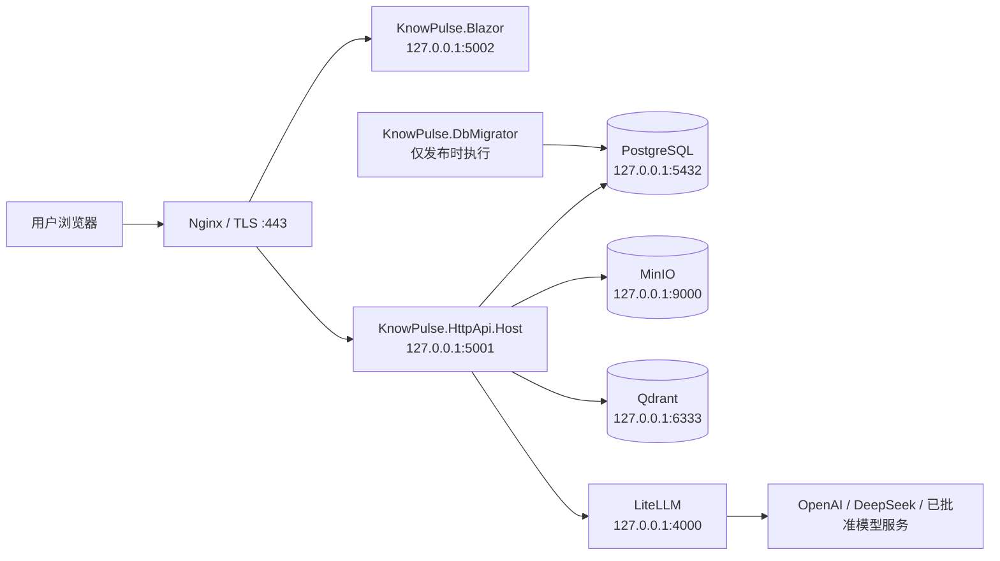

# KnowPulse 正式部署与运维手册

- 版本：v1.0
- 日期：2026-07-18
- 适用代码基线：`684f9e8`
- 部署形态：Linux x64、单机或同一内网小规模私有化部署
- 相关基线：`docs/private-deployment-baseline.md`

## 1. 文档目的

本文用于把 KnowPulse 当前仓库部署为正式可用的私有化环境，并给出上线、验收、备份、恢复、升级、回滚和日常排障的完整操作基线。

本文不是 Kubernetes、高可用集群或跨机房容灾方案。当前仓库实际支持的部署边界是：

- PostgreSQL、MinIO、Qdrant、LiteLLM 由 Docker Compose 管理。
- `KnowPulse.HttpApi.Host`、`KnowPulse.Blazor`、`KnowPulse.DbMigrator` 通过 `dotnet publish` 生成发布产物。
- API Host 和 Blazor 当前没有 Dockerfile，也没有纳入 `docker-compose.yml`。
- 正式环境推荐使用 systemd 管理 API Host 和 Blazor 进程，使用 Nginx 终止 TLS 并反向代理到 Kestrel。
- PostgreSQL 是业务事实库，MinIO 保存知识附件，Qdrant 是可重建向量索引，LiteLLM 数据库只保存模型网关运行数据。

如果交付要求是“所有应用都使用容器镜像”“多节点高可用”或“Kubernetes”，必须先补充应用镜像、健康检查、发布编排和高可用设计，不能直接照搬本文的单机基线。

## 2. 上线前结论与强制门禁

截至本文对应代码基线，项目可以完成开发环境构建、迁移和运行验证，但仍存在正式上线前必须处理或书面接受的风险。

| 级别 | 当前事实 | 正式上线要求 |
| --- | --- | --- |
| P0 | `docker-compose.yml` 只包含依赖服务，API/Blazor 无生产镜像 | 采用本文的 `dotnet publish + systemd` 方案，或先完成应用容器化 |
| P0 | `global.json` 使用 `rollForward: latestFeature`，当前机器会选择预览 SDK | 发布流水线必须固定经过批准的稳定 .NET 10 SDK；禁止 preview SDK 生成正式产物 |
| P0 | 当前依赖扫描报告 `Scriban 7.0.0`、`Microsoft.OpenApi 2.3.0` 存在 High 漏洞 | 升级到无高危版本，或由安全负责人形成带期限的书面风险接受 |
| P0 | API/Blazor 未实现正式 `/health/live`、`/health/ready` 端点 | 上线前补充健康端点；在补齐前只能使用本文的临时探测，不能据此宣称完整依赖健康 |
| P0 | Swagger 在 API 中无条件启用 | 通过 Nginx 限制管理员网段；更推荐后续改为 Production 默认关闭 |
| P0 | DbMigrator 使用 ABP 默认管理员种子凭据 | 首次迁移后立即修改管理员密码；更推荐在正式发布前改为从受控 secret 注入初始密码 |
| P0 | Blazor 使用 HTTPS 重定向，代码未显式配置 Forwarded Headers | Kestrel 必须只绑定 loopback，并设置 `ASPNETCORE_FORWARDEDHEADERS_ENABLED=true`；多级代理必须改为代码中显式信任代理 IP/网段 |
| P0 | Data Protection key 未在代码中显式配置共享和静态加密 | 单机部署至少固定 systemd 用户 HOME、持久化并备份 key ring；多实例前必须实现共享且加密的 key store |
| P0 | 生产备份、恢复和回滚尚未在仓库中自动化 | 正式切流前按本文至少完成一次隔离环境恢复演练 |
| P1 | 上传链路没有项目级恶意文件扫描，未发现显式业务上传大小上限 | 对非完全可信上传者增加查毒/隔离；由 Nginx 和应用共同设定并测试上传限制 |
| P1 | Serilog 文件输出没有项目级滚动策略 | 配置本文的 logrotate，或修改代码使用滚动文件和保留策略 |
| P1 | 当前只有 ABP EF Core Background Jobs，没有 Hangfire Dashboard | 运维手册和监控不得把 Hangfire Dashboard 当成已交付能力 |
| P1 | OpenTelemetry、Prometheus 指标和正式告警尚未落地 | 首次上线至少接入主机、容器、进程、端点、备份和磁盘告警 |
| P1 | MarkItDown 依赖服务器外部可执行程序 | 固定 MarkItDown 版本、显式配置路径，并完成真实 PDF/DOCX/PPTX/XLSX 转换验收 |

任何 P0 项未处理时，部署负责人应在上线审批中记录：风险、影响范围、临时控制、责任人和关闭日期。

## 3. 推荐部署拓扑

正式环境推荐使用两个域名：

- Web：`https://knowpulse.example.com`
- API/Auth：`https://api.knowpulse.example.com`

将文中的 `example.com` 替换为真实域名，不要在正式配置中保留示例值。



### 3.1 数据职责

| 组件 | 数据职责 | 是否业务事实 | 恢复优先级 |
| --- | --- | --- | --- |
| PostgreSQL `KnowPulse` | 用户、权限、知识元数据、考试、审计、索引任务等 | 是 | 最高 |
| MinIO `knowpulse-knowledge` | 知识原始附件和相关对象 | 是 | 最高 |
| PostgreSQL `LiteLLM` | LiteLLM virtual key、预算、运行统计等 | 否，但有运维价值 | 高 |
| Qdrant | chunk embedding 和权限过滤 payload | 否，可重建 | 中 |
| Data Protection key ring | Cookie、临时令牌等加密保护所需 key | 安全状态 | 高 |
| 应用发布产物和配置 | 可重复构建，但决定当前版本和行为 | 否 | 高 |

PostgreSQL 和 MinIO 必须作为同一恢复点进行管理。Qdrant 可以通过重新索引恢复，但数据量大时建议保留 snapshot 以缩短 RTO。

## 4. 容量和可用性假设

在尚未完成生产压测前，以下仅作为首轮容量起点：

| 项目 | 最小正式单机建议 | 说明 |
| --- | --- | --- |
| CPU | 8 vCPU | 文档转换、后台索引和 API 会竞争 CPU |
| 内存 | 32 GiB | PostgreSQL、Qdrant、LiteLLM、MinIO 和两个 .NET 进程同机 |
| 系统盘 | 100 GiB SSD | 系统、镜像、发布产物和日志 |
| 数据盘 | 500 GiB 起步，SSD/NVMe | PostgreSQL、MinIO、Qdrant、备份按实际文档量扩容 |
| 网络 | 千兆内网；模型服务出口稳定 | 模型 API、备份和大附件传输需要带宽 |
| 时间同步 | NTP/chrony | 认证令牌、审计和证书依赖正确时间 |

该单机拓扑没有主机级高可用：宿主机或数据盘故障会中断全部服务。若业务要求高可用，至少应把 PostgreSQL、MinIO/Qdrant 和应用节点拆分，并重新设计共享 Data Protection key、负载均衡、会话、备份和故障切换。

上线审批前必须确认：

- 预计用户数、峰值并发、日上传文档量和单文件上限。
- 允许的 RPO 与 RTO。
- 是否纯内网、是否允许调用公网模型。
- 数据保密等级和模型供应商合规要求。
- 是否需要等保、审计留存、日志脱敏或特定密码策略。

最低建议目标：

- PostgreSQL/MinIO 备份 RPO 不超过 24 小时。
- 单机恢复 RTO 不超过 4 小时。
- 若业务不能接受一天数据损失，应启用 PostgreSQL WAL/PITR 和 MinIO 复制，不能只依赖每日逻辑备份。

## 5. 网络、域名和端口

### 5.1 防火墙策略

| 端口 | 方向 | 是否公网开放 | 用途 |
| --- | --- | --- | --- |
| 22 | 入站 | 仅堡垒机/管理员网段 | SSH 运维 |
| 80 | 入站 | 是或内网 | ACME/跳转 HTTPS |
| 443 | 入站 | 是或内网 | Web、API/Auth |
| 5001 | 本机 | 否 | API Kestrel |
| 5002 | 本机 | 否 | Blazor Kestrel |
| 5432 | 本机/数据库内网 | 否 | PostgreSQL |
| 9000 | 本机/存储内网 | 否 | MinIO API |
| 9001 | 管理内网 | 否 | MinIO Console |
| 6333/6334 | 本机/向量库内网 | 否 | Qdrant HTTP/gRPC |
| 4000 | 本机/模型网关内网 | 否 | LiteLLM |

正式环境不得把 PostgreSQL、MinIO、Qdrant、LiteLLM 直接暴露到公网。本文示例把这些端口绑定到 `127.0.0.1`。

### 5.2 DNS 和证书

上线前完成：

1. `knowpulse.example.com` 指向 Nginx 入口。
2. `api.knowpulse.example.com` 指向 Nginx 入口。
3. 为两个域名申请受信任证书，或使用企业内部 CA。
4. 验证完整证书链、到期时间和自动续期。
5. 在证书续期后自动执行 `nginx -t && systemctl reload nginx`。

不得把 ASP.NET 开发证书 `.pfx` 用于正式环境。

## 6. 目录、账号和权限

建议目录：

```text
/opt/knowpulse/
|-- current -> /opt/knowpulse/releases/<release-id>
|-- releases/
|   `-- <release-id>/
|       |-- api/
|       |-- web/
|       `-- migrator/
|-- deploy/
|   |-- compose.production.yml
|   `-- litellm/
|       `-- config.yaml
`-- markitdown-venv/

/etc/knowpulse/
|-- infrastructure.env
|-- api.env
|-- web.env
`-- migrator.env

/var/lib/knowpulse/
`-- .aspnet/DataProtection-Keys/

/var/log/knowpulse/
|-- api/
`-- web/

/srv/knowpulse/
|-- postgres/
|-- minio/
|-- qdrant/
|-- qdrant-snapshots/
`-- backups/
```

创建专用系统用户：

```bash
sudo useradd --system --home /var/lib/knowpulse --create-home \
  --shell /usr/sbin/nologin knowpulse

sudo install -d -o root -g root -m 0755 /opt/knowpulse/releases
sudo install -d -o root -g root -m 0755 /opt/knowpulse/deploy/litellm
sudo install -d -o root -g root -m 0755 /etc/knowpulse
sudo install -d -o knowpulse -g knowpulse -m 0700 \
  /var/lib/knowpulse/.aspnet/DataProtection-Keys
sudo install -d -o knowpulse -g knowpulse -m 0750 \
  /var/log/knowpulse/api /var/log/knowpulse/web
sudo install -d -o root -g root -m 0750 \
  /srv/knowpulse/postgres /srv/knowpulse/minio \
  /srv/knowpulse/qdrant /srv/knowpulse/qdrant-snapshots \
  /srv/knowpulse/backups
```

容器数据目录的最终 UID/GID 需要按镜像实际运行用户调整。不要为了省事使用 `chmod -R 777`。

## 7. 软件前置条件

部署节点至少需要：

- 经过批准的 Linux 发行版。
- Docker Engine 和 Docker Compose v2。
- Nginx。
- .NET 10 ASP.NET Core Runtime；若改为 self-contained 发布，则目标机可不安装 runtime。
- Python 虚拟环境和固定版本的 Microsoft MarkItDown。
- `curl`、`jq`、`tar`、`sha256sum`。
- PostgreSQL 客户端或容器内 `pg_dump`/`pg_restore`。
- MinIO Client `mc`。
- PowerShell 7，仅在部署节点直接运行仓库 `.ps1` 验证脚本时需要。

检查：

```bash
docker version
docker compose version
nginx -v
dotnet --info
python3 --version
curl --version
jq --version
```

正式发布产物必须由稳定 SDK 生成。当前 `global.json` 允许滚动到更高 feature band，发布前应把策略收紧为经过批准的稳定 SDK，例如使用 `allowPrerelease: false` 和更严格的 `rollForward`，或在 CI 镜像中固定 SDK 并校验：

```bash
dotnet --version
```

若输出包含 `preview`、`rc` 或其他预发布标识，停止发布。

## 8. 构建和发布产物

正式产物应在干净、可重复的构建节点产生，不建议在生产服务器直接从源码运行。

### 8.1 固定代码版本

```bash
git fetch --tags --prune
git checkout <APPROVED_TAG_OR_COMMIT>
git status --short
git rev-parse HEAD
```

要求：

- `git status --short` 为空。
- 提交 SHA 与上线审批单一致。
- 正式发布应使用 tag 或不可变 commit SHA。

### 8.2 依赖、漏洞和静态资源

```bash
dotnet restore KnowPulse.slnx
dotnet list KnowPulse.slnx package --vulnerable --include-transitive
```

生产门禁建议：

- Critical/High：阻断发布，除非有书面风险接受。
- Moderate：评估可利用性并排期。
- 包源和 SDK 必须固定，不允许发布时临时切换到未知镜像源。

API Account/Swagger 页面依赖 `src/KnowPulse.HttpApi.Host/wwwroot/libs`。干净构建节点需要安装与项目 ABP 版本兼容的 ABP CLI，然后执行：

```bash
pushd src/KnowPulse.HttpApi.Host
abp install-libs
test -n "$(find wwwroot/libs -type f -print -quit)"
popd
```

缺少该目录时，Account、OpenID discovery 或 Swagger 可能返回 500。

### 8.3 回归验证

在构建节点执行：

```powershell
.\ops\verify-private-deployment-baseline.ps1
.\ops\verify-mvp3.ps1 -WithBuild
git diff --check
```

如果使用生产环境校验模式，必须先通过部署平台注入真实 secret，且不得把 secret 输出到流水线日志：

```powershell
.\ops\verify-private-deployment-baseline.ps1 -Environment Production
```

`verify-private-deployment-baseline.ps1` 是静态配置门禁，不代表备份、恢复、TLS、登录和真实模型调用已经通过。

### 8.4 发布三个产物

推荐在 Linux x64 构建节点使用 framework-dependent 发布：

```bash
rm -rf artifacts/publish

dotnet publish src/KnowPulse.HttpApi.Host/KnowPulse.HttpApi.Host.csproj \
  -c Release -r linux-x64 --self-contained false \
  -o artifacts/publish/api

dotnet publish src/KnowPulse.Blazor/KnowPulse.Blazor.csproj \
  -c Release -r linux-x64 --self-contained false \
  -o artifacts/publish/web

dotnet publish src/KnowPulse.DbMigrator/KnowPulse.DbMigrator.csproj \
  -c Release -r linux-x64 --self-contained false \
  -o artifacts/publish/migrator
```

不建议在未验证兼容性的情况下启用 trimming 或 Native AOT。ABP、反射、动态模块和 Blazor 依赖可能需要额外适配。

确认关键文件：

```bash
test -f artifacts/publish/api/KnowPulse.HttpApi.Host.dll
test -f artifacts/publish/web/KnowPulse.Blazor.dll
test -f artifacts/publish/migrator/KnowPulse.DbMigrator.dll
test -f artifacts/publish/api/Microsoft.Extensions.DataIngestion.Abstractions.dll
test -f artifacts/publish/api/Microsoft.Extensions.DataIngestion.MarkItDown.dll
test -n "$(find artifacts/publish/api/wwwroot/libs -type f -print -quit)"
```

### 8.5 写入 Blazor 公开配置

Blazor Client 的 `wwwroot/appsettings.json` 会被浏览器下载，不能放任何 secret。发布后、打包前写入正式公开地址：

```bash
API_PUBLIC_URL="https://api.knowpulse.example.com"
APPSETTINGS="artifacts/publish/web/wwwroot/appsettings.json"

jq --arg url "$API_PUBLIC_URL" \
  '.AuthServer.Authority = $url |
   .RemoteServices.Default.BaseUrl = $url' \
  "$APPSETTINGS" > "$APPSETTINGS.tmp"

mv "$APPSETTINGS.tmp" "$APPSETTINGS"
jq . "$APPSETTINGS"
```

必须确认输出中没有：

- 数据库连接串。
- MinIO key。
- LiteLLM key。
- Qdrant key。
- 模型供应商 key。
- `StringEncryption` pass phrase。

### 8.6 打包和校验

```bash
RELEASE_ID="1.0.0-$(git rev-parse --short=12 HEAD)"

pushd artifacts/publish
find api web migrator -type f -print0 |
  sort -z |
  xargs -0 sha256sum > SHA256SUMS

tar -czf "../knowpulse-${RELEASE_ID}-linux-x64.tar.gz" \
  api web migrator SHA256SUMS
popd
```

将 tar 包、SHA256SUMS、commit SHA、构建日志、测试报告和漏洞扫描结果作为同一发布记录保存。

## 9. 生产基础设施配置

### 9.1 不可直接使用开发 Compose

仓库根目录 `docker-compose.yml` 的默认口令和端口用于开发。它默认把端口暴露到所有网卡，不能原样用于生产。

在 `/opt/knowpulse/deploy/compose.production.yml` 创建生产专用文件：

```yaml
name: knowpulse-prod

services:
  postgres:
    image: ${POSTGRES_IMAGE:?POSTGRES_IMAGE is required}
    container_name: knowpulse-prod-postgres
    restart: unless-stopped
    environment:
      POSTGRES_USER: ${POSTGRES_ADMIN_USER:?POSTGRES_ADMIN_USER is required}
      POSTGRES_PASSWORD: ${POSTGRES_ADMIN_PASSWORD:?POSTGRES_ADMIN_PASSWORD is required}
      POSTGRES_DB: postgres
    ports:
      - "127.0.0.1:${KNOWPULSE_POSTGRES_PORT:-5432}:5432"
    volumes:
      - /srv/knowpulse/postgres:/var/lib/postgresql
    healthcheck:
      test:
        - CMD-SHELL
        - pg_isready -U "$${POSTGRES_USER}" -d postgres
      interval: 10s
      timeout: 5s
      retries: 20
    networks:
      - knowpulse

  minio:
    image: ${MINIO_IMAGE:?MINIO_IMAGE is required}
    container_name: knowpulse-prod-minio
    restart: unless-stopped
    command: server /data --console-address ":9001"
    environment:
      MINIO_ROOT_USER: ${MINIO_ROOT_USER:?MINIO_ROOT_USER is required}
      MINIO_ROOT_PASSWORD: ${MINIO_ROOT_PASSWORD:?MINIO_ROOT_PASSWORD is required}
    ports:
      - "127.0.0.1:${KNOWPULSE_MINIO_API_PORT:-9000}:9000"
      - "127.0.0.1:${KNOWPULSE_MINIO_CONSOLE_PORT:-9001}:9001"
    volumes:
      - /srv/knowpulse/minio:/data
    networks:
      - knowpulse

  qdrant:
    image: ${QDRANT_IMAGE:?QDRANT_IMAGE is required}
    container_name: knowpulse-prod-qdrant
    restart: unless-stopped
    environment:
      QDRANT__SERVICE__API_KEY: ${QDRANT_SERVICE_API_KEY:?QDRANT_SERVICE_API_KEY is required}
      QDRANT__STORAGE__SNAPSHOTS_PATH: /qdrant/snapshots
    ports:
      - "127.0.0.1:${KNOWPULSE_QDRANT_HTTP_PORT:-6333}:6333"
      - "127.0.0.1:${KNOWPULSE_QDRANT_GRPC_PORT:-6334}:6334"
    volumes:
      - /srv/knowpulse/qdrant:/qdrant/storage
      - /srv/knowpulse/qdrant-snapshots:/qdrant/snapshots
    networks:
      - knowpulse

  litellm:
    image: ${LITELLM_IMAGE:?LITELLM_IMAGE is required}
    container_name: knowpulse-prod-litellm
    restart: unless-stopped
    command:
      - --config
      - /app/config.yaml
      - --host
      - 0.0.0.0
      - --port
      - "4000"
    environment:
      DATABASE_URL: ${LITELLM_DATABASE_URL:?LITELLM_DATABASE_URL is required}
      LITELLM_MASTER_KEY: ${LITELLM_MASTER_KEY:?LITELLM_MASTER_KEY is required}
      OPENAI_API_KEY: ${OPENAI_API_KEY:?OPENAI_API_KEY is required}
      DEEPSEEK_API_KEY: ${DEEPSEEK_API_KEY:?DEEPSEEK_API_KEY is required}
    ports:
      - "127.0.0.1:${KNOWPULSE_LITELLM_PORT:-4000}:4000"
    volumes:
      - /opt/knowpulse/deploy/litellm/config.yaml:/app/config.yaml:ro
    depends_on:
      postgres:
        condition: service_healthy
    networks:
      - knowpulse

networks:
  knowpulse:
    driver: bridge
```

如果模型配置不使用 OpenAI 或 DeepSeek，应同步修改 `config.yaml` 和环境变量要求，不要注入无用供应商 key。

### 9.2 基础设施环境文件

创建 `/etc/knowpulse/infrastructure.env`：

```dotenv
POSTGRES_IMAGE=postgres:18-alpine
POSTGRES_ADMIN_USER=<GENERATE_DB_ADMIN_USER>
POSTGRES_ADMIN_PASSWORD=<GENERATE_STRONG_DB_ADMIN_PASSWORD>
KNOWPULSE_POSTGRES_PORT=5432

MINIO_IMAGE=minio/minio:RELEASE.2025-09-07T16-13-09Z
MINIO_ROOT_USER=<GENERATE_MINIO_ROOT_USER>
MINIO_ROOT_PASSWORD=<GENERATE_STRONG_MINIO_ROOT_PASSWORD>
KNOWPULSE_MINIO_API_PORT=9000
KNOWPULSE_MINIO_CONSOLE_PORT=9001

QDRANT_IMAGE=qdrant/qdrant:v1.15.1
QDRANT_SERVICE_API_KEY=<GENERATE_STRONG_QDRANT_API_KEY>
KNOWPULSE_QDRANT_HTTP_PORT=6333
KNOWPULSE_QDRANT_GRPC_PORT=6334

LITELLM_IMAGE=ghcr.io/berriai/litellm:v1.89.4
LITELLM_DATABASE_URL=postgresql://litellm_app:<URL_ENCODED_PASSWORD>@postgres:5432/LiteLLM
LITELLM_MASTER_KEY=<GENERATE_STRONG_LITELLM_MASTER_KEY>
OPENAI_API_KEY=<PRODUCTION_PROVIDER_KEY>
DEEPSEEK_API_KEY=<PRODUCTION_PROVIDER_KEY>
KNOWPULSE_LITELLM_PORT=4000
```

设置权限：

```bash
sudo chown root:root /etc/knowpulse/infrastructure.env
sudo chmod 0600 /etc/knowpulse/infrastructure.env
```

要求：

- 所有镜像使用固定 release tag；更严格环境应使用 digest。
- 不使用 `latest`、`main`、`main-stable`、`dev`、`rc`、`nightly`。
- `LITELLM_DATABASE_URL` 中密码必须进行 URL 编码。
- 正式 secret 不进入 Git、工单正文、聊天记录或普通流水线日志。
- 如果部署平台支持 secret store，应优先使用 secret store，而不是长期明文 `.env`。

### 9.3 LiteLLM 配置

复制仓库模板：

```bash
sudo install -o root -g root -m 0644 \
  deploy/litellm/config.example.yaml \
  /opt/knowpulse/deploy/litellm/config.yaml
```

业务代码使用以下稳定 alias：

- `knowpulse-embedding-default`
- `knowpulse-embedding-fallback`
- `knowpulse-chat-default`

实际供应商模型可以在 LiteLLM 配置中替换，但不要随意修改业务 alias。供应商 key 只通过环境变量注入。

LiteLLM 必须使用独立的 `LiteLLM` 数据库，不得把 Prisma 表写进 `KnowPulse` 业务数据库。

## 10. 初始化 PostgreSQL

先只启动 PostgreSQL：

```bash
cd /opt/knowpulse/deploy
sudo docker compose \
  --env-file /etc/knowpulse/infrastructure.env \
  -f compose.production.yml \
  config --quiet

sudo docker compose \
  --env-file /etc/knowpulse/infrastructure.env \
  -f compose.production.yml \
  up -d postgres
```

检查：

```bash
sudo docker compose \
  --env-file /etc/knowpulse/infrastructure.env \
  -f compose.production.yml \
  ps postgres
```

使用受控管理员会话创建两个独立数据库和最小权限账号。下面 SQL 中的占位密码必须替换，执行记录不得包含真实密码：

```sql
CREATE ROLE knowpulse_app LOGIN PASSWORD '<KNOWPULSE_DB_PASSWORD>';
CREATE DATABASE "KnowPulse" OWNER knowpulse_app;

CREATE ROLE litellm_app LOGIN PASSWORD '<LITELLM_DB_PASSWORD>';
CREATE DATABASE "LiteLLM" OWNER litellm_app;
```

正式环境不要让 API 使用 PostgreSQL 超级用户。

如果使用企业托管 PostgreSQL：

- 在数据库平台创建相同的两个数据库和独立账号。
- 配置 TLS、备份、PITR、监控和连接数上限。
- 从 Compose 中删除 `postgres` 服务。
- 将 API 和 LiteLLM 连接串指向内网数据库地址。

## 11. 初始化 MinIO

启动 MinIO：

```bash
cd /opt/knowpulse/deploy
sudo docker compose \
  --env-file /etc/knowpulse/infrastructure.env \
  -f compose.production.yml \
  up -d minio

curl -fsS http://127.0.0.1:9000/minio/health/live
```

使用 `mc` 管理员连接，创建 `knowpulse-knowledge` bucket。以下占位符替换为 `/etc/knowpulse/infrastructure.env` 中的实际值；执行时使用受控管理员终端，并避免让凭据进入共享 shell history：

```bash
mc alias set \
  knowpulse-prod \
  http://127.0.0.1:9000 \
  "<MINIO_ROOT_USER>" \
  "<MINIO_ROOT_PASSWORD>"

mc mb --ignore-existing knowpulse-prod/knowpulse-knowledge
```

创建专用应用账号，并只授权该 bucket。建议策略：

```json
{
  "Version": "2012-10-17",
  "Statement": [
    {
      "Effect": "Allow",
      "Action": [
        "s3:GetBucketLocation",
        "s3:ListBucket"
      ],
      "Resource": [
        "arn:aws:s3:::knowpulse-knowledge"
      ]
    },
    {
      "Effect": "Allow",
      "Action": [
        "s3:GetObject",
        "s3:PutObject",
        "s3:DeleteObject"
      ],
      "Resource": [
        "arn:aws:s3:::knowpulse-knowledge/*"
      ]
    }
  ]
}
```

将上面的策略保存为仅管理员可读的 `/root/knowpulse-minio-policy.json`，再创建应用账号并绑定策略：

```bash
mc admin user add \
  knowpulse-prod \
  "<MINIO_APP_ACCESS_KEY>" \
  "<MINIO_APP_SECRET_KEY>"

mc admin policy create \
  knowpulse-prod \
  knowpulse-knowledge-rw \
  /root/knowpulse-minio-policy.json

mc admin policy attach \
  knowpulse-prod \
  knowpulse-knowledge-rw \
  --user "<MINIO_APP_ACCESS_KEY>"

mc admin user info \
  knowpulse-prod \
  "<MINIO_APP_ACCESS_KEY>"
```

完成后：

- API 使用应用账号，不使用 MinIO root 凭据。
- 设置 `BlobStoring__Minio__CreateBucketIfNotExists=false`。
- MinIO Console 只允许管理员网段访问，默认不经 Nginx 暴露。
- 下载必须继续通过 ABP 权限校验，不能把 bucket 配置为匿名公开。

## 12. 初始化 Qdrant 和 LiteLLM

启动：

```bash
cd /opt/knowpulse/deploy
sudo docker compose \
  --env-file /etc/knowpulse/infrastructure.env \
  -f compose.production.yml \
  up -d qdrant litellm
```

临时健康检查：

```bash
curl -fsS \
  -H "api-key: <QDRANT_API_KEY>" \
  http://127.0.0.1:6333/healthz

curl -fsS \
  -H "Authorization: Bearer <LITELLM_MASTER_KEY>" \
  http://127.0.0.1:4000/health/liveliness
```

从受控运维工作站初始化/验证 Qdrant：

```powershell
$env:KNOWPULSE_QDRANT_API_KEY = "<QDRANT_API_KEY>"
.\ops\verify-qdrant-knowledge-collection.ps1 `
  -QdrantEndpoint "http://<PRIVATE_HOST>:6333" `
  -Ensure
```

当前默认 collection：

- 名称：`knowledge_chunks_1536_mvp1`
- 向量维度：`1536`
- 距离：`Cosine`

embedding 模型维度变化时不能直接复用原 collection，必须创建新 collection 并执行全量重建。

LiteLLM 应通过 master key 创建仅允许 KnowPulse 所需模型 alias 的 virtual key，再把 virtual key 作为 `KNOWPULSE_LITELLM_API_KEY` 注入 API。不要让业务应用长期使用 master key。若当前交付暂时做不到，必须把“应用使用 master key”列为上线风险并限期整改。

验证 alias：

```powershell
$env:KNOWPULSE_LITELLM_API_KEY = "<KNOWPULSE_VIRTUAL_KEY>"
.\ops\verify-litellm-rag-config.ps1 `
  -LiteLlmBaseUrl "http://<PRIVATE_HOST>:4000" `
  -Live
```

## 13. 安装 MarkItDown

KnowPulse 的 PDF、Word、PowerPoint、Excel、HTML、CSV、JSON、XML 转换依赖 MarkItDown 可执行程序。

使用独立虚拟环境并固定经过验收的版本：

```bash
sudo python3 -m venv /opt/knowpulse/markitdown-venv
sudo /opt/knowpulse/markitdown-venv/bin/pip install \
  "markitdown[all]==<APPROVED_VERSION>"

/opt/knowpulse/markitdown-venv/bin/python -c \
  "import importlib.metadata as m; print(m.version('markitdown'))"
```

要求：

- 禁止使用未固定的 `latest` 语义。
- API 环境变量显式设置 `RagAI__Ingestion__MarkItDownExecutablePath`。
- systemd 用户必须有执行权限。
- 使用无敏感信息的 PDF、DOCX、PPTX、XLSX 各做一次真实转换。
- 当前默认不承诺图片 OCR、音频、视频和压缩包解析。
- 若未完成 MarkItDown 安装，应设置 `RagAI__Ingestion__EnableMarkItDown=false`，并在产品界面和验收中明确文档类型限制。

## 14. 应用生产配置

### 14.1 API 环境文件

创建 `/etc/knowpulse/api.env`：

```dotenv
ASPNETCORE_ENVIRONMENT=Production
DOTNET_ENVIRONMENT=Production
ASPNETCORE_URLS=http://127.0.0.1:5001
ASPNETCORE_FORWARDEDHEADERS_ENABLED=true
AllowedHosts=api.knowpulse.example.com

App__SelfUrl=https://api.knowpulse.example.com
App__CorsOrigins=https://knowpulse.example.com
App__RedirectAllowedUrls=https://knowpulse.example.com
AuthServer__Authority=https://api.knowpulse.example.com
AuthServer__RequireHttpsMetadata=true
AuthServer__SwaggerClientId=KnowPulse_Swagger

ConnectionStrings__Default=Host=127.0.0.1;Port=5432;Database=KnowPulse;Username=knowpulse_app;Password=<KNOWPULSE_DB_PASSWORD>;
StringEncryption__DefaultPassPhrase=<GENERATE_RANDOM_LONG_PASSPHRASE>

BlobStoring__Minio__BucketName=knowpulse-knowledge
BlobStoring__Minio__EndPoint=127.0.0.1:9000
BlobStoring__Minio__AccessKey=<MINIO_APP_ACCESS_KEY>
BlobStoring__Minio__SecretKey=<MINIO_APP_SECRET_KEY>
BlobStoring__Minio__WithSSL=false
BlobStoring__Minio__CreateBucketIfNotExists=false

QDRANT_SERVICE_API_KEY=<SAME_QDRANT_SERVER_KEY>
KNOWPULSE_QDRANT_API_KEY=<SAME_QDRANT_SERVER_KEY>
RagAI__VectorStore__Endpoint=http://127.0.0.1:6333

KNOWPULSE_LITELLM_API_KEY=<LITELLM_VIRTUAL_KEY>
RagAI__LiteLlm__BaseUrl=http://127.0.0.1:4000

RagAI__Ingestion__EnableMarkItDown=true
RagAI__Ingestion__MarkItDownExecutablePath=/opt/knowpulse/markitdown-venv/bin/markitdown
RagAI__Ingestion__MaxConvertedMarkdownLength=262144
```

说明：

- `QDRANT_SERVICE_API_KEY` 仅为运维对照，应用实际按 `KNOWPULSE_QDRANT_API_KEY` 读取。
- `StringEncryption__DefaultPassPhrase` 必须跨升级保持一致，并纳入 secret 备份。
- 同机 loopback MinIO 使用 `WithSSL=false`；跨主机访问时应使用内网 TLS 并设置 `true`。
- 如果连接远程 PostgreSQL，应启用并验证数据库 TLS。

### 14.2 Blazor 环境文件

创建 `/etc/knowpulse/web.env`：

```dotenv
ASPNETCORE_ENVIRONMENT=Production
DOTNET_ENVIRONMENT=Production
ASPNETCORE_URLS=http://127.0.0.1:5002
ASPNETCORE_FORWARDEDHEADERS_ENABLED=true
AllowedHosts=knowpulse.example.com
```

API 地址不从该文件进入浏览器，必须按第 8.5 节写入发布产物的 `wwwroot/appsettings.json`。

### 14.3 DbMigrator 环境文件

创建 `/etc/knowpulse/migrator.env`：

```dotenv
DOTNET_ENVIRONMENT=Production
ConnectionStrings__Default=Host=127.0.0.1;Port=5432;Database=KnowPulse;Username=knowpulse_app;Password=<KNOWPULSE_DB_PASSWORD>;
StringEncryption__DefaultPassPhrase=<SAME_API_PASSPHRASE>

OpenIddict__Applications__KnowPulse_Blazor__ClientId=KnowPulse_Blazor
OpenIddict__Applications__KnowPulse_Blazor__RootUrl=https://knowpulse.example.com
OpenIddict__Applications__KnowPulse_Swagger__ClientId=KnowPulse_Swagger
OpenIddict__Applications__KnowPulse_Swagger__RootUrl=https://api.knowpulse.example.com
```

DbMigrator 会写入 OpenIddict redirect URI。域名变化后必须重新运行 Migrator，让已存在 client 的 redirect URI 同步更新。

设置文件权限：

```bash
sudo chown root:knowpulse \
  /etc/knowpulse/api.env \
  /etc/knowpulse/web.env \
  /etc/knowpulse/migrator.env

sudo chmod 0640 \
  /etc/knowpulse/api.env \
  /etc/knowpulse/web.env \
  /etc/knowpulse/migrator.env
```

## 15. 部署发布包

```bash
RELEASE_ID="<VERSION>-<SHORT_SHA>"
PACKAGE="/tmp/knowpulse-${RELEASE_ID}-linux-x64.tar.gz"
TARGET="/opt/knowpulse/releases/${RELEASE_ID}"

sudo install -d -o root -g root -m 0755 "$TARGET"
sudo tar -xzf "$PACKAGE" -C "$TARGET"

cd "$TARGET"
sha256sum --check SHA256SUMS

sudo ln -s /var/log/knowpulse/api "$TARGET/api/Logs"
sudo ln -s /var/log/knowpulse/web "$TARGET/web/Logs"
sudo chown -R root:root "$TARGET"
sudo chmod -R go-w "$TARGET"
```

如果发布包中已经存在 `Logs` 目录，先确认其为空并替换为上述日志目录软链接。

不要立即切换 `current`，先完成迁移和独立启动检查。

## 16. systemd 服务

### 16.1 API 服务

创建 `/etc/systemd/system/knowpulse-api.service`：

```ini
[Unit]
Description=KnowPulse HTTP API and OpenIddict Host
After=network-online.target docker.service
Wants=network-online.target
Requires=docker.service

[Service]
Type=simple
User=knowpulse
Group=knowpulse
WorkingDirectory=/opt/knowpulse/current/api
ExecStart=/usr/bin/dotnet /opt/knowpulse/current/api/KnowPulse.HttpApi.Host.dll
EnvironmentFile=/etc/knowpulse/api.env
Environment=HOME=/var/lib/knowpulse
Restart=always
RestartSec=10
KillSignal=SIGINT
TimeoutStopSec=60
SyslogIdentifier=knowpulse-api

NoNewPrivileges=true
PrivateTmp=true
PrivateDevices=true
ProtectSystem=strict
ProtectHome=true
ProtectKernelTunables=true
ProtectKernelModules=true
ProtectControlGroups=true
RestrictSUIDSGID=true
LockPersonality=true
ReadWritePaths=/var/lib/knowpulse /var/log/knowpulse

[Install]
WantedBy=multi-user.target
```

### 16.2 Blazor 服务

创建 `/etc/systemd/system/knowpulse-web.service`：

```ini
[Unit]
Description=KnowPulse Blazor Web App
After=network-online.target knowpulse-api.service
Wants=network-online.target

[Service]
Type=simple
User=knowpulse
Group=knowpulse
WorkingDirectory=/opt/knowpulse/current/web
ExecStart=/usr/bin/dotnet /opt/knowpulse/current/web/KnowPulse.Blazor.dll
EnvironmentFile=/etc/knowpulse/web.env
Environment=HOME=/var/lib/knowpulse
Restart=always
RestartSec=10
KillSignal=SIGINT
TimeoutStopSec=60
SyslogIdentifier=knowpulse-web

NoNewPrivileges=true
PrivateTmp=true
PrivateDevices=true
ProtectSystem=strict
ProtectHome=true
ProtectKernelTunables=true
ProtectKernelModules=true
ProtectControlGroups=true
RestrictSUIDSGID=true
LockPersonality=true
ReadWritePaths=/var/lib/knowpulse /var/log/knowpulse

[Install]
WantedBy=multi-user.target
```

说明：

- Kestrel 只监听 `127.0.0.1`。
- `ASPNETCORE_FORWARDEDHEADERS_ENABLED=true` 会接受 forwarded headers。当前单机 Nginx + loopback 绑定可以作为临时生产控制。
- 如果 Nginx、负载均衡器和应用不在同一主机，必须修改代码，显式配置 `KnownProxies`/`KnownNetworks`，不要无条件信任任意来源的 forwarded headers。
- `HOME=/var/lib/knowpulse` 让默认 Data Protection key ring 持久化到 `/var/lib/knowpulse/.aspnet/DataProtection-Keys`。
- 当前代码没有对 Linux key ring 做应用级静态加密。至少应使用严格文件权限和磁盘加密；多实例或更高安全要求下应补充显式加密的共享 key store。

加载但暂不启动：

```bash
sudo systemctl daemon-reload
sudo systemctl enable knowpulse-api.service
sudo systemctl enable knowpulse-web.service
```

## 17. Nginx 和 TLS

下面示例假设 TLS 证书已经由 ACME 或企业 CA 部署。证书路径需要替换。

创建 `/etc/nginx/conf.d/knowpulse.conf`：

```nginx
map $http_upgrade $connection_upgrade {
    default upgrade;
    ''      close;
}

limit_req_zone $binary_remote_addr zone=knowpulse_auth:10m rate=10r/s;

server {
    listen 80;
    listen [::]:80;
    server_name knowpulse.example.com api.knowpulse.example.com;
    return 301 https://$host$request_uri;
}

server {
    listen 443 ssl http2;
    listen [::]:443 ssl http2;
    server_name knowpulse.example.com;

    ssl_certificate     /etc/ssl/knowpulse/web-fullchain.pem;
    ssl_certificate_key /etc/ssl/knowpulse/web-private.key;

    client_max_body_size 100m;

    add_header X-Content-Type-Options nosniff always;
    add_header Referrer-Policy strict-origin-when-cross-origin always;
    add_header Strict-Transport-Security "max-age=31536000" always;

    location / {
        proxy_pass http://127.0.0.1:5002;
        proxy_http_version 1.1;
        proxy_set_header Host $host;
        proxy_set_header X-Forwarded-Host $host;
        proxy_set_header X-Forwarded-For $proxy_add_x_forwarded_for;
        proxy_set_header X-Forwarded-Proto $scheme;
        proxy_set_header X-Forwarded-Port 443;
        proxy_set_header Upgrade $http_upgrade;
        proxy_set_header Connection $connection_upgrade;
        proxy_read_timeout 180s;
    }
}

server {
    listen 443 ssl http2;
    listen [::]:443 ssl http2;
    server_name api.knowpulse.example.com;

    ssl_certificate     /etc/ssl/knowpulse/api-fullchain.pem;
    ssl_certificate_key /etc/ssl/knowpulse/api-private.key;

    client_max_body_size 100m;

    add_header X-Content-Type-Options nosniff always;
    add_header Referrer-Policy strict-origin-when-cross-origin always;
    add_header Strict-Transport-Security "max-age=31536000" always;

    location /swagger {
        allow <ADMIN_CIDR>;
        deny all;

        proxy_pass http://127.0.0.1:5001;
        proxy_http_version 1.1;
        proxy_set_header Host $host;
        proxy_set_header X-Forwarded-Host $host;
        proxy_set_header X-Forwarded-For $proxy_add_x_forwarded_for;
        proxy_set_header X-Forwarded-Proto $scheme;
        proxy_set_header X-Forwarded-Port 443;
    }

    location /connect/ {
        limit_req zone=knowpulse_auth burst=30 nodelay;

        proxy_pass http://127.0.0.1:5001;
        proxy_http_version 1.1;
        proxy_set_header Host $host;
        proxy_set_header X-Forwarded-Host $host;
        proxy_set_header X-Forwarded-For $proxy_add_x_forwarded_for;
        proxy_set_header X-Forwarded-Proto $scheme;
        proxy_set_header X-Forwarded-Port 443;
    }

    location / {
        proxy_pass http://127.0.0.1:5001;
        proxy_http_version 1.1;
        proxy_set_header Host $host;
        proxy_set_header X-Forwarded-Host $host;
        proxy_set_header X-Forwarded-For $proxy_add_x_forwarded_for;
        proxy_set_header X-Forwarded-Proto $scheme;
        proxy_set_header X-Forwarded-Port 443;
        proxy_set_header Upgrade $http_upgrade;
        proxy_set_header Connection $connection_upgrade;
        proxy_read_timeout 180s;
    }
}

server {
    listen 80 default_server;
    listen [::]:80 default_server;
    server_name _;
    return 444;
}
```

注意：

- `client_max_body_size 100m` 是示例值，必须与真实业务文件上限和应用限制一起测试。
- HSTS 只应在正式域名、证书和 HTTPS 全部验证后启用。
- 如果已有统一网关/WAF，由网关负责 TLS、Host 校验、速率限制和安全头，但仍要正确传递 `X-Forwarded-*`。
- 不建议仅靠 Nginx 速率限制替代应用级登录保护和账号锁定策略。

检查并加载：

```bash
sudo nginx -t
sudo systemctl reload nginx
```

## 18. 首次发布顺序

### 18.1 发布前备份

如果是全新数据库，记录“无历史数据”。如果是升级，必须先完成第 22 节的 PostgreSQL、MinIO、Qdrant 和 key ring 备份。

### 18.2 执行数据库迁移

在切换应用前运行指定 release 的 Migrator。推荐使用 transient systemd service 读取受保护的环境文件，避免让部署 shell 直接导出数据库密码：

```bash
RELEASE_ID="<VERSION>-<SHORT_SHA>"

sudo systemd-run \
  --wait \
  --collect \
  --pipe \
  --service-type=exec \
  --unit="knowpulse-migrator-${RELEASE_ID}" \
  --uid=knowpulse \
  --gid=knowpulse \
  --working-directory="/opt/knowpulse/releases/${RELEASE_ID}/migrator" \
  --property="EnvironmentFile=/etc/knowpulse/migrator.env" \
  --property="Environment=HOME=/var/lib/knowpulse" \
  /usr/bin/dotnet KnowPulse.DbMigrator.dll
```

如果使用 Kubernetes Job、CI/CD 发布任务或企业部署平台，应由平台的 secret store 注入同一组环境变量，并保留任务退出码和完整迁移日志。

成功标志：

```text
Successfully completed host database migrations.
Successfully completed all database migrations.
```

迁移失败时不要启动新版本，也不要反复执行不明 SQL。保留日志，确认数据库连接、权限、迁移版本和备份可用性。

### 18.3 切换 current

```bash
sudo ln -sfn \
  "/opt/knowpulse/releases/<RELEASE_ID>" \
  /opt/knowpulse/current

readlink -f /opt/knowpulse/current
```

### 18.4 启动 API 和 Web

```bash
sudo systemctl restart knowpulse-api
sudo systemctl restart knowpulse-web

sudo systemctl status --no-pager knowpulse-api
sudo systemctl status --no-pager knowpulse-web
```

实时日志：

```bash
sudo journalctl -fu knowpulse-api
sudo journalctl -fu knowpulse-web
```

## 19. 首次上线验收

### 19.1 基础设施

```bash
cd /opt/knowpulse/deploy
sudo docker compose \
  --env-file /etc/knowpulse/infrastructure.env \
  -f compose.production.yml \
  ps

curl -fsS http://127.0.0.1:9000/minio/health/live
curl -fsS -H "api-key: <QDRANT_API_KEY>" \
  http://127.0.0.1:6333/healthz
curl -fsS -H "Authorization: Bearer <LITELLM_KEY>" \
  http://127.0.0.1:4000/health/liveliness
```

PostgreSQL：

```bash
sudo docker compose \
  --env-file /etc/knowpulse/infrastructure.env \
  -f compose.production.yml \
  exec -T postgres \
  pg_isready -U <POSTGRES_ADMIN_USER> -d postgres
```

### 19.2 应用端点

当前代码没有正式 health endpoint。临时验证：

```bash
curl -fsS https://api.knowpulse.example.com/.well-known/openid-configuration |
  jq '.issuer'

curl -fsSI https://knowpulse.example.com/
curl -fsSI https://knowpulse.example.com/knowledge/upload
```

期望：

- OpenID issuer 是 `https://api.knowpulse.example.com/`。
- Web 和知识上传页面返回 200。
- HTTP 自动跳转 HTTPS。
- URL 中不出现 `localhost:44305` 或 `localhost:44307`。
- 浏览器无证书、CORS、mixed-content、OIDC callback 错误。

Swagger 只能从管理员网段访问：

```bash
curl -fsSI https://api.knowpulse.example.com/swagger/index.html
```

### 19.3 登录和安全

1. 使用首次管理员登录。
2. 立即修改默认管理员密码。
3. 检查管理员邮箱和恢复方式。
4. 创建实名运维管理员，避免长期共用默认 `admin`。
5. 检查角色和权限。
6. 检查非管理员无法访问 Swagger、MinIO Console、Qdrant、LiteLLM。
7. 检查应用日志、审计日志不包含数据库口令、模型 key、附件正文或令牌。

### 19.4 业务闭环

至少完成：

1. 创建知识分类。
2. 通过 `/knowledge/upload` 上传一份无敏感信息的正式支持格式文档。
3. 设置权限范围并发布。
4. 确认附件存在于 MinIO。
5. 确认索引任务完成。
6. 确认 Qdrant collection 和 payload index 正常。
7. 使用有权限用户提问，确认回答包含正确引用。
8. 使用无权限用户验证不能召回受限知识。
9. 创建并审核 AI 候选题。
10. 执行一次考试闭环并确认审计记录。

从受控工作站执行运行页检查：

```powershell
.\ops\verify-mvp3.ps1 `
  -SkipDotnetTests `
  -SkipStatic `
  -SkipRagEvaluation `
  -SkipBlazorBuild `
  -SkipAudit `
  -CheckRuntimePages `
  -ApiBaseUrl "https://api.knowpulse.example.com" `
  -BlazorBaseUrl "https://knowpulse.example.com"
```

生产环境不得运行会创建或删除测试数据的脚本，除非已确认脚本行为并在维护窗口获得授权。

## 20. 日志和监控

### 20.1 应用日志

当前 API 和 Blazor 都会写：

```text
Logs/logs.txt
```

建议使用 `/etc/logrotate.d/knowpulse`：

```text
/var/log/knowpulse/api/logs.txt
/var/log/knowpulse/web/logs.txt {
    daily
    rotate 14
    compress
    delaycompress
    missingok
    notifempty
    copytruncate
    create 0640 knowpulse knowpulse
}
```

同时限制 journald 磁盘占用和保留期。

### 20.2 最低监控项

| 类别 | 指标/检查 | 建议告警 |
| --- | --- | --- |
| 主机 | CPU、内存、load、磁盘、inode、时间同步 | 磁盘 80% 预警，90% 严重 |
| systemd | API/Web 状态、重启次数 | 非 active 或短时反复重启 |
| Docker | 容器状态、restart count | 容器退出或持续重启 |
| PostgreSQL | 可连接、连接数、锁、慢 SQL、备份时间 | 不可连接、连接耗尽、备份过期 |
| MinIO | live、容量、对象错误 | 不可达、容量不足 |
| Qdrant | health、collection、point 数、snapshot | 不可达、collection 异常 |
| LiteLLM | liveliness、模型 alias、401/429/5xx、成本 | 网关失败、供应商错误率升高 |
| API | OpenID discovery、5xx、延迟 | 连续失败或 5xx 上升 |
| Web | 首页、静态资源、OIDC callback | 连续失败 |
| 业务 | 索引失败、后台任务积压、RAG 失败、审计敏感命中 | 超过业务阈值 |
| 备份 | 最近成功时间、文件大小、校验、异地复制 | 超过 RPO 或校验失败 |

当前项目未正式接入 OpenTelemetry/Prometheus。首发至少应使用外部黑盒探测、systemd/Docker 状态和备份告警，后续再补应用指标。

## 21. 日常运维命令

应用：

```bash
sudo systemctl status knowpulse-api knowpulse-web
sudo systemctl restart knowpulse-api knowpulse-web
sudo journalctl -u knowpulse-api --since "30 minutes ago"
sudo journalctl -u knowpulse-web --since "30 minutes ago"
```

依赖：

```bash
cd /opt/knowpulse/deploy
sudo docker compose \
  --env-file /etc/knowpulse/infrastructure.env \
  -f compose.production.yml \
  ps

sudo docker compose \
  --env-file /etc/knowpulse/infrastructure.env \
  -f compose.production.yml \
  logs --tail 200 <service>
```

禁止：

- 不验证备份就执行 `docker compose down -v`。
- 不使用浮动 tag 执行无审查的 `docker compose pull`。
- 不直接删除 PostgreSQL、MinIO、Qdrant 数据目录。
- 不在生产数据库手工修改业务表绕过应用服务。
- 不把真实 key 粘贴到工单、群聊或命令历史。

## 22. 备份

### 22.1 备份策略

最低策略：

- PostgreSQL `KnowPulse`：每日 custom-format 逻辑备份。
- PostgreSQL `LiteLLM`：每日或按 virtual key/预算变更频率备份。
- MinIO `knowpulse-knowledge`：每日镜像或跨节点复制。
- Qdrant：每日 collection snapshot；可接受重建时可降低频率。
- Data Protection key ring：每次 key 变化后备份。
- `/etc/knowpulse`、Nginx、systemd、LiteLLM 配置：每次变更后加密备份。
- 发布包和 SHA256SUMS：每个上线版本永久或按发布策略保留。
- 备份至少一份离开当前宿主机，并加密保存。

建议采用 3-2-1 原则，并对备份存储使用独立账号和不可变/防删除策略。

### 22.2 PostgreSQL

维护窗口或备份任务中执行：

```bash
BACKUP_DIR="/srv/knowpulse/backups/$(date -u +%Y%m%dT%H%M%SZ)"
sudo install -d -o root -g root -m 0700 "$BACKUP_DIR"

cd /opt/knowpulse/deploy

sudo docker compose \
  --env-file /etc/knowpulse/infrastructure.env \
  -f compose.production.yml \
  exec -T postgres \
  pg_dump -U <POSTGRES_ADMIN_USER> -Fc "KnowPulse" \
  > "$BACKUP_DIR/KnowPulse.dump"

sudo docker compose \
  --env-file /etc/knowpulse/infrastructure.env \
  -f compose.production.yml \
  exec -T postgres \
  pg_dump -U <POSTGRES_ADMIN_USER> -Fc "LiteLLM" \
  > "$BACKUP_DIR/LiteLLM.dump"
```

校验 archive 可读：

```bash
sudo docker compose \
  --env-file /etc/knowpulse/infrastructure.env \
  -f compose.production.yml \
  exec -T postgres pg_restore --list \
  < "$BACKUP_DIR/KnowPulse.dump" > /dev/null
```

`pg_dump` 适合逻辑备份和迁移，但高 RPO 要求应使用 WAL/PITR 或数据库平台原生连续备份。

### 22.3 MinIO

把当前对象镜像到备份目录：

```bash
mc mirror --overwrite \
  knowpulse-prod/knowpulse-knowledge \
  "$BACKUP_DIR/minio/knowpulse-knowledge"
```

`mc mirror` 只同步当前对象，不完整保留对象版本历史和全部元数据。若启用了 bucket versioning 或要求完整历史，应使用 MinIO replication/site replication 或企业备份方案。

### 22.4 Qdrant

创建 snapshot：

```bash
curl -fsS -X POST \
  -H "api-key: <QDRANT_API_KEY>" \
  "http://127.0.0.1:6333/collections/knowledge_chunks_1536_mvp1/snapshots" |
  jq .
```

snapshot 默认保存在本文生产 Compose 挂载的：

```text
/srv/knowpulse/qdrant-snapshots
```

将新 snapshot 复制到 `$BACKUP_DIR/qdrant`，并记录 Qdrant 镜像版本。Qdrant snapshot 恢复要求版本兼容。

### 22.5 Data Protection 和配置

```bash
sudo tar -czf "$BACKUP_DIR/data-protection-keys.tar.gz" \
  -C /var/lib/knowpulse .aspnet/DataProtection-Keys

sudo tar -czf "$BACKUP_DIR/deployment-config.tar.gz" \
  /etc/knowpulse \
  /etc/nginx/conf.d/knowpulse.conf \
  /etc/systemd/system/knowpulse-api.service \
  /etc/systemd/system/knowpulse-web.service \
  /opt/knowpulse/deploy
```

配置备份包含 secret，必须二次加密并限制访问。

### 22.6 备份清单

每次备份保存：

- UTC 开始和结束时间。
- 应用 release ID/commit SHA。
- PostgreSQL、MinIO、Qdrant、LiteLLM 镜像版本。
- 文件列表、大小和 SHA-256。
- 成功/失败状态。
- 异地复制状态。
- 最近一次恢复演练日期。

## 23. 恢复

恢复必须先在隔离环境演练，不要直接覆盖唯一生产副本。

### 23.1 推荐顺序

1. 停止 API/Web，阻止新写入。
2. 恢复 PostgreSQL `KnowPulse`。
3. 恢复 MinIO 对象。
4. 恢复 Data Protection key ring 和 `StringEncryption` pass phrase。
5. 恢复 `LiteLLM` 数据库或重新创建 virtual key/预算配置。
6. 恢复 Qdrant snapshot；若不恢复，则初始化 collection 并全量重建索引。
7. 恢复对应应用 release 和配置。
8. 启动 API/Web。
9. 执行登录、附件、索引、RAG、考试和审计验收。

### 23.2 PostgreSQL 示例

在全新隔离数据库中：

```bash
createdb -h <HOST> -U <ADMIN> -O knowpulse_app KnowPulse_restore
pg_restore \
  -h <HOST> \
  -U <ADMIN> \
  -d KnowPulse_restore \
  --no-owner \
  --exit-on-error \
  KnowPulse.dump
```

恢复前检查：

```bash
pg_restore --list KnowPulse.dump
```

不要在未确认目标数据库的情况下使用 `--clean --create` 覆盖生产。

### 23.3 MinIO

```bash
mc mirror --overwrite \
  "$BACKUP_DIR/minio/knowpulse-knowledge" \
  knowpulse-restore/knowpulse-knowledge
```

恢复后抽查：

- 对象数量。
- 随机对象 hash/大小。
- 应用附件下载。
- PostgreSQL 元数据与 MinIO 对象是否存在孤儿或缺失。

### 23.4 Qdrant

按 Qdrant snapshot API 恢复到新 collection，验证成功后切换；或删除空的目标 collection 后通过 startup/API 恢复。恢复时记录 snapshot 对应的 Qdrant minor version。

如果直接重建：

1. 初始化 `knowledge_chunks_1536_mvp1` 和 payload index。
2. 把已发布知识重新进入索引任务。
3. 在重建完成前关闭或降级 RAG 问答。
4. 完成权限过滤和越权召回测试后再恢复服务。

### 23.5 恢复验收

- 管理员和普通用户可登录。
- 老 Cookie 是否仍有效不是唯一成功标准；Data Protection key 丢失会导致用户重新登录。
- 知识元数据、附件、权限范围、发布状态一致。
- RAG 引用指向正确知识版本。
- 考试历史和审计日志完整。
- LiteLLM virtual key、模型 alias、预算生效。
- 备份时间满足 RPO，恢复耗时满足 RTO。

## 24. 升级和回滚

### 24.1 升级原则

- 一次只升级一类风险：应用版本、PostgreSQL 主版本、Qdrant、MinIO、LiteLLM 不应在同一窗口同时大版本升级。
- 镜像使用固定 tag/digest。
- 数据库迁移先在生产备份副本上验证。
- 新版本发布包不可在服务器上原地覆盖旧版本目录。
- 保留至少最近两个可运行 release。

### 24.2 标准升级

1. 发布审批和维护窗口确认。
2. 记录当前 `readlink -f /opt/knowpulse/current`。
3. 完整备份并校验。
4. 上传新 release，校验 SHA-256。
5. 修改新 release 的公开 Blazor 配置。
6. 停止 Web/API 或进入维护模式。
7. 执行新 release DbMigrator。
8. 切换 `current`。
9. 启动 API/Web。
10. 执行第 19 节验收。
11. 观察错误率、登录、索引、模型调用和磁盘。
12. 关闭维护窗口并记录结果。

### 24.3 代码回滚

若数据库迁移向后兼容：

```bash
sudo systemctl stop knowpulse-web knowpulse-api
sudo ln -sfn /opt/knowpulse/releases/<PREVIOUS_RELEASE> /opt/knowpulse/current
sudo systemctl start knowpulse-api knowpulse-web
```

随后执行旧版本烟测。

### 24.4 数据回滚

EF Core migration 不等于可靠的自动业务回滚。若新迁移与旧代码不兼容：

1. 保持写入停止。
2. 恢复升级前 PostgreSQL。
3. 按同一恢复点恢复 MinIO。
4. 恢复/重建 Qdrant。
5. 恢复旧 release。
6. 验证后再开放流量。

不要只回滚 DLL 而让旧代码连接不兼容的新 schema。

## 25. 安全基线

### 25.1 Secret

- 开发默认值 `myPassword`、`knowpulse-local-password`、`sk-local-dev-only`、`local-dev-only-change-before-demo` 禁止进入正式环境。
- PostgreSQL、MinIO、Qdrant、LiteLLM master、LiteLLM virtual key、模型供应商 key、`StringEncryption` pass phrase 必须分别生成和轮换。
- 不同环境不得复用 key。
- secret 文件权限为 root/服务组最小可读。
- 定期检查 Git 是否误跟踪 `.env`、`.pfx`、`appsettings.secrets.json`。

### 25.2 应用和认证

- `AuthServer__RequireHttpsMetadata=true`。
- 只允许正式 CORS origin。
- OpenIddict redirect URI 必须与正式域名完全一致。
- 初始管理员密码立即轮换。
- 设置管理员最小权限、独立账号和登录审计。
- Swagger 仅管理员网段可访问。
- 生产异常页不能暴露堆栈和 secret。

### 25.3 文件和 RAG

- MinIO bucket 不匿名公开。
- 附件下载继续经过 ABP 权限校验。
- 对不完全可信上传者增加恶意文件扫描和隔离。
- 限制文件大小、类型、超时、转换后 Markdown 最大长度。
- 不把附件正文、prompt、token 或模型 key写进通用日志。
- 确认向第三方模型发送的数据符合企业合规要求。
- Qdrant 的 payload filter 不是最终授权；PostgreSQL 二次权限校验必须保留。

### 25.4 宿主机

- 仅开放 22/80/443 必需入口。
- SSH 禁止密码登录，使用堡垒机和密钥。
- 系统、Docker、Nginx、.NET runtime 按补丁策略更新。
- 开启磁盘加密、审计、恶意软件防护和时间同步。
- 定期扫描镜像、NuGet、Python 依赖和系统包漏洞。

## 26. 常见故障

| 现象 | 优先检查 | 处理 |
| --- | --- | --- |
| 登录跳到 `localhost:44305` | API env、Blazor `wwwroot/appsettings.json`、OpenIddict client | 修正 URL，重新运行 Migrator，重启应用 |
| HTTPS 重定向循环 | `X-Forwarded-Proto`、forwarded headers、Kestrel 绑定 | 确认 Nginx header 和 `ASPNETCORE_FORWARDEDHEADERS_ENABLED=true` |
| OIDC callback 不匹配 | 数据库中的 redirect URI | 用正式 RootUrl 重新运行 DbMigrator |
| API/Swagger 500 且提示 `wwwroot/libs` 缺失 | 发布产物静态库 | 构建阶段执行 `abp install-libs` 后重新发布 |
| `relation "AbpBackgroundJobs" does not exist` | 数据库迁移 | 停止应用，使用正确生产连接串运行 DbMigrator |
| 附件上传/下载失败 | MinIO endpoint、bucket、专用账号策略 | 检查 bucket 和应用账号权限，禁止改成匿名 |
| 索引任务 reader 失败 | MarkItDown 路径、版本、文件类型、权限 | 验证可执行文件并用同一 systemd 用户手工转换 |
| RAG 返回 LiteLLM 401 | virtual key、master key、alias、BaseUrl | 验证 `/v1/models` 和 `KNOWPULSE_LITELLM_API_KEY` |
| Qdrant collection 不存在或维度错误 | collection 和 embedding 配置 | 运行 collection 验证；维度变化时新建并重建 |
| Nginx 返回 413 | `client_max_body_size` | 按批准的上传上限调整，并同步验证应用限制 |
| 升级后所有用户退出 | Data Protection key ring | 检查 HOME、key ring 持久化和权限 |
| 日志停止增长或磁盘爆满 | Serilog 文件、journald、logrotate | 检查权限、文件大小、轮转和磁盘 |
| 容器配置已固定但运行镜像仍是旧/浮动 tag | 运行容器未重建 | 比对 `docker inspect`，在维护窗口显式 recreate |

## 27. 正式切流清单

### 27.1 发布物

- [ ] 代码 tag/SHA 已批准。
- [ ] 工作区干净。
- [ ] 使用稳定、固定的 .NET SDK。
- [ ] 测试和构建通过。
- [ ] Critical/High 漏洞为 0，或风险接受已审批。
- [ ] `wwwroot/libs` 存在。
- [ ] DataIngestion 两个关键 DLL 存在。
- [ ] 发布包 SHA-256 已核对。
- [ ] Blazor 公开配置已替换正式 API 地址。

### 27.2 配置和安全

- [ ] 两个正式域名和 TLS 正常。
- [ ] 只开放必要端口。
- [ ] 所有开发默认 secret 已替换。
- [ ] API 使用 PostgreSQL 最小权限账号。
- [ ] API 使用 MinIO 专用账号。
- [ ] Qdrant API key 已启用。
- [ ] LiteLLM 使用独立数据库和应用 virtual key。
- [ ] CORS、redirect URI、Authority 完全一致。
- [ ] `RequireHttpsMetadata=true`。
- [ ] Swagger 仅管理员网段可访问。
- [ ] Data Protection key ring 已持久化和备份。
- [ ] MarkItDown 版本、路径和格式验收通过。

### 27.3 数据和恢复

- [ ] PostgreSQL `KnowPulse` 与 `LiteLLM` 已备份。
- [ ] MinIO 已备份/复制。
- [ ] Qdrant snapshot 已创建，或重建方案已验证。
- [ ] 配置和 key ring 已加密备份。
- [ ] 隔离环境恢复演练成功。
- [ ] RPO/RTO 经业务负责人确认。
- [ ] 回滚 release 和步骤已准备。

### 27.4 运行验收

- [ ] 容器全部正常。
- [ ] API/Web systemd 服务正常且无重启循环。
- [ ] OpenID issuer 正确。
- [ ] Web、知识上传页和静态资源返回 200。
- [ ] 管理员密码已轮换。
- [ ] 知识上传、发布、权限、索引、RAG 引用闭环通过。
- [ ] 越权用户不能检索受限内容。
- [ ] 题库/考试/审计闭环通过。
- [ ] 日志、监控和备份告警正常。
- [ ] 观察期内无异常 5xx、401、索引失败或磁盘增长。

## 28. 当前方案之外的后续生产化任务

本文可以支撑当前代码的正式单机私有化部署，但以下能力仍建议作为独立任务实施：

1. API/Blazor Dockerfile、镜像签名、SBOM 和镜像扫描。
2. 应用 `/health/live`、`/health/ready` 与依赖分层检查。
3. Production 默认关闭 Swagger。
4. 代码级可信代理配置和严格 Host 校验。
5. 加密、共享的 Data Protection key store。
6. 初始管理员密码 secret 注入。
7. PostgreSQL PITR、MinIO replication、自动备份和恢复流水线。
8. OpenTelemetry、Prometheus/Grafana、集中日志和正式告警。
9. 恶意文件扫描、上传限额和文档转换资源隔离。
10. 灰度发布、自动回滚、迁移兼容性检查。
11. 应用和基础设施压测、容量模型。
12. 多节点高可用和灾备设计。

## 29. 官方参考

- ASP.NET Core 10 + Nginx：<https://learn.microsoft.com/en-us/aspnet/core/host-and-deploy/linux-nginx?view=aspnetcore-10.0>
- ASP.NET Core 反向代理和 Forwarded Headers：<https://learn.microsoft.com/en-us/aspnet/core/host-and-deploy/proxy-load-balancer?view=aspnetcore-10.0>
- .NET `dotnet publish`：<https://learn.microsoft.com/en-us/dotnet/core/tools/dotnet-publish>
- ASP.NET Core Data Protection key storage：<https://learn.microsoft.com/en-us/aspnet/core/security/data-protection/implementation/key-storage-providers?view=aspnetcore-10.0>
- Docker Compose 生产使用：<https://docs.docker.com/compose/how-tos/production/>
- Docker Compose secrets：<https://docs.docker.com/reference/compose-file/secrets/>
- PostgreSQL 18 备份与恢复：<https://www.postgresql.org/docs/18/backup.html>
- PostgreSQL `pg_dump`：<https://www.postgresql.org/docs/18/app-pgdump.html>
- MinIO `mc mirror`：<https://min.io/docs/minio/linux/reference/minio-mc/mc-mirror.html>
- MinIO IAM：<https://min.io/docs/minio/linux/administration/identity-access-management.html>
- Qdrant snapshot：<https://qdrant.tech/documentation/snapshots/>
- LiteLLM：<https://docs.litellm.ai/>
- Microsoft MarkItDown：<https://github.com/microsoft/markitdown>
