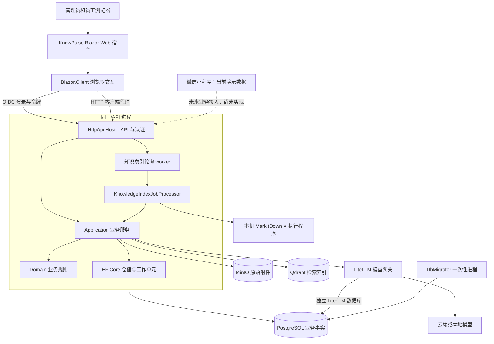
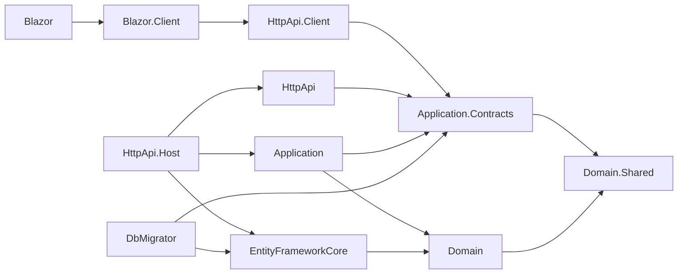
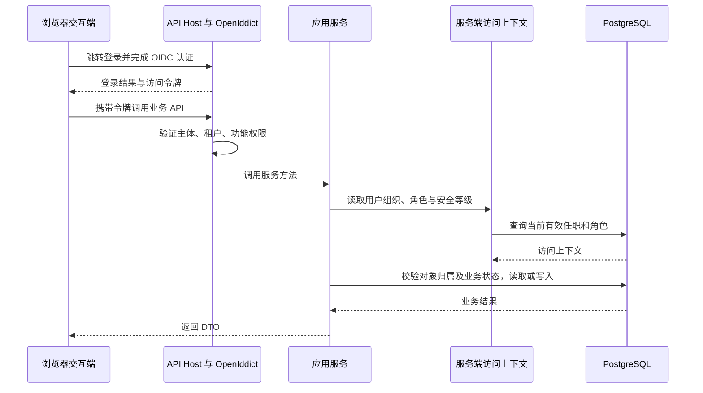
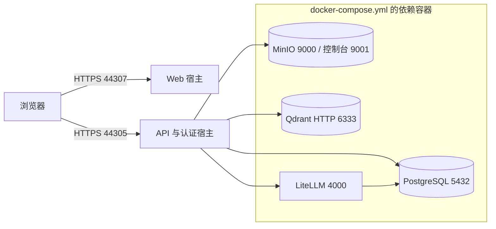

# 系统架构与运行边界

[返回导读](README.md)

## 运行架构

Web 宿主和 API 宿主分别启动。业务服务、索引 worker 和认证服务在 API 宿主内；业务领域没有拆成微服务。小程序虚线表示后续接入方向。

Web 当前使用 `AddInteractiveWebAssemblyComponents` 与 `AddInteractiveWebAssemblyRenderMode`。旧 README 的“Blazor Server”表述不足以准确说明当前渲染方式；不能把 `Blazor.Client` 当成单独的业务后端。

## 编译依赖

箭头表示 `.csproj` 的项目引用，方向为“依赖方 → 被依赖方”，不是 HTTP 调用方向。图中不展开 ABP NuGet 内部依赖。

运行时由 API Host 组合 Application、EntityFrameworkCore 和 HttpApi。Domain 不引用 Application；EF 仓储由宿主注入。HTTP API 同时存在显式控制器和 ABP 自动生成的约定控制器，因此“没有手写 Controller”不等于“没有公开接口”。

## 一次登录与业务请求

认证回答“你是谁”；ABP 功能权限回答“能否操作这个功能”；知识可见范围与考试/路径分配回答“能否访问这个对象”。菜单隐藏只改善界面体验，服务端校验才是权限边界。

## 外部依赖与故障影响

| 依赖 | 数据职责 | 不可用时影响 |
| --- | --- | --- |
| PostgreSQL | 用户、组织、知识版本、索引任务、分块、题库、考试、学习与审计 | 大部分业务读写和认证受影响 |
| MinIO | 版本附件 Blob；元数据保存在 PostgreSQL | 上传、下载、附件解析失败；纯正文不依赖附件读取 |
| Qdrant | 向量与权限快照，用于候选召回 | 索引失败；检索失败时问答返回保守结果并记录阶段 |
| LiteLLM | Chat 与 Embedding 的统一模型入口 | Embedding 失败影响索引/检索；已有授权片段时 Chat 失败可返回带来源的降级回答 |
| MarkItDown | 将配置支持的文档转为 Markdown | 可转换附件在 reader 阶段失败；直接文本读取不经过转换器 |

PostgreSQL 和 MinIO 是备份重点。Qdrant 是可重建索引；模型调用费用、耗时与健康检查需要看应用审计和网关状态。代码中存在费用估算字段，但不能把字段存在视为准确计费已经实现。

## 本地部署边界

Compose 当前只定义依赖服务，未定义 Web/API 应用容器。这里的端口是本地默认值，可由环境变量覆盖；生产入口、HTTPS、证书、secret 注入、备份和反向代理按原有部署手册实施。当前源码与 Compose 没有把 Redis、RabbitMQ、Kafka 或 Hangfire 配置成该业务链路的必需组件；索引队列实际由数据库任务表和进程内 worker 构成。

## 关键证据

- [API Host 组合、认证、审计和 worker 注册](../../src/KnowPulse.HttpApi.Host/KnowPulseHttpApiHostModule.cs)。
- [Web 渲染模式](../../src/KnowPulse.Blazor/KnowPulseBlazorModule.cs)、[浏览器端 OIDC](../../src/KnowPulse.Blazor.Client/KnowPulseBlazorClientModule.cs)。
- [项目引用](../../KnowPulse.slnx)、[HTTP 代理](../../src/KnowPulse.HttpApi.Client/KnowPulseHttpApiClientModule.cs)。
- [基础设施配置](../../docker-compose.yml)、[PostgreSQL 配置](../../src/KnowPulse.EntityFrameworkCore/EntityFrameworkCore/KnowPulseEntityFrameworkCoreModule.cs)。
