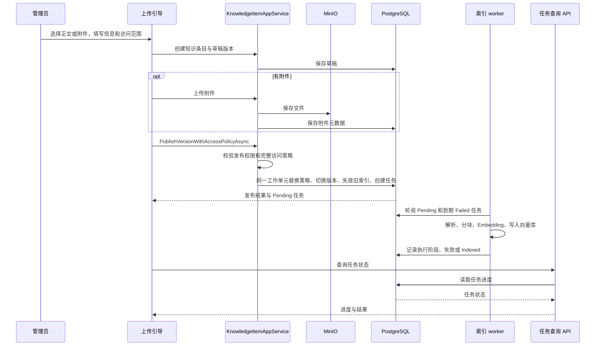
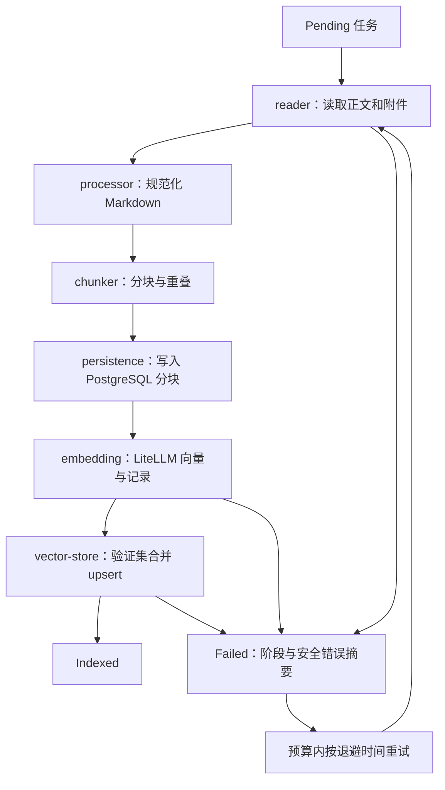
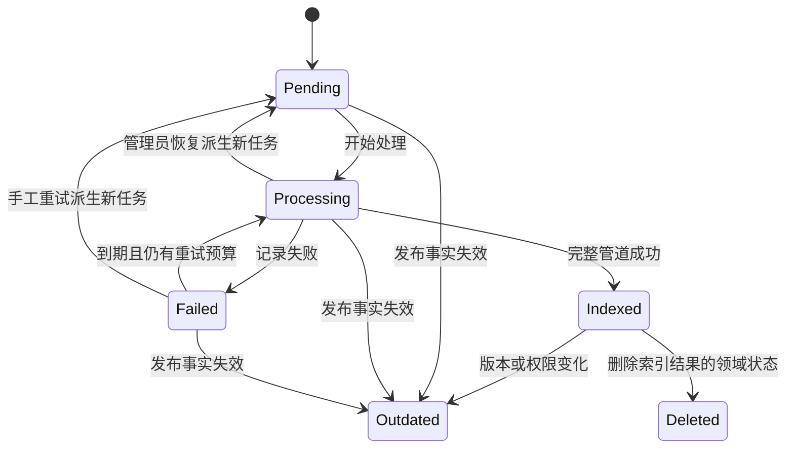
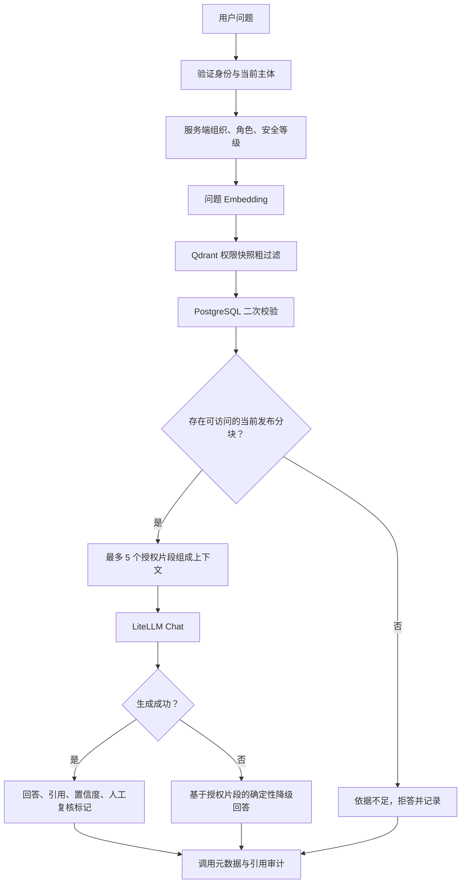
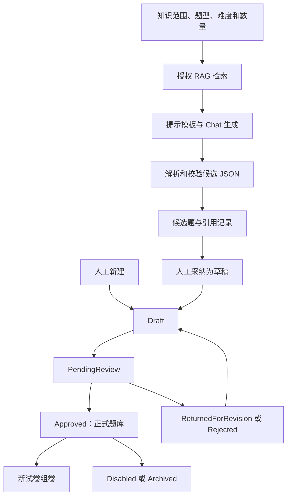
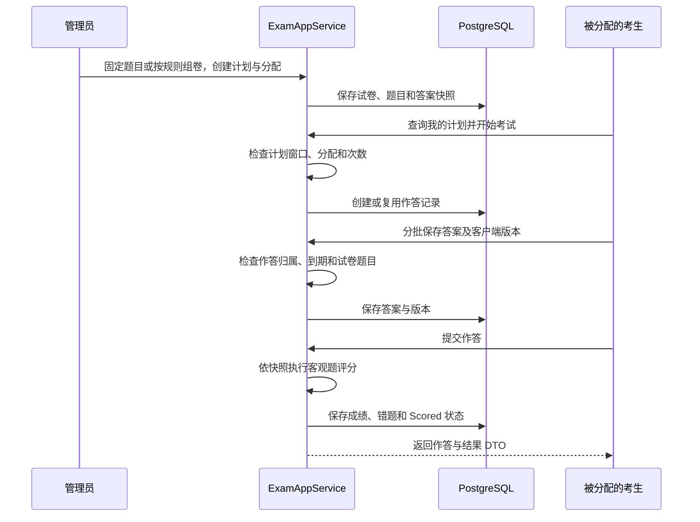
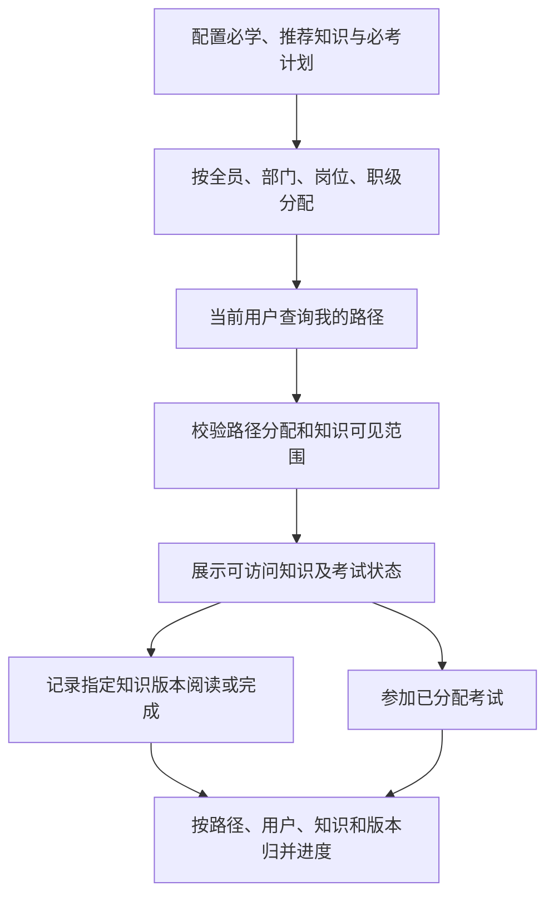
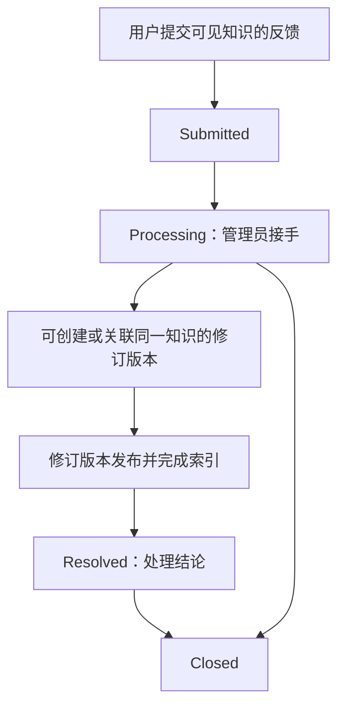

# 核心业务流程

[返回导读](README.md)

## 知识发布与异步索引

界面通过 API 查询任务状态。附件保存早于原子发布，Blob 不参与关系型数据库事务；发布失败后保留可修复草稿。旧 `PublishVersionAsync` 为兼容调用会在空策略时补全员规则，新引导走显式策略入口。

**发布成功**表示版本、访问策略和待执行任务已经保存。**可检索**还需要摄取、Embedding、向量写入全部成功，并通过检索时的状态和权限复核。

源码：[上传引导](../../src/KnowPulse.Blazor.Client/Pages/Knowledge/Upload.razor)、[发布服务](../../src/KnowPulse.Application/KnowledgeBase/KnowledgeItemAppService.cs)、[原子发布 ADR](../adr/0005-atomic-knowledge-publish-with-explicit-access-policy.md)。

## 索引执行与恢复

这是阶段主线，其他阶段异常也会标记失败。当前分块目标为 1,200 字符，重叠 120 字符；这是字符策略，不是语义分块。worker 默认每 5 秒轮询、每批最多 5 项、逐项处理，配置可覆盖。

标有“派生新任务”的边表示 `RetryOfJobId` 来源关系，不是把原记录直接改回 Pending。自动失败重试复用原任务，延迟按指数增长，上限 30 分钟；默认最大重试次数为 3。恢复入口先把原任务记为失败再创建新任务；源码没有据此证明已经中断原执行进程，不能把它当作强制取消能力。

正文和 `.txt/.md/.markdown` 可直接处理；PDF、Office 等依赖启用且可用的 MarkItDown。当前 reader 遇到不支持的附件会让任务失败，**不会自动跳过图片、视频或压缩包**。混合附件需特别检查；“仅附件”不等于后台一定能完成索引。

源码：[worker](../../src/KnowPulse.HttpApi.Host/KnowledgeIndexing/KnowledgeIndexJobBackgroundWorker.cs)、[处理器](../../src/KnowPulse.Application/KnowledgeIndexing/KnowledgeIndexJobProcessor.cs)、[摄取](../../src/KnowPulse.Application/RagAI/KnowledgeIngestionPipeline.cs)、[Embedding](../../src/KnowPulse.Application/RagAI/KnowledgeEmbeddingPipeline.cs)、[任务领域模型](../../src/KnowPulse.Domain/KnowledgeIndexing/KnowledgeIndexJob.cs)。

## 权限感知问答

二次校验同时检查租户、条目有效性、当前发布版本、分块快照和实时知识权限。向量库中的旧权限快照不能覆盖主库事实。检索/Embedding 故障时返回保守结果；Chat 故障且已有授权片段时可降级展示依据。

引用保留知识、版本、分块标识；审计保留问题 hash、受限摘要和引用 metadata，不保存完整 prompt 或完整文档。置信度来自检索分数计算，不是模型正确率保证。

源码：[检索](../../src/KnowPulse.Application/RagAI/KnowledgeRetriever.cs)、[回答](../../src/KnowPulse.Application/RagAI/RagAnswerService.cs)、[审计写入](../../src/KnowPulse.Application/RagAI/RagCallLogWriter.cs)。

## AI 出题与人工审核

AI 出题任务当前在创建请求内同步执行；任务实体和“索引后台 worker”是两种实现，不能混为一谈。没有授权上下文时任务失败，不让模型凭空生成。兼容接口 `SubmitCandidateForReviewAsync` 当前只采纳为草稿，不自动送审。题目停用/修订影响新组卷，已生成试卷使用快照。

源码：[生成任务](../../src/KnowPulse.Application/AiQuestioning/AiQuestionGenerationAppService.cs)、[题库工作流](../../src/KnowPulse.Application/QuestionBank/QuestionAppService.cs)、[题目领域规则](../../src/KnowPulse.Domain/QuestionBank/Question.cs)。

## 考试与评分

评分支持精确匹配及配置的多选部分得分；它不依赖当前题库答案被后来修改。最后一条返回映射当前存在答案披露和结果可见性问题，见[审计第 1 项](06-audit.md#1-考生响应直接包含标准答案和解析)。过期作答也不等于已实现后台自动交卷，见第 2 项。

源码：[考试应用服务](../../src/KnowPulse.Application/Exam/ExamAppService.cs)、[作答领域模型](../../src/KnowPulse.Domain/Exam/ExamAttempt.cs)、[答题页面](../../src/KnowPulse.Blazor.Client/Pages/Exam/Take.razor)。

## 学习路径

学习路径分配不授予知识访问权，也不替代考试分配。阅读记录绑定具体版本；路径关联版本与当前发布版本变化的行为应查看 `TryMapKnowledgeAsync`，不要假设版本更新自动继承完成状态。

源码：[学习服务](../../src/KnowPulse.Application/Learning/LearningPathAppService.cs)、[个人 API](../../src/KnowPulse.HttpApi/Controllers/Learning/LearningPathsController.cs)、[个人页面](../../src/KnowPulse.Blazor.Client/Pages/Learning/MyLearning.razor)。

## 知识反馈闭环

图展示常见处理主线，具体关闭条件以领域方法为准。标记 Resolved 前必须关联同一知识下的当前发布版本，且该版本最新索引任务为 Indexed。创建修订会复制来源正文，但不会自动复制附件，也不替代发布和索引。小程序的反馈表单目前没有真实持久化。

源码：[反馈服务](../../src/KnowPulse.Application/KnowledgeBase/KnowledgeFeedbackAppService.cs)、[反馈领域模型](../../src/KnowPulse.Domain/KnowledgeBase/KnowledgeFeedback.cs)。
