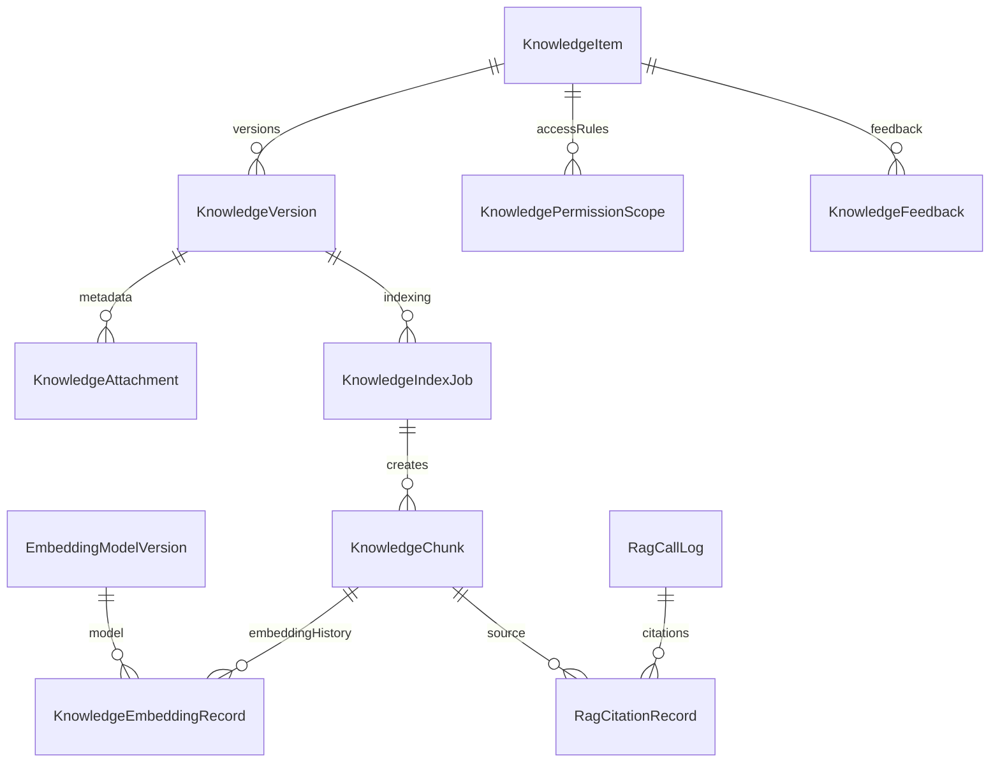
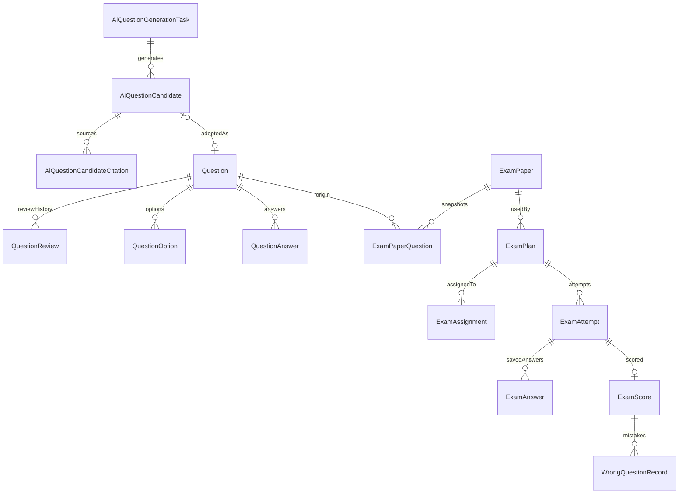
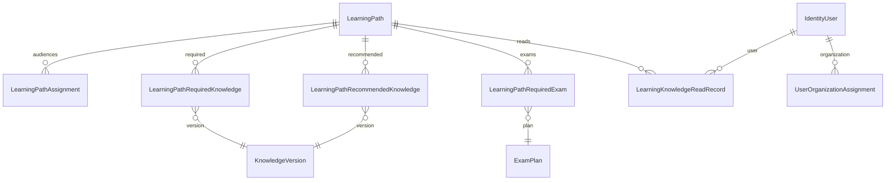
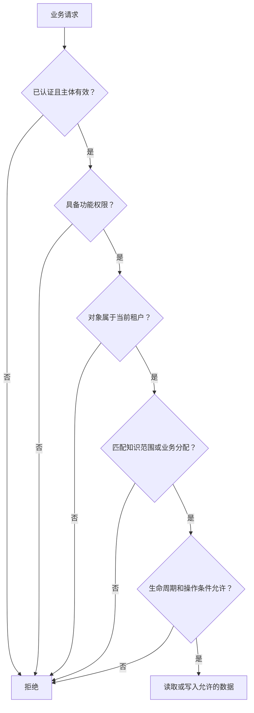

# 数据模型与权限边界

[返回导读](README.md)

## 存储职责

| 存储 | 保存什么 | 恢复方式 |
| --- | --- | --- |
| PostgreSQL 业务库 | ABP 用户/角色/租户、业务实体、任务、分块、审计、学习和考试事实 | 数据库备份与迁移；不可由向量库还原 |
| MinIO | 原始附件 Blob，按业务归属命名 | 对象备份，和附件元数据一起恢复 |
| Qdrant | 检索向量、版本与权限快照 | 从 PostgreSQL 分块、模型版本及附件重新生成 |
| LiteLLM 数据库 | 网关管理数据，逻辑上与 KnowPulse 业务库分开 | 按网关数据库单独管理 |
| 小程序 `globalData` | 演示阅读标识和模拟成绩 | 进程内状态，重启即重置，不是员工业务记录 |

## 知识与 RAG 数据关系

以下 ER 图表达代码中的**逻辑关联**。连线不等于数据库一定创建了外键，也不展开所有 ABP 审计字段。

`KnowledgeItem.CurrentPublishedVersionId` 指向当前版本；版本自身还有 `IsCurrentPublished`。同一知识当前版本的过滤唯一索引是数据库兜底。每次重建会使旧分块失效，保留历史引用所需事实。

向量 payload 是权限和版本的快照，索引成功后仍可能因权限收窄或版本下架变旧。对外返回内容前必须重新读取 PostgreSQL；仅凭 Qdrant 返回不能判断访问授权。

## 题库、试卷与作答

题目答案和解析会复制进 `ExamPaperQuestion`，避免后续题库编辑改变历史考试。重要唯一约束包括：计划/用户/作答序号、作答/试卷题目、作答对应成绩。幂等字段用于处理重复保存/提交；并发正确性仍需服务和真实数据库共同验证。

## 学习路径与进度

阅读记录唯一键包含路径、用户、知识条目和版本；它不是一个全局的“已读知识 ID 列表”。组织任职提供部门、岗位、职级及安全等级，但不同业务的分配维度并不完全相同。

## 权限由四层共同决定

这是应阅读的检查层次；不同服务的具体代码顺序可能不同。客户端提交的 UserId、TenantId 或筛选条件不能充当授权事实。

| 规则 | 服务端依据 | 关键位置 |
| --- | --- | --- |
| 功能权限 | `KnowPulsePermissions` 和 ABP 授权 | Contracts/Permissions、应用服务权限检查 |
| 租户隔离 | `ICurrentTenant`、`IMultiTenant` 与 ABP 数据过滤 | 多租户已启用；宿主数据 TenantId 为空 |
| 知识范围 | All、Department、Position、Role、User | `KnowledgeAccessEvaluator` |
| 安全等级 | 有效任职中的最高等级对比每条规则最低等级 | `KnowledgeAccessContextProvider` |
| 路径分配 | 全员、部门、岗位、职级 | `LearningPathAppService.IsAssignedAsync` |
| 考试分配和作答归属 | 计划分配 + 当前用户 + 作答所有者；空分配按全员兼容 | `ExamAppService.IsAssignedAsync`、`EnsureAttemptOwner` |

知识范围是“命中任一启用规则即允许”；安全等级是每条规则的前置条件。历史知识没有启用规则时仍按默认可见兼容；新显式发布策略要求全员一条或定向多条，禁止全员与定向混合。因此迁移旧知识时需识别空范围，不能假设空范围等于禁止访问。

索引 worker 会在查询候选任务时关闭租户过滤，再切换到每项任务的 TenantId 执行。这是后台跨租户调度机制，不能照搬到面向用户的查询接口。

## 一致性与信任边界

| 操作 | 当前边界 | 理解重点 |
| --- | --- | --- |
| 显式发布 | 一个关系型工作单元：策略、版本、旧索引失效、新任务 | 发布成功不代表向量已生成 |
| 附件上传/删除 | 对象存储和数据库是两种存储 | 不存在自动跨存储事务；失败补偿需单独设计 |
| 后台索引 | 外部模型和 Qdrant 调用 + 数据库事实 | 阶段失败、进程中断、重复执行和重建必须分别分析 |
| 检索返回 | Qdrant 粗过滤 + PostgreSQL 实时复核 | 最终授权以业务主库为准 |
| 考试结果 | 试卷答案快照 + 作答/成绩 DTO | 当前映射缺少考生答案裁剪和结果可见性控制，见审计 |
| AI 输入输出 | 用户问题、附件和模型输出都是外部内容 | 来源引用和结构校验不能等同于内容正确性保证 |

测试库使用 `AddAlwaysDisableUnitOfWorkTransaction()`，测试基类默认 `AddAlwaysAllowAuthorization()`；纯领域权限矩阵测试与应用集成测试的含义不同。现有测试通过不能证明真实令牌/角色授权、生产 PostgreSQL 事务提交、锁竞争和崩溃恢复都已正确。

证据：[DbContext 映射与索引](../../src/KnowPulse.EntityFrameworkCore/EntityFrameworkCore/KnowPulseDbContext.cs)、[知识判定器](../../src/KnowPulse.Domain/KnowledgeBase/KnowledgeAccessEvaluator.cs)、[访问上下文](../../src/KnowPulse.Application/KnowledgeBase/KnowledgeAccessContextProvider.cs)、[测试模块](../../test/KnowPulse.EntityFrameworkCore.Tests/EntityFrameworkCore/KnowPulseEntityFrameworkCoreTestModule.cs)。
