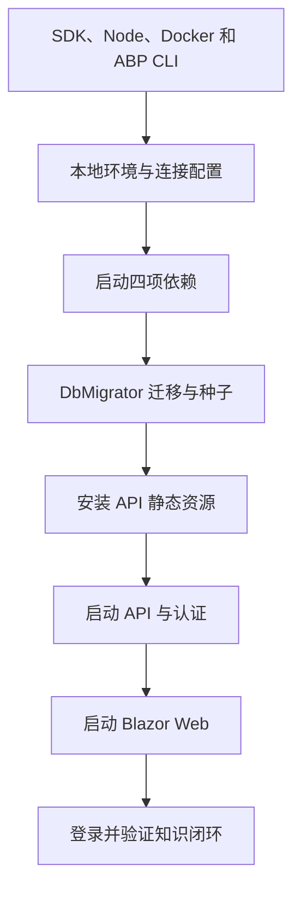

# 本地开发与源码阅读路线

[返回导读](README.md)

## 启动顺序



`global.json` 请求 10.0.301 并允许 `latestFeature` 滚动；本次实际使用 SDK 10.0.402。Node 要求 20.11+。复制配置前先检查是否已有本地 `.env`，避免覆盖个人配置；真实密钥不要提交。

以下命令从**后端仓库 `KnowPulse/`**执行：

```powershell
# 首次配置时执行；已有 .env 时不要重复覆盖
Copy-Item .env.example .env

# 依赖启动、健康检查、数据库迁移与种子初始化
.\ops\start-local.ps1

# 还原与构建
dotnet restore KnowPulse.slnx
dotnet build KnowPulse.slnx --no-restore

# 首次安装 API 登录和 Swagger 所需静态库
Push-Location src/KnowPulse.HttpApi.Host
abp install-libs
Pop-Location

# 终端一
dotnet run --project src/KnowPulse.HttpApi.Host

# 终端二
dotnet run --project src/KnowPulse.Blazor
```

| 本地入口 | 默认地址 |
| --- | --- |
| API / Swagger / 登录宿主 | `https://localhost:44305` |
| Web 应用 | `https://localhost:44307` |
| MinIO 控制台 | `http://localhost:9001` |
| LiteLLM | `http://localhost:4000` |

需要手工迁移时运行 `dotnet run --project src/KnowPulse.DbMigrator`；确认连接配置指向目标本地库。启动脚本会处理迁移使用的连接配置和客户端 URL，手工操作前参照[开发环境](../development-environment.md)。文档中的运行命令是操作入口，本次没有启动或改动你的数据库服务。

## 自动化验证入口

```powershell
# 后端仓库；串行构建参数用于减少构建争用
dotnet test KnowPulse.slnx --no-restore -m:1 -p:UseSharedCompilation=false -p:BuildInParallel=false -nr:false

# 定向验证，例如知识授权检索
dotnet test test/KnowPulse.EntityFrameworkCore.Tests/KnowPulse.EntityFrameworkCore.Tests.csproj --no-restore --filter "FullyQualifiedName~Mvp1KnowledgeRetrieverTests"

# 小程序仓库 KnowPulse.MiniProgram/ 中执行
npm test
```

### 2026-10-19 本次结果

| 检查 | 结果 | 能说明什么 |
| --- | --- | --- |
| Domain.Tests | 66 通过 | 当前领域规则测试通过 |
| Application.Tests | 18 通过 | 当前 API 契约及适配器格式测试通过 |
| EntityFrameworkCore.Tests | 82 通过 | SQLite + 替身环境中的应用集成测试通过 |
| TestBase | 未发现用例 | 测试基础设施项目，不计入通过数量 |
| 小程序 `npm test` | 8 通过 | 资源、搜索、阅读、问答提示和模拟测验逻辑通过 |
| `ops/verify-rag-provider-boundaries.ps1` | 失败 | MarkItDown 依赖与旧扫描规则冲突，详见审计第 6 项 |

`.NET test` 退出码为 0，总计 166 项通过；没有据此宣称 Web/API 发布构建、真实外部服务或端到端登录已经验证。

其他现有脚本按目的选择，不要把它们全部当作无副作用静态检查：

| 脚本 | 用途与前置条件 |
| --- | --- |
| `ops/health-check.ps1` | 检查已运行的依赖 |
| `ops/verify-private-deployment-baseline.ps1` | 部署配置基线；本次未执行 |
| `ops/verify-qdrant-knowledge-collection.ps1 -Ensure` | 显式创建或补齐集合，**会写入 Qdrant** |
| `ops/verify-mvp0-runtime.ps1` | 登录后执行真实业务读写，**会写入开发数据库和对象存储** |
| `ops/seed-demo-data.ps1` | 创建或复用演示业务数据 |
| `ops/verify-mvp1.ps1`、`verify-mvp2.ps1`、`verify-mvp3.ps1` | 阶段回归入口；先读参数和依赖要求 |

## 关键页面和 HTTP 入口

| 能力 | 页面 | 服务或显式 API |
| --- | --- | --- |
| 知识管理 | `/knowledge`、`/knowledge/{Id}`、`/knowledge/upload` | `IKnowledgeManagementAppService`、`IKnowledgeItemAppService` |
| 索引运维 | `/knowledge/index-jobs` | `/api/knowledge/index-jobs`、版本重建/任务执行/恢复 |
| 问答 | `/rag/answer` | `POST /api/ai/rag/answer`、`POST /api/ai/rag/search` |
| 模型目录 | `/rag/models` | `/api/ai/models` |
| AI 出题 | `/question-bank/ai-candidates` | `/api/question-bank/ai-generation` |
| 题库审核 | `/question-bank/drafts`、`/question-bank/reviews`、`/question-bank/formal` | `/api/question-bank/questions` 与 `IQuestionWorkflowAppService` |
| 考试 | `/exam/management`、`/exam/take` | `IExamAppService` 的约定 API；具体路径查 Swagger |
| 个人学习 | `/learning/my` | `GET /api/learning/paths/my`、`POST /api/learning/paths/my/knowledge-read` |
| 反馈 | `/knowledge/feedback` | `/api/knowledge/feedback` |
| RAG 评测 | 应用服务/API 入口 | `/api/ai/rag/evaluations`；不据此声称已有独立页面 |

表中 API 前缀未注明方法的，代表接口族。ABP 还会生成约定接口；联调应以运行宿主的 Swagger 和 Contracts 为准，不从方法名猜路由。

## 按问题阅读源码

| 用时 | 阅读路线 | 应能回答的问题 |
| --- | --- | --- |
| 5 分钟 | 本目录 README → 系统架构运行图 | 哪些东西在运行，事实数据在哪里 |
| 30 分钟 | 目录图 → 知识发布与 RAG → 数据权限 | 知识何时可用，谁可以看到 |
| 1 小时 | `KnowledgeItemAppService` → worker → Processor → Ingestion/Embedding → Retriever → AnswerService | 从一次上传追到一次回答 |
| 另 30 分钟 | `QuestionAppService` → `ExamAppService` → `LearningPathAppService` | 人工审核、试卷快照和个人进度如何连起来 |
| 接手维护前 | 相关测试 → ADR → 审计附录 → 部署手册 | 已有保证、已知缺口和环境边界 |

查找示例：在后端仓库运行 `rg -n "PublishVersionWithAccessPolicyAsync" src test`，先找到契约、实现、UI 和测试，再修改共享规则。

## 小程序单独运行

将 `KnowPulse.MiniProgram/` 导入微信开发者工具，按其 README 使用有项目权限的微信账号。无需 npm 运行依赖或“构建 npm”。`globalData` 只用于当前演示进程；接入账号、问答、学习和考试后，要以服务端事实替代这些状态。

原[设计验收](../../../KnowPulse.MiniProgram/design-qa.md)记录完整交卷弹窗仍待运行时验证；本次 Node 测试通过没有关闭这项验收。AppSecret 只能放在服务端，小程序接入还需合法请求域名和企业账号绑定。
