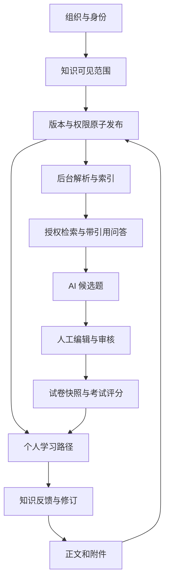

# KnowPulse 项目导读

KnowPulse 把企业知识发布、权限感知问答、人工审题、考试和个人学习连成一个闭环。管理与业务主系统是 ABP 分层单体；同级微信小程序目前是独立交互原型，尚未接入真实业务。

基准：2026-10-19，后端提交 `31c5e6f`。本目录描述当前代码；早期 MVP 文档保留各自阶段语境。

## 从哪里开始

| 你想了解什么 | 阅读入口 | 主要图表 |
| --- | --- | --- |
| 先看整体，再按需深入 | [离线图文总览](overview.html) | 全部图表、章节导航、关键词查找 |
| 代码放在哪里，16 个项目各做什么 | [解决方案目录](01-solution-map.md) | 目录树、项目职责、模块速查表 |
| 哪些进程和服务在运行 | [系统架构](02-system-architecture.md) | 部署关系、项目依赖、认证时序 |
| 一份知识如何变成问答、题目和学习任务 | [核心业务流程](03-business-flows.md) | 发布时序、索引状态、问答、审题、考试、学习、反馈 |
| 数据属于谁，权限在哪里生效 | [数据与权限](04-data-and-permissions.md) | 业务关系图、权限决策图、一致性边界 |
| 怎样启动、验证、顺着源码阅读 | [开发与阅读路线](05-development-and-reading.md) | 启动顺序、路由表、测试结果、改动定位 |
| 接手后优先解决什么 | [代码审计附录](06-audit.md) | 按影响排序的问题、证据与最小修复方向 |

## 五分钟记住这张图

图中表示业务关系，不表示每个箭头都是一次 HTTP 调用。学习路径关联知识版本和考试计划；AI 生成结果先进入候选区，人工审核通过后才可组卷。

## 当前能力与边界

| 范围 | 当前实现 | 不能据此推断的能力 |
| --- | --- | --- |
| Web 主系统 | .NET 10、ABP 10.6、MudBlazor 与 LeptonX Lite、OIDC 登录 | 已完成所有生产部署和容量验收 |
| 知识与 RAG | 版本、附件、显式权限、索引 worker、LiteLLM、Qdrant、引用与审计 | 所有文件均能检索，或索引与发布同步完成 |
| 题库与考试 | 草稿审核、AI 候选、试卷快照、客观题评分、错题记录 | 主观题 AI 评分已经接通；`SubjectiveScoring` 目前只是用途定义 |
| 学习与运营 | 分配路径、阅读完成、考试状态、反馈、RAG 评测 | 完整 BI 或数据仓库 |
| 微信小程序 | 7 个页面、3 个共享组件、5 个导航入口、演示问答和测验 | 微信登录、企业绑定、真实 AI、学习记录和正式成绩写入 |

## 规模快照与验证

解决方案包含 **11 个源码项目、5 个测试及测试辅助项目**；有 27 个声明路由的业务 Razor 文件、34 个 `*Tests.cs` 文件、15 个 EF 迁移。数量不含生成文件；测试辅助项目不等于独立测试套件。

本次执行：.NET 测试 **166/166** 通过，小程序测试 **8/8** 通过。测试结果不覆盖真实模型效果、生产 PostgreSQL 事务行为、浏览器和微信真机；RAG 依赖检查脚本存在已确认的规则冲突，详见审计附录。

## 原有文档如何使用

- 操作步骤：[用户操作手册](../user-operation-guide.md)。
- 环境与部署：[开发环境](../development-environment.md)、[私有化基线](../private-deployment-baseline.md)、[Linux 部署](../production-deployment-guide.md)、[Windows 部署](../windows-production-deployment-guide.md)。
- 业务词汇和已采纳决策：[CONTEXT](../../CONTEXT.md)、[ADR](../adr/)。
- 历史规划：[模块边界](../module-boundaries.md)、[系统架构规划](../system-architecture.md)、[技术架构规划](../technical-architecture.md)。其中的占位状态、技术候选和阶段目标不能直接视为当前实现。
- 小程序：[README](../../../KnowPulse.MiniProgram/README.md)、[设计与运行验收](../../../KnowPulse.MiniProgram/design-qa.md)。跨仓库链接依赖两个仓库在本地保持同级目录；单独浏览后端远程仓库时不可用。

图表的可编辑源保存在 Markdown 的 Mermaid 代码块中；`overview.html` 是对应的离线阅读副本。宽图可横向滚动或打开 SVG 原图；修改 Mermaid 后需重新渲染 SVG 和总览，静态副本不会自动同步。
