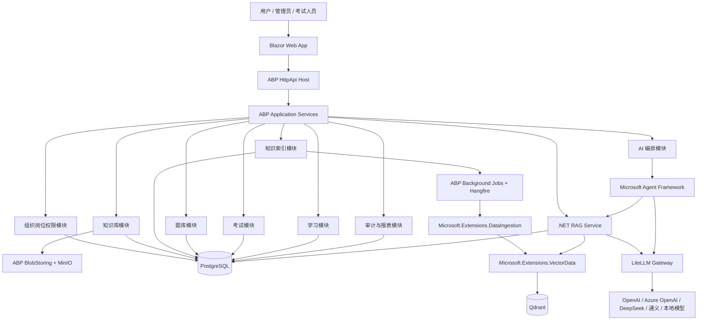
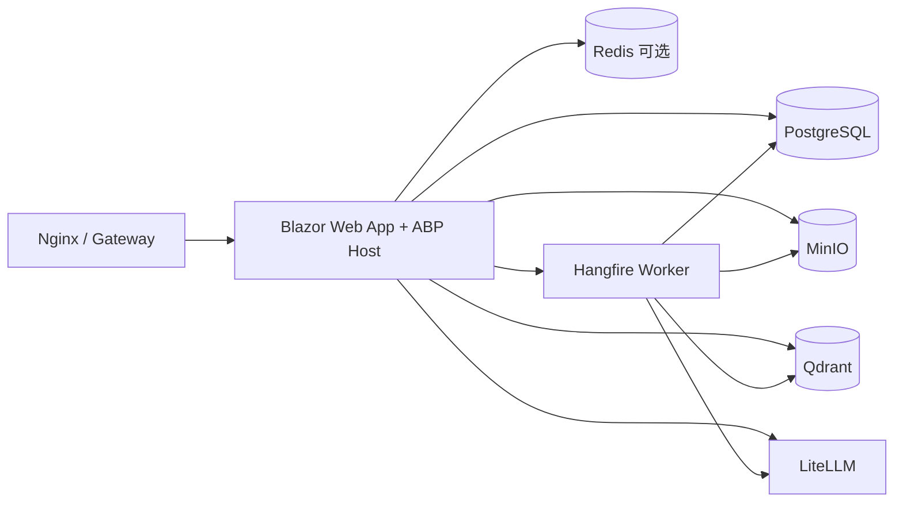

# KnowPulse 企业知识库与考试系统系统架构方案

版本：v1.0  
日期：2026-06-24  
状态：方案稿  

## 1. 架构假设

本文档基于以下假设设计。后续如果假设变化，需要同步调整技术选型、实施计划和成本评估。

### 1.1 业务假设

- KnowPulse 的核心目标不是单纯建设 AI 聊天工具，而是建设企业知识库、岗位学习、AI 问答、AI 出题、题库审核、在线考试、评分和学习闭环的一体化平台。
- 知识内容具有部门、岗位、角色、人员和安全等级差异，必须支持权限化检索。
- AI 生成内容不能直接成为正式业务资产。AI 生成题目、摘要、标签、适用岗位和主观题评分都需要人工审核或人工复核机制。
- 第一阶段优先支持企业内部私有化部署，未来可扩展到多租户 SaaS。
- 初始用户规模按中小企业到集团内部系统估算：数百到数千用户，知识文档从数千到数万份起步。
- 考试高峰会出现短时间并发，但不是全年持续高并发系统。

### 1.2 技术假设

- 主技术栈采用 .NET：ABP Framework + ASP.NET Core + Blazor Web App。
- MVP 默认采用 Blazor Web App 作为主前端，Vue 只作为后续独立考试端或复杂交互端的备选。
- PostgreSQL 是业务事实库；Qdrant 是向量索引库；MinIO 是文件存储；LiteLLM 是模型网关。
- RAG 不引入完整外部平台接管业务链路，采用自研 .NET RAG Service，并复用 Microsoft.Extensions.DataIngestion、Microsoft.Extensions.VectorData.Abstractions 和 Microsoft.Extensions.AI。
- Microsoft.Extensions.DataIngestion 与 Qdrant VectorData provider 目前按 preview 风险管理，必须通过项目内接口隔离。
- MVP 暂不引入 RabbitMQ 和微服务拆分，后台任务使用 ABP Background Jobs + Hangfire。

### 1.3 非目标

- 第一阶段不建设完整 BI 平台。
- 第一阶段不做大规模 OCR、视频知识解析和复杂防作弊。
- 第一阶段不把 Agent 变成可自主改业务数据的执行者。
- 第一阶段不同时维护 Blazor、Vue、React 多套主前端。

## 2. 业务目标

### 2.1 核心目标

1. 沉淀企业制度、流程、培训材料、岗位知识和经验文档。
2. 按租户、部门、岗位、角色、用户和安全等级控制知识访问。
3. 基于企业知识库提供带引用来源的 AI 问答。
4. 基于知识点、岗位、难度和题型生成候选题。
5. AI 生成题目必须经过人工审核后进入正式题库。
6. 支持岗位考试、在线答题、客观题自动评分、成绩和错题记录。
7. 形成知识质量、题库质量、学习效果和考试结果的闭环分析。

### 2.2 业务成功标准

- 用户可以上传、发布、下架、归档知识文档。
- 不同权限用户只能看到和检索自己有权访问的知识。
- AI 问答必须返回引用来源；无依据时必须拒答或说明知识库依据不足。
- AI 题目不能绕过审核直接进入正式考试。
- 已开始考试的试卷不受题库后续修改影响。
- 所有关键动作可审计、可追溯、可回滚或可复核。

## 3. 总体架构

### 3.1 架构风格

采用“模块化单体优先，关键基础设施独立部署，后续按压力拆分”的架构。

理由：

- 当前业务仍处于 MVP 到产品化早期，模块化单体比微服务更容易保持事务一致性和开发效率。
- ABP Framework 适合以 DDD 和模块化方式组织业务边界。
- RAG、文档索引、模型调用和考试高峰是潜在扩展点，先通过接口隔离和后台任务预留拆分空间。

### 3.2 总体架构图



### 3.3 核心原则

- PostgreSQL 是业务事实库，Qdrant 只是检索索引库。
- RAG 检索必须做 Qdrant payload filter 前置过滤和 PostgreSQL 二次权限校验。
- Agent 不直接访问 PostgreSQL、Qdrant、MinIO，只能调用封装后的业务工具。
- AI 输出不直接改变正式业务状态，必须进入审核、复核或建议流程。
- preview 或 provider 依赖必须通过项目内接口隔离，避免污染业务代码。

## 4. 系统模块设计

### 4.1 Identity 与权限模块

职责：

- 用户、角色、权限、租户。
- 登录认证、菜单权限、操作权限。
- 与部门、岗位、安全等级关联。

设计理由：

- 使用 ABP 自带 Identity、Permission、Multi-Tenancy 能力可以减少基础设施自研。
- 知识访问控制不仅是 RBAC，还需要部门、岗位、用户、安全等级等 ABAC 属性，因此业务权限范围要单独建模。

### 4.2 Organization 模块

职责：

- 公司、部门、岗位、职级。
- 岗位能力模型。
- 岗位与知识点、考试要求的映射。

核心实体：

- `Department`
- `Position`
- `JobLevel`
- `PositionCompetency`
- `PositionKnowledgeRequirement`
- `PositionExamRequirement`

### 4.3 KnowledgeBase 模块

职责：

- 知识分类、标签、文档、附件。
- 知识版本、发布、下架、归档。
- 知识权限范围。
- 反馈、纠错、阅读记录。

核心实体：

- `KnowledgeItem`
- `KnowledgeVersion`
- `KnowledgeAttachment`
- `KnowledgePermissionScope`
- `KnowledgeTag`
- `KnowledgeFeedback`
- `KnowledgeReadRecord`

关键规则：

- 只有 `Published` 状态的知识版本可进入检索。
- 权限范围变更必须触发索引 payload 更新或索引失效。
- 原文件保存在 MinIO，业务元数据保存在 PostgreSQL。

### 4.4 KnowledgeIndexing 模块

职责：

- 创建和执行索引任务。
- 调用 Microsoft.Extensions.DataIngestion 读取、清洗、Markdown 化、分块。
- 调用 Microsoft.Extensions.AI 生成 embedding。
- 通过 Microsoft.Extensions.VectorData.Abstractions 写入 Qdrant。
- 记录索引状态、失败原因、重试次数和 pipeline 版本。

核心实体：

- `KnowledgeIndexJob`
- `KnowledgeChunk`
- `KnowledgeEmbeddingRecord`
- `EmbeddingModelVersion`
- `IndexRebuildTask`

设计理由：

- 文档摄取链路容易失败，必须异步化、可重试、可观测。
- DataIngestion 能减少自研底层样板代码，但处理结果必须写回业务表，方便审计和重建。

### 4.5 RagService 模块

职责：

- 根据当前用户上下文生成检索过滤条件。
- 通过 `IKnowledgeVectorStore` 查询 Qdrant。
- 对召回 chunk 做 PostgreSQL 二次权限校验。
- 拼装 prompt context。
- 调用 LiteLLM / Microsoft.Extensions.AI 生成回答。
- 返回答案、引用、置信度和是否需要人工处理。
- 写入 RAG 调用日志和评测数据。

关键接口：

```csharp
public interface IKnowledgeIngestionPipeline
{
    Task<KnowledgeIngestionResult> IngestAsync(Guid knowledgeVersionId, CancellationToken cancellationToken = default);
}

public interface IKnowledgeVectorStore
{
    Task UpsertChunksAsync(IReadOnlyList<KnowledgeChunkVectorRecord> chunks, CancellationToken cancellationToken = default);
    Task<IReadOnlyList<VectorSearchHit>> SearchAsync(KnowledgeVectorSearchRequest request, CancellationToken cancellationToken = default);
    Task DeleteByKnowledgeVersionAsync(Guid knowledgeVersionId, CancellationToken cancellationToken = default);
}

public interface IKnowledgeRetriever
{
    Task<IReadOnlyList<RetrievedChunk>> SearchAsync(RagSearchRequest request, CancellationToken cancellationToken = default);
}

public interface IRagAnswerService
{
    Task<RagAnswerResult> AnswerAsync(RagAnswerRequest request, CancellationToken cancellationToken = default);
}
```

设计理由：

- DataIngestion 和 VectorData 解决底层处理与向量访问问题，但不解决企业权限、引用、审计和知识版本治理。
- 自研 RAG Service 是业务安全边界，不能省略。

### 4.6 QuestionBank 模块

职责：

- 题库、题目、选项、答案、解析、知识点、难度。
- AI 候选题管理。
- 题目审核。
- 相似题检测。

核心实体：

- `Question`
- `QuestionOption`
- `QuestionAnswer`
- `QuestionAnalysis`
- `QuestionKnowledgePoint`
- `QuestionReview`
- `QuestionSource`
- `QuestionSimilarityCheck`

关键规则：

- AI 生成题默认进入 `AiGeneratedDraft` 或 `PendingReview`。
- 未审核通过题目不能进入正式试卷。
- 题目进入考试后需要保留快照，避免后续修改影响历史考试。

### 4.7 Exam 模块

职责：

- 考试计划。
- 试卷与组卷策略。
- 考试分配。
- 在线答题。
- 自动评分。
- 成绩、补考、错题。

核心实体：

- `ExamPlan`
- `ExamPaper`
- `ExamPaperQuestion`
- `ExamAssignment`
- `ExamAttempt`
- `ExamAnswer`
- `ExamScore`
- `WrongQuestionRecord`

关键规则：

- 开考后试卷内容不可变。
- 答题过程需要自动保存，不能只保存在 Blazor circuit 内存中。
- 客观题规则评分，主观题 AI 只做初评，低置信度或争议结果进入人工复核。

### 4.8 Learning 模块

职责：

- 岗位学习路径。
- 必学知识。
- 学习进度。
- 错题复习。
- 薄弱知识点推荐。

### 4.9 AiOrchestration 模块

职责：

- AI 问答工作流。
- AI 出题工作流。
- AI 主观题初评工作流。
- 知识摘要、标签、分类建议。
- Prompt 模板与版本管理。
- 模型调用日志。

设计理由：

- AI 能力需要被版本化和审计，不能散落在普通应用服务中。
- Agent Framework 只在需要多步骤编排、人审节点或工具调用审批时启用。

## 5. 技术选型

| 层级 | 选型 | 理由 |
| --- | --- | --- |
| 前端 | Blazor Web App | 团队熟悉 .NET；ABP 对 Blazor 支持较好；后台管理类界面落地快 |
| 备选前端 | Vue 3 + TypeScript | 仅当考试端出现大量客户端状态、弱网、离线需求时单独评估 |
| 后端 | ABP Framework + ASP.NET Core | DDD、模块化、权限、租户、审计、后台任务能力完整 |
| 主库 | PostgreSQL | 作为业务事实库，事务能力和生态成熟 |
| 向量库 | Qdrant | 独立向量检索服务，payload filter 适合权限化检索 |
| 文件存储 | MinIO + ABP BlobStoring | 私有化部署友好，后续可切 S3/Azure Blob |
| RAG 摄取 | Microsoft.Extensions.DataIngestion | .NET 原生文档摄取、chunk、增强、writer pipeline |
| 向量抽象 | Microsoft.Extensions.VectorData.Abstractions | 隔离向量库 provider，降低替换成本 |
| AI Client | Microsoft.Extensions.AI | 统一 Chat、Embedding、telemetry、caching 抽象 |
| 模型网关 | LiteLLM | 模型路由、fallback、限流、成本统计 |
| Agent | Microsoft Agent Framework | 用于 AI 出题、评分、知识解析等多步骤工作流 |
| 后台任务 | ABP Background Jobs + Hangfire | MVP 足够，具备任务可视化与重试 |
| 监控 | OpenTelemetry + Prometheus/Grafana | 覆盖 API、任务、模型调用、检索延迟 |

## 6. 数据库设计

### 6.1 数据库职责

- PostgreSQL：保存所有业务事实、状态、权限、审计和索引任务元数据。
- Qdrant：保存 chunk embedding 和检索 payload。
- MinIO：保存原始文档、导入文件、导出文件。
- LiteLLM：可以保存模型调用统计，但业务审计仍需回写 PostgreSQL。

### 6.2 PostgreSQL 核心表分组

组织权限：

- `Departments`
- `Positions`
- `JobLevels`
- `UserDepartments`
- `UserPositions`
- `PositionCompetencies`

知识库：

- `KnowledgeItems`
- `KnowledgeVersions`
- `KnowledgeAttachments`
- `KnowledgePermissionScopes`
- `KnowledgeTags`
- `KnowledgeFeedbacks`
- `KnowledgeReadRecords`

索引与 RAG：

- `KnowledgeIndexJobs`
- `KnowledgeChunks`
- `KnowledgeEmbeddingRecords`
- `EmbeddingModelVersions`
- `RagConversationLogs`
- `RagAnswerCitations`
- `RagEvaluationCases`
- `RagEvaluationRuns`

题库考试：

- `Questions`
- `QuestionOptions`
- `QuestionAnswers`
- `QuestionReviews`
- `QuestionSources`
- `ExamPlans`
- `ExamPapers`
- `ExamPaperQuestions`
- `ExamAssignments`
- `ExamAttempts`
- `ExamAnswers`
- `ExamScores`
- `WrongQuestionRecords`

AI 编排：

- `AiTasks`
- `AiTaskRuns`
- `PromptTemplates`
- `PromptVersions`
- `ModelInvocationLogs`
- `AgentWorkflowDefinitions`
- `AgentWorkflowRuns`

### 6.3 Qdrant Collection 设计

推荐 collection：

- `knowledge_chunks`
- `question_chunks` 或后续复用题目相似度专用 collection

payload 示例：

```json
{
  "tenantId": "string",
  "knowledgeId": "guid",
  "knowledgeVersionId": "guid",
  "documentId": "guid",
  "chunkId": "guid",
  "categoryId": "guid",
  "tagIds": ["guid"],
  "visibility": "All|Department|Position|Role|User",
  "departmentIds": ["guid"],
  "positionIds": ["guid"],
  "roleIds": ["guid"],
  "userIds": ["guid"],
  "securityLevel": 1,
  "isPublished": true,
  "effectiveFrom": "2026-06-24T00:00:00Z",
  "effectiveTo": null,
  "sourceTitle": "员工手册",
  "sourcePage": 12,
  "embeddingModel": "text-embedding-xxx",
  "embeddingModelVersion": "v1"
}
```

必须建立 payload index：

- `tenantId`
- `isPublished`
- `visibility`
- `departmentIds`
- `positionIds`
- `roleIds`
- `userIds`
- `securityLevel`
- `effectiveFrom`
- `effectiveTo`

### 6.4 索引与一致性策略

- PostgreSQL 先写业务状态，再异步创建索引任务。
- 索引任务成功后更新 `KnowledgeIndexJobs` 和 `KnowledgeEmbeddingRecords`。
- 知识权限收窄时，必须更新 Qdrant payload 或使旧索引失效。
- Embedding 模型维度变化时使用新 collection 或灰度 collection。
- RAG 检索结果必须回 PostgreSQL 二次校验，防止索引滞后导致越权。

## 7. 接口设计

### 7.1 接口风格

- 对外采用 REST API，使用 ABP Application Service 暴露。
- 所有接口通过 OpenAPI 生成文档。
- 分页列表统一使用 `PagedResultDto<T>`。
- 写操作使用 DTO 明确输入，禁止前端直接提交领域实体。
- 错误返回统一使用 ABP 异常和 ProblemDetails 风格。

### 7.2 知识库 API

- `POST /api/knowledge/items`
- `GET /api/knowledge/items`
- `GET /api/knowledge/items/{id}`
- `POST /api/knowledge/items/{id}/versions`
- `POST /api/knowledge/versions/{id}/publish`
- `POST /api/knowledge/versions/{id}/archive`
- `POST /api/knowledge/files/upload`
- `POST /api/knowledge/versions/{id}/permissions`

### 7.3 索引与 RAG API

- `POST /api/knowledge/versions/{id}/reindex`
- `GET /api/knowledge/index-jobs/{id}`
- `POST /api/ai/rag/search`
- `POST /api/ai/rag/answer`
- `GET /api/ai/rag/conversations/{id}`

回答结果示例：

```json
{
  "answer": "根据员工手册第 12 页，试用期请假需要提前提交申请。",
  "citations": [
    {
      "knowledgeId": "guid",
      "knowledgeVersionId": "guid",
      "chunkId": "guid",
      "title": "员工手册",
      "page": 12,
      "quote": "试用期员工请假需提前提交申请。"
    }
  ],
  "confidence": 0.82,
  "needHumanReview": false
}
```

### 7.4 题库 API

- `POST /api/questions`
- `GET /api/questions`
- `GET /api/questions/{id}`
- `PUT /api/questions/{id}`
- `POST /api/questions/{id}/submit-review`
- `POST /api/questions/{id}/approve`
- `POST /api/questions/{id}/reject`

### 7.5 AI 出题 API

- `POST /api/ai/questions/generate`
- `GET /api/ai/questions/generation-tasks/{id}`
- `POST /api/ai/questions/generated/{id}/submit-review`

### 7.6 考试 API

- `POST /api/exams/plans`
- `POST /api/exams/plans/{id}/assign`
- `POST /api/exams/attempts/start`
- `POST /api/exams/attempts/{id}/answers/save`
- `POST /api/exams/attempts/{id}/submit`
- `GET /api/exams/attempts/{id}/score`
- `GET /api/exams/results`

## 8. 关键业务流程

### 8.1 知识发布与索引

```text
上传文件
-> 保存 MinIO
-> 创建 KnowledgeVersion
-> 人工发布
-> 创建 KnowledgeIndexJob
-> Hangfire 执行 DataIngestion pipeline
-> 生成 chunk 和 embedding
-> VectorData 写入 Qdrant
-> 写回索引状态
```

### 8.2 权限化问答

```text
用户提问
-> 获取租户、用户、部门、岗位、角色、安全等级
-> 生成 Qdrant payload filter
-> VectorData/Qdrant 召回候选 chunk
-> PostgreSQL 二次校验知识状态、版本、权限范围
-> 组装上下文和引用
-> 调用模型生成回答
-> 返回答案与引用
-> 写入审计和评测数据
```

### 8.3 AI 出题与审核

```text
管理员选择岗位、知识范围、题型、难度、数量
-> RagService 拉取相关知识片段
-> AI 生成候选题、答案、解析和来源
-> 相似题检测
-> 写入待审核题目
-> 审核通过后进入正式题库
```

### 8.4 在线考试

```text
创建考试计划
-> 按岗位/知识点/题型/难度组卷
-> 分配考试
-> 用户开始考试
-> 自动保存答案
-> 提交试卷
-> 客观题规则评分
-> 生成成绩和错题
-> 必要时主观题进入人工复核
```

## 9. 部署架构

### 9.1 MVP 部署

MVP 建议使用单机或小集群 Docker Compose 部署。

组件：

- Nginx / Gateway
- Blazor Web App / ABP Host
- PostgreSQL
- Qdrant
- MinIO
- LiteLLM
- Hangfire Worker
- Redis，可选
- Prometheus/Grafana，可选



### 9.2 扩展部署

当业务增长后可拆分：

- `KnowPulse.HttpApi.Host`
- `KnowPulse.Blazor`
- `KnowPulse.Indexing.Worker`
- `KnowPulse.AiOrchestration.Worker`
- `KnowPulse.Rag.Api`
- `KnowPulse.Reporting.Worker`

拆分触发条件：

- 文档解析和 embedding 任务影响主 API。
- RAG 检索和模型调用延迟影响普通业务。
- 考试高峰需要独立扩容。
- 大客户需要独立租户隔离或私有部署。

## 10. 性能设计

### 10.1 API 性能

- 所有列表接口分页。
- 高频查询字段建立 PostgreSQL 索引。
- 读多写少的基础数据可使用 Redis 或本地缓存。
- 大文件上传走流式上传，不把文件全部读入内存。

### 10.2 RAG 性能

- 文档解析、embedding 和索引写入全部异步化。
- Qdrant 必须为高频 payload 字段建立索引。
- RAG 查询先向量召回较大 TopK，再二次校验和 rerank。
- prompt context 控制 token 上限，避免无限塞入 chunk。
- embedding 模型和 collection 维度变更必须灰度。

### 10.3 Blazor 性能

- Interactive Server 页面不能把考试状态只放在 circuit 内存。
- 长列表使用分页或虚拟滚动。
- 高频交互组件避免过多 JS interop。
- 考试答题页必须自动保存到服务端。

### 10.4 考试性能

- 开考时预生成试卷快照。
- 提交答案使用批量写入。
- 客观题评分可后台异步执行，但用户体验上要给出明确状态。
- 考试高峰期可将考试模块独立扩容。

## 11. 安全设计

### 11.1 身份认证与授权

- 使用 ABP Identity / OpenIddict。
- 使用角色权限控制菜单和操作。
- 知识访问使用权限范围和安全等级进一步约束。
- 管理类接口必须有权限点，不只依赖前端隐藏按钮。

### 11.2 租户隔离

- PostgreSQL 业务表使用 ABP `IMultiTenant`。
- Qdrant payload 包含 `tenantId`。
- MinIO 对象路径包含租户前缀。
- 缓存 key 包含租户。
- LiteLLM 调用日志记录租户和业务场景。

### 11.3 RAG 安全

- 不依赖提示词做权限控制。
- Qdrant payload filter 前置过滤。
- PostgreSQL 二次校验最终裁决。
- 回答必须包含引用。
- 无依据时必须拒答。
- Prompt injection 只能作为模型侧风险控制，不能替代权限校验。

### 11.4 AI 安全

- 不完整保存敏感原文到模型调用日志。
- 保存摘要、hash、业务 ID、引用 ID。
- AI 出题、摘要、标签、评分都要记录模型、prompt 版本和输出。
- 高风险知识和考试答案在考试期间可限制问答访问。

### 11.5 考试安全

- 支持试题乱序、选项乱序。
- 支持考试次数限制。
- 支持考试期间禁止查看解析。
- 支持交卷后按配置显示答案或仅显示成绩。
- 复杂防作弊 MVP 暂缓，但预留事件记录。

## 12. 可用性与容灾

### 12.1 可用性目标

MVP 阶段建议目标：

- 核心业务 API 可用性：99.5%。
- 考试期间核心接口优先保障。
- RAG 问答失败不能影响知识库、题库、考试核心流程。

### 12.2 降级策略

- LiteLLM 或模型不可用时，AI 问答返回服务不可用提示，不影响普通知识查看。
- Qdrant 不可用时，知识检索降级为结构化列表检索，RAG 问答暂停。
- DataIngestion 失败时，知识版本可保留发布状态，但显示索引失败并允许重建。
- Agent Framework 不作为 MVP-1 问答必需链路；MVP 问答走 `RagAnswerService + LiteLLM chat alias`。

### 12.3 备份恢复

- PostgreSQL 每日全量备份 + WAL 或增量备份。
- MinIO 定期备份或跨节点复制。
- Qdrant 定期 snapshot。
- 备份恢复演练至少在上线前做一次。
- PostgreSQL 是最终恢复依据，Qdrant 可通过业务表和原文档重建。

## 13. 扩展性设计

### 13.1 业务扩展

- 新增知识类型通过 KnowledgeBase 模块扩展。
- 新增题型通过 Question 类型和评分策略扩展。
- 新增考试策略通过组卷策略接口扩展。
- 新增学习推荐通过 Learning 模块扩展。

### 13.2 AI 扩展

- 新模型通过 LiteLLM 接入。
- 新 embedding 模型通过 `EmbeddingModelVersion` 和 collection 灰度切换。
- 新向量库通过 `IKnowledgeVectorStore` 替换 provider。
- 新 Agent workflow 通过 `AgentWorkflowDefinition` 和版本管理扩展。

### 13.3 部署扩展

- 索引任务可拆为独立 worker。
- RAG 查询可拆为独立 API。
- 报表聚合可拆为独立 worker。
- 考试高峰可独立扩容考试 API 和数据库读副本。

## 14. 观测与运维

### 14.1 指标

- API 延迟、错误率、吞吐。
- PostgreSQL 慢查询。
- Qdrant 检索延迟和失败率。
- DataIngestion pipeline 处理耗时和失败阶段。
- embedding 生成耗时和失败率。
- LiteLLM 模型调用耗时、失败率、token 和成本。
- Hangfire 队列长度和失败任务数。
- 考试提交成功率和自动保存失败率。

### 14.2 日志

- API 访问日志。
- 业务操作日志。
- 审计日志。
- 模型调用日志。
- RAG 检索日志。
- 索引任务日志。

### 14.3 告警

- 数据库不可用。
- Qdrant 不可用。
- MinIO 不可用。
- LiteLLM 连续失败。
- Hangfire 队列积压。
- 考试提交失败率升高。
- RAG 越权评测失败。

## 15. 风险权衡

| 风险 | 影响 | 权衡与控制 |
| --- | --- | --- |
| Blazor Interactive Server 依赖连接稳定性 | 考试答题体验可能受网络影响 | 自动保存落库；考试页可评估 Interactive WebAssembly/Auto |
| DataIngestion / Qdrant provider preview | API 变更或 provider 能力不足 | 通过项目接口隔离；保留直接 Qdrant SDK 降级 |
| Qdrant 与 PostgreSQL 一致性 | 索引滞后导致召回过期内容 | PostgreSQL 二次校验；权限收窄触发索引失效 |
| 模型幻觉 | 回答不准确 | 强制引用；无依据拒答；建立 RAG 评测集 |
| AI 出题质量不稳定 | 题库质量下降 | AI 题必须人工审核；相似题检测；题目质量反馈 |
| 过早微服务化 | 增加部署和排障成本 | MVP 模块化单体，按压力拆分 |
| 考试高峰 | API 和数据库压力升高 | 试卷快照、批量提交、考试模块独立扩容预案 |
| 权限模型复杂 | 越权风险 | RBAC + ABAC；payload filter + PostgreSQL 二次校验 |

## 16. MVP 计划

### MVP-0：工程基础与知识库闭环

周期：2 到 3 周。

交付：

- ABP 工程。
- Blazor Web App。
- PostgreSQL、MinIO、Qdrant、LiteLLM、Hangfire 开发环境。
- 用户、部门、岗位、角色、权限。
- 知识分类、文档上传、版本、发布、权限范围。
- 基础审计日志。

### MVP-1：权限化 RAG 问答闭环

周期：3 到 4 周。

交付：

- DataIngestion pipeline。
- VectorData/Qdrant 适配层。
- Qdrant collection 和 payload index。
- 索引任务与重建。
- 权限化 RAG 问答。
- 引用来源。
- RAG 调用日志和基础评测集。

### MVP-2：题库、AI 出题与考试闭环

周期：3 到 5 周。

交付：

- 题库 CRUD。
- AI 出题到待审核。
- 题目审核。
- 相似题检测。
- 组卷。
- 在线考试。
- 客观题自动评分。
- 成绩和错题。

## 17. 最终建议

建议采用以下架构基线：

- **业务架构**：企业知识库 + 岗位学习 + AI 问答 + AI 出题审核 + 在线考试闭环。
- **应用架构**：ABP 模块化单体优先，后续按 Indexing、RAG、AI Worker、Exam 压力拆分。
- **前端架构**：Blazor Web App 为 MVP 主前端，Vue 仅作为独立考试端备选。
- **数据架构**：PostgreSQL 为业务事实库，Qdrant 为检索索引库，MinIO 为文件存储。
- **RAG 架构**：自研 .NET RAG Service 管业务治理，Microsoft.Extensions.DataIngestion 和 VectorData 管底层管道与向量抽象。
- **AI 架构**：LiteLLM 管模型网关，Microsoft.Extensions.AI 管应用内 client 抽象，Agent Framework 管复杂工作流。
- **安全架构**：权限不依赖提示词，采用 payload filter + PostgreSQL 二次校验 + 审计闭环。

这个方案的核心取舍是：第一阶段不追求微服务和全量 AI 自动化，而是先把知识、权限、RAG、出题审核和考试闭环做扎实。这样可以控制复杂度，同时保留未来扩展空间。
