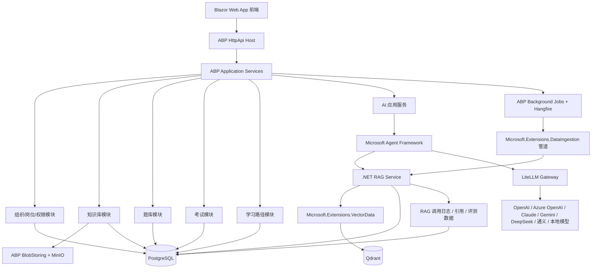
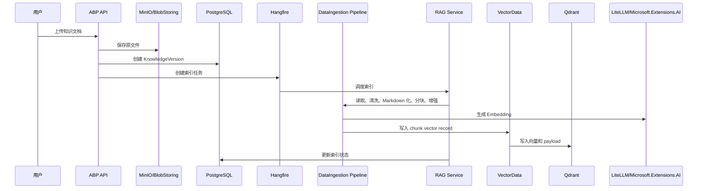
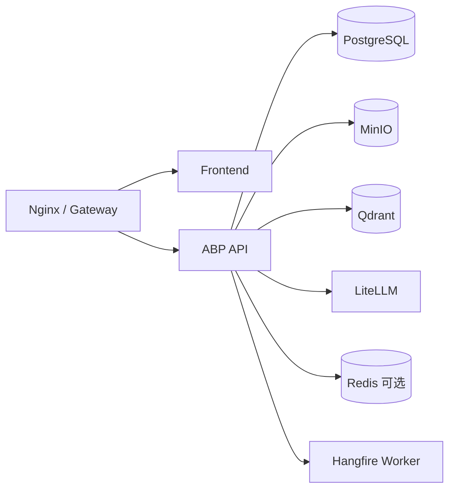

# KnowPulse 企业知识库与考试系统技术架构建议

版本：v0.2  
日期：2026-06-24  
状态：审计补强稿

## 1. 文档目标

本文档用于指导 KnowPulse 企业知识库与考试系统的技术选型、模块拆分、关键流程设计和第一阶段落地实施。

系统目标不是单纯建设一个 AI 聊天工具，而是建设一个可运营、可审计、可扩展的企业知识与岗位能力平台，覆盖：

- 企业知识沉淀与权限化检索。
- 员工按部门、岗位、职级学习。
- 基于知识库的 AI 问答。
- 基于知识点和岗位的 AI 自动出题。
- AI 生成题目经过人工审核后进入正式试题池。
- 按岗位、部门、人员进行考试与自动评分。
- 学习、考试、错题、题库质量和知识质量的闭环分析。

## 2. 建设原则

### 2.1 业务主系统优先

ABP 后端是业务事实的唯一可信来源。知识、题目、考试、权限、审核、成绩、审计等业务事实均以 PostgreSQL 中的业务表为准。

Qdrant 只作为检索索引库，不作为业务主库。

Qdrant 中的 collection 和 payload index 必须能从 PostgreSQL 业务事实与 MinIO/BlobStoring 原始附件重建，不能成为唯一状态来源。

### 2.2 RAG 能力自研，底层组件复用

RAG 的核心风险在于权限、租户、知识版本、引用来源和审计追溯。这些能力强依赖业务模型，不建议交给完整外部 RAG 平台接管。

推荐方式：

- 自研 `.NET RAG Service`，负责业务编排、权限二次校验、引用、审计和评测。
- 使用 `Microsoft.Extensions.DataIngestion` 作为文档读取、清洗、分块、增强和写入管道的基础。
- 使用 `Microsoft.Extensions.VectorData.Abstractions` 作为向量库访问抽象。
- 使用 Qdrant 作为向量检索库。
- 使用 LiteLLM 作为模型网关。
- 使用 Microsoft Agent Framework 进行 Agent 工作流编排。
- 使用 Microsoft.Extensions.AI 统一 AI Client 抽象。

### 2.3 强制人审

AI 生成内容不能直接进入正式业务资产。

- AI 生成题目只能进入“待审核”状态。
- AI 生成知识摘要、标签、适用岗位只作为建议。
- 主观题 AI 评分只作为初评，低置信度或争议结果进入人工复核。

### 2.4 权限前置和二次校验

RAG 检索必须同时具备：

1. Qdrant payload filter 层面的检索前过滤。
2. PostgreSQL 业务表层面的检索后二次校验。

禁止仅依赖提示词约束模型不要回答无权限内容。

## 3. 推荐技术栈

| 层级 | 推荐选型 | 说明 |
| --- | --- | --- |
| 前端 | Blazor Web App | MVP 默认主前端。团队熟悉 Blazor，且项目明确采用 .NET 技术栈实现，可复用 ABP 的 .NET UI、权限、菜单、本地化和模块化经验 |
| 可替代前端 | Vue 3 + TypeScript + Vite | 不与 Blazor 同时建设。仅当考试端或知识编辑端出现 Blazor 难以承载的复杂前端交互时，作为独立前端替代路线 |
| 后端 | ABP Framework + ASP.NET Core | 负责模块化、DDD、应用服务、权限、租户、审计、后台任务 |
| 数据库 | PostgreSQL | 业务主库 |
| 向量库 | Qdrant | 独立向量检索服务，承载 RAG 检索、相似知识、相似题检测 |
| 文件存储 | ABP BlobStoring + MinIO | 私有化部署优先，后续可切 Azure Blob 或 S3 |
| AI Agent 层 | Microsoft Agent Framework | 负责问答、出题、评分、知识解析等 Agent 工作流 |
| 模型网关 | LiteLLM | 统一 OpenAI、Azure OpenAI、Claude、Gemini、DeepSeek、通义、本地模型 |
| RAG 业务编排 | .NET 自研 RAG Service | 掌握权限过滤、索引一致性、引用来源、审计、评测和业务规则 |
| RAG 数据摄取 | Microsoft.Extensions.DataIngestion | 文档读取、Markdown 表示、清洗、chunk、摘要/关键词增强、写入管道 |
| 向量访问抽象 | Microsoft.Extensions.VectorData.Abstractions | 隔离 Qdrant provider，保留替换向量库的空间 |
| 后台任务 | ABP Background Jobs + Hangfire | 文档解析、embedding、索引、批量出题、报表 |
| 消息队列 | RabbitMQ | MVP 后置。拆服务或任务吞吐上来后再引入 |
| 监控 | OpenTelemetry + Prometheus/Grafana 或云厂商 APM | 监控 API、任务、Agent、模型调用、检索延迟 |

### 3.1 前端选型结论

在团队熟悉 Blazor 与 Vue、且项目明确采用 .NET 技术栈实现的前提下，MVP 推荐使用 Blazor Web App 作为主前端，不推荐为了生态泛化选择 React。

选择 Blazor 的理由：

- 团队已有 Blazor 经验，且整体技术栈收敛到 .NET，学习和维护成本最低。
- ABP 官方对 Blazor 有内置 UI 支持，菜单、权限、本地化、表单验证、主题等后台能力更容易与业务模块集成。
- C# 代码、DTO、验证规则、权限常量、应用服务调用可以在前后端之间保持更一致的模型。
- 后台管理、知识库管理、题库审核、考试管理、审计日志等企业后台场景适合 Blazor 快速落地。

推荐模式：

- 使用 Blazor Web App 作为统一前端工程。
- MVP 默认使用 Interactive Server，降低前端复杂度，并复用服务端授权、依赖注入和 ABP UI 能力。
- 对考试答题页、长表单编辑器、离线缓存、弱网场景保留 Interactive WebAssembly 或独立 Vue 前端的评估空间。

约束：

- MVP 不同时建设 Blazor 与 Vue 两套前端。
- Blazor Server/Interactive Server 依赖稳定实时连接，考试倒计时、答题草稿、自动保存不能只保存在 circuit 内存中，必须定期落库或写入服务端缓存。
- 高频交互页面要避免过度依赖复杂 DOM 操作；确实需要浏览器原生能力时，通过 JS interop 封装在局部组件内。
- 如果后续发现考试端需要离线、弱网、大量客户端状态或移动端体验，优先将考试答题页单独评估为 Blazor WebAssembly/Interactive Auto，而不是立刻引入第二套 Vue 主前端。

### 3.2 初始版本基线与锁定规则

第一阶段不追求所有组件使用最新预览版，优先选择长期支持、稳定集成和可回滚。

建议初始基线：

| 组件 | 建议基线 | 锁定方式 |
| --- | --- | --- |
| .NET SDK / ASP.NET Core | .NET 10 LTS | 使用 `global.json` 固定 SDK 主版本，生产环境跟随 LTS 补丁升级 |
| ABP Framework | ABP 10.x 当前稳定版，避免生产使用 preview | 所有 `Volo.Abp.*` 包版本保持一致，并在 `Directory.Packages.props` 或项目文件中统一管理 |
| PostgreSQL | PostgreSQL 18 或组织内已标准化的受支持主版本 | Docker image 固定主版本；主版本升级必须单独做迁移演练 |
| Qdrant | 当前稳定 Docker image | 固定镜像 tag；embedding 维度变化时使用新 collection 或灰度 collection |
| MinIO | 当前稳定 RELEASE tag | 固定镜像 tag；bucket 策略、生命周期和备份脚本纳入部署仓库 |
| LiteLLM | 当前稳定 Docker image / Python package | 固定镜像 tag；模型路由、预算、fallback 和 key 只放在 LiteLLM 配置中 |
| Microsoft.Extensions.AI | 10.x 稳定版 | 作为 `IChatClient`、`IEmbeddingGenerator`、telemetry、caching 的统一抽象 |
| Microsoft.Extensions.VectorData.Abstractions | 10.x 稳定版 | 只依赖 abstractions；provider 通过自定义适配层封装 |
| Microsoft.Extensions.DataIngestion | 10.x preview | 允许作为 MVP 数据摄取实现基础，但必须包在本项目接口后面 |
| Qdrant VectorData Provider | `Microsoft.SemanticKernel.Connectors.Qdrant` preview | 仅通过本项目 `IKnowledgeVectorStore` 适配层访问，禁止业务代码直接依赖 |
| Hangfire | 与 ABP 版本兼容的 Hangfire 集成包 | 通过 ABP Hangfire 集成接入，不在业务代码中直接绑定 provider |
| Blazor 前端 | 与后端相同 .NET LTS，Blazor Web App + Interactive Server | MVP 默认锁定；与 ABP UI 包版本保持一致 |
| Vue 前端 | Node.js Active LTS + Vue 3 + TypeScript + Vite + Pinia + Vue Router | 仅在放弃 Blazor 路线或拆分独立考试前端时启用；使用 `package-lock.json`、`pnpm-lock.yaml` 或 `yarn.lock` 固定依赖 |

执行规则：

- 创建工程后必须提交 `global.json`、锁文件、Docker Compose 镜像 tag 和依赖版本清单。
- 禁止使用 `latest` 镜像 tag 作为可复现环境的默认配置。
- MVP 只允许选择一种主前端技术栈。默认选择 Blazor；如果改选 Vue 或拆分独立考试前端，需要同步更新架构图、版本基线、实施里程碑和前端交付物。
- 预览版依赖只允许用于 PoC 分支或功能开关后面的实验能力，不能成为核心业务链路的唯一实现。
- `Microsoft.Extensions.DataIngestion` 和 Qdrant VectorData provider 当前按 preview 风险管理，必须通过本项目接口隔离，并保留直接 Qdrant SDK 或自研写入器的降级路径。
- 每次升级 ABP、.NET、Qdrant、LiteLLM 或 PostgreSQL 主版本时，必须补一条架构决策记录，说明兼容性、回滚方式和验证结果。

## 4. 总体架构



关键约束：

- Qdrant 只负责候选召回和 payload 前置过滤，RAG Service 必须回 PostgreSQL 做知识状态、版本和权限范围二次校验。
- DataIngestion 与 VectorData 只作为底层处理和访问抽象，不能替代 ABP 中的知识版本、权限范围、审计和引用治理。
- Agent 只能调用 ABP 暴露的业务工具或 RAG Service，不允许直接访问 PostgreSQL、Qdrant 或 MinIO。
- AI 问答、出题、评分的模型调用都必须经过 LiteLLM 或统一的 `Microsoft.Extensions.AI` 客户端封装，便于审计、限流、fallback 和替换模型。

## 5. 系统边界与职责

### 5.1 ABP 业务主系统

职责：

- 用户、租户、角色、权限。
- 组织、部门、岗位、职级。
- 知识库业务数据。
- 题库和审核流程。
- 考试、组卷、答题、评分。
- 学习记录和岗位能力模型。
- 审计日志、操作日志、业务事件。
- AI 应用服务入口。

不建议职责：

- 不直接把 ABP 应用服务写成大模型提示词拼接器。
- 不让 Agent 直接绕过 ABP 权限访问数据库。
- 不把向量检索能力塞进业务服务内部导致耦合。

### 5.2 .NET RAG Service

职责：

- 编排 `Microsoft.Extensions.DataIngestion` 管道完成文档读取、清洗、chunk、增强和写入。
- 通过 `Microsoft.Extensions.AI` 调用 embedding 与 chat 能力。
- 通过 `Microsoft.Extensions.VectorData.Abstractions` 访问向量库。
- 封装 Qdrant collection 管理和 provider 差异。
- 构造 Qdrant payload filter。
- TopK 检索。
- PostgreSQL 二次权限校验。
- 可选 rerank。
- prompt context 组装。
- 引用来源拼装。
- RAG 调用日志与评测埋点。

RAG Service 可以先作为 ABP 单体中的模块实现，后续如果检索压力上升，再拆成独立服务。

边界：

- DataIngestion 负责底层摄取流程，不决定知识是否可发布、谁可访问、索引是否可信。
- VectorData 负责向量库抽象，不作为权限最终裁决者。
- RAG Service 必须保留本项目自己的接口，例如 `IKnowledgeIngestionPipeline`、`IKnowledgeVectorStore`、`IKnowledgeRetriever`，避免 preview provider 或外部库类型渗透到业务模块。

### 5.3 Microsoft.Extensions.DataIngestion 与 VectorData

职责：

- `Microsoft.Extensions.DataIngestion` 负责文档 reader、document processor、chunker、chunk processor、writer pipeline。
- `Microsoft.Extensions.VectorData.Abstractions` 负责统一 vector store、collection、record、search 抽象。
- Qdrant provider 只作为 VectorData 的具体实现之一。
- `Microsoft.Extensions.AI` 提供 embedding generator 和 chat client 抽象。

适用范围：

- 知识文档解析、Markdown 化、分块、摘要、关键词、分类建议。
- chunk 写入 Qdrant 或未来其他向量库。
- 本地开发时可用 in-memory provider 做快速 PoC，但集成测试必须使用 Qdrant 或生产同类 vector store。

不承担：

- 不管理业务知识版本。
- 不管理租户、部门、岗位、角色、用户权限。
- 不负责 PostgreSQL 二次校验。
- 不负责 AI 回答的引用治理、审计和人工复核。

落地约束：

- preview 包必须通过本项目适配层封装。
- 如果 Qdrant provider 不满足 payload filter、索引或性能要求，允许在 `IKnowledgeVectorStore` 内切换为直接 Qdrant SDK 实现。
- DataIngestion pipeline 的每次处理结果必须写回 `KnowledgeIndexJob`、`KnowledgeChunk`、`KnowledgeEmbeddingRecord` 等业务表。

### 5.4 Qdrant

职责：

- 保存知识片段 embedding。
- 保存检索需要的 payload 元数据。
- 支持基于租户、发布状态、岗位、部门、人员、安全级别的过滤检索。
- 支持相似知识和相似题目检索。

不承担：

- 不保存最终业务状态。
- 不作为权限最终裁决者。
- 不直接暴露给前端、Agent 或业务应用服务。

### 5.5 Microsoft Agent Framework

职责：

- 编排 AI 问答流程。
- 编排 AI 出题流程。
- 编排主观题 AI 初评流程。
- 编排知识解析、摘要、标签建议。
- 支持 human-in-the-loop 节点。

约束：

- Agent 只能调用经过封装的业务工具。
- Agent 不直接访问 PostgreSQL、Qdrant、MinIO。
- Agent 的每次关键输出都要记录模型、提示词版本、输入摘要、输出结果和业务关联 ID。

生产落地闸口：

- Agent Framework 必须包在 `IAiWorkflowRunner`、`IQuestionGenerationWorkflow`、`ISubjectiveScoringWorkflow` 等应用层接口后面，业务模块不能直接依赖具体 Agent SDK。
- MVP 阶段的权限化问答先用 `RagAnswerService + LiteLLM chat alias` 实现；只有当多步骤编排、人审节点、工具调用审批确实需要时，再启用 Agent workflow。
- 使用 preview 包或实验 provider 时，只能在功能开关后运行，并保留不用 Agent 的降级路径。
- 写入业务状态的工具调用必须经过人工审批或明确的应用服务权限校验，Agent 输出不能直接发布知识、审批题目、改分或变更权限。
- 每个 Agent workflow 必须记录版本、输入摘要、工具调用列表、人工审批记录、输出摘要、token/成本和异常。
- 需要维护 provider 能力矩阵，至少确认目标模型是否支持 function calling、structured output、streaming、tool approval 和本地部署。

### 5.6 LiteLLM

职责：

- 统一模型调用协议。
- 模型路由。
- fallback。
- 限流。
- 成本统计。
- 不同模型供应商适配。

推荐接入模型：

- 云端：OpenAI、Azure OpenAI、Claude、Gemini。
- 国内：DeepSeek、通义。
- 本地：Ollama 或兼容 OpenAI API 的私有模型服务。

## 6. 模块划分

### 6.0 模块边界、聚合根与事务原则

模块拆分不是实体清单，落地时必须先确定聚合根和跨模块调用边界。

建议聚合边界：

| 模块 | 主要聚合根 | 关键不变量 |
| --- | --- | --- |
| Organization | `Department`、`Position` | 岗位、部门、职级变更必须保留历史可追溯性，不能破坏已发布知识、考试和成绩的历史解释 |
| KnowledgeBase | `KnowledgeItem`、`KnowledgeVersion` | 只有已发布版本可进入 RAG 检索；权限范围变更必须触发索引 payload 更新或失效 |
| KnowledgeIndexing | `KnowledgeIndexJob` | 索引任务只能基于确定的 `KnowledgeVersion` 执行；失败原因和重试次数必须持久化 |
| RagService | 无业务聚合，作为应用服务/领域服务组合 | 只返回通过二次校验的 chunk；必须输出引用来源和审计记录 |
| QuestionBank | `Question` | AI 生成题必须先进入待审核状态；未审核通过题目不能进入正式试卷 |
| Exam | `ExamPlan`、`ExamPaper`、`ExamAttempt` | 开考后试卷内容不可被题库修改影响；提交后评分过程必须可追溯 |
| Learning | `LearningPath`、`UserLearningProgress` | 学习进度只能基于用户实际阅读、考试和复习记录推进 |
| AiOrchestration | `AiTask`、`AiTaskRun` | AI 运行记录追加写入，不允许覆盖原始模型调用结果 |

事务原则：

- 单个聚合内部修改使用同一个 ABP Unit of Work。
- 跨模块动作优先使用应用服务编排，并通过领域事件或后台任务处理索引、报表和通知等副作用。
- PostgreSQL 业务状态先落库，Qdrant、MinIO、LiteLLM 调用记录作为可重试的外部副作用处理。
- 涉及考试提交、成绩、题目审核、知识发布的流程必须有幂等键和并发控制。

### 6.1 Organization 模块

职责：

- 公司、部门、岗位、职级。
- 岗位能力模型。
- 岗位与知识点映射。
- 岗位与考试要求映射。

核心实体建议：

- `Department`
- `Position`
- `JobLevel`
- `PositionCompetency`
- `PositionKnowledgeRequirement`
- `PositionExamRequirement`

### 6.2 KnowledgeBase 模块

职责：

- 知识分类。
- 标签。
- 文档。
- 版本。
- 发布、下架、归档。
- 权限范围。
- 反馈和纠错。

核心实体建议：

- `KnowledgeCategory`
- `KnowledgeItem`
- `KnowledgeVersion`
- `KnowledgeAttachment`
- `KnowledgeTag`
- `KnowledgePermissionScope`
- `KnowledgeFeedback`
- `KnowledgeReadRecord`

知识状态建议：

- `Draft`
- `PendingReview`
- `Published`
- `Rejected`
- `Archived`
- `Disabled`

### 6.3 KnowledgeIndexing 模块

职责：

- 调用 `Microsoft.Extensions.DataIngestion` 解析文档。
- 生成 Markdown-centric document 表示。
- 按标题、章节、页码或语义策略生成 chunk。
- 调用 `Microsoft.Extensions.AI` 生成 embedding。
- 通过 `Microsoft.Extensions.VectorData.Abstractions` 写入 Qdrant。
- 维护索引状态。
- 支持索引重建。

核心实体建议：

- `KnowledgeIndexJob`
- `KnowledgeChunk`
- `KnowledgeEmbeddingRecord`
- `EmbeddingModelVersion`
- `IndexRebuildTask`

索引状态建议：

- `Pending`
- `Processing`
- `Indexed`
- `Failed`
- `Outdated`
- `Deleted`

### 6.4 RagService 模块

职责：

- 权限化检索。
- VectorData 查询封装。
- 引用来源。
- 上下文组装。
- 检索质量评估。
- 问答审计。

核心接口建议：

```csharp
public interface IKnowledgeIndexer
{
    Task IndexKnowledgeVersionAsync(Guid knowledgeVersionId, CancellationToken cancellationToken = default);
    Task DeleteKnowledgeVersionIndexAsync(Guid knowledgeVersionId, CancellationToken cancellationToken = default);
    Task RebuildKnowledgeIndexAsync(Guid knowledgeId, CancellationToken cancellationToken = default);
}

public interface IKnowledgeIngestionPipeline
{
    Task<KnowledgeIngestionResult> IngestAsync(Guid knowledgeVersionId, CancellationToken cancellationToken = default);
}

public interface IKnowledgeVectorStore
{
    Task UpsertChunksAsync(IReadOnlyList<KnowledgeChunkVectorRecord> chunks, CancellationToken cancellationToken = default);
    Task<IReadOnlyList<VectorSearchHit>> SearchAsync(KnowledgeVectorSearchRequest request, CancellationToken cancellationToken = default);
    Task DeleteByKnowledgeVersionAsync(Guid knowledgeVersionId, CancellationToken cancellationToken = default);
}

public interface IKnowledgeRetriever
{
    Task<IReadOnlyList<RetrievedChunk>> SearchAsync(RagSearchRequest request, CancellationToken cancellationToken = default);
}

public interface IRagAnswerService
{
    Task<RagAnswerResult> AnswerAsync(RagAnswerRequest request, CancellationToken cancellationToken = default);
}
```

### 6.5 QuestionBank 模块

职责：

- 题库。
- 题目。
- 题型。
- 答案。
- 解析。
- 难度。
- 知识点。
- AI 生成题审核。
- 相似题检测。

核心实体建议：

- `Question`
- `QuestionOption`
- `QuestionAnswer`
- `QuestionAnalysis`
- `QuestionKnowledgePoint`
- `QuestionReview`
- `QuestionSource`
- `QuestionSimilarityCheck`

题目状态建议：

- `AiGeneratedDraft`
- `PendingReview`
- `Approved`
- `Rejected`
- `Disabled`
- `Archived`

题型建议：

- 单选题。
- 多选题。
- 判断题。
- 填空题。
- 简答题。
- 案例题。
- 操作题。

### 6.6 Exam 模块

职责：

- 考试计划。
- 试卷。
- 自动组卷。
- 在线答题。
- 自动评分。
- 成绩。
- 补考。
- 错题。

核心实体建议：

- `ExamPlan`
- `ExamPaper`
- `ExamPaperQuestion`
- `ExamAssignment`
- `ExamAttempt`
- `ExamAnswer`
- `ExamScore`
- `ExamRetakeRule`
- `WrongQuestionRecord`

组卷策略：

- 固定试卷。
- 按岗位随机组卷。
- 按知识点比例组卷。
- 按题型比例组卷。
- 按难度比例组卷。

### 6.7 Learning 模块

职责：

- 岗位学习路径。
- 必学知识。
- 学习进度。
- 阅读记录。
- 错题复习。
- 薄弱知识点推荐。

核心实体建议：

- `LearningPath`
- `LearningPathItem`
- `UserLearningProgress`
- `KnowledgeStudyRecord`
- `WeakKnowledgePoint`
- `LearningRecommendation`

### 6.8 AiOrchestration 模块

职责：

- AI 问答入口。
- AI 出题入口。
- AI 主观题评分入口。
- AI 摘要和标签建议入口。
- Agent 工作流定义和版本管理。

核心实体建议：

- `AiTask`
- `AiTaskRun`
- `PromptTemplate`
- `PromptVersion`
- `ModelInvocationLog`
- `AgentWorkflowDefinition`
- `AgentWorkflowRun`

## 7. RAG 详细设计

### 7.1 文档入库流程



### 7.2 文档分块策略

初始策略使用 `Microsoft.Extensions.DataIngestion` 的 chunker 能力，并在本项目中封装 `IKnowledgeChunkingStrategy`。

- 按标题、段落、页码优先分块。
- 单个 chunk 建议 500 到 1000 中文字。
- chunk overlap 建议 80 到 150 中文字。
- 保留章节路径、页码、表格标题、图片说明。
- 表格类文档优先转换为结构化文本。
- PDF、Word、PPT、HTML 等文档优先转换为 Markdown-centric document，再进入 chunk pipeline。
- 摘要、关键词、分类、适用岗位等 AI 增强信息只能作为建议元数据，不能自动发布为业务事实。

底层组件建议：

- Reader：优先使用 DataIngestion reader 抽象，具体 reader 按文件类型选择。
- Chunker：优先使用 header-based、section-based 或 semantic-aware chunking。
- Processor：摘要、关键词、分类建议可以使用 DataIngestion chunk processor，但必须记录 prompt 版本和模型调用。
- Writer：优先使用 DataIngestion `VectorStoreWriter<T>` 写入 VectorData 支持的 vector store。

MVP-1 初始文档类型：

- 知识版本正文 `KnowledgeVersion.ContentText`，按 Markdown 文本处理。
- UTF-8 `.txt` 附件，读取后包装为 Markdown 文档。
- UTF-8 `.md` / `.markdown` 附件，按 Markdown 文档处理。
- PDF、Word、PPT、Excel、HTML、CSV、JSON 和 XML 通过项目内 `IKnowledgeDocumentMarkdownConverter` 适配 MarkItDown reader，转换为 Markdown 后进入 chunk pipeline。
- 图片 OCR、音视频转写、压缩包递归解析和扫描件质量控制仍进入后续增强，不在当前默认 pipeline 中静默跳过。

需要保存的 chunk 元数据：

- `ChunkId`
- `KnowledgeId`
- `KnowledgeVersionId`
- `DocumentId`
- `ChunkIndex`
- `TitlePath`
- `PageNumber`
- `SourceTextHash`
- `ChunkText`
- `TokenCount`
- `ChunkingStrategy`
- `IngestionPipelineVersion`
- `CreatedTime`

### 7.3 Qdrant Collection 设计

MVP-1 初始 collection 固定为：

- `knowledge_chunks_1536_mvp1`

命名规则为 `{业务对象}_{向量维度}_{阶段或模型代号}`。embedding 维度变化时必须创建新 collection，例如 `knowledge_chunks_3072_mvp2`，禁止把不同维度向量写入同一个 collection。

后续可扩展 collection：

- `question_chunks` 或后续复用 `questions`

`knowledge_chunks` payload 建议：

```json
{
  "tenantId": "string",
  "knowledgeItemId": "guid",
  "knowledgeVersionId": "guid",
  "chunkId": "guid",
  "categoryId": "guid",
  "tagIds": ["guid"],
  "visibility": "All|Department|Position|Role|User",
  "departmentIds": ["guid"],
  "positionIds": ["guid"],
  "roleIds": ["guid"],
  "userIds": ["guid"],
  "securityLevel": 1,
  "isPublished": true,
  "effectiveFrom": "2026-06-23T00:00:00Z",
  "effectiveTo": null,
  "sourceTitle": "员工手册",
  "sourcePage": 12,
  "embeddingModel": "text-embedding-xxx",
  "embeddingModelVersion": "v1"
}
```

payload 设计要求：

- `visibility` 用于表达权限范围类型，避免仅靠空数组推断“全员可见”或“未配置权限”。
- `departmentIds`、`positionIds`、`roleIds`、`userIds` 只用于检索前过滤，不作为最终授权依据。
- `securityLevel` 必须与 PostgreSQL 中的知识安全等级保持一致。
- `embeddingModel` 与 `embeddingModelVersion` 必须能定位到实际 embedding 模型、维度和 collection。
- MVP-1 默认通过 LiteLLM alias `knowpulse-embedding-default` 调用 embedding，模型版本记为 `2026-06-mvp1`，向量维度为 `1536`，collection 为 `knowledge_chunks_1536_mvp1`。
- MVP-1 必建 Qdrant payload index 为 `tenantId`、`knowledgeItemId`、`knowledgeVersionId`、`chunkId`、`isPublished`、`departmentIds`、`positionIds`、`roleIds`、`userIds`、`securityLevel`。
- collection 和 payload index 通过 `IKnowledgeVectorStoreMaintenance` 或 `.\ops\verify-qdrant-knowledge-collection.ps1 -Ensure` 显式初始化；脚本可重复执行，缺失时创建，存在时只做健康验证。
- Qdrant 不保存业务最终状态，只保存 embedding、检索 payload 和外部 point id。全量重建时以 PostgreSQL 的 `KnowledgeVersion`、`KnowledgeChunk`、`KnowledgeEmbeddingRecord`、权限范围记录和 MinIO/BlobStoring 原始附件为准。

### 7.4 权限化检索流程

```text
用户提问
-> ABP 获取 CurrentTenant / CurrentUser / 部门 / 岗位 / 角色 / 安全等级 / 权限
-> RagService 生成 vector search request 和 payload filter
-> IKnowledgeVectorStore 通过项目内 Qdrant 适配层执行向量检索
-> PostgreSQL 按 chunkId / knowledgeVersionId 二次校验知识状态、版本、权限范围
-> 可选 rerank
-> 拼装上下文
-> 调用模型生成回答
-> 返回答案、引用、置信度
-> 写入审计日志
```

Qdrant filter 必须至少包含：

- 当前 `TenantId`。
- `IsPublished = true`。
- 当前时间在生效时间范围内。
- 用户具备访问权限的全员、部门、岗位、角色、用户范围。
- 安全等级不高于用户可访问等级。

权限过滤表达：

```text
tenantId == currentTenantId
AND isPublished == true
AND effectiveFrom <= now
AND (effectiveTo == null OR effectiveTo > now)
AND securityLevel <= userSecurityLevel
AND (
    visibility == "All"
    OR departmentIds intersects currentUserDepartmentIds
    OR positionIds intersects currentUserPositionIds
    OR roleIds intersects currentUserRoleIds
    OR userIds contains currentUserId
)
```

PostgreSQL 二次校验必须重新读取 `KnowledgeVersion`、`KnowledgePermissionScope` 和必要的组织/岗位/角色映射，确认：

- 知识版本仍为已发布且未过期。
- 当前租户与用户权限仍匹配。
- chunk 对应的 `KnowledgeVersionId` 未被重新发布或撤回。
- 权限范围没有在 Qdrant 索引后被收窄。
- 引用来源仍允许当前用户查看。

### 7.5 回答约束

系统提示词必须包含：

- 只能基于提供的企业知识片段回答。
- 如果知识片段不足，必须说明“当前知识库中没有足够依据”。
- 必须返回引用来源。
- 不得输出无来源的制度、流程、数字、日期。

返回结构建议：

```json
{
  "answer": "string",
  "citations": [
    {
      "knowledgeId": "guid",
      "knowledgeVersionId": "guid",
      "chunkId": "guid",
      "title": "string",
      "page": 1,
      "quote": "string"
    }
  ],
  "confidence": 0.82,
  "needHumanReview": false
}
```

## 8. AI Agent 工作流

### 8.1 问答 Agent

输入：

- 用户问题。
- 当前租户。
- 当前用户。
- 当前岗位、部门。
- 检索策略。

流程：

```text
接收问题
-> 调用 RagService 检索
-> 判断上下文是否足够
-> 生成答案
-> 校验是否包含引用
-> 输出答案和引用
-> 记录问答日志
```

输出：

- 答案。
- 引用来源。
- 置信度。
- 是否建议转人工。

### 8.2 出题 Agent

输入：

- 知识范围。
- 岗位。
- 题型。
- 难度。
- 数量。
- 出题目标。

流程：

```text
选择知识点
-> RagService 拉取相关知识片段
-> 生成候选题
-> 生成答案和解析
-> 绑定来源 chunk
-> 执行相似题检测
-> 写入待审核题目
```

输出：

- 候选题。
- 答案。
- 解析。
- 难度。
- 知识点。
- 来源引用。
- 相似题提示。

硬性约束：

- 不允许直接进入正式题库。
- 审核前不能用于正式考试。

### 8.3 评分 Agent

客观题：

- 使用规则评分。
- 不调用大模型。

主观题：

- AI 初评。
- 输出评分、评分理由、扣分点、参考依据。
- 低置信度进入人工复核。

人工复核触发条件：

- 分数接近及格线。
- AI 置信度低。
- 用户申诉。
- 题目被标记为高风险。
- 考试管理员开启强制复核。

### 8.4 知识解析 Agent

输入：

- 文档文本。

输出建议：

- 摘要。
- 关键词。
- 标签。
- 适用岗位。
- 知识点。
- 可生成题目方向。

约束：

- 只生成建议，不自动发布。
- 所有建议需要用户确认或可回滚。

## 9. 权限、租户与审计

### 9.1 租户隔离

要求：

- PostgreSQL 业务表使用 ABP `IMultiTenant`。
- Qdrant payload 带 `tenantId`。
- 文件存储路径或容器中带租户隔离前缀。
- LiteLLM 调用日志带租户和业务场景。
- 缓存 key 带租户。

### 9.2 权限模型

主要权限：

- 知识查看。
- 知识创建。
- 知识审核。
- 知识发布。
- 题库管理。
- 题目审核。
- 考试管理。
- 考试参加。
- 成绩查看。
- AI 出题。
- AI 问答。
- 报表查看。

知识访问范围：

- 全员可见。
- 部门可见。
- 岗位可见。
- 指定用户可见。
- 指定角色可见。
- 安全等级限制。

### 9.3 审计要求

必须记录：

- 知识上传、修改、发布、下架。
- 文档解析和索引结果。
- AI 问答请求和引用来源。
- AI 出题请求、模型、提示词版本、生成结果。
- 题目审核人、审核意见、审核时间。
- 考试开始、提交、评分、改分。
- 主观题 AI 初评和人工复核。
- 权限变更。

敏感内容：

- 不建议完整保存用户隐私或保密文档原文到 AI 调用日志。
- 可保存摘要、hash、业务 ID、引用 ID。

## 10. 数据一致性设计

PostgreSQL 是主库，Qdrant 是索引库。

### 10.1 知识版本更新

当知识版本发布时：

1. 创建新 `KnowledgeVersion`。
2. 标记旧版本为过期。
3. 创建新索引任务。
4. 新版本索引成功后，Qdrant 中新 chunk `isPublished = true`。
5. 旧版本 chunk 标记为不可检索或删除。

### 10.2 索引失败处理

要求：

- 索引任务有重试机制。
- 失败原因写入 `KnowledgeIndexJob`。
- 前端展示索引状态。
- 管理员可以手动重建索引。

### 10.3 Embedding 模型升级

要求：

- 保存 `EmbeddingModelVersion`。
- 不同 embedding 维度使用不同 collection 或迁移策略。
- 支持全量重建。
- 支持灰度切换检索 collection。

MVP-1 默认模型配置通过 `RagAI` 配置节表达：

- `RagAI:Embedding:Provider = LiteLLM`
- `RagAI:Embedding:ModelName = knowpulse-embedding-default`
- `RagAI:Embedding:ModelVersion = 2026-06-mvp1`
- `RagAI:Embedding:VectorDimension = 1536`
- `RagAI:Embedding:CollectionName = knowledge_chunks_1536_mvp1`
- `RagAI:LiteLlm:ApiKeyEnvironmentVariable = KNOWPULSE_LITELLM_API_KEY`

仓库配置模板只保存模型 alias、endpoint、timeout、fallback alias 和环境变量名，不保存真实模型密钥。

MVP-1 embedding 生成规则：

- 模型调用必须经过 `IKnowledgeEmbeddingClient`，业务应用服务和 pipeline 不直接依赖供应商 SDK。
- 本地没有 `KNOWPULSE_LITELLM_API_KEY` 时，LiteLLM client 返回明确的 `embedding` 阶段失败，不阻塞非 RAG 测试。
- `KnowledgeEmbeddingRecord` 保存 chunk、模型版本、content hash、向量维度和目标向量库 record id。
- 同一模型版本下 content hash 或维度不匹配的 active chunk 必须进入重建查询结果。

MVP-1 Qdrant 适配规则：

- 业务代码只依赖 `IKnowledgeVectorStore`。
- Qdrant REST 适配层负责 upsert、search、delete 和 payload filter 构造。
- `IKnowledgeVectorStoreMaintenance` 负责显式 ensure collection、ensure payload index 和健康检查。
- Qdrant provider/SDK 类型不得泄漏到 Application.Contracts、Application 或 Domain。
- 权限前置过滤至少包含 tenant、published、department、position、role、user 和 security level 条件；命中结果仍需 PostgreSQL 二次校验。
- Qdrant collection 可以通过 `.\ops\verify-qdrant-knowledge-collection.ps1 -Ensure` 初始化，并通过同一脚本验证向量维度和必建 payload index。

MVP-1 RAG 搜索和问答规则：

- `POST /api/ai/rag/search` 只能返回 `IKnowledgeRetriever` 二次校验后的 chunk。
- `POST /api/ai/rag/answer` 当前使用 `RagAnswerService` 调用 LiteLLM chat alias 生成回答和 citation；模型上下文只能来自二次校验后的 chunk，模型不可用时降级为保守回答。
- 无可访问依据时必须返回“知识库依据不足”，不得编造制度、流程、数字、日期或引用。
- citation 必须包含 `KnowledgeItemId`、`KnowledgeVersionId`、`ChunkId`、来源标题、页码和受控长度摘录。

## 11. 后台任务设计

任务类型：

- 文档解析任务。
- OCR 任务。
- embedding 生成任务。
- Qdrant 索引写入任务。
- 索引重建任务。
- AI 批量出题任务。
- 考试自动组卷任务。
- 考试结束自动评分任务。
- 报表聚合任务。
- RAG 评测任务。

MVP 推荐：

- 使用 ABP Background Jobs 作为业务抽象。
- 使用 Hangfire 作为任务运行和可视化后台。
- RabbitMQ 暂不引入，等跨服务事件驱动需求明确后再加。

## 12. 部署架构

### 12.1 MVP 单机或小集群部署

组件：

- Web 前端。
- ABP 后端。
- PostgreSQL。
- Qdrant。
- MinIO。
- LiteLLM。
- Hangfire Dashboard。
- Redis，可选。



### 12.2 后续扩展部署

当并发、文档量、模型调用量上升后，可拆分：

- `Knowledge.Api`
- `Exam.Api`
- `Rag.Api`
- `AiOrchestration.Worker`
- `Indexing.Worker`
- `Reporting.Worker`

拆分条件：

- RAG 检索耗时影响主 API。
- 文档解析和 embedding 任务占用过多资源。
- 考试高峰期需要独立扩容。
- 多租户大客户需要隔离部署。

## 13. 安全设计

### 13.1 AI 安全

风险：

- Prompt injection。
- 越权检索。
- 模型编造答案。
- 敏感信息泄露。
- 用户通过问答套取考试答案。

控制措施：

- RAG 权限过滤不依赖提示词。
- 系统提示词禁止泄露内部提示词和考试答案。
- 考试期间限制访问相关知识库或隔离考试环境。
- 输出必须包含引用。
- 无依据时必须回答知识库依据不足。
- 对高敏知识设置更高安全等级。

### 13.2 考试安全

可选能力：

- 试题乱序。
- 选项乱序。
- 按规则随机抽题。
- 考试次数限制。
- 防切屏提醒。
- 考试期间禁止查看解析。
- 交卷后按配置显示答案或仅显示成绩。

### 13.3 数据安全

要求：

- 文件存储私有访问。
- 下载通过 ABP 权限校验。
- 数据库备份。
- Qdrant 快照备份。
- MinIO bucket 策略收敛。
- 模型调用不传递无关个人信息。

## 14. 观测与评测

### 14.1 技术观测

指标：

- API 延迟。
- Qdrant 检索延迟。
- DataIngestion pipeline 处理耗时。
- embedding 生成耗时。
- 文档读取、chunk、VectorData 写入失败率。
- LiteLLM 模型调用耗时。
- 模型调用失败率。
- 模型成本。
- Hangfire 任务积压。

### 14.2 RAG 质量评测

建议建立评测集：

- 常见制度问答。
- 岗位操作流程问答。
- 容易混淆的问题。
- 无答案问题。
- 权限边界问题。

评测指标：

- 检索命中率。
- 引用准确率。
- 答案忠实度。
- 无答案拒答率。
- 越权召回率，目标必须为 0。

可选工具：

- Ragas。
- DeepEval。
- 自研 ABP 评测任务。

## 15. MVP 范围

第一阶段仍建议控制在 8 到 12 周，但拆为 3 个可验收的小版本，避免知识库、RAG、AI 出题和考试系统同时未闭环。

### 15.1 MVP-0：工程基础与知识库闭环

建议周期：2 到 3 周。

必须交付：

1. ABP 后端、前端、PostgreSQL、MinIO、Qdrant、LiteLLM、Hangfire 的本地 Docker Compose 开发环境。
2. 用户、部门、岗位、角色、基础权限。
3. 知识分类、标签、文档上传。
4. 知识版本、发布、下架、归档。
5. 知识权限范围：全员、部门、岗位、角色、指定用户、安全等级。
6. 基础审计日志。

验收标准：

- 本地一条命令可启动依赖服务。
- 管理员可以上传文档并发布一个知识版本。
- 不同部门、岗位、角色用户看到的知识列表不同。
- MinIO 文件下载必须经过 ABP 权限校验。

### 15.2 MVP-1：权限化 RAG 问答闭环

建议周期：3 到 4 周。

必须交付：

1. 基于 `Microsoft.Extensions.DataIngestion` 的文档读取、Markdown 化、chunk、embedding、写入 pipeline。
2. 基于 `Microsoft.Extensions.VectorData.Abstractions` 的 `IKnowledgeVectorStore` 适配层。
3. Qdrant `knowledge_chunks` collection 和 payload index。
4. 索引任务、失败重试、手动重建索引。
5. Qdrant payload filter 前置过滤。
6. PostgreSQL 二次权限校验。
7. RAG 问答接口。
8. 答案引用来源。
9. RAG 调用日志和基础评测集。

验收标准：

- 同一问题在不同权限用户下只能召回各自可见的 chunk。
- DataIngestion pipeline 的每个失败文档必须能定位到 reader、chunker、processor 或 writer 阶段。
- Qdrant provider 只能通过 `IKnowledgeVectorStore` 间接访问，业务代码不得直接依赖 preview provider 类型。
- 跨租户、跨部门、跨角色、越过安全等级的检索测试必须失败。
- 无依据问题必须回答知识库依据不足。
- 每个答案必须返回可点击或可追溯的引用来源。
- Qdrant 索引落后于 PostgreSQL 权限变更时，二次校验必须阻断越权引用。

### 15.3 MVP-2：题库、AI 出题与考试闭环

建议周期：3 到 5 周。

必须交付：

1. 题库 CRUD。
2. AI 自动出题到待审核。
3. 题目审核通过后进入正式题库。
4. 相似题检测。
5. 按岗位、知识点、题型、难度组卷。
6. 在线考试。
7. 客观题自动评分。
8. 成绩和错题记录。

验收标准：

- AI 生成题未审核通过前不能进入正式考试。
- 审核记录必须包含审核人、审核时间和审核意见。
- 已开始考试的试卷不受题库后续修改影响。
- 客观题评分可重复执行且结果一致。
- 成绩、错题与原始答题记录可追溯。

暂缓：

- RabbitMQ。
- 微服务拆分。
- 复杂防作弊。
- 完整 BI 报表。
- 多模型自动评测平台。
- 视频知识解析。
- 大规模 OCR。
- 主观题 AI 自动评分正式入成绩。
- Agent 自主工具规划和跨 Agent 协作。

## 16. 推荐实施里程碑

本章是完整产品路线，和 MVP 分期的对应关系如下：

- MVP-0 对应第 1 阶段和第 2 阶段。
- MVP-1 对应第 3 阶段。
- MVP-2 对应第 4 阶段和第 5 阶段。
- 第 6 阶段属于 MVP 后的运营质量建设。

### 16.1 第 1 阶段：工程基础

目标：

- 建立 ABP 工程。
- 完成认证、租户、权限基础。
- 完成 PostgreSQL、MinIO、Qdrant、LiteLLM 本地开发环境。

交付物：

- 可运行后端。
- 可运行前端。
- Docker Compose 开发环境。
- 基础权限和菜单。

### 16.2 第 2 阶段：知识库

目标：

- 完成知识库核心 CRUD。
- 完成文件上传。
- 完成版本和发布。

交付物：

- 知识分类。
- 知识文档。
- 权限范围。
- 发布状态。

### 16.3 第 3 阶段：索引与 RAG

目标：

- 完成 DataIngestion 文档读取、分块、embedding、VectorData/Qdrant 写入。
- 完成权限化问答。

交付物：

- 索引任务。
- DataIngestion pipeline。
- VectorData/Qdrant 适配层。
- Qdrant collection。
- 问答接口。
- 引用来源。
- 检索审计。

### 16.4 第 4 阶段：题库与 AI 出题

目标：

- 完成题库。
- 完成 AI 出题。
- 完成审核流。

交付物：

- 题目管理。
- AI 候选题。
- 审核通过入库。
- 相似题提示。

### 16.5 第 5 阶段：考试

目标：

- 完成考试计划、组卷、答题、评分。

交付物：

- 岗位考试。
- 在线答题。
- 自动评分。
- 成绩和错题。

### 16.6 第 6 阶段：运营与质量

目标：

- 完成基础报表和质量评测。

交付物：

- 知识阅读报表。
- 考试通过率报表。
- 题目错题率报表。
- RAG 评测集。

## 17. 初始 API 边界建议

### 17.1 知识库 API

- `POST /api/knowledge/items`
- `GET /api/knowledge/items`
- `GET /api/knowledge/items/{id}`
- `POST /api/knowledge/items/{id}/versions`
- `POST /api/knowledge/versions/{id}/publish`
- `POST /api/knowledge/versions/{id}/archive`
- `POST /api/knowledge/files/upload`

### 17.2 RAG API

- `POST /api/ai/rag/answer`
- `POST /api/ai/rag/search`
- `POST /api/knowledge/versions/{id}/reindex`
- `GET /api/knowledge/index-jobs/{id}`

### 17.3 题库 API

- `POST /api/questions`
- `GET /api/questions`
- `GET /api/questions/{id}`
- `PUT /api/questions/{id}`
- `POST /api/questions/{id}/submit-review`
- `POST /api/questions/{id}/approve`
- `POST /api/questions/{id}/reject`

### 17.4 AI 出题 API

- `POST /api/ai/questions/generate`
- `GET /api/ai/questions/generation-tasks/{id}`
- `POST /api/ai/questions/generated/{id}/submit-review`

### 17.5 考试 API

- `POST /api/exams/plans`
- `POST /api/exams/plans/{id}/assign`
- `POST /api/exams/attempts/start`
- `POST /api/exams/attempts/{id}/submit`
- `GET /api/exams/attempts/{id}/score`
- `GET /api/exams/results`

## 18. 关键技术决策

### 18.1 是否使用独立 Qdrant

结论：使用独立 Qdrant。

理由：

- 检索能力更专注。
- payload filter 适合权限化检索。
- 与 PostgreSQL 业务主库职责清晰。
- 后续可独立扩容。
- 适合私有化部署。

代价：

- 多一个基础设施组件。
- 需要处理索引一致性。
- 需要备份和监控 Qdrant。

### 18.2 是否使用 Microsoft.Extensions.DataIngestion + VectorData

结论：使用，作为 .NET RAG 的底层数据摄取与向量访问基线。

理由：

- 与当前 `.NET + ABP + Blazor` 技术栈一致，减少跨语言 RAG 框架引入。
- DataIngestion 覆盖文档读取、Markdown 表示、chunk、增强和 writer pipeline，可减少自研底层样板代码。
- VectorData 提供统一 vector store 抽象，避免业务代码直接绑定 Qdrant SDK。
- 与 Microsoft.Extensions.AI 的 `IEmbeddingGenerator`、`IChatClient`、telemetry、caching 能力天然兼容。
- 后续如果从 Qdrant 切换到其他 vector store，可优先替换 provider 和适配层，而不是重写业务检索逻辑。

约束：

- 不把 DataIngestion 当成完整 RAG 平台，它只处理摄取管道。
- 不把 VectorData 当成权限系统，它只处理向量库抽象和检索。
- `Microsoft.Extensions.DataIngestion` 和 Qdrant provider 若仍处于 preview 状态，必须通过 `IKnowledgeIngestionPipeline`、`IKnowledgeVectorStore` 隔离。
- PostgreSQL 二次权限校验、知识版本、引用、审计、人工复核仍由自研 RAG Service 和 ABP 业务模块负责。

### 18.3 是否直接使用开源 RAG 平台

结论：不作为核心业务链路，最多用于 PoC 或参考。

原因：

- 企业权限、租户、岗位考试、审核审计都强依赖业务模型。
- 完整 RAG 平台难以深度嵌入 ABP 权限体系。
- 核心检索链路需要可测、可审、可控。

可以参考：

- LangChain。
- LlamaIndex。
- Haystack。
- RAGFlow。
- Dify。

### 18.4 是否第一阶段引入 RabbitMQ

结论：暂缓。

理由：

- MVP 用 ABP Background Jobs + Hangfire 足够。
- 过早引入消息队列会增加部署和排障成本。
- 等任务吞吐、跨服务事件驱动、服务拆分明确后再引入。

## 19. 待确认问题

1. 是否接受 Blazor Web App 作为 MVP 默认主前端；如改选 Vue 或拆分独立考试前端，需要同步调整架构图、版本基线和交付计划。
2. 是否需要多租户商业化 SaaS，还是单企业私有化优先。
3. 初始模型供应商选择 Azure OpenAI、OpenAI、DeepSeek、通义还是本地模型。
4. 是否要求纯内网部署。
5. 初始文档类型范围：PDF、Word、Excel、PPT、HTML、图片 OCR 是否全部需要。
6. 考试防作弊强度。
7. 主观题是否第一阶段上线 AI 初评。
8. 是否需要对接企业微信、钉钉、飞书或 Entra ID。

## 20. 参考资料

- Microsoft Agent Framework: https://learn.microsoft.com/en-us/agent-framework/
- Microsoft Agent Framework Overview: https://learn.microsoft.com/en-us/agent-framework/overview/
- Microsoft Agent Framework Tools: https://learn.microsoft.com/en-us/agent-framework/agents/tools/
- Microsoft.Extensions.AI: https://learn.microsoft.com/en-us/dotnet/ai/microsoft-extensions-ai
- Microsoft.Extensions.VectorData / Vector Stores: https://learn.microsoft.com/en-us/dotnet/ai/vector-stores/overview
- Microsoft.Extensions.DataIngestion: https://learn.microsoft.com/en-us/dotnet/ai/conceptual/data-ingestion
- Microsoft.Extensions.VectorData.Abstractions NuGet: https://www.nuget.org/packages/Microsoft.Extensions.VectorData.Abstractions
- Microsoft.Extensions.DataIngestion NuGet: https://www.nuget.org/packages/Microsoft.Extensions.DataIngestion
- Qdrant VectorData Provider NuGet: https://www.nuget.org/packages/Microsoft.SemanticKernel.Connectors.Qdrant
- .NET Support Policy: https://dotnet.microsoft.com/en-us/platform/support/policy/dotnet-core
- ABP Documentation: https://abp.io/docs/latest/
- ABP Domain Driven Design: https://abp.io/docs/latest/framework/architecture/domain-driven-design
- ABP Background Jobs: https://abp.io/docs/latest/framework/infrastructure/background-jobs
- ABP BLOB Storing: https://abp.io/docs/latest/framework/infrastructure/blob-storing
- Blazor Documentation: https://learn.microsoft.com/en-us/aspnet/core/blazor/
- Blazor Render Modes: https://learn.microsoft.com/en-us/aspnet/core/blazor/components/render-modes
- ABP Blazor UI: https://abp.io/docs/latest/framework/ui/blazor
- Vue Introduction: https://vuejs.org/guide/introduction.html
- Vue with TypeScript: https://vuejs.org/guide/typescript/overview.html
- LiteLLM: https://docs.litellm.ai/docs/
- Qdrant: https://qdrant.tech/documentation/
- Qdrant Filtering: https://qdrant.tech/documentation/concepts/filtering/
- PostgreSQL Versioning Policy: https://www.postgresql.org/support/versioning/
- LangChain RAG: https://docs.langchain.com/oss/python/langchain/rag
- LlamaIndex: https://docs.llamaindex.ai/en/stable/
- Ragas: https://docs.ragas.io/en/stable/
