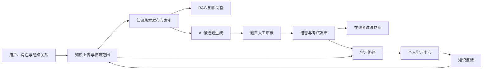
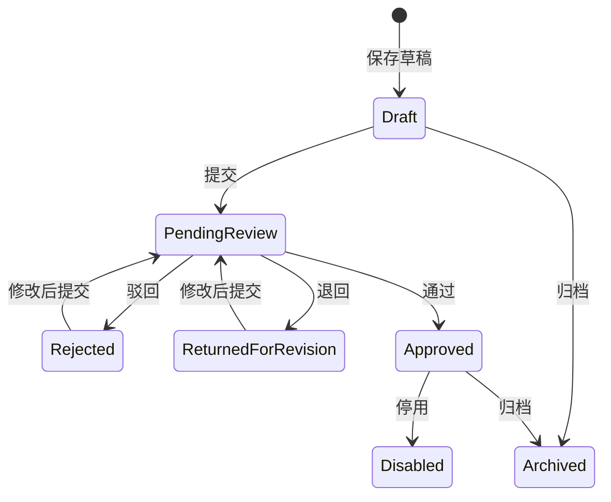

# KnowPulse 详细使用操作手册

- 版本：v1.0
- 文档日期：2026-07-19
- 适用范围：当前 `main` 分支的 KnowPulse Web 应用
- 目标读者：系统管理员、知识运营人员、题库审核人员、考试管理员、普通学习用户和运维人员

## 1. 文档目的

本手册说明如何使用 KnowPulse 完成以下业务闭环：

1. 配置用户、角色、部门、岗位、职级和用户组织关系。
2. 上传、发布和维护知识，配置知识可见范围并跟踪索引任务。
3. 使用有引用依据的 RAG 知识问答。
4. 配置 AI 模型目录和业务用途默认模型。
5. 人工创建题目，或基于知识库生成 AI 候选题并完成人工审核。
6. 创建、预览、发布和参加考试。
7. 查看个人学习路径，完成知识阅读和必考考试。
8. 提交和处理知识反馈，形成知识修订闭环。

本手册以当前页面、权限、应用服务和领域规则为依据，不把规划中的功能写成已经存在的页面功能。

部署、备份、恢复和服务启动不属于本手册的主体范围。开发环境启动参见 [development-environment.md](development-environment.md)，私有化配置边界参见 [private-deployment-baseline.md](private-deployment-baseline.md)。

## 2. 系统业务全景



建议按以下顺序初始化新环境：

1. 创建用户和业务角色，并分配 KnowPulse 权限。
2. 创建部门、岗位、职级。
3. 为用户配置有效的组织关系和安全等级。
4. 创建知识分类。
5. 上传并发布知识，配置可见范围。
6. 确认索引完成，并在知识问答中验证。
7. 配置模型健康状态和业务用途绑定。
8. 创建或生成题目，完成人工审核。
9. 创建并发布考试。
10. 配置学习路径，让用户完成学习和考试。
11. 定期处理知识反馈、索引失败和模型健康异常。

## 3. 访问地址与登录

### 3.1 本地开发默认地址

| 用途 | 默认地址 |
| --- | --- |
| KnowPulse Web | `https://localhost:44307` |
| API 与 Swagger | `https://localhost:44305/swagger/index.html` |
| LiteLLM Admin UI | 在“模型管理”页面点击 `LiteLLM Admin UI`，地址由服务端配置决定 |

生产环境应使用实际域名替换本地地址。

### 3.2 登录步骤

1. 打开 KnowPulse Web 地址。
2. 点击登录，进入统一账户登录页。
3. 输入用户名和密码。
4. 登录成功后，系统根据角色权限显示菜单。

本地开发模板默认管理员通常为：

- 用户名：`admin`
- 本地模板密码：`1q2w3E*`

该密码只适用于本地开发基线。生产环境必须修改默认密码，禁止长期共用默认 `admin` 账号。

### 3.3 账户管理

登录后打开右上角用户菜单，点击“我的账户”。该入口会在新标签页打开账户管理页面，可修改个人资料和密码。

## 4. 权限和数据可见性

KnowPulse 同时使用三层控制：

1. 功能权限：决定菜单是否显示、页面和 API 是否允许访问。
2. 知识权限范围：决定当前用户能否看到某一份知识。
3. 安全等级：作为知识权限范围的附加门槛。

拥有“知识库”菜单权限，不代表可以看到所有知识。后端仍会根据部门、岗位、角色、指定用户和安全等级进行二次判断。

### 4.1 建议角色

下列角色是部署时的建议，并非系统预置角色：

| 建议角色 | 主要职责 | 建议权限 |
| --- | --- | --- |
| 系统管理员 | 用户、角色、权限、全部业务配置 | 全部 KnowPulse 权限及 ABP 管理权限 |
| 组织管理员 | 部门、岗位、职级、用户组织关系 | `KnowPulse.Organization.*` |
| 知识运营员 | 分类、知识、版本、附件、权限和索引 | `KnowPulse.KnowledgeBase` 及所需子权限、`KnowPulse.KnowledgeIndexing.IndexJobs` |
| 知识反馈处理员 | 查询反馈、创建修订、发布验证并完成反馈 | `KnowPulse.KnowledgeBase`、`KnowledgeBase.Items`、`KnowledgeBase.Feedback`、`KnowledgeBase.Versions`、`KnowledgeBase.PermissionScopes`；排障时再授予 `KnowledgeIndexing.IndexJobs` |
| 模型管理员 | 模型目录、健康检查和默认模型切换 | `KnowPulse.Rag`、`KnowPulse.AiModels.*` |
| 题库编辑 | 人工题目和 AI 候选题 | `KnowPulse.QuestionBank`、`QuestionBank.Questions`、`QuestionBank.AiGeneration` |
| 题库审核员 | 题目通过、退回或驳回 | `KnowPulse.QuestionBank`、`QuestionBank.Questions`、`QuestionBank.Reviews` |
| 考试管理员 | 组卷和发布考试 | `KnowPulse.Exam`、`Exam.Manage`，并建议拥有题库查看权限 |
| 学习用户 | 问答、在线考试和个人学习 | `KnowPulse.Rag`、`Rag.Answer`、`KnowPulse.Exam`、`Exam.Participate`、`Learning.View`；需要打开知识详情时另行评估知识权限 |

### 4.2 当前权限粒度注意事项

- `KnowPulse.KnowledgeBase.Items` 当前同时控制知识页面入口和知识文档管理应用服务，并未拆分为纯只读与编辑权限。
- “题目管理”页面会根据题目状态显示审核按钮，但真正执行“通过、退回、驳回”仍要求 `QuestionBank.Reviews`。
- `Learning.Manage`、`Rag.AuditLogs`、`Rag.Evaluations` 和 `Exam.Results` 当前主要通过 API 使用，没有对应的完整独立管理页面。
- 如果菜单缺失，先检查角色权限；如果菜单存在但某条知识不可见，再检查知识权限范围和用户组织关系。

### 4.3 配置角色权限

1. 打开“管理”菜单。
2. 进入 Identity/身份管理中的“角色”。
3. 新建或编辑角色。
4. 打开权限配置。
5. 找到 `KnowPulse` 权限组。
6. 勾选所需根权限和子权限。
7. 保存角色。
8. 将角色分配给用户。
9. 让用户重新登录，确认菜单和功能是否生效。

## 5. 组织管理

组织数据会被知识权限、考试分配和学习路径分配共同使用。建议先配置组织，再开始录入业务内容。

### 5.1 部门

入口：`组织管理 → 部门`；路由：`/organization/departments`

字段说明：

| 字段 | 是否必填 | 说明 |
| --- | --- | --- |
| 编码 | 是 | 最长 64 字符，建议使用稳定业务编码，如 `RD`、`HR` |
| 名称 | 是 | 最长 128 字符 |
| 上级部门 | 否 | 用于形成部门层级 |
| 安全等级 | 是 | 非负整数，作为部门主数据保存；当前用户实际访问等级以“用户组织关系”中的安全等级为准 |
| 启用 | 是 | 停用后不建议继续用于新分配 |

操作步骤：

1. 填写编码和名称。
2. 如果是子部门，选择上级部门。
3. 设置安全等级。
4. 保持“启用”。
5. 点击“保存”。
6. 在右侧列表确认新增记录。

点击“编辑”可回填表单；点击“删除”会删除记录。删除前应先确认没有岗位、用户组织关系、权限范围、考试或学习路径继续引用该部门。

### 5.2 岗位

入口：`组织管理 → 岗位`；路由：`/organization/positions`

岗位字段包括编码、名称、所属部门、安全等级和启用状态。岗位可以不绑定部门，但建议业务岗位明确归属部门，以便权限和分配规则容易维护。

### 5.3 职级

入口：`组织管理 → 职级`；路由：`/organization/job-levels`

字段说明：

- 编码、名称：必填。
- 排序：数值越小通常越靠前。
- 安全等级：非负整数。
- 启用：控制是否继续用于用户组织关系和学习路径分配。

### 5.4 用户组织关系

入口：`组织管理 → 用户组织关系`；路由：`/organization/user-assignments`

用户组织关系把 Identity 用户与部门、岗位、职级和安全等级连接起来。部门、岗位和职级页面也保存安全等级字段，但当前知识访问上下文实际读取的是用户组织关系的安全等级。

字段说明：

| 字段 | 说明 |
| --- | --- |
| 用户 ID | Identity 用户的 GUID，不是用户名 |
| 部门 | 必填 |
| 岗位 | 可选 |
| 职级 | 可选 |
| 安全等级 | 非负整数 |
| 主组织关系 | 表示用户的主要组织任职 |
| 启用 | 只有启用的关系参与权限和分配判断 |

获取用户 ID 的常用方法：

1. 在“管理 → Identity/身份管理 → 用户”中查找用户。
2. 或在 Swagger 中调用用户列表接口，复制返回的 `id`。

查询区支持按用户 ID、部门和启用状态筛选。

当前用户的知识访问安全等级取所有启用组织关系中的最高值。部门和岗位匹配也会合并所有启用关系。

## 6. 知识库基础数据

### 6.1 知识分类

入口：`知识库 → 知识分类`；路由：`/knowledge/categories`

字段：编码、名称、上级分类、启用。

建议：

- 分类用于稳定的业务层级，例如“制度 → 人力资源制度”。
- 编码保持唯一且长期稳定。
- 停用旧分类优于直接删除仍被知识引用的分类。

### 6.2 标签

入口：`知识库 → 标签`；路由：`/knowledge/tags`

标签页面当前支持标签名称和启用状态的新增、编辑、删除。

当前版本边界：知识上传页和知识管理页尚未提供把标签绑定到知识文档的控件；题目页面中的“标签”是题目自由文本字段，不等同于知识标签字典。标签页面目前主要用于维护基础字典和后续扩展。

## 7. 上传知识：推荐流程

入口：`知识库 → 上传知识`；路由：`/knowledge/upload`

这是管理员创建一份可用知识的推荐入口。页面包含五个步骤，并在右侧持续显示当前状态。

### 7.1 上传前权限

进入页面至少需要：

- `KnowPulse.KnowledgeBase.Items`

要完整保存和发布文件型知识，还需要：

- `KnowPulse.KnowledgeBase.Versions`
- `KnowPulse.KnowledgeBase.Attachments`

要在引导流程中设置限制范围，还需要：

- `KnowPulse.KnowledgeBase.PermissionScopes`

要查看、重试索引任务，还需要：

- `KnowPulse.KnowledgeIndexing.IndexJobs`

### 7.2 第一步：选择内容来源

| 模式 | 支持内容 | 是否进入 RAG | 限制 |
| --- | --- | --- | --- |
| 正文输入 | 直接粘贴制度、流程、FAQ、说明 | 直接进入 | 最长 8192 字符 |
| 文本或 Markdown | `.txt`、`.md`、`.markdown` | 索引阶段直接读取 | 文件最大 128 KB；附件总限制仍为 20 MB |
| 文档转换 | `.pdf`、`.doc`、`.docx`、`.ppt`、`.pptx`、`.xls`、`.xlsx`、`.html`、`.htm`、`.csv`、`.json`、`.xml` | 通过 MarkItDown 转成 Markdown 后进入 | 单文件最大 20 MB；服务端必须可执行 MarkItDown |
| 附件留存 | 图片、音频、视频、压缩包和其他文件 | 不进入 | 单文件最大 20 MB |

操作步骤：

1. 选择一种来源模式。
2. 正文模式下粘贴正文；其他模式选择一个文件。
3. 确认页面提示的 RAG 状态。
4. 点击“下一步”。

重要区别：

- 文件上传成功不等于文件已经可以被问答检索。
- “附件留存”只保存原始文件，不执行 OCR、音频转写、视频解析或压缩包递归解析。
- 可转换文档会在索引阶段转换；转换失败时，索引任务通常显示 `reader` 阶段失败。

### 7.3 第二步：填写基础信息

| 字段 | 是否必填 | 限制或用途 |
| --- | --- | --- |
| 知识标题 | 是 | 最长 256 字符，用于知识列表和问答引用 |
| 分类 | 否 | 无分类时保存为“未分类” |
| 摘要 | 否 | 最长 1024 字符 |
| 版本标题 | 是 | 最长 256 字符，用于记录本次内容版本 |

建议版本标题表达变更，例如：

- `初始发布`
- `2026 年 7 月制度更新`
- `补充报销审批示例`

### 7.4 第三步：确认可见范围

默认选择“全员可见”。这里的“全员”是指拥有知识功能权限的用户，而不是未登录用户。

限制范围支持：

- 部门
- 岗位
- 角色
- 指定用户

还可以填写“最低安全等级”。

如果内容包含部门内部制度、管理层资料或其他受限信息，不要直接使用默认全员范围。

### 7.5 第四步：发布确认

页面会汇总：

- 知识标题
- 内容来源
- RAG 状态
- 可见范围
- 分类

可选择两种操作：

- `保存草稿`：创建知识文档、草稿版本和附件，但不发布，不进入问答检索。
- `发布并创建索引`：发布当前版本，并创建索引任务。

发布前重点检查：

1. 是否误用了“附件留存”，导致内容不能检索。
2. 是否误选“全员可见”。
3. 文档转换环境是否已配置 MarkItDown。
4. 是否具有附件、版本和权限范围所需权限。

### 7.6 第五步：处理结果

可能出现的结果：

| 结果 | 含义 | 后续操作 |
| --- | --- | --- |
| 草稿已保存 | 文档和版本存在，但未发布 | 到“知识管理”继续维护和发布 |
| 上传完成 | 知识已发布，索引任务已创建 | 查看索引状态，再去问答验证 |
| 发布成功，索引失败 | 业务版本已发布，但无法检索 | 查看失败阶段，修复后重试索引 |
| 处理失败 | 创建文档、版本、附件、范围或发布中的某一步失败 | 按失败阶段排查；必要时到高级管理清理不完整记录 |

成功后可直接：

- 去问答验证
- 继续上传下一份
- 查看高级管理

## 8. 知识管理：高级维护

入口：`知识库 → 知识管理`；路由：`/knowledge/items`

该页面同时管理知识文档、版本、附件和用户反馈。新手上传优先使用“上传知识”，版本维护和排障使用本页面。

### 8.1 新建或编辑知识文档

左侧“新增知识文档”只维护元数据：

- 标题
- 分类
- 摘要
- 启用状态

正文不直接保存在文档元数据中，必须通过“版本内容”创建版本。

操作步骤：

1. 点击“新建文档”。
2. 填写标题、分类和摘要。
3. 点击“创建并打开”。
4. 在“版本内容”填写版本标题和正文。
5. 点击“创建版本”。

### 8.2 版本生命周期

| 状态 | 含义 |
| --- | --- |
| Draft | 草稿，尚未成为当前发布版本 |
| 当前发布 | 当前对用户和检索链路生效的版本 |
| Withdrawn | 已下架 |
| Archived | 已归档，不能再次发布 |
| Disabled | 已禁用 |

版本操作：

- `预览`：查看版本正文。
- `发布`：把该版本设为当前发布版本；旧的当前版本会失去当前发布标记，相关旧索引会变为过期。
- `下架`：取消该版本的发布状态，用户不再按当前发布版本访问它。
- `重建索引`：创建新的手动重建任务，不覆盖历史任务。
- `归档`：终止该版本生命周期，归档后不能重新发布。

同一知识文档最多只有一个当前发布版本。

### 8.3 附件管理

1. 打开一份知识文档。
2. 在“版本附件”选择版本。
3. 选择文件。
4. 点击“上传”。
5. 在列表中执行预览、下载或删除。

单个附件最大 20 MB。

浏览器在线预览支持：

- PDF
- 安全文本：`.txt`、`.md`、`.markdown`、`.json`、`.csv`、`.log`、`.yaml`、`.yml`
- 普通图片、音频和视频

HTML、XML、SVG 和未知二进制类型不会直接在线预览，应下载后查看。

附件预览和下载始终通过应用服务权限检查，不使用公开裸文件地址。

### 8.4 用户提交知识反馈

在知识管理页打开知识和版本后，可填写：

- 类型：问题、过期、错误、缺失、建议
- 标题：必填，最长 256 字符
- 说明：必填，最长 2048 字符

点击“提交反馈”后，反馈进入“待处理”。

当前反馈提交入口位于 `/knowledge/items`，因此提交人需要 `KnowledgeBase.Items`。由于该权限当前未拆分纯只读和编辑能力，生产角色设计时应评估授权范围。

## 9. 知识权限范围

入口：`知识库 → 知识管理 → 打开一份知识 → 访问策略 → 调整访问策略`；路由：`/knowledge/permission-scopes?itemId={知识ID}`

权限范围不再作为知识库一级菜单。管理员先选择具体知识，再调整这份知识的访问策略，避免在全局下拉中误改其他文档。

### 9.1 配置步骤

1. 选择知识文档。
2. 选择范围类型：全员、部门、岗位、角色或指定用户。
3. 非全员范围选择目标。
4. 根据需要设置最低安全等级。
5. 点击“保存”。

保存前页面会展示当前策略、本次变化和检索影响，并要求二次确认。已发布知识发生权限变化时，旧检索结果会立即失效，系统自动创建权限变更索引任务；新索引完成前该知识暂不可用于问答。

指定用户范围支持先输入关键字搜索用户，再从结果中选择。

### 9.2 判断规则

- 如果一份知识没有任何启用的权限范围，则默认可见。
- 一旦存在启用范围，用户至少要命中一条范围才可访问。
- 多条范围之间是“或”关系，不是“且”关系。
- 每条范围都可以附带最低安全等级要求。
- 用户安全等级取其所有启用组织关系中的最高值。

示例：

某知识配置两条规则：

1. 研发部，最低安全等级 2。
2. `knowledge-reviewer` 角色，最低安全等级 4。

用户满足任意一条完整规则即可访问。

### 9.3 修改权限后的索引影响

创建或删除权限范围会让旧索引权限快照失效，并创建权限变更类型的索引任务。修改权限后应检查索引任务，避免旧向量权限数据长期保留。

## 10. 索引任务

日常入口：`知识库 → 知识管理 → 打开一份知识 → 检索状态`。

高级排障路由仍保留为 `/knowledge/index-jobs`，但不再作为知识库一级菜单。正常发布和权限调整不需要人工创建或启动任务。

### 10.1 状态

| 状态 | 含义 |
| --- | --- |
| 待处理 | 已创建，等待摄取处理 |
| 处理中 | 正在读取、转换、分块或写入索引事实 |
| 已索引 | 当前任务已成功完成 |
| 失败 | 某个阶段失败，页面会显示阶段和原因 |
| 已过期 | 版本下架、归档、被新版本替换、权限变化或重建后，旧结果不再有效 |
| 已删除 | 索引结果或对应知识版本已删除 |

### 10.2 触发类型

- 发布
- 手动重建
- 权限变更
- 模型变更
- 删除

### 10.3 页面操作

- 按状态筛选任务。
- 查看知识条目 ID、版本 ID、重试次数和任务时间。
- 失败任务点击“重试”：系统创建一条新的待处理任务，保留原失败记录。
- 待处理任务点击“开始”：当前页面操作会把任务状态标记为处理中。

### 10.4 当前执行边界

发布动作负责创建 `Pending` 任务；后台 worker 自动消费待处理或到期重试任务，摄取管道负责读取内容、转换文档、生成 chunk 并更新任务状态。

因此：

- “发布成功”不能单独作为“已经可以问答”的验收依据。
- 管理员通常只需在知识详情查看状态；“重试”和“重建索引”用于失败排障，不是日常发布步骤。
- 部署环境必须保证后台 worker 正常运行，并确认任务最终为“已索引”。
- 如果任务长期停留在“待处理”或“处理中”，应由运维检查任务消费者、MarkItDown、Qdrant、LiteLLM 和数据库连接。

### 10.5 常见失败阶段

| 阶段 | 常见原因 |
| --- | --- |
| reader | 文件格式不支持、附件读取失败、MarkItDown 未安装或路径错误 |
| processor | 文档处理异常或转换结果不可用 |
| chunker | 内容无法正确分块或内容为空 |
| embedding | LiteLLM、模型 Key、模型 Alias、超时或向量维度异常 |
| vector-store | Qdrant 不可达、collection 不存在、维度不匹配或 payload 索引缺失 |

## 11. 知识问答

入口：`RAG 问答 → 知识问答`；路由：`/rag/answer`

### 11.1 操作步骤

1. 输入问题，最长 1024 字符。
2. 设置引用数量，范围 1 至 10，默认 5。
3. 点击“提问”。
4. 查看回答、置信度和“可用/需要复核”标记。
5. 检查下方引用表中的来源、版本、片段和摘录。

### 11.2 结果判断

- 有回答且有引用：优先核对引用内容是否真正支持结论。
- 显示“需要复核”：通常表示模型调用失败、引用数量不足或最高检索分数较低。
- 显示“无可引用依据”：不要把回答当作已验证事实。
- 找不到预期知识：先确认版本已发布、索引已完成、当前用户命中权限范围、模型和向量库健康。

点击“清空”只清除浏览器页面中的问题和结果，不删除后端 RAG 调用日志。

## 12. 模型管理

入口：`RAG 问答 → 模型管理`；路由：`/rag/models`

模型管理分为三个部分：模型目录、业务用途绑定和健康检查。

### 12.1 模型目录字段

| 字段 | 说明 |
| --- | --- |
| Alias | 业务使用的稳定模型别名 |
| 能力 | Chat 或 Embedding |
| 供应商 | LiteLLM、OpenAI、AzureOpenAI、DeepSeek、Tongyi、Ollama 或 Other |
| 上游模型 | LiteLLM 或上游供应商识别的真实模型名称 |
| 业务版本 | 用于审计和追溯的版本标识 |
| Key 环境变量 | 只填写环境变量名称，不填写真实密钥 |
| 输出 token | Chat 模型输出上限 |
| 向量维度 | Embedding 模型必须与 Qdrant collection 维度一致 |
| Base URL | 模型或网关基础地址 |
| 启用 | 控制模型是否可用于绑定和健康检查 |

真实 API Key 必须通过环境变量或 secret 注入，不要写入模型目录、仓库配置或操作文档。

### 12.2 新增模型

1. 点击“新增模型”。
2. 填写 Alias、能力、供应商和上游模型。
3. 填写业务版本。
4. 如模型需要 Key，填写环境变量名称。
5. Chat 模型填写输出 token；Embedding 模型填写准确向量维度。
6. 填写 Base URL。
7. 勾选“启用”。
8. 保存。
9. 点击“测试”，确认健康状态为“正常”。

### 12.3 业务用途绑定

系统支持以下用途：

- RAG 问答
- AI 出题
- 知识 Embedding
- 主观题评分

Chat 用途只能绑定 Chat 模型；知识 Embedding 只能绑定 Embedding 模型。

绑定字段：

- 默认模型
- 业务版本
- 输出 token
- Temperature
- Fallback alias

切换默认模型前先执行健康检查。已被默认用途绑定的模型不能直接停用。

切换 Embedding 模型时：

- 不同向量维度的切换会被系统拒绝。
- 即使维度相同，也应对已发布知识执行重建索引，确保新旧 embedding 模型结果不混用。

### 12.4 健康状态

| 状态 | 说明 |
| --- | --- |
| 未知 | 尚未检查 |
| 正常 | 健康检查通过 |
| 失败 | 网关、模型、响应或维度检查失败 |
| 缺 key | 配置的环境变量不存在或没有值 |
| 停用 | 模型已停用 |

“批量健康检查”会依次检查模型，并在“最近健康检查”中记录延迟和错误摘要。

## 13. 题目管理

入口：`题库 → 题目管理`；路由：`/question-bank/questions`

### 13.1 查询题目

可按以下条件筛选：

- 关键字
- 题型
- 状态
- 难度
- 岗位
- 知识点
- 只看可组卷

只有审核通过且仍启用的题目才应被视为正式可组卷题目。

### 13.2 人工创建题目

字段说明：

| 字段 | 说明 |
| --- | --- |
| 题型 | 单选、多选、判断、填空 |
| 难度 | 简单、普通、困难 |
| 创建来源 | 人工创建通常选择“人工” |
| 适用岗位 | 可选，不限或指定岗位 |
| 标题 | 题目短标题 |
| 题干 | 完整问题 |
| 安全等级 | 当前作为题目元数据保存 |
| 标签 | 自由文本 |
| 选项 | 选择题每行一个，格式 `选项键|内容` |
| 标准答案 | 选择题填选项键；多选用逗号或换行；判断题用 `true/false` 或 `对/错` |
| 解析 | 答案说明 |
| 知识点 | 多个值用逗号分隔 |
| 来源标题 | 人工资料或知识来源标题 |
| 人工来源说明 | 补充来源说明 |

单选示例：

```text
选项：
A|制度用于规范费用报销
B|制度仅用于保存附件
C|制度不需要审批

标准答案：
A
```

多选示例：

```text
选项：
A|部门负责人审批
B|财务审核
C|随意跳过审批

标准答案：
A,B
```

### 13.3 题目状态流转



操作说明：

- `编辑`：修改题目内容。
- `提交`：把草稿、驳回或退回修改状态送入审核。
- `通过`：需要题目审核权限；通过后才可正式组卷。
- `退回`：要求编辑人员修改后重新提交。
- `驳回`：审核不通过，但仍可修改后重新提交。
- `停用`：从正式可用集合中移除。
- `归档`：终止题目生命周期。

## 14. AI 候选题

入口：`题库 → AI 候选题`；路由：`/question-bank/ai-candidates`

### 14.1 创建生成任务

字段：

- 知识范围：必填，最长 512 字符，用于构造检索问题。
- 知识点：可选，用于增强检索。
- 题型：单选、多选、判断、填空。
- 难度：简单、普通、困难。
- 数量：1 至 10，默认 3。
- 引用 TopK：1 至 10，默认 5。
- 适用岗位：可选。
- 安全等级：0 至 10。
- 标签：可选。

操作步骤：

1. 先确认相关知识已经发布并索引。
2. 填写清晰的知识范围，例如“公司差旅报销制度中的审批和票据要求”。
3. 选择题型、难度和数量。
4. 点击“生成候选题”。
5. 在任务列表选择任务。
6. 检查候选题题干、选项、答案、解析、知识点和引用。
7. 关注相似题警告，避免重复入库。
8. 点击“提交审核”。
9. 具有审核权限的用户执行“审核通过”或“驳回”。

### 14.2 状态说明

任务状态：待处理、处理中、已生成、失败、已取消。失败任务可点击“重试”，重试会清理旧候选结果并重新生成，同时保留调用审计历史。

候选题状态：

- 可提交
- 校验失败
- 已提交审核
- 已驳回

存在校验错误或缺少必要 citation 的候选题不能直接提交审核。AI 生成结果必须人工检查，不能把“已生成”当作“已审核通过”。

## 15. 考试管理

入口：`考试 → 考试管理`；路由：`/exam/management`

### 15.1 创建前置条件

1. 题库中已有审核通过的正式题目。
2. 如果按部门或岗位分配，组织数据已经配置。
3. 如果按指定用户分配，已取得用户 GUID。
4. 考试开始和结束时间、时长、及格分和次数已经确认。

### 15.2 基础字段

| 字段 | 规则 |
| --- | --- |
| 考试名称 | 必填，最长 256 字符 |
| 说明 | 可选，最长 1024 字符 |
| 开始时间 | 考生只能在允许时间内开始 |
| 结束时间 | 必须晚于开始时间 |
| 时长分钟 | 1 至 1440 |
| 及格分 | 0 至 100000，实际应与试卷总分匹配 |
| 次数 | 1 至 20 |

实际答题到期时间取“开始时间 + 考试时长”和“考试结束时间”中的较早值。

### 15.3 组卷方式

#### 规则组卷

每行格式：

```text
题型|难度|知识点|数量|每题分值
```

示例：

```text
单选|普通|制度基础|5|10
多选|困难|审批流程|2|15
判断|简单||3|5
```

支持中文或枚举英文题型、难度。知识点可留空。

如果符合条件的审核通过题目不足，预览或发布会失败，应调整规则或补充题目。

#### 固定题目

填写题目 GUID，每行一个。当前题目列表页面不直接显示 ID，建议通过 Swagger 的题目查询接口获取。

固定题目也必须处于审核通过状态。

### 15.4 分配范围

支持：

- 全员
- 部门
- 岗位
- 指定用户

部门和岗位使用下拉框；指定用户需要输入用户 GUID。

### 15.5 预览和发布

1. 填写考试和组卷配置。
2. 点击“预览试卷”。
3. 检查题目数量、总分、题型、难度、知识点和题干。
4. 确认及格分不高于总分。
5. 点击“发布考试”。

发布时会保存试卷快照。以后修改题库，不会改变已经开始或已经发布考试中的试卷快照。

当前页面以创建和查看为主，没有提供完整的考试编辑、取消、成绩报表和改分管理界面；相关结果查询主要通过 API 完成。

## 16. 在线考试

入口：`考试 → 在线考试`；路由：`/exam/take`

### 16.1 参加条件

- 考试已经发布。
- 当前用户命中考试的全员、部门、岗位或指定用户分配。
- 当前时间允许开始考试。
- 尚未超过最大考试次数。
- 用户拥有 `Exam.Participate` 权限。

### 16.2 作答步骤

1. 在左侧“可参加考试”列表选择考试。
2. 点击“开始”。
3. 查看第几次作答、状态和剩余时间。
4. 按题型填写答案：
   - 单选：选择一个选项。
   - 多选：勾选多个选项。
   - 判断：选择对或错。
   - 填空：输入文本。
5. 页面会在答案变化时自动保存。
6. 需要时点击“手动保存”。
7. 确认完成后点击“提交试卷”。

如果保存失败，页面会显示“重试保存”。不要在保存失败时直接关闭浏览器。

### 16.3 提交和评分

提交后不能继续修改答案。当前系统按 `objective-v1` 规则自动评分：

- 单选、判断和填空按归一化后的答案集合匹配。
- 多选根据试卷快照中的多选评分模式计算。
- 页面会显示所得分和总分，并根据及格线显示通过或未通过。

重复提交和重复评分按幂等规则处理，不应生成重复成绩。

## 17. 我的学习

入口：`学习路径 → 我的学习`；路由：`/learning/my`

个人学习中心只显示：

- 已启用的学习路径。
- 当前用户按部门、岗位或职级命中的路径。
- 当前用户有权限访问的知识。

每条学习路径包含：

- 必学知识
- 推荐知识
- 必考考试

知识操作：

- `去阅读`：记录已阅读，状态从未开始变为进行中，并打开对应知识版本。
- `标记完成`：把该知识在当前学习路径中的状态标记为已完成。

“去阅读”会跳转 `/knowledge/items`。当前用户还需要 `KnowledgeBase.Items` 才能打开该页面；该权限同时包含知识管理能力，是当前版本需要谨慎配置的权限边界。

考试操作：

- `去考试入口`：跳转在线考试。
- 考试是否真的可以开始，仍由考试模块自己的分配范围、时间和次数规则决定。

学习路径把某场考试列为“必考”，不会自动覆盖考试自身的分配范围。管理员配置学习路径时，应确保考试分配也覆盖同一批用户。

## 18. 学习路径管理：Swagger 操作

当前版本没有独立的学习路径配置页面。拥有 `KnowPulse.Learning.Manage` 权限的管理员通过 Swagger 使用 `api/learning/paths` 接口。

### 18.1 Swagger 授权

1. 打开 Swagger。
2. 点击“Authorize”。
3. 使用有相应权限的账户完成授权。
4. 展开 `LearningPaths` 接口组。

### 18.2 创建学习路径

接口：`POST /api/learning/paths`

示例请求：

```json
{
  "name": "研发新员工入职路径",
  "description": "完成研发制度阅读和入职考试",
  "assignments": [
    {
      "scopeType": 1,
      "targetId": "<部门ID>"
    }
  ],
  "requiredKnowledge": [
    {
      "knowledgeItemId": "<知识文档ID>",
      "knowledgeVersionId": null,
      "displayOrder": 1,
      "note": "入职第一天完成",
      "reason": null
    }
  ],
  "recommendedKnowledge": [
    {
      "knowledgeItemId": "<知识文档ID>",
      "knowledgeVersionId": null,
      "displayOrder": 1,
      "note": null,
      "reason": "建议了解研发协作规范"
    }
  ],
  "requiredExams": [
    {
      "examPlanId": "<已发布考试ID>",
      "displayOrder": 1,
      "passingRequired": true,
      "note": "达到及格线才算完成"
    }
  ]
}
```

`scopeType`：

- `0`：全员，`targetId` 传 `null`
- `1`：部门
- `2`：岗位
- `3`：职级

规则：

- 至少配置一条分配规则。
- `knowledgeVersionId` 为空时，使用知识文档当前发布版本。
- 必考考试必须引用已发布考试。
- 知识内容还会经过知识权限范围二次过滤。

### 18.3 查询、编辑和停用

| 操作 | 接口 |
| --- | --- |
| 管理端查询列表 | `GET /api/learning/paths` |
| 查询详情 | `GET /api/learning/paths/{id}` |
| 整体替换配置 | `PUT /api/learning/paths/{id}` |
| 停用 | `POST /api/learning/paths/{id}/deactivate` |

编辑会整体替换分配、必学知识、推荐知识和必考考试配置，并递增配置版本。执行更新前先读取当前详情，避免遗漏已有配置。

## 19. 知识反馈处理

入口：`知识库 → 知识管理 → 打开一份知识 → 反馈与修订 → 处理当前知识反馈`；路由：`/knowledge/feedback?itemId={知识ID}`

反馈处理不再作为知识库一级菜单。页面默认限定当前知识，避免处理人脱离内容上下文判断问题。

### 19.1 查询

可按状态、类型和关键字筛选。

状态：

- 待处理
- 处理中
- 已完成
- 已关闭

### 19.2 处理流程

1. 选择反馈。
2. 点击知识标题，打开来源知识和版本核实问题。
3. 填写处理备注，点击“接手处理”，状态变为“处理中”。
4. 点击“创建修订草稿”。系统复制反馈来源版本的正文并自动关联反馈，不需要填写版本 ID；附件不会自动复制，应在修订中重新上传更新后的附件。
5. 点击“编辑或发布修订”，完成正文或附件修改，将修订发布为当前版本。
6. 等待知识详情的“检索状态”变为“已索引”。
7. 回到反馈页点击“刷新验证状态”，填写处理结论。
8. 点击“验证并完成反馈”。服务端会再次校验关联修订确实是当前发布版本，且最新索引任务已经完成。

如果反馈无效、重复或无需继续处理：

1. 填写关闭原因。
2. 点击“关闭反馈”。
3. 确认关闭。

关闭后不能继续处理或创建修订。关闭用于无效、重复或无需改动的反馈；需要修改内容的反馈必须走“接手 → 创建修订 → 发布验证 → 完成”闭环。

## 20. 高级 API 与运营检查

以下能力当前没有完整页面，主要通过 Swagger 使用。

### 20.1 RAG 调用日志

权限：`KnowPulse.Rag.AuditLogs`；接口：`GET /api/ai/rag/call-logs`

可按用户、知识版本、模型版本、调用类型、状态和时间范围查询。日志保存查询摘要、模型信息、token、耗时、置信度和引用记录，不应保存完整知识正文或完整 prompt。

### 20.2 RAG 质量评测

权限：`KnowPulse.Rag.Evaluations`；接口组：`/api/ai/rag/evaluations`

典型步骤：

1. 创建评测用例 `POST .../cases`。
2. 配置问题、期望拒答、权限上下文、期望引用和禁止引用。
3. 创建评测运行 `POST .../runs`。
4. 查询运行详情和逐用例结果。
5. 重点检查命中率、引用准确率、无答案拒答率和未授权召回率。

任何未授权引用都应视为严重失败，不应只看平均命中率。

### 20.3 考试成绩

权限：`KnowPulse.Exam.Results`

考试应用服务提供成绩列表和错题记录 DTO，但当前没有完整成绩管理页面。需要批量查询成绩、及格情况或错题时，通过 Swagger 使用考试相关接口。

## 21. 四个端到端操作场景

### 21.1 场景一：上传一份全员制度并验证问答

1. 创建知识分类“公司制度”。
2. 打开“上传知识”。
3. 选择“正文输入”或“文档转换”。
4. 填写知识标题、分类、摘要和版本标题。
5. 保持“全员可见”。
6. 点击“发布并创建索引”。
7. 在索引任务中确认最终为“已索引”。
8. 打开知识问答，提出一个正文中可以直接回答的问题。
9. 确认回答有引用，并检查引用摘录来自该制度。

完成标准：版本已发布、索引已完成、问答有正确 citation。

### 21.2 场景二：发布部门受限知识

1. 创建部门并配置用户组织关系。
2. 上传知识。
3. 在可见范围选择“限制范围 → 部门”。
4. 选择目标部门和最低安全等级。
5. 发布并完成索引。
6. 用部门内满足安全等级的用户验证可以检索。
7. 用部门外用户验证知识列表和问答都不能召回该知识。

完成标准：授权用户可见，未授权用户不可见，RAG 也不能越权引用。

### 21.3 场景三：知识生成题目并发布考试

1. 确认目标知识已索引。
2. 在“AI 候选题”创建生成任务。
3. 检查候选题答案、解析、citation 和相似题警告。
4. 提交审核。
5. 题库审核员审核通过。
6. 在“考试管理”使用规则组卷。
7. 预览试卷，确认题量和总分。
8. 设置考试分配范围并发布。
9. 使用被分配用户进入“在线考试”完成作答。

完成标准：候选题经过人工审核、考试可见、答案保存成功、提交后生成成绩。

### 21.4 场景四：反馈推动知识修订

1. 用户在知识管理页提交“过期”或“错误”反馈。
2. 反馈处理员在“知识反馈”接手。
3. 打开来源知识，创建新的修订版本。
4. 关联修订版本 ID。
5. 发布新版本并完成索引。
6. 填写处理结论并标记已处理。
7. 在知识问答中验证新内容生效，旧版本不再是当前发布版本。

完成标准：反馈有处理人、结论和修订版本，知识和索引均已更新。

## 22. 常见问题排查

| 现象 | 优先检查 |
| --- | --- |
| 看不到菜单 | 角色是否授予对应根权限和子权限；重新登录 |
| 页面提示无权限 | 检查具体子权限，不只检查根菜单权限 |
| 用户看不到知识 | 文档是否启用、版本是否发布、权限范围是否命中、安全等级是否满足 |
| 上传页不能保存或发布 | 是否缺少 Versions 权限 |
| 文件上传按钮不可用 | 是否缺少 Attachments 权限；是否选择了版本和文件 |
| 文本文件上传失败 | 扩展名是否为 `.txt/.md/.markdown`；是否超过 128 KB |
| 转换文档 reader 失败 | MarkItDown 是否安装；可执行路径和服务账号权限是否正确 |
| 索引长期待处理 | 是否存在实际任务消费/摄取调用；数据库和服务是否健康 |
| 索引失败后点击重试仍旧失败 | 新任务会保留相同根因；先修复 reader、模型或向量库问题 |
| 问答没有引用 | 知识是否已索引；用户是否有权限；TopK 是否过小；向量库是否健康 |
| 模型显示缺 key | 模型目录中的环境变量名称是否存在于服务进程环境中 |
| 模型不能停用 | 该模型是否仍绑定为某个业务用途默认模型 |
| AI 候选题生成失败 | RAG 是否能检索到知识；Chat 模型是否健康；知识范围是否明确 |
| AI 候选题不能提交 | 是否有校验错误、是否已经提交过、是否缺少 citation |
| 题目不能用于组卷 | 状态是否为审核通过；是否已经停用或归档 |
| 规则组卷题目不足 | 放宽题型、难度、知识点或岗位条件；补充审核通过题目 |
| 考试无法开始 | 是否发布、是否到开始时间、是否命中分配、是否超过次数 |
| 学习路径能看到考试但不能参加 | 学习路径分配和考试分配是否一致 |
| 反馈不能关联版本 | 版本 ID 是否有效且属于同一知识文档 |

## 23. 当前版本边界

使用和交付时应明确以下边界：

- 知识上传引导一次处理一份知识和一个文件，不支持批量上传。
- 图片 OCR、音视频转写、压缩包递归解析未启用。
- 知识标签字典尚未在知识上传和知识管理页绑定到文档。
- 学习路径配置没有独立页面，需要 Swagger。
- RAG 调用日志和质量评测没有独立页面，需要 Swagger。
- 考试成绩、错题运营和考试编辑没有完整管理页面，需要 API 或后续页面增强。
- 索引任务页面没有提供完整 worker 管理；部署必须明确实际摄取执行方式。
- `KnowledgeBase.Items` 尚未拆分纯只读和编辑权限。
- 完整 BI 不在当前最小运营闭环内。

## 24. 页面路由速查

| 菜单 | 路由 |
| --- | --- |
| 首页 | `/` |
| 部门 | `/organization/departments` |
| 岗位 | `/organization/positions` |
| 职级 | `/organization/job-levels` |
| 用户组织关系 | `/organization/user-assignments` |
| 上传知识 | `/knowledge/upload` |
| 知识管理 | `/knowledge` |
| 知识分类 | `/knowledge/categories` |
| 标签 | `/knowledge/tags` |
| 知识详情 · 访问策略 | `/knowledge/{id}?tab=access` |
| 知识详情 · 检索状态 | `/knowledge/{id}?tab=index` |
| 知识详情 · 反馈与修订 | `/knowledge/{id}?tab=feedback` |
| 知识问答 | `/rag/answer` |
| 模型管理 | `/rag/models` |
| 题目管理 | `/question-bank/questions` |
| AI 候选题 | `/question-bank/ai-candidates` |
| 考试管理 | `/exam/management` |
| 在线考试 | `/exam/take` |
| 我的学习 | `/learning/my` |

## 25. 权限键速查

### 25.1 组织管理

- `KnowPulse.Organization`
- `KnowPulse.Organization.Departments`
- `KnowPulse.Organization.Positions`
- `KnowPulse.Organization.JobLevels`
- `KnowPulse.Organization.UserAssignments`

### 25.2 知识库

- `KnowPulse.KnowledgeBase`
- `KnowPulse.KnowledgeBase.Categories`
- `KnowPulse.KnowledgeBase.Tags`
- `KnowPulse.KnowledgeBase.Items`
- `KnowPulse.KnowledgeBase.Versions`
- `KnowPulse.KnowledgeBase.Attachments`
- `KnowPulse.KnowledgeBase.PermissionScopes`
- `KnowPulse.KnowledgeBase.Feedback`
- `KnowPulse.KnowledgeIndexing`
- `KnowPulse.KnowledgeIndexing.IndexJobs`

### 25.3 RAG 和模型

- `KnowPulse.Rag`
- `KnowPulse.Rag.Search`
- `KnowPulse.Rag.Answer`
- `KnowPulse.Rag.AuditLogs`
- `KnowPulse.Rag.Evaluations`
- `KnowPulse.AiModels`
- `KnowPulse.AiModels.View`
- `KnowPulse.AiModels.Manage`
- `KnowPulse.AiModels.Test`
- `KnowPulse.AiModels.SwitchDefaults`

### 25.4 题库、考试和学习

- `KnowPulse.QuestionBank`
- `KnowPulse.QuestionBank.Questions`
- `KnowPulse.QuestionBank.Reviews`
- `KnowPulse.QuestionBank.AiGeneration`
- `KnowPulse.Exam`
- `KnowPulse.Exam.Manage`
- `KnowPulse.Exam.Participate`
- `KnowPulse.Exam.Results`
- `KnowPulse.Learning`
- `KnowPulse.Learning.Manage`
- `KnowPulse.Learning.View`

## 26. 交付验收清单

### 26.1 管理员

- [ ] 能登录并看到被授权菜单。
- [ ] 能创建部门、岗位、职级和用户组织关系。
- [ ] 能创建分类并上传一份知识。
- [ ] 能配置受限知识范围并验证未授权用户不可见。
- [ ] 能查看索引状态和失败原因。
- [ ] 能完成模型健康检查和业务用途绑定。
- [ ] 能创建、审核题目并发布考试。
- [ ] 能从反馈自动创建修订，并在发布和索引成功后完成反馈。

### 26.2 普通用户

- [ ] 只能看到权限范围内的知识。
- [ ] 能提出问题并看到 citation。
- [ ] 能看到被分配的考试并保存、提交答案。
- [ ] 能看到被分配的学习路径。
- [ ] 能阅读知识、标记完成并进入考试。
- [ ] 能提交知识反馈。

### 26.3 运维

- [ ] PostgreSQL、MinIO、Qdrant、LiteLLM 均健康。
- [ ] MarkItDown 在服务账号环境中可执行。
- [ ] 发布知识后实际摄取流程会消费待处理任务。
- [ ] 索引任务最终进入“已索引”或保留可定位的失败阶段。
- [ ] Embedding 模型维度与 Qdrant collection 一致。
- [ ] 真实密钥只通过环境变量或 secret 注入。
- [ ] RAG、考试、反馈和关键管理动作有审计记录。
