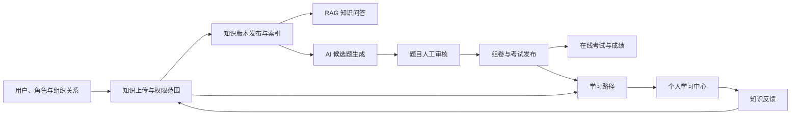
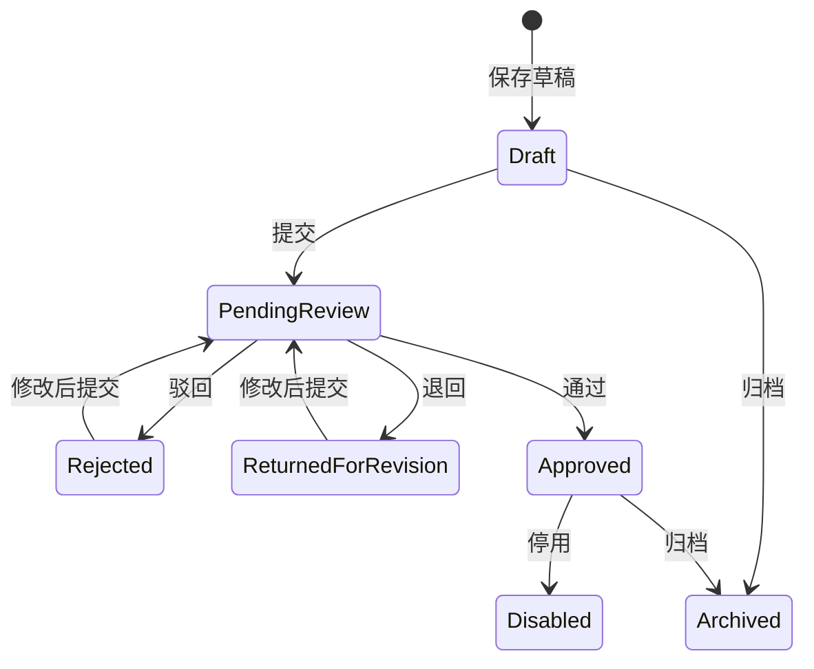

# KnowPulse 详细使用操作手册

- 版本：v1.1
- 文档日期：2026-10-07
- 适用范围：KnowPulse Web 应用；第 27 节为当前工作区新增的教育个人库操作，尚未完成登录后的流程验收
- 目标读者：系统管理员、知识运营人员、题库审核人员、考试管理员、普通学习用户和运维人员

## 1. 文档目的

本手册说明如何使用 KnowPulse 完成以下业务闭环：

1. 配置用户、角色、部门、岗位、职级和用户组织关系。
2. 上传、发布和维护知识，配置知识可见范围并跟踪索引任务。
3. 使用有引用依据的 RAG 知识问答。
4. 配置 AI 模型目录和业务用途默认模型。
5. 人工创建题目，或基于知识库生成 AI 候选题并完成人工审核。
6. 创建、预览、发布和参加考试。
7. 查看个人学习路径，完成知识阅读和必考考试。
8. 提交和处理知识反馈，形成知识修订闭环。

本手册以当前页面、权限、应用服务和领域规则为依据，不把规划中的功能写成已经存在的页面功能。

部署、备份、恢复和服务启动不属于本手册的主体范围。开发环境启动参见 [development-environment.md](development-environment.md)，私有化配置边界参见 [private-deployment-baseline.md](private-deployment-baseline.md)。

## 2. 系统业务全景



建议按以下顺序初始化新环境：

1. 创建用户和业务角色，并分配 KnowPulse 权限。
2. 创建部门、岗位、职级。
3. 为用户配置有效的组织关系和安全等级。
4. 创建知识分类。
5. 上传并发布知识，配置可见范围。
6. 确认索引完成，并在知识问答中验证。
7. 配置模型健康状态和业务用途绑定。
8. 创建或生成题目，完成人工审核。
9. 创建并发布考试。
10. 配置学习路径，让用户完成学习和考试。
11. 定期处理知识反馈、索引失败和模型健康异常。

## 3. 访问地址与登录

### 3.1 本地开发默认地址

| 用途 | 默认地址 |
| --- | --- |
| KnowPulse Web | `https://localhost:44307` |
| API 与 Swagger | `https://localhost:44305/swagger/index.html` |
| LiteLLM Admin UI | 在“模型管理”页面点击 `LiteLLM Admin UI`，地址由服务端配置决定 |

生产环境应使用实际域名替换本地地址。

### 3.2 登录步骤

1. 打开 KnowPulse Web 地址。
2. 点击登录，进入统一账户登录页。
3. 输入用户名和密码。
4. 登录成功后，系统根据角色权限显示菜单。

本地开发模板默认管理员通常为：

- 用户名：`admin`
- 本地模板密码：`1q2w3E*`

该密码只适用于本地开发基线。生产环境必须修改默认密码，禁止长期共用默认 `admin` 账号。

### 3.3 账户管理

登录后打开右上角用户菜单，点击“我的账户”。该入口会在新标签页打开账户管理页面，可修改个人资料和密码。

## 4. 权限和数据可见性

KnowPulse 同时使用三层控制：

1. 功能权限：决定菜单是否显示、页面和 API 是否允许访问。
2. 知识权限范围：决定当前用户能否看到某一份知识。
3. 安全等级：作为知识权限范围的附加门槛。

拥有“知识库”菜单权限，不代表可以看到所有知识。后端仍会根据部门、岗位、角色、指定用户和安全等级进行二次判断。

### 4.1 建议角色

下列角色是部署时的建议，并非系统预置角色：

| 建议角色 | 主要职责 | 建议权限 |
| --- | --- | --- |
| 系统管理员 | 用户、角色、权限、全部业务配置 | 全部 KnowPulse 权限及 ABP 管理权限 |
| 组织管理员 | 部门、岗位、职级、用户组织关系 | `KnowPulse.Organization.*` |
| 知识运营员 | 分类、知识、版本、附件、权限和索引 | `KnowPulse.KnowledgeBase` 及所需子权限、`KnowPulse.KnowledgeIndexing.IndexJobs` |
| 知识反馈处理员 | 查询反馈、创建修订、发布验证并完成反馈 | `KnowPulse.KnowledgeBase`、`KnowledgeBase.Items`、`KnowledgeBase.Feedback`、`KnowledgeBase.Versions`、`KnowledgeBase.PermissionScopes`；排障时再授予 `KnowledgeIndexing.IndexJobs` |
| 模型管理员 | 模型目录、健康检查和默认模型切换 | `KnowPulse.Rag`、`KnowPulse.AiModels.*` |
| 题库编辑 | 人工题目和 AI 候选题 | `KnowPulse.QuestionBank`、`QuestionBank.Questions`、`QuestionBank.AiGeneration` |
| 题库审核员 | 题目通过、退回或驳回 | `KnowPulse.QuestionBank`、`QuestionBank.Questions`、`QuestionBank.Reviews` |
| 考试管理员 | 组卷和发布考试 | `KnowPulse.Exam`、`Exam.Manage`，并建议拥有题库查看权限 |
| 学习用户 | 问答、在线考试和个人学习 | `KnowPulse.Rag`、`Rag.Answer`、`KnowPulse.Exam`、`Exam.Participate`、`Learning.View`；需要打开知识详情时另行评估知识权限 |

### 4.2 当前权限粒度注意事项

- `KnowPulse.KnowledgeBase.Items` 当前同时控制知识页面入口和知识文档管理应用服务，并未拆分为纯只读与编辑权限。
- “题目管理”页面会根据题目状态显示审核按钮，但真正执行“通过、退回、驳回”仍要求 `QuestionBank.Reviews`。
- `Learning.Manage`、`Rag.AuditLogs`、`Rag.Evaluations` 和 `Exam.Results` 当前主要通过 API 使用，没有对应的完整独立管理页面。
- 如果菜单缺失，先检查角色权限；如果菜单存在但某条知识不可见，再检查知识权限范围和用户组织关系。

### 4.3 配置角色权限

1. 打开“管理”菜单。
2. 进入 Identity/身份管理中的“角色”。
3. 新建或编辑角色。
4. 打开权限配置。
5. 找到 `KnowPulse` 权限组。
6. 勾选所需根权限和子权限。
7. 保存角色。
8. 将角色分配给用户。
9. 让用户重新登录，确认菜单和功能是否生效。

## 5. 组织管理

组织数据会被知识权限、考试分配和学习路径分配共同使用。建议先配置组织，再开始录入业务内容。

### 5.1 部门

入口：`组织管理 → 部门`；路由：`/organization/departments`

字段说明：

| 字段 | 是否必填 | 说明 |
| --- | --- | --- |
| 编码 | 是 | 最长 64 字符，建议使用稳定业务编码，如 `RD`、`HR` |
| 名称 | 是 | 最长 128 字符 |
| 上级部门 | 否 | 用于形成部门层级 |
| 安全等级 | 是 | 非负整数，作为部门主数据保存；当前用户实际访问等级以“用户组织关系”中的安全等级为准 |
| 启用 | 是 | 停用后不建议继续用于新分配 |

操作步骤：

1. 填写编码和名称。
2. 如果是子部门，选择上级部门。
3. 设置安全等级。
4. 保持“启用”。
5. 点击“保存”。
6. 在右侧列表确认新增记录。

点击“编辑”可回填表单；点击“删除”会删除记录。删除前应先确认没有岗位、用户组织关系、权限范围、考试或学习路径继续引用该部门。

### 5.2 岗位

入口：`组织管理 → 岗位`；路由：`/organization/positions`

岗位字段包括编码、名称、所属部门、安全等级和启用状态。岗位可以不绑定部门，但建议业务岗位明确归属部门，以便权限和分配规则容易维护。

### 5.3 职级

入口：`组织管理 → 职级`；路由：`/organization/job-levels`

字段说明：

- 编码、名称：必填。
- 排序：数值越小通常越靠前。
- 安全等级：非负整数。
- 启用：控制是否继续用于用户组织关系和学习路径分配。

### 5.4 用户组织关系

入口：`组织管理 → 用户组织关系`；路由：`/organization/user-assignments`

用户组织关系把 Identity 用户与部门、岗位、职级和安全等级连接起来。部门、岗位和职级页面也保存安全等级字段，但当前知识访问上下文实际读取的是用户组织关系的安全等级。

字段说明：

| 字段 | 说明 |
| --- | --- |
| 用户 ID | Identity 用户的 GUID，不是用户名 |
| 部门 | 必填 |
| 岗位 | 可选 |
| 职级 | 可选 |
| 安全等级 | 非负整数 |
| 主组织关系 | 表示用户的主要组织任职 |
| 启用 | 只有启用的关系参与权限和分配判断 |

获取用户 ID 的常用方法：

1. 在“管理 → Identity/身份管理 → 用户”中查找用户。
2. 或在 Swagger 中调用用户列表接口，复制返回的 `id`。

查询区支持按用户 ID、部门和启用状态筛选。

当前用户的知识访问安全等级取所有启用组织关系中的最高值。部门和岗位匹配也会合并所有启用关系。

## 6. 知识库基础数据

### 6.1 知识分类

入口：`知识库 → 知识分类`；路由：`/knowledge/categories`

字段：编码、名称、上级分类、启用。

建议：

- 分类用于稳定的业务层级，例如“制度 → 人力资源制度”。
- 编码保持唯一且长期稳定。
- 停用旧分类优于直接删除仍被知识引用的分类。

### 6.2 标签

入口：`知识库 → 标签`；路由：`/knowledge/tags`

标签页面当前支持标签名称和启用状态的新增、编辑、删除。

当前版本边界：知识上传页和知识管理页尚未提供把标签绑定到知识文档的控件；题目页面中的“标签”是题目自由文本字段，不等同于知识标签字典。标签页面目前主要用于维护基础字典和后续扩展。

## 7. 上传知识：推荐流程

入口：`知识库 → 上传知识`；路由：`/knowledge/upload`

这是管理员创建一份可用知识的推荐入口。页面包含五个步骤，并在右侧持续显示当前状态。

### 7.1 上传前权限

进入页面至少需要：

- `KnowPulse.KnowledgeBase.Items`

要完整保存和发布文件型知识，还需要：

- `KnowPulse.KnowledgeBase.Versions`
- `KnowPulse.KnowledgeBase.Attachments`

要在引导流程中设置限制范围，还需要：

- `KnowPulse.KnowledgeBase.PermissionScopes`

要查看、重试索引任务，还需要：

- `KnowPulse.KnowledgeIndexing.IndexJobs`

### 7.2 第一步：选择内容来源

| 模式 | 支持内容 | 是否进入 RAG | 限制 |
| --- | --- | --- | --- |
| 正文输入 | 直接粘贴制度、流程、FAQ、说明 | 直接进入 | 最长 8192 字符 |
| 文本或 Markdown | `.txt`、`.md`、`.markdown` | 索引阶段直接读取 | 文件最大 128 KB；附件总限制仍为 20 MB |
| 文档转换 | `.pdf`、`.doc`、`.docx`、`.ppt`、`.pptx`、`.xls`、`.xlsx`、`.html`、`.htm`、`.csv`、`.json`、`.xml` | 通过 MarkItDown 转成 Markdown 后进入 | 单文件最大 20 MB；服务端必须可执行 MarkItDown |
| 附件留存 | 图片、音频、视频、压缩包和其他文件 | 不进入 | 单文件最大 20 MB |

操作步骤：

1. 选择一种来源模式。
2. 正文模式下粘贴正文；其他模式选择一个文件。
3. 确认页面提示的 RAG 状态。
4. 点击“下一步”。

重要区别：

- 文件上传成功不等于文件已经可以被问答检索。
- “附件留存”只保存原始文件，不执行 OCR、音频转写、视频解析或压缩包递归解析。
- 可转换文档会在索引阶段转换；转换失败时，索引任务通常显示 `reader` 阶段失败。

### 7.3 第二步：填写基础信息

| 字段 | 是否必填 | 限制或用途 |
| --- | --- | --- |
| 知识标题 | 是 | 最长 256 字符，用于知识列表和问答引用 |
| 分类 | 否 | 无分类时保存为“未分类” |
| 摘要 | 否 | 最长 1024 字符 |
| 版本标题 | 是 | 最长 256 字符，用于记录本次内容版本 |

建议版本标题表达变更，例如：

- `初始发布`
- `2026 年 7 月制度更新`
- `补充报销审批示例`

### 7.4 第三步：确认可见范围

默认选择“全员可见”。这里的“全员”是指拥有知识功能权限的用户，而不是未登录用户。

限制范围支持：

- 部门
- 岗位
- 角色
- 指定用户

还可以填写“最低安全等级”。

如果内容包含部门内部制度、管理层资料或其他受限信息，不要直接使用默认全员范围。

### 7.5 第四步：发布确认

页面会汇总：

- 知识标题
- 内容来源
- RAG 状态
- 可见范围
- 分类

可选择两种操作：

- `保存草稿`：创建知识文档、草稿版本和附件，但不发布，不进入问答检索。
- `发布并创建索引`：发布当前版本，并创建索引任务。

发布前重点检查：

1. 是否误用了“附件留存”，导致内容不能检索。
2. 是否误选“全员可见”。
3. 文档转换环境是否已配置 MarkItDown。
4. 是否具有附件、版本和权限范围所需权限。

### 7.6 第五步：处理结果

可能出现的结果：

| 结果 | 含义 | 后续操作 |
| --- | --- | --- |
| 草稿已保存 | 文档和版本存在，但未发布 | 到“知识管理”继续维护和发布 |
| 上传完成 | 知识已发布，索引任务已创建 | 查看索引状态，再去问答验证 |
| 发布成功，索引失败 | 业务版本已发布，但无法检索 | 查看失败阶段，修复后重试索引 |
| 处理失败 | 创建文档、版本、附件、范围或发布中的某一步失败 | 按失败阶段排查；必要时到高级管理清理不完整记录 |

成功后可直接：

- 去问答验证
- 继续上传下一份
- 查看高级管理

## 8. 知识管理：高级维护

入口：`知识库 → 知识管理`；路由：`/knowledge/items`

该页面同时管理知识文档、版本、附件和用户反馈。新手上传优先使用“上传知识”，版本维护和排障使用本页面。

### 8.1 新建或编辑知识文档

左侧“新增知识文档”只维护元数据：

- 标题
- 分类
- 摘要
- 启用状态

正文不直接保存在文档元数据中，必须通过“版本内容”创建版本。

操作步骤：

1. 点击“新建文档”。
2. 填写标题、分类和摘要。
3. 点击“创建并打开”。
4. 在“版本内容”填写版本标题和正文。
5. 点击“创建版本”。

### 8.2 版本生命周期

| 状态 | 含义 |
| --- | --- |
| Draft | 草稿，尚未成为当前发布版本 |
| 当前发布 | 当前对用户和检索链路生效的版本 |
| Withdrawn | 已下架 |
| Archived | 已归档，不能再次发布 |
| Disabled | 已禁用 |

版本操作：

- `预览`：查看版本正文。
- `发布`：把该版本设为当前发布版本；旧的当前版本会失去当前发布标记，相关旧索引会变为过期。
- `下架`：取消该版本的发布状态，用户不再按当前发布版本访问它。
- `重建索引`：创建新的手动重建任务，不覆盖历史任务。
- `归档`：终止该版本生命周期，归档后不能重新发布。

同一知识文档最多只有一个当前发布版本。

### 8.3 附件管理

1. 打开一份知识文档。
2. 在“版本附件”选择版本。
3. 选择文件。
4. 点击“上传”。
5. 在列表中执行预览、下载或删除。

单个附件最大 20 MB。

浏览器在线预览支持：

- PDF
- 安全文本：`.txt`、`.md`、`.markdown`、`.json`、`.csv`、`.log`、`.yaml`、`.yml`
- 普通图片、音频和视频

HTML、XML、SVG 和未知二进制类型不会直接在线预览，应下载后查看。

附件预览和下载始终通过应用服务权限检查，不使用公开裸文件地址。

### 8.4 用户提交知识反馈

在知识管理页打开知识和版本后，可填写：

- 类型：问题、过期、错误、缺失、建议
- 标题：必填，最长 256 字符
- 说明：必填，最长 2048 字符

点击“提交反馈”后，反馈进入“待处理”。

当前反馈提交入口位于 `/knowledge/items`，因此提交人需要 `KnowledgeBase.Items`。由于该权限当前未拆分纯只读和编辑能力，生产角色设计时应评估授权范围。

## 9. 知识权限范围

入口：`知识库 → 知识管理 → 打开一份知识 → 访问策略 → 调整访问策略`；路由：`/knowledge/permission-scopes?itemId={知识ID}`

权限范围不再作为知识库一级菜单。管理员先选择具体知识，再调整这份知识的访问策略，避免在全局下拉中误改其他文档。

### 9.1 配置步骤

1. 选择知识文档。
2. 选择范围类型：全员、部门、岗位、角色或指定用户。
3. 非全员范围选择目标。
4. 根据需要设置最低安全等级。
5. 点击“保存”。

保存前页面会展示当前策略、本次变化和检索影响，并要求二次确认。已发布知识发生权限变化时，旧检索结果会立即失效，系统自动创建权限变更索引任务；新索引完成前该知识暂不可用于问答。

指定用户范围支持先输入关键字搜索用户，再从结果中选择。

### 9.2 判断规则

- 如果一份知识没有任何启用的权限范围，则默认可见。
- 一旦存在启用范围，用户至少要命中一条范围才可访问。
- 多条范围之间是“或”关系，不是“且”关系。
- 每条范围都可以附带最低安全等级要求。
- 用户安全等级取其所有启用组织关系中的最高值。

示例：

某知识配置两条规则：

1. 研发部，最低安全等级 2。
2. `knowledge-reviewer` 角色，最低安全等级 4。

用户满足任意一条完整规则即可访问。

### 9.3 修改权限后的索引影响

创建或删除权限范围会让旧索引权限快照失效，并创建权限变更类型的索引任务。修改权限后应检查索引任务，避免旧向量权限数据长期保留。

## 10. 索引任务

日常入口：`知识库 → 知识管理 → 打开一份知识 → 检索状态`。

高级排障路由仍保留为 `/knowledge/index-jobs`，但不再作为知识库一级菜单。正常发布和权限调整不需要人工创建或启动任务。

### 10.1 状态

| 状态 | 含义 |
| --- | --- |
| 待处理 | 已创建，等待摄取处理 |
| 处理中 | 正在读取、转换、分块或写入索引事实 |
| 已索引 | 当前任务已成功完成 |
| 失败 | 某个阶段失败，页面会显示阶段和原因 |
| 已过期 | 版本下架、归档、被新版本替换、权限变化或重建后，旧结果不再有效 |
| 已删除 | 索引结果或对应知识版本已删除 |

### 10.2 触发类型

- 发布
- 手动重建
- 权限变更
- 模型变更
- 删除

### 10.3 页面操作

- 按状态筛选任务。
- 查看知识条目 ID、版本 ID、重试次数和任务时间。
- 失败任务点击“重试”：系统创建一条新的待处理任务，保留原失败记录。
- 待处理任务点击“开始”：当前页面操作会把任务状态标记为处理中。

### 10.4 当前执行边界

发布动作负责创建 `Pending` 任务；后台 worker 自动消费待处理或到期重试任务，摄取管道负责读取内容、转换文档、生成 chunk 并更新任务状态。

因此：

- “发布成功”不能单独作为“已经可以问答”的验收依据。
- 管理员通常只需在知识详情查看状态；“重试”和“重建索引”用于失败排障，不是日常发布步骤。
- 部署环境必须保证后台 worker 正常运行，并确认任务最终为“已索引”。
- 如果任务长期停留在“待处理”或“处理中”，应由运维检查任务消费者、MarkItDown、Qdrant、LiteLLM 和数据库连接。

### 10.5 常见失败阶段

| 阶段 | 常见原因 |
| --- | --- |
| reader | 文件格式不支持、附件读取失败、MarkItDown 未安装或路径错误 |
| processor | 文档处理异常或转换结果不可用 |
| chunker | 内容无法正确分块或内容为空 |
| embedding | LiteLLM、模型 Key、模型 Alias、超时或向量维度异常 |
| vector-store | Qdrant 不可达、collection 不存在、维度不匹配或 payload 索引缺失 |

## 11. 知识问答

入口：`RAG 问答 → 知识问答`；路由：`/rag/answer`

### 11.1 操作步骤

1. 输入问题，最长 1024 字符。
2. 设置引用数量，范围 1 至 10，默认 5。
3. 点击“提问”。
4. 查看回答、置信度和“可用/需要复核”标记。
5. 检查下方引用表中的来源、版本、片段和摘录。

### 11.2 结果判断

- 有回答且有引用：优先核对引用内容是否真正支持结论。
- 显示“需要复核”：通常表示模型调用失败、引用数量不足或最高检索分数较低。
- 显示“无可引用依据”：不要把回答当作已验证事实。
- 找不到预期知识：先确认版本已发布、索引已完成、当前用户命中权限范围、模型和向量库健康。

点击“清空”只清除浏览器页面中的问题和结果，不删除后端 RAG 调用日志。

## 12. 模型管理

入口：`RAG 问答 → 模型管理`；路由：`/rag/models`

模型管理分为三个部分：模型目录、业务用途绑定和健康检查。

### 12.1 模型目录字段

| 字段 | 说明 |
| --- | --- |
| Alias | 业务使用的稳定模型别名 |
| 能力 | Chat 或 Embedding |
| 供应商 | LiteLLM、OpenAI、AzureOpenAI、DeepSeek、Tongyi、Ollama 或 Other |
| 上游模型 | LiteLLM 或上游供应商识别的真实模型名称 |
| 业务版本 | 用于审计和追溯的版本标识 |
| Key 环境变量 | 只填写环境变量名称，不填写真实密钥 |
| 输出 token | Chat 模型输出上限 |
| 向量维度 | Embedding 模型必须与 Qdrant collection 维度一致 |
| Base URL | 模型或网关基础地址 |
| 启用 | 控制模型是否可用于绑定和健康检查 |

真实 API Key 必须通过环境变量或 secret 注入，不要写入模型目录、仓库配置或操作文档。

### 12.2 新增模型

1. 点击“新增模型”。
2. 填写 Alias、能力、供应商和上游模型。
3. 填写业务版本。
4. 如模型需要 Key，填写环境变量名称。
5. Chat 模型填写输出 token；Embedding 模型填写准确向量维度。
6. 填写 Base URL。
7. 勾选“启用”。
8. 保存。
9. 点击“测试”，确认健康状态为“正常”。

### 12.3 业务用途绑定

系统支持以下用途：

- RAG 问答
- AI 出题
- 知识 Embedding
- 主观题评分

Chat 用途只能绑定 Chat 模型；知识 Embedding 只能绑定 Embedding 模型。

绑定字段：

- 默认模型
- 业务版本
- 输出 token
- Temperature
- Fallback alias

切换默认模型前先执行健康检查。已被默认用途绑定的模型不能直接停用。

切换 Embedding 模型时：

- 不同向量维度的切换会被系统拒绝。
- 即使维度相同，也应对已发布知识执行重建索引，确保新旧 embedding 模型结果不混用。

### 12.4 健康状态

| 状态 | 说明 |
| --- | --- |
| 未知 | 尚未检查 |
| 正常 | 健康检查通过 |
| 失败 | 网关、模型、响应或维度检查失败 |
| 缺 key | 配置的环境变量不存在或没有值 |
| 停用 | 模型已停用 |

“批量健康检查”会依次检查模型，并在“最近健康检查”中记录延迟和错误摘要。

## 13. 题目管理

入口：`题库 → 题目管理`；路由：`/question-bank/questions`

### 13.1 查询题目

可按以下条件筛选：

- 关键字
- 题型
- 状态
- 难度
- 岗位
- 知识点
- 只看可组卷

只有审核通过且仍启用的题目才应被视为正式可组卷题目。

### 13.2 人工创建题目

字段说明：

| 字段 | 说明 |
| --- | --- |
| 题型 | 单选、多选、判断、填空 |
| 难度 | 简单、普通、困难 |
| 创建来源 | 人工创建通常选择“人工” |
| 适用岗位 | 可选，不限或指定岗位 |
| 标题 | 题目短标题 |
| 题干 | 完整问题 |
| 安全等级 | 当前作为题目元数据保存 |
| 标签 | 自由文本 |
| 选项 | 选择题每行一个，格式 `选项键|内容` |
| 标准答案 | 选择题填选项键；多选用逗号或换行；判断题用 `true/false` 或 `对/错` |
| 解析 | 答案说明 |
| 知识点 | 多个值用逗号分隔 |
| 来源标题 | 人工资料或知识来源标题 |
| 人工来源说明 | 补充来源说明 |

单选示例：

```text
选项：
A|制度用于规范费用报销
B|制度仅用于保存附件
C|制度不需要审批

标准答案：
A
```

多选示例：

```text
选项：
A|部门负责人审批
B|财务审核
C|随意跳过审批

标准答案：
A,B
```

### 13.3 题目状态流转



操作说明：

- `编辑`：修改题目内容。
- `提交`：把草稿、驳回或退回修改状态送入审核。
- `通过`：需要题目审核权限；通过后才可正式组卷。
- `退回`：要求编辑人员修改后重新提交。
- `驳回`：审核不通过，但仍可修改后重新提交。
- `停用`：从正式可用集合中移除。
- `归档`：终止题目生命周期。

## 14. AI 候选题

入口：`题库 → AI 候选题`；路由：`/question-bank/ai-candidates`

### 14.1 创建生成任务

字段：

- 知识范围：必填，最长 512 字符，用于构造检索问题。
- 知识点：可选，用于增强检索。
- 题型：单选、多选、判断、填空。
- 难度：简单、普通、困难。
- 数量：1 至 10，默认 3。
- 引用 TopK：1 至 10，默认 5。
- 适用岗位：可选。
- 安全等级：0 至 10。
- 标签：可选。

操作步骤：

1. 先确认相关知识已经发布并索引。
2. 填写清晰的知识范围，例如“公司差旅报销制度中的审批和票据要求”。
3. 选择题型、难度和数量。
4. 点击“生成候选题”。
5. 在任务列表选择任务。
6. 检查候选题题干、选项、答案、解析、知识点和引用。
7. 关注相似题警告，避免重复入库。
8. 点击“提交审核”。
9. 具有审核权限的用户执行“审核通过”或“驳回”。

### 14.2 状态说明

任务状态：待处理、处理中、已生成、失败、已取消。失败任务可点击“重试”，重试会清理旧候选结果并重新生成，同时保留调用审计历史。

候选题状态：

- 可提交
- 校验失败
- 已提交审核
- 已驳回

存在校验错误或缺少必要 citation 的候选题不能直接提交审核。AI 生成结果必须人工检查，不能把“已生成”当作“已审核通过”。

## 15. 考试管理

入口：`考试 → 考试管理`；路由：`/exam/management`

### 15.1 创建前置条件

1. 题库中已有审核通过的正式题目。
2. 如果按部门或岗位分配，组织数据已经配置。
3. 如果按指定用户分配，已取得用户 GUID。
4. 考试开始和结束时间、时长、及格分和次数已经确认。

### 15.2 基础字段

| 字段 | 规则 |
| --- | --- |
| 考试名称 | 必填，最长 256 字符 |
| 说明 | 可选，最长 1024 字符 |
| 开始时间 | 考生只能在允许时间内开始 |
| 结束时间 | 必须晚于开始时间 |
| 时长分钟 | 1 至 1440 |
| 及格分 | 0 至 100000，实际应与试卷总分匹配 |
| 次数 | 1 至 20 |

实际答题到期时间取“开始时间 + 考试时长”和“考试结束时间”中的较早值。

### 15.3 组卷方式

#### 规则组卷

每行格式：

```text
题型|难度|知识点|数量|每题分值
```

示例：

```text
单选|普通|制度基础|5|10
多选|困难|审批流程|2|15
判断|简单||3|5
```

支持中文或枚举英文题型、难度。知识点可留空。

如果符合条件的审核通过题目不足，预览或发布会失败，应调整规则或补充题目。

#### 固定题目

填写题目 GUID，每行一个。当前题目列表页面不直接显示 ID，建议通过 Swagger 的题目查询接口获取。

固定题目也必须处于审核通过状态。

### 15.4 分配范围

支持：

- 全员
- 部门
- 岗位
- 指定用户

部门和岗位使用下拉框；指定用户需要输入用户 GUID。

### 15.5 预览和发布

1. 填写考试和组卷配置。
2. 点击“预览试卷”。
3. 检查题目数量、总分、题型、难度、知识点和题干。
4. 确认及格分不高于总分。
5. 点击“发布考试”。

发布时会保存试卷快照。以后修改题库，不会改变已经开始或已经发布考试中的试卷快照。

当前页面以创建和查看为主，没有提供完整的考试编辑、取消、成绩报表和改分管理界面；相关结果查询主要通过 API 完成。

## 16. 在线考试

入口：`考试 → 在线考试`；路由：`/exam/take`

### 16.1 参加条件

- 考试已经发布。
- 当前用户命中考试的全员、部门、岗位或指定用户分配。
- 当前时间允许开始考试。
- 尚未超过最大考试次数。
- 用户拥有 `Exam.Participate` 权限。

### 16.2 作答步骤

1. 在左侧“可参加考试”列表选择考试。
2. 点击“开始”。
3. 查看第几次作答、状态和剩余时间。
4. 按题型填写答案：
   - 单选：选择一个选项。
   - 多选：勾选多个选项。
   - 判断：选择对或错。
   - 填空：输入文本。
5. 页面会在答案变化时自动保存。
6. 需要时点击“手动保存”。
7. 确认完成后点击“提交试卷”。

如果保存失败，页面会显示“重试保存”。不要在保存失败时直接关闭浏览器。

### 16.3 提交和评分

提交后不能继续修改答案。当前系统按 `objective-v1` 规则自动评分：

- 单选、判断和填空按归一化后的答案集合匹配。
- 多选根据试卷快照中的多选评分模式计算。
- 页面会显示所得分和总分，并根据及格线显示通过或未通过。

重复提交和重复评分按幂等规则处理，不应生成重复成绩。

## 17. 我的学习

入口：`学习路径 → 我的学习`；路由：`/learning/my`

个人学习中心只显示：

- 已启用的学习路径。
- 当前用户按部门、岗位或职级命中的路径。
- 当前用户有权限访问的知识。

每条学习路径包含：

- 必学知识
- 推荐知识
- 必考考试

知识操作：

- `去阅读`：记录已阅读，状态从未开始变为进行中，并打开对应知识版本。
- `标记完成`：把该知识在当前学习路径中的状态标记为已完成。

“去阅读”会跳转 `/knowledge/items`。当前用户还需要 `KnowledgeBase.Items` 才能打开该页面；该权限同时包含知识管理能力，是当前版本需要谨慎配置的权限边界。

考试操作：

- `去考试入口`：跳转在线考试。
- 考试是否真的可以开始，仍由考试模块自己的分配范围、时间和次数规则决定。

学习路径把某场考试列为“必考”，不会自动覆盖考试自身的分配范围。管理员配置学习路径时，应确保考试分配也覆盖同一批用户。

## 18. 学习路径管理：Swagger 操作

当前版本没有独立的学习路径配置页面。拥有 `KnowPulse.Learning.Manage` 权限的管理员通过 Swagger 使用 `api/learning/paths` 接口。

### 18.1 Swagger 授权

1. 打开 Swagger。
2. 点击“Authorize”。
3. 使用有相应权限的账户完成授权。
4. 展开 `LearningPaths` 接口组。

### 18.2 创建学习路径

接口：`POST /api/learning/paths`

示例请求：

```json
{
  "name": "研发新员工入职路径",
  "description": "完成研发制度阅读和入职考试",
  "assignments": [
    {
      "scopeType": 1,
      "targetId": "<部门ID>"
    }
  ],
  "requiredKnowledge": [
    {
      "knowledgeItemId": "<知识文档ID>",
      "knowledgeVersionId": null,
      "displayOrder": 1,
      "note": "入职第一天完成",
      "reason": null
    }
  ],
  "recommendedKnowledge": [
    {
      "knowledgeItemId": "<知识文档ID>",
      "knowledgeVersionId": null,
      "displayOrder": 1,
      "note": null,
      "reason": "建议了解研发协作规范"
    }
  ],
  "requiredExams": [
    {
      "examPlanId": "<已发布考试ID>",
      "displayOrder": 1,
      "passingRequired": true,
      "note": "达到及格线才算完成"
    }
  ]
}
```

`scopeType`：

- `0`：全员，`targetId` 传 `null`
- `1`：部门
- `2`：岗位
- `3`：职级

规则：

- 至少配置一条分配规则。
- `knowledgeVersionId` 为空时，使用知识文档当前发布版本。
- 必考考试必须引用已发布考试。
- 知识内容还会经过知识权限范围二次过滤。

### 18.3 查询、编辑和停用

| 操作 | 接口 |
| --- | --- |
| 管理端查询列表 | `GET /api/learning/paths` |
| 查询详情 | `GET /api/learning/paths/{id}` |
| 整体替换配置 | `PUT /api/learning/paths/{id}` |
| 停用 | `POST /api/learning/paths/{id}/deactivate` |

编辑会整体替换分配、必学知识、推荐知识和必考考试配置，并递增配置版本。执行更新前先读取当前详情，避免遗漏已有配置。

## 19. 知识反馈处理

入口：`知识库 → 知识管理 → 打开一份知识 → 反馈与修订 → 处理当前知识反馈`；路由：`/knowledge/feedback?itemId={知识ID}`

反馈处理不再作为知识库一级菜单。页面默认限定当前知识，避免处理人脱离内容上下文判断问题。

### 19.1 查询

可按状态、类型和关键字筛选。

状态：

- 待处理
- 处理中
- 已完成
- 已关闭

### 19.2 处理流程

1. 选择反馈。
2. 点击知识标题，打开来源知识和版本核实问题。
3. 填写处理备注，点击“接手处理”，状态变为“处理中”。
4. 点击“创建修订草稿”。系统复制反馈来源版本的正文并自动关联反馈，不需要填写版本 ID；附件不会自动复制，应在修订中重新上传更新后的附件。
5. 点击“编辑或发布修订”，完成正文或附件修改，将修订发布为当前版本。
6. 等待知识详情的“检索状态”变为“已索引”。
7. 回到反馈页点击“刷新验证状态”，填写处理结论。
8. 点击“验证并完成反馈”。服务端会再次校验关联修订确实是当前发布版本，且最新索引任务已经完成。

如果反馈无效、重复或无需继续处理：

1. 填写关闭原因。
2. 点击“关闭反馈”。
3. 确认关闭。

关闭后不能继续处理或创建修订。关闭用于无效、重复或无需改动的反馈；需要修改内容的反馈必须走“接手 → 创建修订 → 发布验证 → 完成”闭环。

## 20. 高级 API 与运营检查

以下能力当前没有完整页面，主要通过 Swagger 使用。

### 20.1 RAG 调用日志

权限：`KnowPulse.Rag.AuditLogs`；接口：`GET /api/ai/rag/call-logs`

可按用户、知识版本、模型版本、调用类型、状态和时间范围查询。日志保存查询摘要、模型信息、token、耗时、置信度和引用记录，不应保存完整知识正文或完整 prompt。

### 20.2 RAG 质量评测

权限：`KnowPulse.Rag.Evaluations`；接口组：`/api/ai/rag/evaluations`

典型步骤：

1. 创建评测用例 `POST .../cases`。
2. 配置问题、期望拒答、权限上下文、期望引用和禁止引用。
3. 创建评测运行 `POST .../runs`。
4. 查询运行详情和逐用例结果。
5. 重点检查命中率、引用准确率、无答案拒答率和未授权召回率。

任何未授权引用都应视为严重失败，不应只看平均命中率。

### 20.3 考试成绩

权限：`KnowPulse.Exam.Results`

考试应用服务提供成绩列表和错题记录 DTO，但当前没有完整成绩管理页面。需要批量查询成绩、及格情况或错题时，通过 Swagger 使用考试相关接口。

## 21. 四个端到端操作场景

### 21.1 场景一：上传一份全员制度并验证问答

1. 创建知识分类“公司制度”。
2. 打开“上传知识”。
3. 选择“正文输入”或“文档转换”。
4. 填写知识标题、分类、摘要和版本标题。
5. 保持“全员可见”。
6. 点击“发布并创建索引”。
7. 在索引任务中确认最终为“已索引”。
8. 打开知识问答，提出一个正文中可以直接回答的问题。
9. 确认回答有引用，并检查引用摘录来自该制度。

完成标准：版本已发布、索引已完成、问答有正确 citation。

### 21.2 场景二：发布部门受限知识

1. 创建部门并配置用户组织关系。
2. 上传知识。
3. 在可见范围选择“限制范围 → 部门”。
4. 选择目标部门和最低安全等级。
5. 发布并完成索引。
6. 用部门内满足安全等级的用户验证可以检索。
7. 用部门外用户验证知识列表和问答都不能召回该知识。

完成标准：授权用户可见，未授权用户不可见，RAG 也不能越权引用。

### 21.3 场景三：知识生成题目并发布考试

1. 确认目标知识已索引。
2. 在“AI 候选题”创建生成任务。
3. 检查候选题答案、解析、citation 和相似题警告。
4. 提交审核。
5. 题库审核员审核通过。
6. 在“考试管理”使用规则组卷。
7. 预览试卷，确认题量和总分。
8. 设置考试分配范围并发布。
9. 使用被分配用户进入“在线考试”完成作答。

完成标准：候选题经过人工审核、考试可见、答案保存成功、提交后生成成绩。

### 21.4 场景四：反馈推动知识修订

1. 用户在知识管理页提交“过期”或“错误”反馈。
2. 反馈处理员在“知识反馈”接手。
3. 打开来源知识，创建新的修订版本。
4. 关联修订版本 ID。
5. 发布新版本并完成索引。
6. 填写处理结论并标记已处理。
7. 在知识问答中验证新内容生效，旧版本不再是当前发布版本。

完成标准：反馈有处理人、结论和修订版本，知识和索引均已更新。

## 22. 常见问题排查

| 现象 | 优先检查 |
| --- | --- |
| 看不到菜单 | 角色是否授予对应根权限和子权限；重新登录 |
| 页面提示无权限 | 检查具体子权限，不只检查根菜单权限 |
| 用户看不到知识 | 文档是否启用、版本是否发布、权限范围是否命中、安全等级是否满足 |
| 上传页不能保存或发布 | 是否缺少 Versions 权限 |
| 文件上传按钮不可用 | 是否缺少 Attachments 权限；是否选择了版本和文件 |
| 文本文件上传失败 | 扩展名是否为 `.txt/.md/.markdown`；是否超过 128 KB |
| 转换文档 reader 失败 | MarkItDown 是否安装；可执行路径和服务账号权限是否正确 |
| 索引长期待处理 | 是否存在实际任务消费/摄取调用；数据库和服务是否健康 |
| 索引失败后点击重试仍旧失败 | 新任务会保留相同根因；先修复 reader、模型或向量库问题 |
| 问答没有引用 | 知识是否已索引；用户是否有权限；TopK 是否过小；向量库是否健康 |
| 模型显示缺 key | 模型目录中的环境变量名称是否存在于服务进程环境中 |
| 模型不能停用 | 该模型是否仍绑定为某个业务用途默认模型 |
| AI 候选题生成失败 | RAG 是否能检索到知识；Chat 模型是否健康；知识范围是否明确 |
| AI 候选题不能提交 | 是否有校验错误、是否已经提交过、是否缺少 citation |
| 题目不能用于组卷 | 状态是否为审核通过；是否已经停用或归档 |
| 规则组卷题目不足 | 放宽题型、难度、知识点或岗位条件；补充审核通过题目 |
| 考试无法开始 | 是否发布、是否到开始时间、是否命中分配、是否超过次数 |
| 学习路径能看到考试但不能参加 | 学习路径分配和考试分配是否一致 |
| 反馈不能关联版本 | 版本 ID 是否有效且属于同一知识文档 |

## 23. 当前版本边界

使用和交付时应明确以下边界：

- 知识上传引导一次处理一份知识和一个文件，不支持批量上传。
- 图片 OCR、音视频转写、压缩包递归解析未启用。
- 知识标签字典尚未在知识上传和知识管理页绑定到文档。
- 学习路径配置没有独立页面，需要 Swagger。
- RAG 调用日志和质量评测没有独立页面，需要 Swagger。
- 考试成绩、错题运营和考试编辑没有完整管理页面，需要 API 或后续页面增强。
- 索引任务页面没有提供完整 worker 管理；部署必须明确实际摄取执行方式。
- `KnowledgeBase.Items` 尚未拆分纯只读和编辑权限。
- 完整 BI 不在当前最小运营闭环内。

## 24. 页面路由速查

| 菜单 | 路由 |
| --- | --- |
| 首页 | `/` |
| 部门 | `/organization/departments` |
| 岗位 | `/organization/positions` |
| 职级 | `/organization/job-levels` |
| 用户组织关系 | `/organization/user-assignments` |
| 上传知识 | `/knowledge/upload` |
| 知识管理 | `/knowledge` |
| 知识分类 | `/knowledge/categories` |
| 标签 | `/knowledge/tags` |
| 知识详情 · 访问策略 | `/knowledge/{id}?tab=access` |
| 知识详情 · 检索状态 | `/knowledge/{id}?tab=index` |
| 知识详情 · 反馈与修订 | `/knowledge/{id}?tab=feedback` |
| 知识问答 | `/rag/answer` |
| 模型管理 | `/rag/models` |
| 题目管理 | `/question-bank/questions` |
| AI 候选题 | `/question-bank/ai-candidates` |
| 考试管理 | `/exam/management` |
| 在线考试 | `/exam/take` |
| 我的学习 | `/learning/my` |

## 25. 权限键速查

### 25.1 组织管理

- `KnowPulse.Organization`
- `KnowPulse.Organization.Departments`
- `KnowPulse.Organization.Positions`
- `KnowPulse.Organization.JobLevels`
- `KnowPulse.Organization.UserAssignments`

### 25.2 知识库

- `KnowPulse.KnowledgeBase`
- `KnowPulse.KnowledgeBase.Categories`
- `KnowPulse.KnowledgeBase.Tags`
- `KnowPulse.KnowledgeBase.Items`
- `KnowPulse.KnowledgeBase.Versions`
- `KnowPulse.KnowledgeBase.Attachments`
- `KnowPulse.KnowledgeBase.PermissionScopes`
- `KnowPulse.KnowledgeBase.Feedback`
- `KnowPulse.KnowledgeIndexing`
- `KnowPulse.KnowledgeIndexing.IndexJobs`

### 25.3 RAG 和模型

- `KnowPulse.Rag`
- `KnowPulse.Rag.Search`
- `KnowPulse.Rag.Answer`
- `KnowPulse.Rag.AuditLogs`
- `KnowPulse.Rag.Evaluations`
- `KnowPulse.AiModels`
- `KnowPulse.AiModels.View`
- `KnowPulse.AiModels.Manage`
- `KnowPulse.AiModels.Test`
- `KnowPulse.AiModels.SwitchDefaults`

### 25.4 题库、考试和学习

- `KnowPulse.QuestionBank`
- `KnowPulse.QuestionBank.Questions`
- `KnowPulse.QuestionBank.Reviews`
- `KnowPulse.QuestionBank.AiGeneration`
- `KnowPulse.Exam`
- `KnowPulse.Exam.Manage`
- `KnowPulse.Exam.Participate`
- `KnowPulse.Exam.Results`
- `KnowPulse.Learning`
- `KnowPulse.Learning.Manage`
- `KnowPulse.Learning.View`

## 26. 交付验收清单

### 26.1 管理员

- [ ] 能登录并看到被授权菜单。
- [ ] 能创建部门、岗位、职级和用户组织关系。
- [ ] 能创建分类并上传一份知识。
- [ ] 能配置受限知识范围并验证未授权用户不可见。
- [ ] 能查看索引状态和失败原因。
- [ ] 能完成模型健康检查和业务用途绑定。
- [ ] 能创建、审核题目并发布考试。
- [ ] 能从反馈自动创建修订，并在发布和索引成功后完成反馈。

### 26.2 普通用户

- [ ] 只能看到权限范围内的知识。
- [ ] 能提出问题并看到 citation。
- [ ] 能看到被分配的考试并保存、提交答案。
- [ ] 能看到被分配的学习路径。
- [ ] 能阅读知识、标记完成并进入考试。
- [ ] 能提交知识反馈。

### 26.3 运维

- [ ] PostgreSQL、MinIO、Qdrant、LiteLLM 均健康。
- [ ] MarkItDown 在服务账号环境中可执行。
- [ ] 发布知识后实际摄取流程会消费待处理任务。
- [ ] 索引任务最终进入“已索引”或保留可定位的失败阶段。
- [ ] Embedding 模型维度与 Qdrant collection 一致。
- [ ] 真实密钥只通过环境变量或 secret 注入。
- [ ] RAG、考试、反馈和关键管理动作有审计记录。

## 27. 教育个人知识库

分配“个人知识库”功能权限后，从“我的知识库”进入 `/my-knowledge`。首次进入创建或恢复账号本人的默认库；此入口不要求先加入学校。其他用户或管理员不能因为具有管理权限而读取该库。

1. 新建资料并保存标题、摘要、资料类型、年份、学科标签和自定义标签，再保存正文草稿版本。可按类型、年份、学科、精确标签及关键词组合查找本人资料；关键词也搜索本人的历史版本正文。资料保存、版本保存和检索准备分别确认；失败后从已保存阶段继续。
2. 在草稿版本选择附件并上传，检查服务端返回的数量和大小限制；上传失败保留选中文件供重试。已保存附件可下载，删除须确认。已经准备的版本不能修改附件，需要新建草稿版本。
3. 检查正文与附件后选择准备检索。该动作仅让本人资料进入处理流程，不表示已向学校共享。等待完整索引成功；失败时查看原因并重试，刷新状态不会自动丢弃正在编辑的草稿。
4. 修订时新增版本。可归档选定版本，确认其将停止检索、学校共享的新使用和新的题目复用；归档不可继续编辑或重新发布，修订须新建版本。正文与已保存附件仍可由本人查阅，重复归档保留首次时间，其他版本和历史教学事实不被删除。
5. 删除资料前核对影响提示，需要个人副本时先完成导出；资料删除停止新的使用，但不级联删除已经提交的答卷、评分和历史试卷快照。

整理资料时可修改类型、年份、学科和标签；最多 20 个自定义标签，每个 64 字符。学科可自由填写，建议项只作整理提示，不创建任教关系或改变教材范围。整理编辑检测服务端版本，旧页面不能覆盖新修改；冲突后保留输入，重新载入并核对。整理不替换正文版本、不更新已共享版本的标题/对外简介，也不改写冻结试卷。个人导出清单保留这些整理信息。

当前页面包含个人资料整理与正文版本、附件、归档、检索准备、状态和失败重试；指定版本学校共享见第 29 节，自有资料异步导出见第 30 节。学校共享素材导出以及师生微信工作区仍按[教育 PRD](education-prd.md)实施，不能把准备检索视为这些能力已完成。

索引成功由实际处理流程确认，不能使用旧“手动标为已索引”接口跳过分块、Embedding 和向量写入。

## 28. 学校与教学关系

从“学校与教学关系”进入 `/education/schools`，查看本人的有效学校身份。具备创建学校权限的账号可创建学校，并成为该校管理员；管理已有学校还必须同时具有学校管理功能权限和该校当前有效管理员身份。

1. 选择学校后配置学期、年级班级及学科。学期班级保留当时归属，下一学期另建记录。
2. 按姓名或账号查找当前租户的活跃账号，添加教师、学生或管理员成员身份；不能仅输入用户编号绕过账号核验。
3. 选已有教师成员、学期班级和学科建立任教关系；选已有学生成员建立在班关系。成员有效区间必须覆盖对应关系，重叠关系会被拒绝。
4. 转班或变更任教先结束旧关系，再建立新关系。结束成员身份前先处理依赖关系；历史记录不会被覆盖或删除。

成员页支持批量加入已有教师或学生账号，每批 1–100 行、一行一个准确登录账号。选择身份和有效期后先核验预览，核对学校、实名/登录账号、身份与逐行结果再确认导入。仅当前租户的启用账号可用；存在错误整批不写入，同名单重复和相同身份/有效期的已有记录跳过。确认时重新检查账号、管理员权限和学校配置；变化后编辑并重新预览。结果未知时可重试同一已确认名单，不重复建立关系。此功能不创建账号、不发送邀请、不自动建立任教或在班关系，也不开放个人资料；管理员身份须单独核对添加。

时间以当前浏览器本地时区录入，服务端保存 UTC。结束时刻不包含在有效区间内。配置失败保留输入；并发修改时刷新核对最新内容后重试。没有管理身份的教师仍可查看本人学校，但不能使用配置和账号查找入口。

## 29. 指定版本学校共享

从“学校共享库”进入 `/school-knowledge`。本人共享记录可查看及撤回；学校浏览需要该校当前有效教师身份，通用教师角色或管理员权限不能替代该关系。

1. 在个人库找到已准备的发布版本，选择“共享此版本到学校”。确认固定版本、本人有效教师学校、允许用途和对外简介；对外简介需主动填写，不复制私人资料摘要。
2. 默认阅读及检索。基于内容生成试题、下载原附件需另行选择；生成同时需要检索。当前不提供导出授权入口。
3. 确认后提交同一次共享操作；超时或失败可重试固定参数，不能在结果未知时换参数创建新授权。共享成功不表示索引已完成，详情展示真实处理状态。
4. 学校教师可浏览被授权版本。后续私有修订不会更新已共享版本的标题、简介、正文或附件；未获下载用途不能下载原文件。
5. 撤回前核对学校及版本。撤回后停止他人新阅读、检索、下载、出题、采纳、审核及组卷；已有向量不代表仍有权限。作者离校或账号失效也会使学校新使用失效；账号有效时，离校不妨碍作者从本人共享记录中收回授权。

问答可选择本人库、学校共享或全部获准知识，并选择当前有效教师学校。新出题默认本人库；加入学校资料须主动选择范围，生成者管理自己的候选和题卷。重试保持原任务范围，并重新检查来源权限。个人衍生题的原始来源引用不能通过清空编辑字段移除；手工说明与题干仍可编辑。

撤回不承诺收回已下载副本或已见内容。历史试卷继续按冻结快照与归属处理；既有学生任务、衍生作品及离校历史访问政策见 PRD D03/D06。以上页面仍需登录后操作与学校真实流程验收，不能由构建通过推定上线完成。

## 30. 本人资料异步导出

在 `/my-knowledge` 的“个人资料导出”区域发起导出。处理时整理当前仍属于本人且未删除的资料正文、历史版本和已保存原附件，包含归档版本；不会导出学校共享素材、试卷答案或学生教学记录。本人导出权限不要求学校成员身份，其他教师和管理员不能代下载。

1. 确认范围后提交。请求成功表示任务已保存，不表示文件已生成；可离开页面，稍后返回或刷新状态。
2. 提交超时或失败时确认同一次请求，或刷新核对任务记录。相同请求只对应一个任务，结果未知时不用新请求代替恢复。
3. “文件已生成”后在显示的有效期内下载 ZIP。资料清单记录标题、版本、原附件名与文件位置；正文按版本保留，原附件保持实际字节及安全扩展名。下载仍检查当前账号、库归属和原来源可用性，资料或账号失效时不能绕过检查。
4. 失败原因区分资料变化、资料或附件不可读、容量限制和存储故障；原资料不受失败影响。可重试的任务重新核对当前自有资料生成文件，不把旧快照假装成新结果。超出限制或持续故障联系支持人员。
5. 可取消等待/进行中的导出，或移除已生成文件。后续下载立即停止，后台持续处理临时文件及服务器文件清理；已下载个人副本由本人保管。到期文件不可下载，需要时创建新的导出。

运维配置位于 `PersonalKnowledge:Exports`。当前开发默认有效期 24 小时、总实际未压缩数据与成品各 512 MiB、1000 份资料、5000 个版本和 5000 个附件；部署须按 PRD D06/D09 确认留存与容量，不能把这些默认值作为学校容量承诺。任务的源引用、运行标识和清理定位不出现在客户端返回或通用正文日志中；取消/租约到期不能被当作外部写入已停止，恢复会保留旧运行清理目标。

导出页面与真实 MinIO、多 Host 并发、账号退出及留存流程仍需运行验收；学校共享用途中的“导出”仍未开放。

## 31. 学校教材目录、知识点与教师选用

从“教材与知识点”进入 `/education/curriculum`，选择本人具有当前有效教师或管理员身份的学校。教材维护还要求该校当前管理员身份及“教材目录维护”权限；通用管理员权限不能管理另一学校目录。教师只查阅本校已发布目录及本人选用历史，学生不能从此入口获取教师资料或答案。

1. 管理人员为获准教材建立目录草稿，录入学科、七至九年级、出版社、出版版次、册次和学校目录编号。不自行抓取教材内容；真实目录与使用条件由学校和教研提供。
2. 在知识点页建立学科内的稳定知识点，明确编号、名称及可选父级修订。调整名称或层级新增修订，历史修订保留；不同学科同名概念独立管理，不能按名字合并。
3. 在草稿目录整理章节、父章节与顺序，人工选择具体知识点修订形成多对多映射。缺少映射的章节明确提示，不自动制造知识点。保存检测版本及关联范围，错误时保留输入供核对。
4. 检查并保存后发布。发布后的元信息、章节和映射冻结；修改须创建目录新修订。目录修订号与出版版次不同。退役停止新的教材选用，历史目录与已结束选用仍保留。
5. 教师在“教材选用”选择本人当前有效任教关系，再确认同学校、同学科、同年级的已发布教材。更换或新的确认操作保留独立选用记录并结束旧记录，同操作重试只返回原事实，不覆盖后来的新选择。无有效任教关系时仍可使用自己的个人知识库，但不能以此入口替别人选教材。

此处维护教材元数据和映射，不授予任何私人知识库读取权，不自动重写旧题库的知识点名称或冻结试卷。备课、课程出题与独立试卷见第 32 节，题型规则见第 33 节，教学测评发布见第 34 节；学情分析仍需继续实施，不能把目录可选视为 EDU-M2 已完整完成。真实教材、登录后编辑和选用、PostgreSQL 并发仍需运行验收。

## 32. 资料课程关联、备课、教材出题与独立试卷

从“备课与资料关联”进入 `/education/preparations`；资料关联也可从 `/education/material-bindings` 进入。资料所有者为明确版本或已经索引的段落选择本校已发布教材映射。关联资料要求有效教师或管理成员身份；正式备课和出题另外要求本人当前有效任教及教材选用。自由学科标签不能替代课程映射。

1. 查找本人的资料版本，选择具体段落及章节知识点。只有确认整份资料均适用时才选择整份关联；未确认的建议不能用于课程检索。精确段落关联优先，结束后不能借原整份关联重新使用该段落。新的学校共享会冻结当次关联及必要的排除依据，后来私人整理不自动扩大旧共享。
2. 新建备课，选择当前任教教材，填写教学目标并选择知识点、获准资料及真实题目或已保存试卷。每次保存保留独立修订。复制历史记录须重新确认当前范围和来源；失效时替换或移除，历史记录不产生新授权。
3. 课后填写私人反思。只有主动选择“保存反思到个人知识库”才产生本人资料草稿；不会自动复制学生报告或教师观察，也不会自动向学校共享。可从资料查看其备课使用记录。
4. 从备课继续出题，核对教材映射、检索要求、题型、数量、难度、分值及用途。提交成功表示生成任务已持久化，等待后台处理，可离开后恢复。材料不足或模型失败显示实际状态；失败恢复继续原轮，明确重新生成新增一轮并保留已编辑或采纳候选。
5. 核对候选正文、实际来源与建议知识点。未知映射或无依据候选不能采纳；修改候选遇到版本冲突时保留输入，明确重新加载后核对。采纳得到个人草稿，不自动送审或通过审核。
6. 编辑课程题时明确总分与各知识点实际分值，保存内容后另行确认评分；各点分值之和须等于总分。内容或分配修改会使原确认失效。来源链不会因清空可编辑引用消失；源材料、共享或任教失效时阻止新确认、审核及组卷。旧编辑窗口遇到冲突须重新核对，不覆盖新稿。
7. 从“课程试卷”进入 `/education/papers`，选择当前教材下已审核且评分确认的题目，排序、核对逐题分值、总分及覆盖范围。教师视角显示答案和评分依据，学生预览只显示安全题目内容。独立保存冻结当时内容与依据，保存结果未知时确认同一次操作；历史试卷可按保存标识恢复。

独立保存试卷不发布教学任务，不分配学生，也不启动考试。正式测评发布见第 34 节，作答保存与提交联调见第 35 节，教师批改及统一发布见第 36 节，学生网页结果见第 37 节；微信页面和学情报告按教育 PRD 继续实施。现有企业题不按名称自动转为课程题。新增题型规则见第 33 节；页面与真实模型、共享撤回、多 Host 和真实设备需另行验收。

## 33. 逐空、多选和主观评分规则及正式题修订

此节对应新评分定义实现；构建、迁移和真实运行结果以[实施记录](education-implementation-progress.md)为准。经确认学科的真实公式、长文、图表与图片样本仍需教研验收。

1. 新建或编辑课程题时，多选须明确选择全对得分或无错选时按正确选项比例得分。题目确认的方式随正式题冻结，组卷中的旧企业规则不能替换它。
2. 填空为每个空添加独立规则，在题干放置仅出现一次的标记（例如【1】）。按题干位置检查顺序，分别填写允许答案、精确/忽略大小写/人工方式、空白处理、格式说明、分值及实际知识点。不同空可以填写同一答案。无法确定公式或表达等价时明确选人工，不以格式说明替代自动等价判断。
3. 简答或解答题填写参考解答，并将人工评分点分别对应一个实际知识点和最高分；同一评分点不能把整分重复归入多个知识点。逐空或点评分总和、题目总分和按知识点合计必须一致。
4. 未完成规则可以保存草稿。确认评分、送审和通过审核时必须完整；缺规则、总分不符或来源失效时修订后再确认。人工填空和主观题使用结构化规则，不额外制造旧式占位标准答案。AI 输出仍是建议，结构校验失败可编辑，生成成功不代替确认或审核。
5. 审核按当前页面加载的版本执行。旧窗口不能批准修改后重新送审的新稿；未知结果可查询本次审核回执或重试相同操作。意见或决定改变时先恢复旧结果、重新核对新版本，再发起新操作。回执显示当时决定，不表示题目后来仍处于该状态。
6. 审核通过记录正式题修订及审核人；编辑、重新确认和审核产生新修订。题目管理接口可查询完整修订历史，来源撤回不会把历史记录重新变为可组卷题。独立试卷冻结正式修订和规则，后续源题编辑不改旧试卷。
7. 教师预览可核对逐空答案、参考解答及评分点；学生作答视角仅显示安全题面、选项及空位控件，不含完整规则、正式修订引用、允许答案、人工评分要点或私有来源。教育任务的作答与人工批改见第 34–36 节，不通过旧企业客观评分入口执行新规则；完整讲评开放后才通过第 37 节的结果接口返回获准评分依据。

## 34. 教师教学测评草稿与发布

从“教学测评任务”进入 `/education/assessment-tasks`。需要测评管理功能权限、本人有效教师身份及任教教材选用；通用管理角色不能创建他人班级任务。此处操作个人保存试卷的教学发布，个人试卷保存本身不分配学生。

1. 新建任务并填写名称和作答说明，选择本人当前任教与教材，明确考察章节知识点；查找当前范围可正式使用的已保存试卷。试卷分页筛选可能出现本页无匹配但仍有更多记录，使用“继续查找试卷”查阅后续页。
2. 在界面显示的任教允许区间内填写开始、截止和时长，时间以浏览器本地时区录入、服务端保存 UTC。选择当前班级全班，或从核验过的在班学生中指定对象；同名学生用账号一起核对。
3. 保存草稿。每次有效修改形成新修订；保存后可按任务链接继续。修改教材、试卷、时间或对象后须再次保存和预览，不沿用旧名单确认。
4. 预览当前学生名单，核对已保存试卷、窗口和人数后确认发布。名单或草稿已变时重新读取并核对，不静默接受新对象。发布形成固定接收人与修订；已发布页面显示当次固定名单及实际开始情况。
5. 写入结果未知时页面保留同一次操作及原参数，先查询原操作或原样重试。重试遇到登录失效或权限拒绝仍保留原命令，恢复身份后查询同一操作；后一次拒绝不能证明前一次没有提交。浏览器无法保存恢复信息时不发送本次写入。原保存/发布回执与任务后来的最新修订分别显示，恢复不创建重复任务；结果确认前不改变原参数。

此页承接草稿、固定名单发布和开始情况查看；已发布任务提供“批改与成绩发布”入口，详见第 36 节。取消、加时、补考尚未接入。教师登录后发布与设备流程仍需运行验收；真实微信学习/作答继续按完整 PRD 实施，不由客户端编译通过推定完成。

## 35. 教育作答保存与提交接口联调

本节是当前教育接口的恢复约定，学生微信页面尚待接入。学生从本人固定任务明确开始；`GetAttemptAsync` 查询同一次作答及已确认响应，截止以服务端开始和任务窗口计算，不信任客户端时间。学生接口只返回安全题面和本人内容，评分规则、标准答案及私有题源不返回。

- 保存一题传完整原始响应、冻结试卷版本、所见作答版本及稳定操作号。逐空使用真实空位标识，选择和图片保持原顺序；保存成功返回该操作的不可变修订。旧设备不能覆盖新版本，响应未知时查原保存回执或原样重试，不能改参数复用操作号。
- 主观图片按稳定操作逐张上传；校验实际格式、字节、hash 和容量，上传已确认后再保存答案关联、排序与旋转。上传成功不等于老师已收到有效答案，未确认或未关联图片不能算作已保存作答。存储异常可重试原上传恢复，原答卷及已成功图片不因单图失败清空。
- 手动交卷前客户端列出漏答、未同步及未上传项，优先同步。选择仅交服务端已保存部分须明确确认，携带当前作答版本。响应未知时查询答卷或提交回执；截止后只查询恢复已确认内容，不把迟到本机内容写入旧答卷。
- 手动交卷和后台到时封存争用同一作答，最终只保留一份提交回执及全部题目的保存修订或未答项。回执区分有效交卷/截止时间与实际封存时间；离校、任教变化或账号停用不阻止后台按原分配封存，但后续个人查询仍检查当前授权。

提交完成只表示本次作答不可编辑，不代表评分完整或成绩已经向学生开放。图片格式/大小与后台参数见开发环境说明；学校生产限制、临时图片清理及留存仍按 PRD 决策执行。接口、数据库、存储、多 Host 与微信真机的验证证据分别记入[实施记录](education-implementation-progress.md)。

## 36. 教师逐题批改与统一成绩发布

在“教学测评任务”打开本人已发布任务，选择“批改与成绩发布”，进入 `/education/assessment-grading/{taskId}`。需要测评管理权限及本人当前有效任教关系；历史题卷归属不能代替学生数据权限，更换教材不改变原答卷冻结依据。

1. 从提交名单打开学生答卷，核对原始文字、逐空答案和已提交图片。后台自动按冻结规则评分可判定题；人工空位和主观评分点仍是待处理，不当零分。
2. 按题目评分点填写分值和逐题反馈，保存批改草稿。空白表示尚未评分，明确零分须填写 0；不能超出每点满分或使用多于两位小数。确认只采用当前已保存草稿，其他设备的旧版本不能覆盖新批改。
3. 确认逐题评分。修改已有确认分时填写原因；原始答卷、旧评分和原因保留。逐题反馈在完整讲评时开放，不因保存或确认而提前发送给学生。
4. 提交窗口自然结束后检查封存预览并确认封存。系统封存所有进行中答卷、固定提交集合及未开始者的缺考终态；这一步不意味着批改完成。
5. 全部有效答卷的所有题都完整确认后，选择隐藏、仅成绩或完整讲评，填写独立成绩与讲评开放时间，再明确确认本次规则和统一发布。修改任务原开放规则需要显式确认；缺考不生成零分成绩。
6. 结果未知时先查询原操作或原样重试。完整命令先写入当前账号/租户的会话存储，存储失败不发送写入；重试遭遇登录失效仍保留原操作号。恢复回执与后来最新评分分别处理，不能把新状态当作旧操作内容。

保存改分草稿时学生仍看到原正式分；改分确认后在同一事务生成替代正式发布，旧发布版本仍可追溯。当前默认流程按自然截止完成；提前结束、加时、补考及题目作废计分不在此页提供空操作。

## 37. 学生测评结果查看

学生网页入口为“我的测评结果” `/education/assessment-results`，只列本人当前有效分配，按页查看任务。此页面及同一结果接口可验证结果逻辑；微信客户端接入与真机验收单独记录，不能据网页编译或接口通过宣称微信已交付。

- 尚未发布或未到成绩开放时间：显示待开放，不显示临时总分、答案或解析。
- 仅成绩：显示本人的最终总分和满分，不显示逐题答案、评分依据及反馈。
- 完整讲评：查看本人原始作答、图片、逐题得分、标准答案、解析、评分点及教师反馈。个人题源、教师内部映射和其他学生记录始终不返回。
- 缺考：明确无提交答卷，不记为零分。成绩更正后刷新读取新的正式版本。

复核申请和教师处理已有权限控制的接口及操作恢复；新申请只能引用本人当前已开放的正式结果。成绩隐藏或被替代后，旧发布编号不能用于新申请；已经提交成功的同一操作仍可恢复原申请。申请处理中原正式分仍可读，处理说明按讲评门槛开放。该接口不等于已提供独立复核页面或通知渠道。

## 38. 教师私有观察与学生评语

教师使用“教师观察与评语” `/education/feedback`。需要 `KnowPulse.Education.FeedbackManage` 功能权限、当前有效任教关系与相应学生的有效在班/成员身份；平台管理员或另一任教教师不能据此读取他人观察或评语草稿。

1. 选择实际任教班级/学科，再选择学生；同名学生结合账号和班级识别。切换对象会提示未保存内容并清空旧对象的编辑状态，不修改旧评语的收件人。
2. “私有教师观察”仅本人可见。保存后作为独立日志保留，修正另存一条。明确点击“将此条文字复制到评语草稿”后，才把该条文字作为独立草稿起点；发布前须检查并删除不适合学生的内容。
3. 填写日常、任务或阶段背景、时间和正文，保存草稿。任务评语至少关联一项测评；日常/阶段正文如果引用测评事实，也须选择全部关联项。系统不自动识别自由文字中的所有测评引用。
4. 选择“预览已保存版本”，核对学生、账号、班级、学科、正文及每项讲评条件，明确确认后发布。只保存不发布；关联测评中任一项尚未完整讲评时，学生读不到正文或评语通知。仅开放总分不等于完整讲评。
5. 更正先保存新草稿，学生仍读原正式版本；填写原因、重新预览并确认后生成新发布版本。新版本必须由学生重新打开，旧版已读不会自动沿用。
6. 撤回须填写原因并确认；后续学生仅看到撤回状态，不再获取原文或内部原因。撤回不能消除学生此前已经看到、复制的内容。
7. 写入结果未知时查询原操作或原样重试。完整命令先保留在当前账号/租户会话存储；存储失败不发写入，重试遭遇登录或权限拒绝仍保留旧操作号。回执成功与后来工作区分别展示。

网页接入真实服务，个人常用语和真实微信端仍待后续实现；页面编译与服务测试不等于登录后浏览器或微信真机验收。

## 39. 学生评语与通知

学生使用“老师给我的评语” `/education/feedback/my`，需要 `KnowPulse.Education.FeedbackView` 及本人当前有效学校成员和在班关系。卡片显示教师、班级、学科、当前版本和阅读状态，不含评语正文；主动打开当前获准版本后才记录该版本的首次阅读。

尚未发布、未满足全部讲评条件的评语不会出现在学生列表或通知中。更正显示新版本并重新计未读；撤回仅显示通用状态。打开期间版本变化会拒绝陈旧版本，刷新后查看当前获准内容；不会把旧正文当作新版本。

通知只提示评语新增、更正或撤回，不携带评语正文、内部观察、原因或成绩。当前版本入口每次重新鉴权；获准的测评依据进入本人结果页，仍按该测评自己的成绩/讲评规则核验。这些站内通知不代表已配置或成功投递微信提醒。

## 40. 教师学情证据核验

在批改页打开实际学生答卷，选中题目后进入“学情证据核验” `/education/evidence/{questionGradeId}`。需要测评管理权限、本人任务及当前有效任教关系。核验针对这一份已提交原始作答及其冻结题目，不改写答案、评分或正式成绩。

1. 默认未核验。按实际情况选择未核验、声明独立、复练或不纳入证据，并填写依据或更正原因。声明独立还须明确核对未接受答案/提示、新的考察要求及原题/复制/变式关系。已经确认评分不等于自动拥有独立证据；“不纳入证据”也不是作废题或撤销考试。
2. 在“原题与变式关系”选择已有题目。列表从同一学生在本人同校同学科的实际评分中取值，逐页核对冻结题面；确认同题关系用于后续分析去重。纠正错误关联时另存取消版本，历史仍保留；没有关联不证明两道题独立。
3. 查看实际提供的讲评与关联上下文。完整讲评属于确认曝光，不能清除为未提示；关联评语默认提示未知。没有记录，尤其是系统启用前的历史，不证明学生从未接触答案。
4. 评语作者另外具有评语管理权限、且当前仍获准查看对应学生时，才可打开并核验当时提供的确切发布版本及冻结题目。页面显示旧评语正文和当时题目的评分依据，不用后来更正的文字代替。明确确认已核对该上下文并填写原因后，保存提示未知、含答案/提示或该上下文无提示。该决定只影响本上下文，不能清除其他讲评或提示事实。
5. 所有判断保留版本、更正原因和 UTC 记录时间；旧页面不能覆盖新版本。保存前确认本次内容；保存会刷新本页，其他未保存的核验表单不一并保存。离页、切换题目和分页会提示未保存内容。
6. 写入前先在当前租户/账号/评分记录的会话存储保存完整命令；结果未知时查询原操作或原样重试。重试的登录或权限拒绝不抹掉未知原操作；恢复仍核对当前账号、教学及评语权限，不以旧回执授予已结束的读取权限。

此页交付核验记录与版本，不是完整学情报告。后续分析仍须结合全量有效评分、完整尝试历史、原题关系、曝光、学科规则及窗口；师生报告、重算、个性化方案和新题复测继续实施。当前为 Web 入口，登录后浏览器流程和微信端尚未验收。

## 41. 教师班级与个人学情报告

教师从“教学学情报告”菜单或批改页进入 /education/learning-reports。需具有“管理教学分析”功能权限、有效教师账号和当前班级学科任教关系。请选择当前教材选用、知识点映射及本地起止时间。窗口开始含、结束不含，结束不能在未来；页面纳入窗口相交的本人已发布任务。变更窗口或教材请生成新报告。

页面展示排队、进度、失败阶段、生成轮次及报告版本。后台保留租约、心跳和恢复链；恢复原计算使用原来源，重新计算采集当前来源。发送前保存本账号/租户完整操作；结果不明时先查询回执或原样重试。查不到、权限拒绝或读取失败不证明此前未提交；放弃本地操作需明确确认，不撤销服务器操作。容量超限请缩小新报告范围。

班级表显示有效归属得分比例及未测评、证据不足、需巩固、达到当前目标人数。比例不是能力概率。点击学生查看状态、确认题数、得分及证据数量，再查看逐题计入/排除依据；冻结答卷与核验页面还需批改权限。不同试卷分数仅保留事实，不直接判断进退步。

未开始、作答中、等待封存、待批改、缺考及窗口外提交分别保留，未完成和缺考不是零分。状态反映生成时刻，非按窗口结束重放历史状态。未配置或已停用规则时只显示有效比例和证据不足；无有效证据显示“—”。

来源变化后查询立即隐藏旧统计，后台定期重算。分页明细须用当前报告版本。范围或规则变化可能需确认当前映射或新建合适窗口的报告。轮询有延迟，读取仍即时核对来源。

教师报告可含尚未发布的确认分，学生不能调用。学生成绩继续由 /education/assessment-results 按当前正式发布版本和隐藏、总分、完整讲评三类规则开放。本节不表示学生成长报告或微信客户端已交付。

## 42. 学科学情规则

有效学校管理人员从“学科学情判定规则”进入 /education/analysis-rules，选择学校、学科，明确输入学校采用的窗口上限、独立题数、测评次数、最近证据时限及目标，填写原因并确认学校政策后保存新版本。初次不提供默认达标线；目标大于 0、至多 1、最多四位小数，证据时限不超过窗口。

更正或停用保留旧版本及回执。停用后不再判断达标；旧规则报告失效并按当前规则重算。未知写入先查回执或原样重试。界面和约束通过不代表教学校准完成，试点学校须确认参数。

学科规则中的“最近证据时限”以报告固定窗口结束时刻为准，报告显示其实际起止时间；不能把打开历史报告的当前时刻替换为历史分析终点。

## 43. 学生“我的成长”

学生从菜单“我的成长”或学生结果页进入 /education/growth。只列出本人有效学校、学期、在班关系下已开放正式成绩的学科教学背景，按学校、班级、教师和教材区分。没有已开放成绩时显示空态，不展示隐藏测评的数量、分数或诊断标签。

选择教学背景及本地起止时间后查看。窗口开始含、结束不含，不能在未来，最长还受当前学科规则限制；证据时限以窗口结束判断。知识点目标来自此背景已开放测评的冻结映射，窗口筛选提交/缺考封存事实和有效评分。页面显示实际窗口、计算时间、算法版本、规则及知识点修订号；不同学科不合成能力总分。

成绩记录只用当前正式发布版本的本人总分；缺考、无有效证据不补零。知识点显示有效归属比例、独立题数、测评覆盖、最近证据、复练/未核验/无效数量和证据缺口。真实零分有有效分母，和未测评的“—”分别表达。缺少或停用规则时不自行判定达标。

图表只在相邻记录的知识点覆盖、满分、名义难度组成和冻结评分依据相同时连线；下表说明限制。不能将连线当作试卷已等值，不能把同题复练算成新独立题，也不能把涨分直接解释为干预效果。缺考不画零分点，完整数值始终可在表格读取。

知识点概览可纳入仅成绩的有效证据，逐题依据仅返回完整讲评已开放的记录。部分依据受限时提示等待讲评，不返回那些题的标识、单题分和排除标签。通过“查看完整讲评”进入原结果页，仍由服务器检查当前正式成绩版本和讲评时刻；成长依据页本身不提供答案或解析。

每次查看会核验当前开放范围并完整计算、保存一个一致快照；相同条件和来源的重试复用原版本与计算时间。计算失败可用相同条件重试，不会显示半份新结果。改分或规则/证据/开放条件变化后，旧依据版本要求刷新概览。重新隐藏或在班关系失效后，旧链接和快照编号都不能恢复数据。成长响应禁止 HTTP 缓存；已经获准交付并被用户看到的内容不等同于可远程撤回。

此为真实 Web 与服务接口，未完成微信真机、登录后点击、生产负载或历史留存政策验收。同步计算的容量与历史版本保留仍需按学校规模验证；手工个性化方案见下节，活动与正式测评衔接见第 47–50 节。

## 44. 教师制定和下发个性化教学方案

教师需同时具备“教学方案管理”和“学情分析管理”权限，并拥有当前有效的任教关系。从“教师学情报告”的学生详情选择“为此学生起草方案”，进入 /education/teaching-plans。首稿使用当前完整报告版本，服务器重新核验真实来源；报告已过期时先重算报告，再重新进入，不能把过时数据直接作为已确认依据。

选择该学生报告中的目标知识点，填写学生目标、教师行动、达成标准、执行起止和复测时间。每一步应有明确标题、类型、操作说明、预计分钟数与期限；至少有一个复测步骤，期限等于方案复测时间。存在未测评或证据不足的目标时，第一步必须安排诊断，不能直接把缺证据认定为薄弱。执行期限须在已知学期、任教和在班/成员关系有效期内。

“内部记录”只给当前作者查看；面向学生的目标、教师行动、步骤与标准单独填写。当前支持教师自行编写的行内讲解和练习说明，须确认有权使用。下发时形成固定版本的行内学习活动；AI、资料版本/附件授权和正式测评关联另行接入。

操作顺序为保存草稿、明确确认、再下发。确认与下发各自要求核对接收人和内容、素材使用权、学生正文安全三项。确认后的编辑须另存新草稿并再次确认；更新已下发方案和撤回时填写原因。新草稿不替换学生正在看到的旧下发版，撤回后学生只看到撤回状态，再保存私有草稿也不会公开草稿信息。

若本人评分、证据核验、规则或相关课程依据已变化，服务器拒绝确认/下发，并暂不向学生提供过期正文。先重算原报告，在方案中载入最新依据，检查目标与内容后保存、确认、下发新版本。他人改分不会单独使本人的教学方案失效。原版本和操作回执保留供当前有权作者核对。

保存或下发响应丢失时，页面保留与账号/租户绑定的原命令，可恢复原操作或原样重试。不要把超时当成未提交而新建操作。主动放弃本地待确认命令可能留下服务端已完成的版本；继续前重新读取方案。页面提供离开和未保存编辑提示；尚未完成登录后浏览器交互验收。

## 45. 学生查看教学方案

学生需具备“查看本人教学方案”权限，进入 /education/teaching-plans/my。列表只显示本人已有下发历史的公开状态，不返回方案正文，不显示教师私有草稿、内部记录或更正原因。点击确切版本后服务器重新检查当前账号、在班/成员关系、学校背景和依据；旧链接不能绕过撤回或关系失效。

所有显式关联的测评当前都已开放完整讲评后，才可提供可能包含提示的方案正文；相关学生测评参与权限也需有效。仅成绩、尚未开放、本人依据变化、无权或撤回时不提供正文。教师重新下发后刷新列表再打开新版本，页面不会在加载失败时保留旧正文。

正文包含目标知识点名称与修订号、学习目标、教师行动、具体步骤、预计工作量、时间与达成标准。实际提供正文后记录无正文的方案上下文，供后续判断是否为独立证据；它不表示学生已经读完、完成练习或达标。

方案行内学习活动、困难反馈与教师处理见第 47–48 节；资料版本/附件、订正和正式新题复测仍待接入。教师端与学生端当前为 Web 及服务接口；微信、方案通知、AI 起草、真实教材样本和教学校准另行验收。

## 46. 核验学生实际收到的方案提示上下文

在教师逐题证据页面的提供上下文列表，可查看完整讲评、关联评语及教学方案三类记录。方案与其他记录按首次实际提供时间共同分页。仅下发方案、看到列表卡片或等待开放不产生记录，没有实际提供事实就不能核验。

方案作者需同时具备 TeachingPlanManage、AnalysisManage 和 AssessmentManage，并保有当前任教、在班/成员及账号权限。第三项权限用于核对冻结题答案，不能只凭方案管理读取答案。其他教师可按已有评分权限看到必要的提供元数据，但不会获得作者私有方案正文、核验原因或核验入口；知道记录编号也不能绕过授权。

点击方案记录的“核验上下文”，页面展示学生当时实际收到的确切公开方案版本，以及这道冻结题与答案。请逐项核对，选择“提示未知”“已含答案或提示”或“已确认此上下文无提示”，勾选核对确认并填写原因后保存。新草稿、更正或撤回不改变当时提供的文本；撤回后仍可在当前授权内核验原记录，但不会恢复学生访问。

新判断另存修订，保留原判断及原因。响应丢失时恢复原操作或原样重试，不另建操作猜测结果。页面按账号、租户和上下文保留待确认命令，保存完成或明确放弃后清理；主动放弃时须注意服务器可能已经保存，重新读取当前判断。刷新未保存内容及离开页面有提示。

更新判断后重新计算学情报告。来源会记录当前核验修订，但不把私有原因、方案正文或答案带进计算快照。无提示只适用于当前这一条方案上下文，不能取消已提供完整讲评、重复作答、其他提示或已知原题关系；不能直接增加分数、独立题数、学习完成或掌握度。提供时间仍为真实首次提供时间，晚于测评的方案不反过来影响此前独立性。

当前为服务及 Web 接入，尚未完成登录后浏览器/微信、生产负载及完整应用并发验收。行内活动与困难反馈见第 47–48 节，正式测评衔接见第 49–50 节；AI 方案、授权资料及订正仍为后续工作。

## 47. 学生执行学习活动与提交困难

从“我的教学方案”进入“我的学习活动” /education/teaching-plans/{planId}/activities?versionId={公开版本编号}。读取本人活动和历史需 TeachingPlanView，开始、完成与提交困难另需 LearningParticipate；显式关联测评的正文仍遵守当前完整讲评和 AssessmentParticipate 权限。学校/学期、在班/成员及账号关系失效后，旧链接和原回执也不能绕过授权。

教师下发后按确切方案版本和步骤形成活动。页面显示步骤、预计分钟、截止及当前进度。列表与工作量汇总不算提供正文，实际获准打开后才记录首次提供；首次提供不代表已经阅读或学会。

选择活动后可开始，学完后明确确认仅活动完成，用时可选填。诊断与复测不能点击完成代替正式测评；需要教师另行发布并关联正式考试。完成不改成绩或知识点估计。已完成后重新开始需说明原因；当前变为进行中，原完成历史保留。超过计划期限仍如实记录，不能用虚假完成掩盖受阻。

可选择看不懂、时间不足、材料打不开或其他困难，填写具体说明，勾选确认提交给本方案教师。这是独立上交记录，不自动读取私人笔记。困难会标为受阻，教师处理后由学生根据实际情况重新开始，不由教师替学生宣告完成。已实际提供的当前活动即使因来源变化或讲评门槛暂时不能再显示正文，仍可上交困难；从未提供、被替代或撤回的活动不得新增执行。

“活动历史记录”只显示本人上交的动作和文字。教师私有处理说明不发给学生，只显示针对本次困难的处理时间；新困难不沿用旧处理时间。撤回后可查看最后一版曾提供活动的本人记录，不恢复方案正文。更早版本的本人记录保留并有受权接口，跨版本历史入口仍待增强。

跨学科工作量按 UTC 截止日期、学科汇总窗口内尚未完成活动的预计分钟，窗口最多 31 天。已完成、等待开放、来源过期、撤回及无权安排不计入，页面说明未计入的可见方案数量；不代表已经完成正式测评，也不代表实际学习时长。各方案逐一核验，进度或版本变化后刷新。

开始、完成或反馈响应未知时恢复原操作，或原样重试；不要改内容后复用操作编号。待确认命令按账号、租户和方案保留，主动放弃前注意服务器可能已保存。网页会提示离开及未保存编辑；尚无登录后浏览器和微信真机验收。

## 48. 教师查看活动与处理困难

在教学方案详情选择“学习活动跟进”，进入 /education/teaching-plans/{planId}/progress。作者需 TeachingPlanManage、AnalysisManage 以及当前真实任教和学生关系；其他任教教师、学校管理身份或知道记录编号不授予作者私有处理记录访问权。

页面按学生/学科/确切下发版本统计分配、学生自报完成与受阻数量，展示首次提供、学生上交内容及历史。可切换历史下发版本查看原事实；新版本不沿用旧步骤的完成状态。旧版或撤回版只读，不再补建未有分配的历史活动，也不新增处理。

对当前困难填写“仅本人可见的处理说明”，明确确认向学生显示已记录处理的时间后保存。此说明不发给学生，不改变学生进度或掌握度；如需向学生发送教学建议，请另用已有评语功能，经确认与可见条件核验后发布。新的学生反馈需要新的处理，旧处理仅保留在历史。

处理时再次核对本次学生反馈及当前活动版本；学生已重新开始或报告新困难时，旧页面不能覆盖。原操作可恢复，响应未知时原样重试不会回退后来的状态。任务目标、安排与期限变更仍通过网页保存新方案、确认再下发，原活动事实保留。

当前支持行内活动与私有跟进，正式诊断/新题复测关联见下节。教师/学生资料版本及附件读取、独立学习任务、上交订正、暂停恢复和最终教学决策仍待接入；不把活动完成当成教学干预已经有效。登录后页面、真实微信、教学校准、完整应用并发和生产规模仍需验收。

## 49. 教师关联诊断/复测与核验方案提示

在方案的活动进度页选择诊断或复测步骤，点击“关联正式测评与复核”。需要方案管理、学情分析和测评管理权限，并且仍是该学生的有效任课教师。先按现有题库审核、组卷和测评发布流程发布新的测评，再在此页选择它；该页面不会自动生成试题或发布考试。

候选测评须对应同一学校、学期班级、任教和教材，固定接收人中包含方案学生，且尚未开始、仅允许一次作答。测评起止应在活动起止内，时长不得超过该步估计；预览进一步核验冻结试题恰好覆盖方案目标知识点。原方案题、已知同源题、以前已经开始但未评分的题、已接触且未经确认无提示的题，以及别的正式活动已安排的题均不能充当新题。换题号不等于换新题。

逐项核对显示的实际完整方案、冻结题干/选项/答案/解析/评分要点，再确认原题关系、新题要求和方案无提示后关联。预览后版本或依据变化会拒绝旧确认，应重新预览；不要以新操作编号强行覆盖旧结果。网络结果未知时可恢复回执或原样重试，待确认操作按当前账号和活动保存在本标签页。每个活动及测评接收人只有一个固定关联，不能换绑已开始的答卷。

关联不表示方案已提供，也不表示学生开始考试。学生真实打开方案后，记录该版方案对这些题目的实际接触时间；如果关联前已经提供，保留原先实际时间。发现方案含有提示时，记录私有理由、选择提示分类并停止新开始；更正保留旧复核。仅明确确认无提示才能重新允许新开始，其他真实试卷讲评曝光不会被这一更正抹除。

撤回、替换方案或停止关联后，新的正式作答会被服务端拒绝，包括直接进入测评。已经开始的答卷可按原测评规则继续、恢复和提交；其成绩仍走原批改、任务结束与统一发布流程。单独发布测评后，仅方案原始分析依据过期不等于自动撤销考试，应明确停止关联或撤回方案。活动中“正式答卷已封存”只是存在真实交卷/截止封存，仍需教师评估；不会新增学生自报完成或自动提高掌握度。

## 50. 学生进入正式作答、保存与交卷

从方案活动的“正式测评作答”，或“我的测评结果”中进入 `/education/assessments/{本人接收人编号}`。本人身份由登录账号确定，不接受切换到他人的编号。查看分配不会开始计时；点击开始后服务器生成或恢复同一答卷，并显示真实开始、截止、保存版本和上次服务器核对时间。刷新不会重置时限，截止以服务器为准。

选择、判断、多选、填空和主观文字可编辑，点击“保存本题到服务器”获得该题保存回执。未获确认的答案仅为本标签页草稿，与服务器答案区分；刷新会保留本页草稿，关闭标签页可能丢失。逐题保存后再确认仅提交服务器已保存的答案；有本地草稿时须先保存或明确放弃，交卷按钮不会暗中把草稿算作提交。主观题图片的新增、替换、旋转、排序、缓冲恢复与保存区别见第 51 节。

网络中断后保留原请求：恢复回执或原样重试。恢复旧保存回执后重新读取当前服务器答案，不拿旧回执覆盖另一设备较新的答案。刷新后仍保留草稿最初依据的本题修订；同题服务器答案改变或旧草稿缺少版本依据时，展示两者并明确选择，不能直接保存旧内容。清除本地记录不会撤销服务器已成功操作。不能把等待、错误或本地时间到期显示为交卷成功，只有服务器正式封存回执才表示已交卷；截止封存由现有后台任务处理。

交卷后可查看本人结果入口。未统一发布时不提供中间成绩；仅成绩模式不返回答案/评分细节；逐题讲评按教师确认的开放时间显示。原申诉与复核流程继续适用。这是 Web 与接口实现，尚未完成登录后浏览器和微信真机流程验收。

## 51. 学生图片作答与本机恢复

主观题作答页从本人答卷读取当前图片限制，显示 JPEG/PNG/WebP、单张字节上限和每题图片上限。先阅读并确认本浏览器图片缓冲说明，再选择一张图片；支持时浏览器可提示拍照，不表示已接通微信原生相机。图片会先以原操作和内容 hash 暂存，再按原操作上传；单图失败保留本题文字及原图片，不清空整题。

“上传已确认”不等于“本题已保存”。确认上传后图片加入本题草稿，需再点击“保存本题到服务器”。每张图分别标明上次核对的服务器关联状态，或仅在本地草稿的图片/顺序/旋转。交卷只包含服务器已确认的答案；待上传、待关联或本地修改不会被算作有效图片答案。

可预览并缩放图片、顺时针旋转、上移/下移、重拍替换或从本题草稿移除。替换在新图上传确认前保留旧图，成功后才替换原位置；这些操作仍需保存本题。它们不修改原图二进制，不删除历史已保存响应或已经提交的证据。教师批改和学生已开放结果使用同一缩放预览，仍按原权限及成绩开放规则读取。

断网或刷新后，先恢复原上传回执；尚未上传时可从本机图片缓冲原样重试。缓冲按租户/账号/接收人/操作隔离，逻辑有效期 24 小时，重复重试不延长未过期记录；过期内容在后续使用时清理。它不是物理定时清理承诺，浏览器关闭后不会继续运行。只保证服务端已确认内容；本机缓冲被清除、过期或换设备时，需要重新选择内容完全相同的图片。重新拍摄是另一份图片，不能冒充原操作重试。

上传确认并把图片标识持久化到本题草稿后，清理本机原图缓冲。清理失败保留标记并提示，可重试或刷新后恢复；主动放弃该上传也清理相应缓冲，但不撤销可能已经成功的服务端上传。缓存不可用或超时不会显示保存成功；共用设备请留意本机残留和退出提示。全部退出/身份切换拦截及学校设备留存政策仍待验收。

本机草稿始终保留最初的本题服务器修订。另一设备修改同一题后，页面展示当前服务器文字、选项、空位和图片，与下方本机草稿比较；明确保留本地内容用于下次保存，或放弃本题草稿使用服务器答案。确认选择本身不保存，保存时服务器仍检查版本；其他题变化不会自动被当成本题冲突。旧缓存没有基准时也需明确选择。

原图无法解码时提示显示失败，保留文件和保存/交卷回执，不因此产生或修改成绩。本切片已做集成测试及浏览器原生缓存验证，尚未做完整登录业务页、真实相机/微信、真实长卷图片质量及设备/容量/生产并发验收。

## 52. 学生交卷前核对与只交已保存部分

作答页先提供“同步全部本机草稿并核对”，按题目顺序保存。出现同题冲突或未知操作即停止，保留其余草稿；请比较当前服务器答案并明确选择，或恢复/原样重试待确认操作。未知上传、保存或交卷未处理前，不能发起新的核对/提交。重新核对不会暗中把旧草稿改为基于另一设备的较新答案。

“核对已保存内容与排除项”读取当前服务器答案版本，逐题列出是否漏答、未填空格数和已关联图片数，同时列出本机未同步题目、失败/已放弃的图片选择，以及服务器未关联到当前答案的上传记录。未关联记录可能是已替换的历史图片或上传后未保存到本题的图片，不都表示上传失败。上传已确认仍须保存本题，才会计入交卷。

优先返回作答并保存；也可逐项核对后勾选只交已保存部分，再点击确认交卷并进行第二次确认。排除的本机修改和图片不会进入答卷，本机草稿仍保留，可主动清理；移除本机失败选择记录也不会删除服务器事实。任何本机内容变更、刷新或新操作都会重置核对和选择。若另一设备保存答案或出现新图片上传，服务器拒绝过期核对，请先处理原操作再重新核对。

交卷超时仍先查询原回执或原样重试，不更换原操作及其核对指纹。旧版已成功交卷的回执仍能按原命令恢复；旧版尚未成功的手动命令须明确放弃后重新核对。服务器到期封卷不等待本机同步或二次确认，只封存截止前已确认的服务器答案；核对过程中跨过截止也遵循该规则。

## 53. 已确认的共享撤回规则（D03）

2026-10-17 已确认：共享资料撤回后，停止后续在线读取正文和附件，包含此前已布置或已打开的学生材料；历史答卷和已上交记录按各自权限保留以便追溯。任务记录不永久授予资料阅读权，也不保证收回已看过或下载的副本。原有冻结考试及成绩权限独立适用，其他衍生作品和学校留存政策仍待确认，见 ADR 0029。

已合法发布并冻结的测评，仍可由当前有权教师依据原答卷批改、统一发布及按原流程更正成绩；更正保留旧发布记录，不修改原始答卷。学生仍按当前身份和成绩开放条件查看本人结果，这个入口不重新开放已撤回资料的正文或附件。

指定方案活动和独立材料任务的授权/读取接口及 Web 入口已分别按 ADR 0030、0031 实现，见下节及第 55 节。完整登录页面、微信真机及生产并发不能据本节认定已验收。

## 54. 为方案活动布置指定版本材料

先保存一份方案草稿，在“选择活动材料”中查找已发布的个人资料，或作者明确允许布置给学生的学校共享资料。查看确切版本正文，选择非诊断/复测步骤和必要附件，填写学生可见名称，再加入本机草稿。最多 50 份材料、每步 10 份、每份 10 个附件；来源附件预览上限 200。加入本机不表示已下发，仍须保存、确认并发布方案。移除步骤会从新草稿移除该步骤的材料引用，既有发布版本不改写。

资料作者在学校共享页单独勾选“允许本校教师把指定版本布置给其学生”；默认不勾选，旧共享也不会自动获得此用途。共享附件还须允许下载。确认素材权利和学生安全文字后才能下发，旧私有或共享版本不会被后来私人新版本的正文、标题替换。

学生打开本人方案活动后，在“活动学习材料”读取该活动指定版本，或下载已选附件；其他附件和教师个人库不会开放。老师也可从已保存方案、活动进度及提示核验/正式测评预览中核对确切材料正文和附件。无提示确认须包含对引用材料的核验，材料不可读时不能新增无提示确认。

共享撤回、来源失效或必要附件元数据不再有效时，后续材料读取被阻断，活动显示受阻，不能新增开始/完成记录；学生可明确提交“材料打不开”的困难反馈，老师按原处理流程跟进。历史上交文字、完成时间、原操作回执和成绩保留；已上交事实仍独立于当前材料能否读取，不被自动改成未上交。存储缺失或下载失败提示受控错误，不给出私有存储路径。阅读、下载和自报完成均不自动增加掌握度。

部署新共享用途前须应用迁移 `20261017152215_AllowExplicitStudentMaterialSharing`。新用途记录存在时数据库回滚会拒绝，不能自动剥离授权；新材料 JSON 的应用版本回滚也须另行兼容性审查或匹配恢复。当前已验证服务、编译及独立 PostgreSQL 迁移边界，真实登录、设备、微信与完整应用并发/容量仍待验收。

## 55. 独立材料学习任务、上交与教师跟进

教师使用“学习任务管理” `/education/study-tasks`，需 LearningManage；学生“我的学习任务” `/education/study-tasks/my` 需 LearningParticipate。查看或选择教师材料还需个人库权限，不要求已有测评、学情报告或个人方案，也不要求分析或方案权限。

新建时选择学校、当前任教班级/学科的教材版本与知识点，填写学生可见要求、开始/截止时间和预计分钟，先保存草稿。随后查看确切个人/共享材料版本，选必要附件和学生可见名称，加入后重新保存。每任务最多 10 份材料，每份最多 10 个指定附件；共享必须由作者明确允许布置给学生，所选附件还需下载用途。任务固定该任教和教材，切换教材/班级应新建任务。

“预览已保存的接收名单”显示真实学生及账号，默认全班。可勾选后选择“使用勾选学生并重新保存”，再次预览后发布；要扩大为全班，先改为全班、保存并重新预览。名单变化或草稿改动会使旧预览失效。确认学生、资料权利、附件和安全文字后发布，后来入班学生不自动加入此版本。

编辑已有任务先形成新草稿，原发布仍有效。再次发布生成新版本与固定接收人；原版本停止新的执行和材料读取，保留历史上交。更新/撤回原因对原接收学生可见，不要写内部备注。撤回后继续写私有草稿，也不会让学生看到草稿名称或覆盖撤回原因。

学生列表只显示任务摘要，不写首次提供或开始。进入已到开始时间且当前资料可用的任务才提供正文并记录首次提供；显式点击开始、上交小结并确认完成，或选择困难并确认提交给老师。自报分钟为可选项，任何文字共享须确认；已完成后重新开始须说明原因。截止后允许阅读当前材料及提交困难，不新增开始/完成；它不改变原考试封存和成绩规则。

学校共享撤回后，即使曾打开仍拒绝新的正文与附件读取。当前已提供任务可提交材料打不开的困难，历史上交文字、完成事实及原操作回执保留。整个任务撤回或换版后只保留历史查看，不允许原版本继续执行。当前学校/任教/在班关系与账号状态仍须有效；留校/离校历史政策 D06 未另行扩大。

教师“学生进度与跟进” `/education/study-tasks/{任务}/progress` 可切换发布版本，区分固定接收数和当前允许查看数。私有跟进必须针对学生当前困难，学生只看到对应处理时间；其新提交不会被教师旧页面的备注覆盖。学生自己的历史列表不包含教师内部备注。此处跟进不是面向学生发布的评语，正式评语沿用既有反馈发布流程。

写入前本标签页按账号/租户临时保存原命令，异常后先查回执、原样重试，或明确放弃待确认操作；不能直接换操作编号重发。会保存填写内容用于恢复，请使用本人设备。sessionStorage 不保证保密或设备退出擦除；清理本机命令也不会删除服务端已成功事实。

实际相关材料接触会进入分析版本作为“提示情况未核验”的依据，不复制正文，也不写成绩/掌握度。相关接触会阻断新的正式活动独立性确认，须按第 56 节核对确切任务版本和冻结试题；不能将未知默认当作无提示。

上线前须应用 `20261017162737_AddIndependentMaterialStudyTasks`。迁移不补造旧任务、上交和评分；存在任何学习任务历史时数据库降级会拒绝，需明确的兼容恢复。当前已完成自动化、编译和一次性 PostgreSQL 检查，真实登录、微信真机、完整应用并发/容量仍待验收，见 ADR 0031。

## 56. 对照学习材料与冻结试题复核提示情况

在独立任务的学生进度中，已实际获得任务正文的学生才显示“学习材料提示复核”入口。也可从教师成绩证据页的“学习任务材料”上下文进入。页面需要 LearningManage、AssessmentManage 和个人库权限；只有资料任务作者、有效任教及在班关系下的学生、本人已保存试卷且实际已分配给该生的已发布测评题目可以复核。别人的私有任务或答案不会通过上下文链接开放。

从候选列表选择测评与题目，逐一对照原下发任务名称、要求、时间/分钟、指定资料版本与附件，以及冻结题干、选项、答案、解析和评分点。页面显示原任务版本和真实首次提供时间，后来的私有草稿或另一份试卷冻结副本不会替代它。候选上限 3000 条；筛选依据为相关正权重教材知识点，列表不是答案授权的替代。

明确选择“未核验”“确有答案/提示”或“已确认无提示”，勾选逐一核对，并填写私有原因。材料/附件权限不可用时不能新增无提示判断，仍可记录未核验、已知提示或恢复旧回执。撤回不清除历史接触，也不重新授予学生材料读取权。旧任务版本的复核不会重新开放原版本学习。

每次判断都形成新修订，旧判断按“查看上一条复核”只读追溯；查看旧记录不会把编辑表单改成基于旧头。另一设备已有新判断时须刷新核对，不能直接覆盖。页面先按账号、租户和学生接收记录保存待确认命令；异常后查原回执、原样重试或明确放弃，不能换号猜测重发。历史回执仍重新检查当前权限，查询成功也不会回滚当前判断。

无提示确认仅清除此接收人、确切任务版本和这道冻结试题的材料上下文。另一份材料、另一份冻结副本、既有作答和真实讲评曝光仍各自约束证据。只有正式活动的其他任教、未开始、新题、时限及方案条件也满足时，复核后的提示校验才允许继续；它不自动生成独立观察、成绩或掌握结论。没有明确冻结题目来源的内部校验仍保守未核验。

教师的分析来源记录当前复核修订 ID，原因和材料正文不进入分析清单；学生任务页不显示教师私有复核原因。公共任务变更通知及其实际阅读来源是另外的上下文，不由本判断一并清除。

需应用迁移 `20261017170118_AddExactStudyMaterialHintReviews`。迁移不补造无提示判断，也不修改旧上交/成绩；已有复核历史时降级会拒绝，须明确的兼容恢复。实际登录/设备、微信和完整应用并发仍需单独验收，见 ADR 0032。

## 57. 布置订正、明确上交与指定版本复核

教师在 `/education/assessment-grading/{taskId}` 选择真实学生试题，点击“布置订正”。需同时拥有测评管理与学习管理权限，且任教和学生在班关系有效。在 `/education/corrections` 填写学生可见要求、开始/截止及预计分钟数，先保存教师草稿，再预览固定学生与原题评分，明确确认后发布。只有原题当前开放完整讲评且评分来源未变化时可以发布；原评分变化后须重新保存草稿、预览并发布新版本。换版或撤回需填写学生可见说明。新教师草稿不影响已发布版本，旧上交和复核不被删除。

学生从菜单或成绩页进入 `/education/corrections/my`，打开任务才实际提供正文和确切原题讲评。填写原来怎样思考（可选）、现在的过程和检查策略。“仅保存本机草稿”不发给教师，草稿按账号/租户/任务保存在当前浏览器；共用设备应谨慎保存，使用“清理本机草稿”主动清理。浏览器清理、设备更换或未保存的输入可能丢失，这不是云端笔记。

订正可附最多 5 张 PNG/JPEG/WebP，每张不超过 5 MB。图片上传后仍未上交，可以预览、旋转或移除，原始图片和历史副本不被改写。点击“核对本次上交内容”检查这次文字、图片和方向，明确勾选上交教师后才能提交；任何改动须重新预览。不同设备已有新上交时，本机草稿保留原基准；先比较历史，再明确选择保留草稿并基于最新版本继续，不会自动覆盖另一份答卷。

请求中断时页面保留待确认操作。先“恢复”原回执，或重试同一操作；刷新后图片未确认需重新选择同一个文件，文件 hash 不同会被拒绝。确需放弃须明确确认，放弃本机待确认记录不撤回服务器可能已完成的上交。上传原图本身不会向教师开放，只有图片被选入明确上交的副本才可供教师读取。当前开发保护另限制每个接收任务 20 MB/40 次图片预留，容量与学校留存规则待试点确定。

教师打开任务的复核区，可选择已发布版本并分页查看学生实际上交副本。核对“本次复核针对第几次上交”，选择“需要继续完善”或“本次订正已复核通过”，填写学生可见建议并明确发布。学生再次上交产生新版本，原复核留在原副本；旧回执恢复不改写最新版本。教师无法通过进度或下载接口查看学生未上交的文字/图片。

讲评关闭、仅成绩或原确认评分变化时，停止后续原题/要求读取、新上交及新的复核，并隐藏学生侧教师复核正文；本人已上交文字/图片及历史按当前有效身份保留。任务撤回/换版或截止后不可继续上交旧版本，历史不被抹去。学校共享撤回仍按第 53 节及 ADR 0029/0030 停止后续材料正文/附件读取；订正历史不重新授予材料权。上交、通过复核、阅读和图片上传均不直接改分或生成掌握度/独立新题证据。

需迁移 `20261017174449_AddIndependentCorrectionTasks`，已有订正事实时降级会拒绝。教师与学生都须当前账号/租户/固定关系授权，离校后的扩大历史访问政策未定。本段为人工 Web/服务能力；统一跨任务工作量另见第 58 节和 ADR 0034。完整云笔记、同题复练、登录设备与微信、真实 Blob 时序及完整应用并发仍需单独完成和验收（ADR 0033）。

## 58. 学生统一学习安排与工作量

从学生菜单的“我的学习安排与工作量”或材料、订正、方案活动、成绩页的同名链接进入 `/education/workload`。选择 UTC 起止日期并刷新，窗口最多 31 天，结束日期不包含当天；修改日期会清空旧合计，避免把上一次结果当作新范围。点击汇总表的日期可查看当天安排，明细按 20 条分页。

页面按本人当前授权归集方案活动、独立材料、订正和正式测评。需要学习参与权限；方案另需方案查看权限，依赖测评依据的可读方案还沿用原测评参与门槛；订正/测评另需测评参与权限。缺少某类权限时明确显示未纳入类型，不返回该权限下的任务数量或内容。已结束的学期和在班关系先过滤，之后各来源再核验实际权限、当前发布版本和状态。

“已知可安排分钟”只合计当前可安排和未开始的未完成项目；材料及活动使用教师原预计，不减去自报用时，也不宣称已测得注意力。受阻、已截止和无法估算分开提示，不混入合计。合计为零不表示没有待处理安排。方案正文尚未获准展示时只提示当前无法估算的方案份数，不按其隐藏日期筛选，无法确认它们是否属于当前日期范围，也不显示步骤数、时长或目标。

订正尚未上交时计入原预计；已上交等待教师复核时不再计待做，教师对确切当前副本发布“需要继续完善”后恢复原预计，通过后移除。旧副本的复核不能套用到新上交。讲评关闭或原评分变化时，这个小范围待做状态也会隐藏；对应当前订正只显示受阻，不显示复核建议或隐含分数。

方案步骤已实际关联正式测评时，按真实固定接收人、测评时长和截止在正式测评中计一次，不再累加该方案步骤原预计。开始后按个人剩余时限封顶，正式提交后从待做安排移除；查询本身不开始、恢复或封存考试。未关联的诊断/复测步骤显示受阻。关联停止后已经开始的考试继续遵循原考试规则，不能靠查询或活动打卡造出提交。

材料完成后不计待做，后续新困难显示受阻，教师私有处理不自动完成它。换版只计当前发布，旧版完成不替新版本完成；撤回从当前安排移除，历史上交仍按原权限保留。共享材料即使尚未到开始时间也检查撤回状态，受阻不记录首次提供或实际材料接触。

“打开对应任务”进入确切方案版本、材料接收人、订正交付或正式测评，再次校验当前权限和时限；汇总不提供题面、答案、材料正文、教师私有说明，也不生成阅读/上交/成绩/掌握记录。来源可能在计算后变化，实际操作以任务页为准。每类最多 1,000 个当前候选，总明细最多 3,000 条，超限整次失败，不给不完整合计；缩小范围或联系教师整理历史安排。

原方案活动页的方案专用工作量接口保留兼容，权限和范围与此统一入口不同。本轮没有数据模型变更或迁移，也没有升级共享业务库。真实登录与设备、微信、学校本地日历/负荷以及完整应用/PostgreSQL 并发仍待单独验收，见 ADR 0034。

## 59. 学生云端私有笔记

从“我的笔记本”菜单或本人测评结果、材料学习、订正、方案活动页进入 `/education/notebook`。需要给账号授予已有的“个人知识库”权限（`KnowPulse.KnowledgeBase.PersonalLibrary`）；学生成员或任教关系不会自动赋予该功能权限，也不会赋予读取他人笔记的权限。笔记本与“我的知识库”使用本人同一套资料，入口默认筛选“笔记”，新建时也默认该类型。

点击“新建私有笔记”创建条目，再保存正文版本。每次保存新增一个历史版本；重新登录相同账号后可读取已保存版本。图片和附件需逐个上传并收到成功反馈；只选择本机文件或尚未保存的输入不表示已经保存在云端，离开或刷新前应核对。笔记本不自动发起 AI 检索准备。

用学科与本人标签整理笔记；章节和知识点可作为私人标签，目前不等同于系统正式教材映射。可以组合关键词、类型、学科、标签和年份筛选，正文关键词也会查找本人未删除的历史版本。标签建议仅由本人资料产生。

保存仅本人可见，教师、学校管理员和其他学生不能读取或修改；删除笔记不删除原答卷、正式成绩或上交副本。若需交给老师，请回到老师布置的任务，核对准备上交的文字和图片后单独提交。教材资料、试题讲评仍从原任务入口按当前授权读取，此入口不会永久复制受限素材。

“导出”按已有个人库规则处理全部本人未删除资料及历史版本/原附件，包含归档版本，不限于当前笔记筛选结果；学校共享资料、试卷答案和学生教学记录不混入导出。完成后由本人下载和保管。后端对可能返回私有正文、元数据或文件的个人库、知识条目、管理聚合和导出响应设置 private/no-store；这不表示能够收回本人已经保存的下载副本。

通用审计不保存私人正文、标题/摘要、整理信息和私人搜索参数；保留账号、操作、受控路径、耗时与结果等追踪信息。API 主机不再以 Information 级别记录含查询字符串的原始访问 URL。既有历史审计不会因此自动删除，留存与清理仍按既定流程处理。

在已开放完整讲评的题目，或实际打开的独立材料学习任务中，点击“在笔记中引用此来源”。选择或新建自己的笔记并先保存正文版本，在对应版本点“查看或刷新来源”，核对来源后点“将来源关联到此笔记版本”。这只保存原任务的确切版本标识，不保存或导出题目、答案、讲义正文，也不表示已看讲评、完成学习或上交。每版本最多 20 个有效引用，每条笔记含移除历史最多 200 个。

点击来源会回到原任务，仍需通过当前完整讲评或材料授权；共享撤回、身份或授权失效时显示“原来源当前不可读取”，不再提供材料正文和附件。自写笔记及已上交记录按各自权限保留。“移除引用”不删除笔记或原任务，已不可用引用也可移除。个人导出按笔记版本附有效引用标识，并注明需重新授权；它不保存“已获授权”的长期承诺，也不包含原资料内容。

引用操作的临时回执按租户、账号和笔记版本保存在本次浏览器会话。网络结果不明确时，先查询回执，或以同一操作重试；不要另建操作假设前一次失败。刷新后可恢复，会话关闭可能清除回执，服务器已保存记录不会因此撤销；清除本机回执前应核对当前来源。此处会话数据只有命令标识与并发版本，没有笔记或原资料正文。

目前提供 Web 入口；同题复练见下一节，完整微信小程序、弱网和真机体验仍需后续实施与验收。

## 60. 同题复练与独立上交副本

学生在本人已开放完整讲评的逐题结果点击“开始一轮同题复练”，再明确开始。开始操作只保存这一轮的编号和确切来源，不重新开放未获授权题目；题干按当前来源读取，标准答案和解析不会出现在未提交的复练里。复练页菜单可查本人历史；从结果进入时按当前题目筛选。需同时具备测评参与和学习参与权限，并保持记录中的有效在班身份。

可以重新选择选项、按原填空标识填写，或写主观过程并上传自己的图片。每轮最多选择 5 张 JPEG、PNG 或 WebP，每张 5 MB；确认的原图不改写，顺序和旋转是本次作答的显示引用。上传本身不表示上交；未选择的原图和未提交文字不向老师开放。每轮另有 40 次保留预约/20 MB 的开发保护上限，学校留存及容量政策另行验收。

点击“核对提交内容”，检查完整文字、选项、填空和每张所选原图，再确认“交给原任务老师”和“不改变首答及正式证据”。“提交本次复练”封存一次独立教学副本；同轮不能改写，重复同操作取回原回执。需要再做一次请另开一轮，不能借此覆盖原考试答案、增加考试次数、改正式成绩或累计独立题数。

提交成功后读取本轮详情才显示当前获准的参考反馈。客观部分沿用冻结试题规则；有人工判断的题目不自动生成完整总分，不把空值当作零分。主观题可对照已开放标准自行核对；本切片未新增教师对复练的独立评分或评语修订工作流，不把原考试评分/评语冒充本轮反馈。正式订正要求及教师逐副本复核仍从独立订正任务处理。

老师从原答卷批改页进入“已提交的复练记录”，只查看明确上交的副本和该副本确实选择的原图。开始记录、学生本机会话草稿和未选择上传不出现在教师列表。学校管理员或其他教师不因身份而读取该教师的记录。老师还需测评管理和学习管理权限，以及原记录对应的当前教学/学生关系；离校历史政策未因复练放宽。

讲评关闭、发布版本或对应评分变化后，该轮不能继续执行或读取原题反馈，但自己已上交的作答和原图仍在其当前身份授权下独立追溯。旧回执只证明旧操作，不重新授予来源权，也不会被静默套用到新发布版本。共享材料的 D03 撤回规则保持不变。

未提交的文字、图片选择和待确认操作暂存于本次浏览器会话，不代表云端确认；关闭会话可能丢失。账号/租户分别保存，本机会话不缓存原图片二进制。上传结果不明时先查询回执，或重新选择同一文件以原操作重试；提交结果不明时先查原操作，保留其确切内容，不另造编号假设失败。清除本机状态或放弃待确认操作前核对服务器历史；清除不会撤销已保存的开始、上传或提交。

当前为 Web/服务实现，完整网页登录交互、微信真机、弱网/跨端缓存和真实存储故障场景仍需单独验收；编译、契约或 SQLite 测试不等于这些体验已通过。

## 61. 教师与学生工作区入口

登录后从菜单进入“教学工作区”（`/education/workspace`）。系统按当前账号的有效学校成员记录显示教师或学生入口；同时具有两种学校确认身份时才显示两种选择。仅有平台角色、功能权限或学校管理身份不会自动生成师生身份；学校管理员保留单独的已授权学校管理入口。

教师工作区显示本人在当前学期有效的班级与学科，可按功能权限进入测评批改、成绩发布、材料任务、学生评语、学情报告、教学方案及订正复核。学生工作区显示本人的有效在班记录，可进入测评与成绩、材料学习、学习安排、成长、教师评语、方案、订正和复练。各功能继续按当前关系、任务分配和开放条件判断，工作区选择不能扩大权限。

没有当前任教或在班关系时，页面说明对应情况，不显示可执行班级教学功能。个人知识库及学生私有笔记依其独立功能权限使用，不因没有教学关系而转归学校。工作区查看不会新建个人库、提交作答或生成学习/掌握事实。

“刷新身份”和选择角色均重新向服务端核对。退出或切换账号后清除本页的工作区投影，旧请求返回不覆盖新账号。本页为只读入口，不保存角色凭据或把其他页面的草稿视为已同步；离开编辑或答题页面仍需处理其本机草稿、图片与待确认操作。

此 Web 入口使用已有网页登录认证。原生微信登录、账号绑定及只读工作区见第 62 节；原生业务页面、邀请恢复、通知与真机仍需继续完成，也未确定使用一个或两个 AppID。

## 62. 微信登录、本人绑定与解除

管理员先按 [原生工程接入说明](../miniprogram/README.md) 在服务器和微信后台配置实际应用。默认没有启用项时，网页提示未配置，小程序留空配置不能登录；没有演示账号回退。AppSecret 仅在服务端配置，不能填写进小程序或发送给其他人。

使用已核验账号正常登录 Web，从“微信账号绑定”（`/account/wechat-bindings`）核对当前账号、租户和应用，重新输入本人的当前密码，确认绑定本人微信，再生成五分钟有效绑定码。将其粘贴到小程序绑定入口，由当前微信完成核验。小程序不收集 KnowPulse 密码；不得将绑定码分享给他人。网页换号或请求期间身份变化会清除敏感内容并拒绝不匹配的结果。

绑定码只在本次网页内展示；清除或离开后不能找回原秘密。生成响应丢失可重新验证密码生成，新码使旧待绑定码失效。交换响应丢失可以原码和同一微信的新证明重试，不会重复建立关系。小程序丢失绑定标识时，通过已登录网页解除旧绑定后重新绑定，原账号与业务历史保留。当前绑定需要密码验证，尚不支持无密码/外部身份提供方的重新核验。

后续微信登录使用已保存的绑定标识和新的微信证明。客户端仅保存绑定、账号、租户标识，不持久保存访问令牌；令牌最长五分钟，没有刷新令牌。退出立即清空本地会话并向既有 ABP 撤销端点发起请求；网络失败会明确显示服务端撤销未确认。可等待令牌到期，或在 Web 解除绑定使该绑定的所有后续请求失效。密码/安全戳变化、账号停用/锁定或应用停用也会阻断后续使用。

网页按本人分页显示签发、绑定、解除历史。解除须再次确认，不删除历史；他人、学校管理员身份本身均不能读取或解除你的绑定。绑定仅增加登录方式，教师、学生入口仍来自学校确认关系及当前功能权限。原生测评进度和学生结果见第 63 节，评语见第 64 节，答题交卷见第 65 节；复杂批改、统一发布仍由 Web 承接。首期已确认一个 AppID、师生两个独立工作区；实际认证/域名尚未配置，先完成代码和本地验证。

## 63. 原生测评进度与本人成绩回顾

教师从当前学校工作区进入“查看测评与评分进度”，按页查找本人已发布测评，核对任务、班级、学科和分配人数。详情显示未开始、作答中、已交卷、待确认题目、评分完整份数及确认评分集合版本；总分未完整确认时显示“—”。封卷时未开始人数与缺考不等于零分答卷。评分完整、任务封卷、正式发布和学生已开放分别判断，不能互相替代。

需要批改、修改评分或统一发布时，使用“到网页继续批改与统一发布”明确复制当前任务网址，在网页正常登录后继续第 36 节等已有流程。网址只携带任务标识，没有令牌、学生作答或评语；仍须当前任教权限。小程序没有将复制网址当作发布操作，也不会提前开放成绩。

学生从当前学校工作区进入“查看本人成绩与回顾”，列表只显示本人任务及当前开放状态。详情分别显示未开放、仅成绩、完整讲评或缺考；只有完整讲评才提供冻结题目、本人原始上交作答、参考依据与教师反馈。计划时间不代表已发布。成绩更正后重新读取实际当前发布，原始答卷不被覆盖；讲评读取沿用原有接触记录，不等于新的独立作答或掌握事实。

完整讲评通过上一题/下一题逐题回顾，原答图片按原始顺序打开，保留上交旋转并缩放拖动；每次下载仍校验本人身份与原图归属，不通过公开文件链接读取。页面隐藏、刷新、失权或换号时清空正文和图像视图，尝试删除本次自有临时文件，迟到结果不能恢复旧界面。业务正文、成绩和图片路径不写入小程序持久存储；设备临时缓存能否物理清除仍待 D10 与微信真机验收，无法收回已看到或另行复制的内容。

当前原生页面提供上述读取与网页继续入口，教师评语见第 64 节，答题交卷见第 65 节；成绩复核及其余教学业务仍需继续。复杂公式、图表、手势、弱网与设备尺寸也尚未据平台替身测试认定通过。

## 64. 原生教师评语与学生版本阅读

教师从当前学校进入“学生评语中心”，按本人任教关系选择班级和单个学生；同时核对姓名与账号，避免同名误选。日常、测评和阶段评语先保存云端草稿，再预览已保存的当前版本，明确确认接收人及正文后发布。私有观察不会自动复制；原生私有观察编辑与个人常用语尚未接入。

正文涉及测评事实时须明确关联对应测评，测评类型至少关联一项；所有关联测评均开放完整讲评前，学生不能从列表、提醒或直接打开读取正文。仅成绩开放不会提前开放评语。更正、重新发布和撤回均须填写原因；保存新草稿不覆盖现有正式版本，撤回停止后续正文读取，保留通用记录与历史追溯，不能收回已经看到或复制的内容。

网络响应未确认时，保留原操作标识，先查服务器回执；明确重试也先查原回执，只重发当前运行内存中的同一请求。没有查询到不表示失败，不自动重发或换编号。关闭本机追踪不撤销服务器操作。小程序仅持久保存按账号、租户、应用隔离的评语与操作标识，不存正文或内部原因；页面卸载、进程关闭后可能只剩标识，须核对云端再编辑，不能恢复已丢失的原请求正文。

隐藏页面或会话到期先隐藏正文。到期可以明确微信重新验证，同一账号恢复当前编辑并比较云端；主动退出、换号、失权或卸载会清除私有内存。另一设备改版时不自动合并或覆盖，显示云端文字供核对，须明确重新读取。先保存云端并核对回执，才能复制同一记录的网页地址；未保存文字不会随地址传递，网页仍需正常登录和本人权限。

学生从当前学校进入“查看我的教师评语”。卡片与站内提醒没有正文，不代表已读；明确打开选中版本才记该版本阅读。旧版本链接失败时重新读取列表选择新版，更正不会继承旧版的已读状态。撤回版本只展示通用信息，不展示原正文、私有观察或内部原因。关联依据仅指向获准的本人测评结果，不代表新的作答或掌握事实。这些提醒不代表微信订阅通知送达。

本轮通过 Page 脚本、实际本地 HTTPS/身份/数据库联调；真实微信核验、开发者工具编译、WXML 与真机交互、共享设备及完整弱网仍须单独验收，尚未认定 EDU-M3 完成。

## 65. 学生原生答题、图片与交卷核对

从当前学校进入“测评作答、成绩与回顾”，选择“考前说明 / 开始或继续作答”。先核对任务、学科、班级、时间和说明；读取不开始计时。明确开始才创建或恢复同一份本人答卷，退出或切换页面不会暂停服务器时间。显示的剩余时间只是估计，是否已封存须刷新并核对真实回执。

编辑和重试前，先了解并允许本机暂存。作答暂存按应用、账号、租户和确切接收人隔离，保存逐题草稿、原云端版本及待确认请求；它不同于评语的仅标识恢复。文字和本应用专用图片复制有 24 小时逻辑保留期，后续使用时检查，关闭应用不保证物理删除。只有已确认的云端答案保证跨设备恢复。退出或换号时尝试清理正文和专用复制；真实失权先隐藏视图并清空受限页面内存，不删除其他任务的个人草稿；若提示清理未确认，共享设备上应核对应用数据，不能当作已经擦除。会话到期先隐藏正文，可明确重新验证同一账号后比较并继续。

逐题支持单选、多选、判断、按标识填空和主观文字，保留原文；单选/判断也可明确清空选择，清空仍须保存本题。当前题目显示本机草稿或已确认云端状态。点击“保存本题并核对回执”后才进入服务器答案。另一设备修改本题时，分别查看云端答案与本机草稿，比较后明确选择使用哪一份；刷新不会静默改写草稿基准或覆盖云端新答案。

主观题按当前页面显示的类型、大小和张数限制，逐张选择或拍摄原图。上传确认后只加入本题本机草稿，仍须保存本题；待确认上传不会当作答案。替换保留旧图直到新图回执确认；旋转、前后移动、移除只改本机引用，保存后才影响当前答案，不删除历史原图。原图通过本人授权读取，可缩放拖动。相机、权限、画质和共享设备实际行为仍待微信真机验收。

响应未确认时，先查询原回执；明确重试也先查询，并使用同一请求和操作编号，不自动换号。图片丢失可先查询，再重新选择内容完全相同的原图；新拍照片不能替代原请求。文字请求正文过期或退出后可能只剩标识，此时不能重放丢失正文，应核对云端再编辑。关闭本机追踪不撤销已经成功的服务器操作。存储不足会提示当前文字可能仅在运行内存，不发送无法保留操作记录的新请求；不要直接关闭页面。

交卷前可选择“依次同步全部草稿，再核对”，遇到待确认回执或版本冲突会停止并保留余下草稿。也可先看交卷核对：按页检查已保存题目、未作答/空格、图片数量、本机排除草稿和未关联上传。历史替换图可能仍在未关联清单，不自动表示失败。若有排除项，须明确选择“只交已保存部分”，再通过第二次确认。编辑、上传或刷新会使已有核对失效，未保存文字和图片不会随交卷按钮自动提交。

手动提交与截止封存使用同一份正式答案，回执明确区分原因。关闭客户端后后台仍只封存服务器确认答案；未保存的本机内容不进入答卷，截止后迟到保存被拒绝。规则或版本拒绝会保留草稿和待确认操作供核对；真实失权仍停止访问。封存不表示已经评分，未完整评分的总分保持“—”；教师最终统一发布后，再按仅成绩或完整讲评查看本人结果。没有开始的学生保持缺考，不伪造零分答卷。

本轮已通过原生 Page/平台测试及真实本地 HTTPS、签名身份、数据库和原图存储联调。按已确认 D02，本阶段先完成代码与本地验证，真实微信认证/域名尚未配置；SDK、WXML、相机/手势、大字号/设备、完整弱网及完整浏览器点击验收仍待继续。

## 66. 学生小程序材料学习与上交历史

在学生工作区选择当前学校，进入“材料学习与我的上交记录”。列表展示任务、学科、班级、教师、时限和学习状态，不代表已经阅读或开始。明确进入任务才提供当前允许的要求和材料；尚未开始、已截止、被换版、已撤回和材料不可用分别提示。换版或撤回后的历史任务不会显示新任务的私有草稿。

点击指定材料阅读正文，再明确预览所需附件。每次都重新核对当前来源授权；只提供本任务选中的附件，不开放教师个人库或学校资料检索。原生支持 20 MB 内的常用文档和图片，其他类型提示在网页阅读。正文按纯文本显示，预览会产生临时副本；离开页面尝试清理，但不能保证设备物理擦除或收回已保存副本。

“记录开始学习”与“自报完成”均需本人确认，阅读不自动开始。完成需要已有开始记录，并勾选“完成仅表示学习活动”；用时可留空或填 1–1440 分钟。填写的总结、困难或重新开始原因须明确勾选共享给本任务教师，才随这次操作上交；困难还需选择类型。完成后再次开始须说明原因。所有这些记录都不改写正式成绩或知识点掌握度。

未上交文字仅在本次页面内存，离开页面或退出会丢失。响应未确认时先查询原回执，不自动重发；本页面仍保留原请求时可以明确重试，操作编号、内容和原修订保持不变。冷启动或离开后仅剩标识时，不能重放丢失的正文。关闭本机追踪也不会撤销可能已经成功的云端操作，应核对历史再继续。云端修订变化时保留原输入，先比较历史，再明确丢弃本机输入并重新读取，不能静默覆盖。

任务内按页查看“我已上交的记录”。学生不会看到老师私有跟进笔记，只会看到与当前困难匹配的处理时间。资料共享被撤回后，停止后续正文和附件在线读取，既有上交总结、活动记录和原操作回执仍按当前身份保留。已提供的当前任务仍可反馈“材料无法读取”；历史记录不恢复原材料的阅读权。实际微信配置、SDK/WXML、文档渲染、真机与共享设备行为仍须另行验收。

## 67. 小程序统一学习安排与工作量

在学生工作区选择学校，进入“统一学习安排与预计工作量”。只统计当前学校的获准任务，不把另一个学校的安排混入。汇总包含材料、教学方案活动、订正及正式测评，查看列表不会打开正文、开始考试或标记完成。

选择 UTC 开始日期（含）和结束日期（不含），最多 31 天。日期与学校本地日历可能不同，卡片上的截止时刻另用设备本地时间显示。更改范围会清空旧结果，点击“查询 / 刷新安排”重新核对；每日按钮可钻取该 UTC 截止日，任务可分页查看。

“所选范围已知可安排分钟”是当前未完成且可安排任务的原估算，不是实际剩余精力、已掌握结论或保证空闲。受阻、逾期仍列出，但不计入这项分钟数；正式绑定测评按实际考试规则只算一次。已提交待复核订正、被接受的订正和真实已封存的答卷按各自服务规则处理，老师私有跟进不等于学生完成。

部分方案当前无法展示正文时，仅说明无法估算的份数，不根据其隐藏日期判断是否在所选范围内。缺少某类功能权限时明确提示“未纳入”，不会显示隐藏任务数量。即使已知分钟数为 0，也应核对受阻、逾期、权限缺项和无法估算提示。

材料、测评、方案活动和订正均可进入对应原生页面。详情保留明确的网页继续入口，浏览器需用本人账号登录，重新核对当前版本及权限。地址只定位这项交付，不含登录凭据；复制不算阅读、提供或上交。离开页面或身份变化会清空工作量视图，没有长期本机工作量正文缓存。

实际微信、SDK/WXML、文档和设备交互仍待独立验收，当前验证使用本地真实服务和签名身份，外部微信证明由测试替身提供。

## 68. 小程序个人教学方案与学习活动

学生在当前学校进入“我的教学方案与学习活动”，或从统一学习安排定位某个方案步骤。列表只有当前获准版本的元数据，不表示已提供或开始。明确打开确切版本后，才展示当前允许的目标、教师安排、验收标准和活动；教材知识点名称与版本可核对。切换学校或失去身份会清空视图。

非正式测评活动可明确记录开始、自报完成或困难。完成需已有开始记录，并确认“完成仅表示学习活动”；用时可留空或填 1–1440 分钟。自写文字须勾选共享给本方案教师，按原文上交。重新开始已完成活动须说明原因。日期是方案安排提示，正式考试仍以自己的服务器时限为准；这些自报记录不改写成绩或掌握度。

未上交输入只在当前页面内存。待确认操作按学校、账号和方案只保存活动与操作编号；响应未知时先查询原回执，不自动重发。本页面仍保留原请求时，明确重试使用原内容和原修订；离开或失权后不能重造丢失的正文。新版或云端修订出现时保留比较提示，不静默替换原版本和输入。即使旧方案链接已失效，仍可按原编号核对已成功回执；关闭本机追踪不撤销云端记录。

学生可分页查看本人已上交记录，教师私有跟进不进入学生历史；只显示与当前困难匹配的处理时间。指定材料正文分段纯文本阅读，切分保留完整表情符号；只预览选中的获准附件。学校共享撤回后，后续正文不再返回内容，附件下载被拒绝，新开始/完成停止；已提供的当前活动仍可反馈材料困难，原上交记录保留。临时附件离开时尝试清理，不能保证设备物理擦除。

诊断和复测活动不提供自报开始/完成按钮。教师关联真实正式测评后，学生可跳转到确切的考前说明/答题页；查看或跳转本身不开始考试。真实提交/截止封存只显示“正式答卷已封存”，成绩仍待教师批改和统一发布。方案撤回不取消已开始答卷的原时限及独立成绩规则。

## 69. 小程序订正、图片上交与教师复核

学生在当前学校进入“订正上交与教师复核”，或从统一学习安排定位固定交付。列表不提供原题或产生阅读事实。明确打开后，只有当前完整讲评和原确认评分门槛允许时才显示原题、首答与公开建议；原题图片可进入完整成绩讲评查看。订正独立于首答和正式成绩，不以反复订正增加独立掌握证据。

先阅读并允许本机暂存，再编辑原思路（可选）、当前解法及检查策略。本机草稿按账号、学校和交付隔离，保留开始编辑时的云端上交基准；24 小时是后续使用时检查的逻辑有效期，不表示关闭微信时物理删除。退出/换号按账号尝试清理；当前订正页检测到实际失权时清理该交付的私人正文和本应用原图副本。清理失败单独提示。存储不足时当前文字仍在页面内存，应先重新保存，不能直接离开，也不会发送没有操作记录的上交。跨设备只有云端已确认的上交副本可以恢复，草稿不是云端私人笔记。

选择或拍摄 JPEG、PNG、WebP 图片，最多五张、每张 5 MB。应用核对摘要、头部与复制后的字节，上传确认只把图片标识放入本机草稿，教师尚未得到上交副本。预览、旋转、上移和从草稿移除均不修改原图或历史副本；已上传但未选中的图片不随下一次上交自动共享。服务端还会核对交付总量限制。

点击“核对即将上交的内容”，逐一检查本次文字和选中图片，再勾选共享并明确确认上交。当前解法须有文字或图片，检查策略必填。编辑或刷新会使旧预览失效。若其他设备已上交新副本，先比较当前云端副本与本机草稿，再明确保留本机内容并重设基准；不会静默覆盖。

响应未知先“查询原回执”。明确重试也先查询，再用同一编号、原内容和原基准重发，不自动更换请求。图片遗失时先查上传回执，再重新选择同一原图；不同照片不能冒充原请求。过期或退出后已清除的文字正文不能重建。关闭本机追踪不撤销可能已成功的云端操作，请先核对历史。

教师在 Web 针对确切上交副本发布“需要完善”或“已通过复核”及建议。新副本不继承旧意见；学生可分页、逐份查看上交历史及对应复核。原讲评关闭或评分门槛变化时隐藏原题和教师建议，本人上交文字和图片仍按当前身份保留。任务换版不自动转到新交付，新交付没有旧副本；撤回停止新执行，不删除历史，也不回滚已经存在的较新上交。

原图预览离开时尝试删除本应用临时文件，不能保证设备物理擦除。当前完成代码及本地真实接口验证；实际微信、相机、SDK/WXML、设备和完整弱网仍须另行验收。

## 70. 教师小程序学情报告与知识点依据

在教师工作区选择当前学校，进入“班级、学生学情与知识点依据”，再选择有效任教的班级和学科。列表显示既有报告的窗口和请求代次；打开后核对具体教材、知识点范围和时间。没有报告时可复制网页创建入口，在浏览器用本人账号选择范围后生成。手机只查看，不会自动创建、重算或修改评分、证据资格。学校管理身份或功能权限本身不生成教师身份和任教范围。

班级页分别显示请求代次、计算进度及展示快照代次。新请求计算期间，仍与当前来源一致的旧快照可能继续展示，界面会分别标明；没有当前有效快照时，不返回旧统计或部分总量。窗口按 UTC 固定，页面时间以设备时区显示。规则和数据变化后，后续读取会重新核对；页面不是实时推送，需刷新核对当前来源。

“当前纳入学生”和“至少有一次完整确认评分”按人数统计；分配、完整评分、尚未开始、作答中、待封存、待完整批改、缺考及窗口外按测评人次统计。同一学生参加多项测评会有多个人次。班级总量来自完整快照，不是当前 20 名学生的合计。缺失状态不算零分，尚未完整确认的分数不会冒充完整成绩。

知识点显示有效独立得分比例、四类状态人数和规则修订。该比例不是能力概率；没有学科规则时，已有得分比例仍可能是“证据不足”。阈值、最少独立题/测评量和近期证据条件由服务端规则决定，学校仍需教学样本校准。没有有效独立证据时显示“暂无有效证据”和缺省符号，不能显示为 0/0；真实有效零分才显示 0%。

进入学生详情，查看该学生在同一快照中的测评状态、确认成绩、知识点状态、独立题数、测评次数、近期依据和缺少条件。再点击知识点查看每条确切评分修订是否纳入，以及无效、未核验、练习、既有作答、先前答案/提示、窗口外或提示上下文待核验等原因。练习用途可以保留正式确认分数，但不形成独立证据；“未测评”指此口径下暂无有效独立测评依据，不表示没有作答。

学生和知识点页面固定原快照，分页也会重新核对。遇到来源变化或换版，先回班级报告刷新，再重新选择，不自动混入新版本。报告正在更新时的一次读取可能返回冲突，页面会清空旧视图并提示稍后刷新同一报告，不自动重试、新建或重算。原有完整快照仍按服务端规则留存，不因读取冲突被改写。

知识点页只展示评分事实和排除原因，不附原答案或教师私有资格理由。具备另行评分管理权限时，可复制这条评分证据的网页复核地址；网页需要本人登录并重新核验当前评分。一般“网页调整 / 重算入口”是报告工作台入口，并不保证打开手机刚看的同一历史快照。复制或查看不改变证据资格。

教师报告可能包含尚未向学生发布的确认成绩。教师查看、规则变更、改分或证据用途更正都不会替代统一成绩发布；学生结果继续受原开放规则保护。任教关系失效后，原报告链接拒绝访问。隐藏、切换工作区或失权会清空手机视图，不持久化报告业务缓存；实际微信、SDK/WXML、真机、完整弱网、趋势可比性和生产并发仍需独立验收。

## 71. 教师手机私有观察与个人常用语

在教师工作区的学生评语中心选择班级、学科与单个学生，核对姓名、账号后打开编辑器。点击“打开本人私有观察与个人常用语”，才读取这两个私有区。当前教师身份、有效任教、学校及学生在班/成员组合都要通过核验；其他教师、学校管理或学生不因知道标识而取得正文。

观察独立于学生评语保存，可输入发生日期、时间和最多 4000 字符原文。时间按设备时区显示，云端保存 UTC。保存只形成本人私有的不可变记录，不通知学生、不发布评语，也不改变成绩或掌握度。历史每页 20 条；纠正判断应另记一条，保留先前记录。

选择某一条观察须明确确认复制到评语编辑区，替换当前正文。复制后逐字核对允许公开的部分，删除内部判断并关联引用的测评事实。然后按原流程保存独立草稿、预览确切学生/版本/正文，再确认发布。原观察与其他未选择记录始终私有；任何关联测评仍须满足完整讲评门槛。

个人常用语只属于本人账号和租户，可以在本人不同有效任教学校使用。手机和 Web 的学生评语页均可新建、读取当前版本、编辑、归档和恢复。不要放入学生身份或私有观察；系统不承诺自动识别文字中的此类信息。归档后默认不列出，可勾选显示再恢复；这是保留历史的归档，不是删除或抹除。

选入常用语前再次读取当前非归档版本，确认后只替换当前学生的本机评语文字，清除此前观察选择；请结合该学生修改并核对关联测评。选用不自动保存、群发或发布。以后修改、归档或恢复常用语，不回写已经保存或发布的学生评语。

每次观察保存及常用语变更都有固定操作编号。响应丢失先查询原回执，不代表失败；明确重试也先查询，再用同一编号、原内容和原基准发送。手机仅持久保存标识，原文和精确请求留在当前编辑器运行内存。冷启动仍可查询已有回执，但不能重造遗失正文；关闭追踪不撤销云端操作。一个待确认操作未处理前，不能用另一动作替代。

手机与网页并发改常用语时，旧修订不能覆盖新版本。本机文字和原基准保留；读取云端正文仅供比较，不自动重设基准。先核对回执，必要时确认关闭追踪，再明确确认放弃旧编辑并重新读取。学生评语编辑与常用语编辑相互独立，常用语保存或冲突处理不会顺带保存学生评语。

隐藏页会清空可见私有正文并阻止迟到响应；会话到期先隐藏，可明确重新核验同一账号继续。主动退出、换号、失去实际任教/权限或卸载清空私有文字和精确重试正文。未保存文字不保证跨页面、关闭进程或冷启动恢复，网页继续链接也不携带这些文字。响应采用 private/no-store；实际微信、SDK/WXML、真机、共享设备物理擦除、完整浏览器/弱网、离校留存和生产并发仍需独立验收。

## 72. 学生题目收藏与原结果回顾

学生在原生当前学校工作区进入“本人题目收藏”，Web 从学生工作区或测评结果进入 `/education/question-collections`。列表每页 20 条，仅显示当前本人身份可访问的题目引用和任务元数据，不复制题干、答案、解析或图片，不把收藏自动认定为错题。教师、学校管理员及其他学生不能代读本人收藏。

新增收藏须先打开原测评的当前完整讲评，教师在该冻结任务版本已明确允许收藏，且原教师、在班与学校关系、确认评分和结果开放条件仍有效。原生按确切冻结题目定位，Web 在原结果中明确选择单题后核对收藏状态。成绩尚未发布、仅成绩、讲评隐藏或来源版本变化时，收藏不能恢复内容。列表回顾会重新走原结果授权；读取收藏列表、状态或回执不记录讲评曝光，不新建复练，也不修改首答、正式成绩或知识点掌握度。

收藏、取消、再次收藏各有不可变操作编号与当前基准。确认后才发送；旧基准不能覆盖网页或手机的新状态。讲评关闭仍可在本人当前身份下取消已有收藏。失去本人在班关系后不再提供原学校记录；既有答卷和收藏历史保留，D06 离校与留存政策另行确定，不借收藏取得永久读取权。

响应未知时保留原操作。原生按 API、应用、账号、租户、学校和题目保存元数据；Web 用当前来源的 sessionStorage 保存本人范围的元数据。只含操作/题目/接收人/学校/结果版本/基准编号与收藏布尔值，没有正文或图片。可从列表的待确认操作查原回执，明确重试也先查再按原编号和完全相同的请求发送，不能用新编号代替未知操作；元数据尚在时冷启动可继续。网页会话存储不可用或平台配额失败时阻止没有操作记录的写入。

原回执只证明原操作，出现后续取消或再次收藏时不回滚当前头；核对后重新读取当前状态。明确关闭本机追踪不撤销已成功的服务器操作。新讲评版本需回到当前结果重新选择，旧入口不静默绑定新版。隐藏、换号或失权清空原生视图并拒绝迟到响应；private/no-store 不等于能收回已看到的内容。

同一账号具备两个经学校确认的角色时，刷新期间保留本次明确选择的角色，仍只开放该身份的工作区；切换账号后清除选择。选角不授予另一学生记录或教师权限。网页/原生同题复练仍使用独立流程，收藏不自动开始练习。实际微信、SDK/WXML、真机、完整浏览器确认/弱网、共享设备及生产并发需独立验收。

## 73. 学生小程序同题复练与独立上交

在当前学校工作区进入“同题复练与独立上交记录”，每页20轮；或先打开原测评完整讲评，按确切题目进入复练。列表只读元数据，不提供答案或开始练习。明确确认后才开始一轮，服务器再次核对当前学校/在班关系、原教师、冻结题目、确认评分和原讲评版本。收藏授权与复练分开判断，收藏不自动创建复练，旧讲评入口不自动换成新版。

每轮支持单选、多选、判断、按固定空格编号填空及主观文字/图片。先了解并允许本机暂存再编辑：按账号、租户、API/应用、学校和本轮保存自写答案、图片引用和原请求；不保存原题、参考答案或评分说明。后续使用时检查24小时逻辑有效期，不保证关闭应用时物理擦除，也不等于云端私人笔记。存储失败保留页面内存输入，恢复保存前不上传或上交；换号、退出或实际失权尝试清理正文和自有图片副本，清理失败明确提示。不要把网页定位链接当作草稿同步。

主观题最多选5张原图，每张5MB，支持JPEG/PNG/WebP。原图需摘要、大小和头部校验；上传确认只加入本人草稿，未上交时教师不可读取。旋转、排序、移除只改本轮引用，不改原字节，不删除历史原图。响应未知先查原上传，重新选择必须为同一原图；未选图片不随上交共享。本人已确认上传可以重新核对或明确加入本轮选择。

先查看“本轮全部上交内容”，核对文字、选项、各空和选中图片及方向，再分别确认共享给原任务教师、了解复练不改首答/正式成绩/独立证据，最后再次确认封存。任何编辑使预览和两项确认失效。每轮只封存一次，不能用新操作覆盖已上交内容；再次复练另开一轮。客观参考自动分与需人工核对的空值分开显示，不把未知当0分，本流程不新增教师复练批改工作流。

开始、上传和上交各有原操作编号。响应未知先查原回执，明确重试也先查再同号同请求发送。学校列表可发现待确认的开始操作；冷启动存在待确认操作时只展示恢复入口，不自动提供参考反馈。提交成功或恢复上交回执后仍须明确读取本轮详情，才按当前完整讲评重新提供参考答案/评分说明并记录实际接触；回执本身不提供这些内容。过期、退出或清理后遗失的提交正文不能重造，仍可查回执、核对历史或确认关闭本机追踪；关闭追踪不撤销云端事实。

讲评关闭、改分或原版本变化后，停止该轮新执行并隐藏题目和参考反馈；本人已上交文字及所选原图仍按当前身份独立追溯。教师只能看到明确上交副本和所选原图，不能枚举未上交草稿或下载未选上传。失去本人在班关系后原记录读取拒绝，历史留存按待定D06处理。原始首答、正式评分、发布成绩及掌握证据不被复练改写。原生只是同一业务服务的客户端，实际微信/SDK/WXML/真机、完整浏览器/弱网、共享设备和生产容量仍需独立验收。
## 74. 师生小程序本人私有笔记

教师和学生都可从工作区的“我的私有笔记”进入；此入口属于当前账号，不需要正在任教或在班。仍需个人知识库功能权限、有效账号及本人所有权。教师、学校管理员和其他学生不能借学校身份读取你的笔记。结束在班关系不会删除或转移本人笔记；来源资料是否能继续打开，另按当前来源权限检查。

列表可按关键词、自由学科、年份、标签筛选，每页最多20篇。新建时填写标题与自己的思考，正文最多8192字，摘要1024字；最多20个标签，每个64字。先了解并允许本机暂存，再编辑文字或选择原附件。暂存按当前应用、源站、客户端、租户和账号隔离，使用时检查24小时有效期。页面隐藏清空可见正文；退出、换号或实际失权会尝试清理草稿、原请求及应用自有文件副本。失败会提示，不能理解为共享设备上已物理擦除。

“保存本人笔记为新版本”会新增正文版本，不覆盖旧版。版本列表只含元数据，明确选择后读取该版正文和附件；查看历史版后，可先打开云端最新版开始编辑，再明确复制历史正文到编辑区。网页和小程序同时改动时，旧基础的保存被拒绝，本机文字保留。刷新并比较云端内容后，明确选择以当前云端版本继续，再保存新版本，不会自动合并或改写历史。

创建、保存、附件上传和删除都有原操作编号。响应未知时先查询原回执，不要反复新建。关闭后重新打开，会先查询已有待确认操作。明确重试仍先查回执，然后只发送同号同内容；旧回执不会把较新的云端版本回滚。原文或原文件名已过期、退出清理后，不会从当前表单重造原请求；仍可查询回执、核对云端，或明确关闭本机追踪。关闭追踪不撤销可能已经成功的操作。删除本人笔记不删除原题、教学记录或已上交答卷；自己的删除回执仍可核对，但不能据此读取已删除正文。

原附件固定属于所选版本。草稿版本可从微信选择原文件，或添加笔记原图，每个文件最多20MB。会核对原始内容摘要、大小，复制为本应用文件后再上传；响应未知先查原上传，重新选择必须是同一原文件。同一编号不会用另一个文件替换。图片、PDF、Word、Excel、PowerPoint可按设备能力预览，其他格式或预览失败请复制笔记网页地址，在网页独立登录后查看。未保存的本机文字不会自动同步到网页；下载预览可能产生设备副本，清理不是撤回已看到或另存的内容。

在完整讲评的某一冻结题目，或当前材料任务中，可选择写本人笔记并携带来源编号，再选已有笔记或新建。创建响应丢失后也会保留这些编号；不会自动建立引用。保存自己的正文后，明确核对来源，再确认只关联引用，引用固定属于当前查看的笔记版本。只关联原题或材料标识，不复制题干、答案或讲义正文；保存笔记也不是上交给老师。来源发布版本变化会停止关联或打开，不会静默换成新来源。

来源被撤回、完整讲评关闭或原学生身份结束后，来源标题和跳转入口隐藏；本人笔记、原附件及独立历史保留。可移除已经失效的来源引用。显式打开来源时，仍经原题/材料服务检查确切版本和当前权限，只有真实提供才记录相应讲评接触或材料提供事实。笔记创建、保存、预览、关联和回执查询不产生上交、成绩、掌握度或学习进度。

原生与Web共用账号私库和业务版本；原生的命令回执不代表既有Web编辑自动具有同样的恢复协议。当前仅完成代码和本地验证，真实微信认证/合法域名、SDK/WXML渲染、相机与真机、完整弱网及浏览器交互仍需独立验收。参见ADR0041和最新实施记录。

## 75. 学生小程序的学科成长、比较限制与逐题依据

从学生学校工作区选择“本人的学科成长、成绩记录与知识点依据”，或从本人测评结果进入。只显示当前学校中向本人开放成绩的正式测评范围，按班级、学科、教材及教学关系分别选择。任教、学校管理或知道他人快照编号不授予学生读取权。没有已开放范围不表示零分、能力不足或没有学习；隐藏、未到开放时间或已结束的关系不会借成长页开放内容。

日期明确按UTC，开始日和结束日均包含；历史结束日截止到下一日零点，今天截止到本次点击时刻，形成服务器使用的半开时间窗口。当前学科规则限制最长天数，未配置规则的总上限为730天。分页和依据保持原始窗口不变，只有明确查看新日期时才重新选择截止时刻。窗口以UTC显示，测评和计算时间按本机时区显示。

成绩记录有文字分数和条形，不用一条上升线暗示学习能力提高。满分、知识点覆盖、名义难度构成或冻结评分口径变化都会标明，缺考不画成零分。即使相邻原始得分可比，也不能直接认定教学干预有效；已知同题重测仍单列为练习证据，不增加独立题数。真实有效零分显示0，无有效证据显示未测评与缺项，不使用伪造的0%。

知识点卡显示当前估计状态、得分证据比例、独立题数、测评数、待核验/练习/无效数量、缺口和最近时间。比例不是能力概率，也不是永久掌握结论。未配置有效学科规则时，即使有比例也只显示证据不足，不由小程序自行设阈值；有效规则会显示版本、窗口、题数/测评要求、时效及目标比例。学校仍需用实际教学样本校准。

选择一个知识点核对逐题依据，只返回当前完整讲评开放的题目记录；仅成绩的贡献仍可用于获准概览，但不提供逐题编号、得分和排除原因，并提示存在受限依据。列表总数仅为当前可读依据数。成长概览、依据列表与分页不自动读取题干、标准答案、评分说明或教师反馈，也不自动记录讲评接触。

每次分页和下钻固定同一成长快照。成绩更正、规则或开放条件变化会清空旧页并提示返回成长页重新选择，不把新旧版本拼接。明确打开原结果时另固定当时的成绩发布编号及确切题目；原版本变化在反馈和接触记录前拒绝。只有实际打开当前获准原题才记录相应讲评接触。

页面隐藏、退出、换号、失去当前学校或功能权限后会停止显示私有结果，迟到网络响应不会恢复旧内容。成长业务数据不持久缓存；复制网页地址只提供独立登录入口，需要重新选择范围。当前来源繁忙返回409时清空旧页，稍后手动读取同一窗口，不自动重试或回退旧报告。真正结束在班关系后，旧快照编号也不能恢复在线访问；数据库历史留存按另行确认的学校政策处理。

当前仅完成代码和本地验证；真实微信认证、合法域名、SDK/WXML渲染、真机、完整弱网/浏览器、历史留存与生产容量仍需独立验收。教师跨测评趋势见§76，新的AI方案生成等完整教育PRD工作继续。

## 76. 教师班级/单生成绩趋势与本次测评依据

在教师网页报告的当前完整快照中，选择“查看班级历次测评成绩”；打开学生明细后选择“查看这名学生的成绩趋势”。教师小程序的班级报告、学生明细提供相同入口，一个AppID下仍与学生工作区分开。均须当前学校任教身份及学情分析权限，学校管理或学生身份不自动获得读取权。

趋势固定报告、快照、学校和任教关系。班级只对完整确认评分计算均分，真实零分计入，缺考、未提交、作答中、待封存、待批改和窗口外记录分开计数，不折算零分；单生显示本人完整原分。原固定分配与当前纳入人数同时展示。班级按完整评分中最晚的有效提交排列；单生有提交时刻则采用，否则按截止时刻排列，缺失行不会跳过。

每行只与紧邻前次比较。知识点覆盖、满分、名义难度、冻结评分口径或纳入/完整评分学生范围变化均显示限制；冻结元数据不足时不判断可比。不同题目即使满分相同也不默认等价。条形附原分和计数；可比的分数上涨不等于教学干预效果，同题再考也不增加独立掌握证据。教师看到确认分数不表示学生已经看到成绩。

从单生某次测评选择知识点依据，手机继续到该学生的同一快照并保留测评编号，再进入知识点；网页直接选择知识点。知识点选项及掌握信号来自整个报告窗口，评分依据仅列本次测评，筛选先于总数和分页。没有依据不表示零分；原评分复核另需批改权限。每页最多20条。

保存评分草稿不会改变趋势；确认更正会使旧快照失效，须回到报告等待当前完整重算后重新选择。正式成绩发布条件变化也重新校验报告来源，后台可能已生成新代次；旧链接仍不会自动切入新快照。来源变化或409时手机清空结果，手动刷新。任教结束、切换身份、隐藏页面和迟到响应都不能恢复旧私有视图，不持久缓存报告正文。

本轮1216项.NET、303项原生测试以及真实HTTPS/PostgreSQL/报告worker联调通过；详情见实施记录与ADR0043。独立验收库、对应进程及配置已清理，无业务数据提交或部署。实际微信/SDK/WXML/真机、完整浏览器/弱网和生产并发容量尚未验收；此切片不代表完整教育PRD完成。

## 77. 从学情报告起草 AI 个性化教学方案

具备“教学方案起草”、方案管理和学情分析权限的教师，在网页当前完整报告的学生明细中选择 AI 起草入口，进入 `/education/teaching-plan-generation`。入口固定这名学生、报告快照、任教和教材；仍需当前有效学校/任教/在班关系，管理员角色本身不代替这些业务身份。学生没有生成任务或教师私有草稿读取权限。一个 AppID 下的学生工作区沿用已发布方案，教师原生起草界面不在本轮范围。

先核对本人的学生依据，选择 1–20 个知识点、起止和复测时刻，以及 5–10,080 分钟的总预计工作量。网页日期按浏览器本地时间输入/显示，服务端保存 UTC。所选依据为未评估或证据不足时，提议必须先诊断；这不是已测量的薄弱结论。生成仅发送学科、年级、教材、所选知识点证据汇总及时间预算，不发送姓名/账号、原题作答/成绩正文、其他学生、评语或私有观察。

生成完成后先查看目标、讲解、例题/阅读、练习和最终新题复测步骤，再进入方案编辑器逐项核对和修改。打开初稿不保存；明确保存才形成本人私有修订，随后独立确认接收人、文字和使用权，再明确下发。再次打开已采用的提议会进入当前已保存的教师方案，避免覆盖人工修改。移除 AI 权限后仍可按普通方案权限编辑已保存方案或人工起草。

AI 不自动搜索个人/学校材料，也不创建正式考试。保存后通过原材料选择器加入当前有权的确切资料版本；学校共享撤回依 D03 阻止后续正文/附件读取，保留历史答卷和已上交事实。诊断/复测步骤须由教师另行绑定真实固定测评，学生不能自报考试已完成。下发沿用原完整讲评门槛、确切发布版本和活动安排；实际学习、评分、统一发布和掌握依据仍来自既有业务动作。

“本人近期生成任务”只列元数据，可明确刷新状态和打开原任务。提交响应不明确时，先查原操作回执；仍未找到可发送完全相同的原请求，不能改内容复用编号。待确认时禁用编辑/内部跳转；明确放弃本机追踪不撤销服务端任务。失败后只有明确重试才新建关联轮次，刷新、回执查询和恢复原操作均不调用模型。超时/过期租约也不自动重跑；丢失响应可能已有费用，不能据未知用量断言未计费。

成绩确认更正、本人相关证据/规则/教材/关系变化会使旧提议不可采用，须回报告查看当前依据后重新起草。另一学生变化或新班级快照本身不使未变化的个人依据失效；不会自动混入新版。长调用结束时再次读取账号当前角色及业务关系，期间撤权不能借旧身份完成。任教结束后旧链接拒绝正文，列表在计数和分页前排除失权记录；历史业务事实保留。

管理员在模型管理页为独立用途“教学方案起草”明确配置可用 Chat 部署及业务模型版本，建议初始输出上限 4,096；服务端硬上限 8,192。没有绑定、模型不可用或输出不合规则，显示受控失败，仍可从报告人工起草；不会自动借用别的用途。服务端 `TeachingPlanGeneration` 默认每租户/教师每天 UTC 20 轮、模型超时 90 秒、租约 120 秒，同一教师最多一个待执行/执行中任务；明确重试也计新轮次。可配置 `MaximumRequestsPerOwnerPerDay`、`ModelTimeoutSeconds`、`LeaseSeconds`，启动校验范围及租约必须比超时至少长 10 秒。

任务保存受控失败阶段、版本、哈希、已报告 token 和耗时；完整 prompt、被拒输出和 provider 异常正文不写通用日志/审计。校验后的初稿与冻结依据属于私有业务记录。现有价格字段未明确计价单位，预计费用保持“未知”，不显示为零；学校级额度、真实计费与多模型质量校准仍待落实。

本轮全量 1,243 项 .NET 和 303 项原生测试通过，EF 模型与迁移一致。独立 PostgreSQL/真实 HTTPS、生产 HTTP 模型适配器和学生原生 Page 已验证未配置降级、失败回执、保存/确认/下发、调用中改分/撤角色和任教结束失权，外部模型与微信证明均为本地合成替身。浏览器只实测了正常登录、生成页文字和任教结束后的空列表，完整可用编辑流程及弱网未验收。证据及独立资源清理见实施记录、ADR0044和 `TestResults/education-ai-teaching-plan-verification-summary.json`；真实上游、微信认证/合法域名、SDK/WXML/设备和生产容量仍需验收，完整教育 PRD 继续实施。

## 78. 暂停、恢复、调整安排与教师复盘

教师在“个性化教学方案”或“学习活动跟进”中进入“方案执行与教学复盘”。需要方案管理、学情分析权限及当前有效任教和学生关系；学校管理身份不提供他人方案访问权。界面显示确切发布版当前活动记录、正式答卷封存及已确认评分题数，可回原活动/学情报告，并在具备批改权限时打开原测评批改和版本。没有批改权限的正式评分依据保留未知，不显示隐藏分数。

“复核后继续”仅记录本人教学判断；“暂停新执行”停止尚未开始的安排；“明确恢复执行”重验当前依据、材料与周期。选择“调整安排并暂停”后，须另行编辑、保存、确认和下发新版本，再回此页明确恢复。发布新版本不会自动恢复；旧活动和上交事实留在原版本。“结束本轮安排”及“终止后续安排”均停止新执行，本方案不能重新下发；下一轮从当前报告另建方案。

填写私有理由、证据不足及教学反思，明确核对后记录。理由仅本人可见，不发送给学生，也不自动加入学校共享库或模型输入。自报完成、阅读、封存或确认评分题数不等于掌握，结束安排也不表示达标；结合首答、新题复测和观察决定继续、调整或结束，范围不可比时保留不确定性。系统不会自动输出确定的干预提升结论。

决定固定当时的活动事件、正式答卷和确切确认评分版本。学生新上交、教师跟进、确认改分或其他相关变化发生在预览后，旧请求会冲突，须刷新重核，不自动采用新依据。原操作响应不明确时先查询原回执，可明确发送完全相同的请求；改内容需新操作。恢复旧回执会重新读取当前状态，不撤销后续恢复或调整。待确认命令按本人/租户/方案保存在当前网页标签会话中；放弃本机追踪不撤销可能已提交的决定。

学生 Web 和微信“我的学习方案”分别显示正文可用性与执行状态。暂停、结束或终止后不能新开始活动或原题重启；尚未实际开始的活动材料也停止新读。已开始的非正式活动仍可按原规则自报完成或反馈困难。已开始的正式测评保留原答卷、计时、保存、交卷和截止封存，不能用暂停延长考试；原测评地址也不能绕过对新开始的限制。材料还要独立通过当前授权和 D03 撤回检查。

统一工作量和原方案工作量不再安排已停止的未执行活动；已开始的正式测评仍按真实截止处理，其他独立任务保留。私有“继续”记录不会改变学生执行状态更新时间。方案撤回后，当前仍有权的教师可只读本人复盘历史，不能借历史恢复执行；任教结束后教师私有复盘拒绝，学生正文不可用，已提供活动的本人历史仅按既有当前身份规则保留，不能据此获取失效材料。这不新增离校历史授权。

本轮真实 PostgreSQL/HTTPS 和签名原生脚本验证了暂停、恢复、继续、调整换版、到期保留、明确下一轮、新题复测及改分后结束。浏览器正常登录验证了已结束复盘、九条决定历史、批改链接和禁用表单；完整浏览器写入/弱网、真实微信/SDK/真机、教学样本校准与生产并发容量未验收。撤回只读补充通过服务测试，未再进行浏览器运行。独立资源清理及最终回归见实施记录、ADR0045和 TestResults/education-plan-execution-verification-summary.json；完整教育 PRD 仍在实施。

## 79. 教师微信端查看方案进度与私有困难跟进

一个 AppID 中选择“教师工作区”，在当前学校进入“查看方案执行与记录私有跟进”，再选择有效任教的班级/学科。需要方案管理和学情分析权限，只列本人曾下发且当前关系仍有效的方案，每页20份。打开卡片固定其确切发布版；切换版本须明确选择，历史或撤回版本只读，不会自动采用新的发布正文。

手机分别显示学生当前自报完成、材料/学习受阻和实际正式答卷封存。材料受阻不抹掉已有自报完成；没有批改权限时正式详情和封存汇总显示未知。这些事实都不直接代表知识点掌握或教学干预有效。选择一个活动后查看学生明确上交的困难及本人针对该条困难的私有跟进，不读取未上交的学生笔记。

针对当前发布版的当前困难，填写仅本人可见的处理措施，勾选核对并再次确认后保存。记录固定这条困难和当前活动版本；学生发生新反馈或其他教师跟进后，旧请求冲突，须重新核对。学生仅看到匹配困难的处理时间，私有文字不会发送给学生，也不替学生完成活动、改分或变更正式结果。需要给学生评语时仍到独立评语流程确认发布。

未保存文字和精确重试请求只留在本页内存，隐藏、离开、换号或失权后清除。待确认操作只在本机保存学校、任教、方案、活动和操作编号。响应不明确时先“查询原操作回执”；同页仍有原请求才可明确同号重试。重新进入不能凭空重建私有文字，查询不到时先在网页核对历史，再决定是否关闭本机追踪；关闭不撤销可能已保存的记录。格式损坏的追踪不能猜测编号发送请求，可明确关闭后重读。恢复旧回执始终重新读取当前进度，不回滚较新的记录。

“复制网页当前进度/完整历史入口”和“复制网页正式调整/复盘入口”只复制方案地址；网页须正常登录并重新授权。编辑、确认下发、暂停/恢复和正式调整继续在网页完成。手机不能绕过当前关系、正式结果开放或材料撤回规则。

本轮完成代码、本地构建、相关68项Node检查、4项契约和6项服务测试，以及静态页面检查；按用户要求未再跑全量.NET或新建运行验收库。真实微信认证/合法域名、SDK/WXML渲染、真机及完整浏览器/弱网仍需验收，完整教育PRD继续实施。决策见ADR0046，详细命令和限制见实施记录。

## 80. 测评催办与学生站内提醒

教师网页在“测评任务”中打开本人已发布任务，选择“测评催办与对象预览”；微信教师工作区从测评“任务与评分进度”进入“预览指定学生并发送站内催办”。按当前学校、任教及固定名单分页，每页20人；只显示当前仍有效的接收关系。选择一位学生后重新取得其姓名、确切任务、是否开始、当前截止和催办状态，核对后明确确认发送。网页须勾选核对，手机还有一次对象与任务确认。

确认发送会再次检查本人权限、学校/任教、学生成员/在班及账号、当前发布版本、真实交卷/截止、关联方案与原预览指纹。预览后学生开始、交卷或已有新催办等相关状态变化，旧请求会冲突，不静默采用新预览。已交卷、已封卷、已截止、关系失效和已暂停/撤回等不可执行关联方案阻止新催办；待教师批改不等于学生尚未完成。当前开发保护为同一任务、同一学生至少间隔一小时，页面展示下次允许时间，尚未代表学校最终通知政策或容量验收。

站内提醒只提示“老师提醒你查看测评任务”，不带成绩、薄弱项、答案、任务正文或内部观察。当前微信认证/域名和提醒投递未配置，界面明确显示“微信未配置，未投递”；创建站内记录不会调用微信发送，也不重建任务、加时、重新发布成绩或改变答卷。

学生在当前学校工作区打开“我的测评站内提醒”，网页也可由学校卡片进入。列表只读，不标已读；主动“打开提醒并查看当前任务”才记录该条提醒的首次已读，之后重复打开保留原时间。随后进入现有测评预检页，仍须单独确认开考；打开提醒本身不启动计时。任务、结果与材料仍由原服务每次重新授权，提醒编号不能绕过当前关系、开放时间或撤回规则。

发送响应不明确时先查原操作回执。待确认仅保存学校、任务、学生分配、发布版、操作编号与原预览指纹，按本人/租户/端隔离，不保存姓名或任务正文；重新进入仍可查询，并明确以原编号、原指纹重试。恢复后重读当前状态，不回滚较新的催办。格式损坏的标识不能猜测请求，可明确关闭追踪；关闭不撤销可能已创建的站内提醒。本机无法保存标识时阻止新的未追踪发送。隐藏、换号或失权后微信页面清空可见业务数据，迟到响应和确认不能写入新的账号上下文。

本轮全方案构建、61项相关Node、1项契约和3项服务检查通过；新迁移在独立PostgreSQL库完成DbMigrator及种子并核对约束，临时库已删除、连接配置已清空。未跑全量.NET，也未启动新API/浏览器验收。真实微信/SDK/WXML/设备、完整浏览器确认/弱网和生产多Host并发仍待验收。其他任务催办、自动通知来源与完整FR34继续，见ADR0047和实施记录。

## 81. 新任务、结果开放与旧消息来源

发布新的正式测评后，系统为固定名单中的每位学生保存一条通用“新测评任务”消息。结果统一发布且配置了成绩开放时，系统为封卷名单保存对应结果消息；缺考学生也能收到结果状态入口，但不产生零分或答卷。重复同一次任务/结果发布不创建重复消息，自动消息不占用人工催办的一小时间隔。旧的人工催办列表接口仍只提供人工催办，新消息入口使用独立的全类型列表。

学生继续从网页学校卡片或微信工作区的“我的测评站内提醒”进入，每页20条。列表只显示固定通用文案、站内开放和已读时间，不展示分数、薄弱项、答案、任务正文或内部说明。消息写入、站内可见、首次已读、源内容实际打开和考试开始分别处理；打开新任务只进入原考试预检，仍需单独确认开考。微信尚未配置，仍明确未尝试投递。

成绩消息不能早于该结果的成绩开放时刻出现；完整讲评还要达到原来的讲评开放时间。若某个预定结果在开放前被新的发布替代或重新隐藏，原定消息永久取消，之后到时也不会补发旧提示，直接猜测其编号不能读取。新发布按自己的开放时间处理，不提前暴露旧分数或答案。

已经开放过的消息保留在当前仍有权的本人列表中，首次已读不被更正、隐藏或替代重置。原结果不再可读时，消息显示来源已变化，可以仅标记消息已读；不会自动打开别的成绩版本。查看当前成绩需要从现有成绩入口明确重选。消息本身不授予历史访问、离校访问或新的材料权限。

来源仍可打开时，结果消息固定学校、学生分配、任务发布版和结果发布版跳转；原服务在返回分数/逐题内容前再次核对。网页和微信均不静默换版，迟到响应不能恢复其他账号或其他所选结果，原图读取同样按当前结果保护。没有消息推送授权也能走原任务和成绩入口。

迁移20261018104238_AddAutomaticAssessmentNotices为原提醒记录增加类型、结果引用与站内开放时间；已有人工记录的编号、指纹、已读时间保留，开放时间取其原记录时间，不补造历史任务/结果通知。新代码需要先应用对应迁移；未验收混合新旧Host滚动部署。

本轮完成构建、相关62项Node、1项接口契约、4项服务检查，以及模型一致性和独立PostgreSQL迁移/种子、实际外键与唯一约束核对。临时库已删除、临时配置已清空；未跑全量回归或新建API/浏览器联调，真实旧学校数据升级、真实微信/SDK/WXML/设备和生产并发仍待验收。其他通知来源与完整FR34继续，见ADR0048及实施记录。

## 82. 学生按学校统一查看测评、评语消息

网页学生工作区在学校卡片进入“站内消息”，微信学生工作区也使用同一入口。首批来源为“测评消息”和“评语消息”，只有当前学校实际在班且拥有对应来源权限时才显示可用来源。选择来源后每页20条，只显示该来源数量，不将当前页或单个来源当作全部未读。来源失权、换号或换学校后旧内容不能继续读取；可以明确重新选择仍获准的来源，不静默混入另一类消息。

测评来源继续使用既有新任务、人工催办、成绩开放消息及其定时/旧版取消规则。评语来源接入已发布或撤回的通用通知，消息中不带正文、分数、薄弱项、答案、内部观察、教师私有说明或更正原因。微信仍未配置、未尝试投递；没有微信授权也可以完成这些站内操作。

“消息已读”与“打开评语正文后的按版本已读”是两件事。统一入口主动读取通用消息只记录首次消息已读，不代替打开正文、不产生题目曝光、不开考，也不表示完成学习。之后确实进入原评语页并获准打开该版，才沿用原来的正文阅读事实。已有正文已读不会被自动补成消息已读，重复读消息不改变首次时间。

撤回、过期或已被替代的消息可仅标为消息已读，页面说明来源不可打开，保留已读时间，不自动换入更新正文。来源仍可打开时，测评结果固定原学校、分配和结果发布版，评语固定学校、反馈记录及公开版本。服务端在返回正文、记录正文阅读或曝光前先核对学校和版本；错误学校的链接直接拒绝。旧网页、旧消息及原有阅读接口保留兼容。

微信消息页不持久化内容；切换来源会清空上一来源，隐藏、换号或失权清空可见数据，迟到回复不能恢复旧账号消息。网页及评语正文也有账号/租户、路由和请求代次保护。点击来源不是授权捷径，仍须原服务的当前成员、在班、学期和内容开放检查。

迁移20261018112218_AddFeedbackMessageReading只新增可空的消息已读时间和检查，不修改正文阅读记录、不补造旧消息已读。构建、26项相关Node、3项契约和3项服务检查通过；独立PostgreSQL完成DbMigrator及种子、字段/约束核对，临时库已删除、连接配置清空。未跑全量回归、未启动新API/浏览器验收；真实旧库升级、微信/SDK/WXML/设备和生产并发仍待验收。方案、执行状态和困难处理消息仍待补齐，完整FR34继续，见ADR0049。

## 83. 教学方案、执行变化与困难处理站内消息

学生在网页或微信学生工作区进入所选学校的“站内消息”，选择“教学方案消息”。需要当前有效在班身份和 TeachingPlanView；仅有学校管理或教师身份不能读取学生消息。只拥有方案查看权限、没有测评或评语权限的学生也能看到这个入口。来源按学校独立分页，每页20条，不显示伪造的全局未读数。

教师确认下发新方案、撤回、作出实际改变学生执行状态的决定，或明确确认处理当前学习困难时，系统在原操作事务保存通用站内通知。草稿、确认待下发和私有“继续”复盘不通知；同一个操作重试不重复通知。处理消息不含教师私有备注、内部决定编号、理由、学生困难正文、评分或掌握结论。微信仍未配置，未尝试投递。

点击消息只记录首次消息已读，随后明确跳转原来源；读消息本身不提供方案/活动正文，不创建题目曝光、学生参与、学习完成、上交或掌握证据。重复读取保留首次已读时间。可用链接固定原学校、方案发布版，困难处理再固定原公开步骤。来源页重新授权；学校或步骤不符时拒绝，不替换成其他版本或活动。

撤回、已换版或依据失效的消息仍可在当前学生关系下仅标记已读，不能继续打开其原正文。困难处理若已不再对应当前学生困难，也只能读通用消息。执行消息提示安排变化，进入确切发布版后查看当前公开状态；暂停不重写已开始正式测评的原计时/交卷规则。

迁移20261018115039_AddEducationTeachingPlanNotices新增独立通知及6个配对来源外键、类型/时间检查和3项来源去重索引，不补造旧消息、不推断旧已读，也不修改历史答卷或活动。先迁移再启用新服务，混合版本滚动部署未验收。构建、2项契约、6项服务、36项相关Node检查、模型一致性和独立PostgreSQL迁移/种子验证通过；临时库已删除、临时连接配置清空。未跑全量回归或浏览器/真机验收，微信投递、真实旧库升级和生产多Host行为仍待验收。见ADR0050和实施记录。

## 84. 学校邀请、本人确认及原操作恢复

学校当前有效管理员在网页“学校管理”选择学校，进入“学校师生邀请”。搜索并选择确切已有账号，核对账号名、姓名和角色，不能以同名、班级码或对方自选教师代替身份核验。选择教师或学生、计划成员起止时间、确认截止，并明确确认已核验后创建。界面显示本地时间，服务端保存UTC；默认截止三天，最长七天。管理成员继续既有受权成员/导入流程，本入口不邀请管理角色。创建只产生待确认邀请，不建立任教、在班或功能权限。

收件人在网页教学工作区进入“我的学校邀请”，或微信工作区点击“查看本人学校邀请”；尚无学校身份也能进入。只显示当前已核验账号的邀请。点开单份后核对学校名称与代码、角色和期间，勾选本人核对，再单独确认加入。信息不符可以选择“身份信息不符”“学校或角色不符”“暂不加入”并确认拒绝，学校可看到这个固定反馈。知道编号、分享链接或选角不能代他人认领。

接受时重新核对当前账号、学校及发起人的有效管理员成员和账号；发起人离任或停用后原邀请不可确认，学校可撤回后重新核验发起。新成员不早于本人确认时刻生效；若已有同校同角色成员覆盖整个期间，则复用该记录，不重复创建或延长冲突记录。学校仍需另行核验任教和在班，学生成绩、报告等继续原功能权限及有效关系检查。个人库始终属于原账号，不新建或转移个人资产。

学校可填写仅管理可见的原因，撤回尚待确认的邀请。已接受不能通过撤回邀请移除成员，应使用原“结束成员关系”流程；到期、拒绝、撤回均保留记录。历史“已确认加入”和原成功回执只说明当时事实，不证明当前成员仍有效，重复接受原操作不会恢复已结束的成员。默认列表只查尚未过期的待处理，勾选查看已处理及过期记录可定位历史邀请；过期由截止/计划结束即时计算。

网页创建/撤回和网页、手机接受/拒绝均保留原操作编号处理网络不确定。先“查询原回执”，只有同邀请、同操作及相应结果才算成功，不拿别的操作或最新状态替代。网页与手机的原输入只在当前页面内存；本机持久标识仅含身份/学校/邀请/操作和固定动作元数据。离开/换号清除输入，返回后先查原回执；当前页仍保有原请求时可明确重试原操作，不自动换编号。手机冷启动可勾选已处理记录，选择原邀请后查该操作。清除本机待确认标识不会撤销可能已成功的加入/拒绝/撤回，须先核对服务端。

新增迁移20261018121744_AddSchoolInvitations，先迁移再启用新服务；不补造旧邀请、不改历史成员或个人库。当前构建、1项7路由/权限/字段契约、2项服务流程与53项相关Node检查，以及模型一致性、独立PostgreSQL迁移/种子与实际约束验证通过。临时库删除、临时连接配置清空。未跑全量回归或真实浏览器/微信/设备验收；真实学校核验责任、账号恢复/解绑协助、关系更正及学校停用政策继续落实D06/D10，不能据此认定FR01/FR35或完整教育PRD已完成。见ADR0051及实施记录。

## 85. 教师任教核对、更正申请与学校处理

教师网页教学工作区在确切学校进入“本人任教记录与更正申请”，微信教师工作区同样有此入口，缺少任教但具有当前教师成员身份也能申请。先核对学校名称与代码，按页查看本人任教，明确选择原关系或“任教缺失”，填写班级、学科、时间和原因，并确认向本校管理员发送。请勿写无关学生隐私。没有明确选择和共享确认不能提交；提交只产生待核验申请，不授予任教、班级或成绩读取权，也不读取其他教师或学生资料。

申请、本人撤回和学校处理均保留原编号和操作回执。原教师成员仍有效时，本人可查申请说明、原关系申请时结束时间、当前记录及学校处理说明；失去原教师成员身份后，当前入口不自动开放历史教学信息。个人知识库、私有笔记、历史答卷和资料归属不因申请改变。信息不符可撤回仍待处理的申请，原关系不会随撤回改变。

学校当前管理员通过学校管理进入“核验任教更正申请”，需要SchoolManage与本校有效管理成员。核对确切账号、原关系、当前学校配置、班级学科和时间，再选择“不变更并说明原因”“结束原任教”“补建本人任教”或“结束旧任教并建立新关系”。补建只用于缺失申请；修改固定申请人不受支持。说明向申请教师可见，不应写私有观察或无关学生信息。结束原任教会影响后续访问，须先核对未完成教学工作；本流程不移交任务和历史归属。

原关系已被其他操作变更时不能按旧申请结束或替换，只能说明不变更或请教师重新提交。已结束的关系不能延长或追溯改写，确有当前任教缺失应重新申请补建。新生效时间不早于本次确认，计划未来切换则旧结束与新开始使用同一时刻；新关系完整通过原成员覆盖、学期/班级/学科和重叠规则。先验证整个目标，再在同一事务保存原结束、新建/复用关系及处理事实，不留下“旧关系先结束、目标验证失败”的半次操作。历史成功回执不恢复随后结束的任教，实际范围请回工作区刷新核对。

网页与微信只持久保存按身份、学校、动作隔离的请求/操作编号。未提交说明和原命令只留当前页面内存，角色/账号变化及离开清除；微信进入后台也清除，页面有明确提示与可用时的离开提醒。读取其他记录或分页前核对未提交说明，网页离开确认同样保留不确定操作说明。网络不确定先查原回执，当前页仍有原请求才可明确重试；冷启动查询原申请，不自动换编号重发。清除本机标识不会撤销可能已成功的服务端操作。已知业务版本拒绝保留有效登录，实际失权仍清空上下文。

迁移20261018130346_AddTeachingRelationRequests仅新增申请表与约束，沿用既有成员/任教配对键，不改名旧约束、不回填请求或改写历史。先迁移再启用新服务。本轮构建、1项8路由/权限/固定申请人契约、2项服务流程、5项选定Node检查，以及模型一致性和独立PostgreSQL迁移/种子/约束验证通过。临时库删除、临时配置清空；未跑全量回归或浏览器/真机验收。账号恢复/解绑、学校停用、历史访问及移交政策、真实旧库升级和生产并发仍待实施/验收，见ADR0052及实施记录。

## 86. 原账号密码找回、本人绑定与统一帮助入口

网页首页、教学工作区和本人微信绑定页进入“账号与微信绑定帮助”（/account/assistance），尚未登录也能查看。微信小程序登录页以及师生工作区均可主动复制该公开帮助地址；尚未配置AppID也不依赖先成功微信登录。复制的地址只有固定网页路径，不带账号、学校、密码、验证码或绑定码。不要把密码或绑定码作为帮助页参数发送给他人。

忘记密码时进入认证服务器既有找回页面，核对页面显示的租户与原账号登记邮箱，再按验证邮件完成原账号验证。普通“账号登录”仍走本应用既有OIDC流程并返回，不把API站点已登录当作网页客户端已经拿到会话。无法收信、登记信息不符或无法核对原账号时，联系学校/平台核验原记录；不要新建另一个账号替代原资料，也不能仅凭同名或班级码接管。异常恢复与人工解绑的最终核验责任仍待D06/D10选择，本帮助页不代替尚未完成的人工申请/审批流程。

换设备、遗失本机绑定标识或需要更换微信时，先网页登录你要保留的原账号，核对本人绑定管理页显示的账号，再解除本人的旧绑定、重新验证密码并生成限时绑定码。解除与绑定沿用现有本人操作和私有历史；学校管理员没有读取或解除其他账号绑定的新增接口。恢复或更换登录方式不创建学校成员、任教或在班，不转移个人知识库或历史答卷。当前学习/成绩访问仍按有效学校关系和原开放规则核验。

重新认证、换设备不会重置服务端考试计时。跨设备只能恢复服务端确认过的内容；请先检查未同步作答、图片和原操作回执。当前尚未配置的微信不能视为真实登录或设备验收通过，显示密码找回步骤也不代表验证邮件实际送达。仓库DEBUG会使用NullEmailSender，本轮未发出验证邮件或执行真实密码恢复；正式邮件投递需配置并单独验收。

恢复地址只取可信AuthServer:Authority并使用固定路径，保留部署路径前缀；拒绝含凭据、查询/片段、相对地址和非本机HTTP配置，错误配置显示不可用而不跳到任意目标。现有服务器包含ABP 10.6.0 Account Web/MVC找回页。无需数据库迁移，本轮构建、5项地址边界检查、1项选定原生公开路径检查及入口/本地化静态检查通过；未跑全量回归、API/浏览器、真实邮件、微信/设备或实际跨设备恢复验收。见ADR0053及实施记录。
