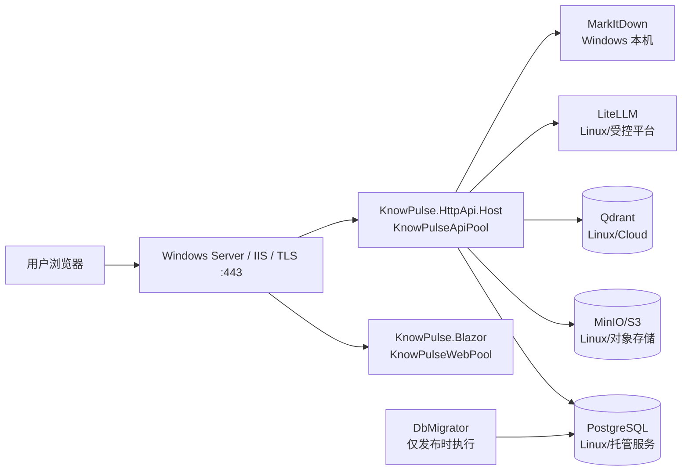
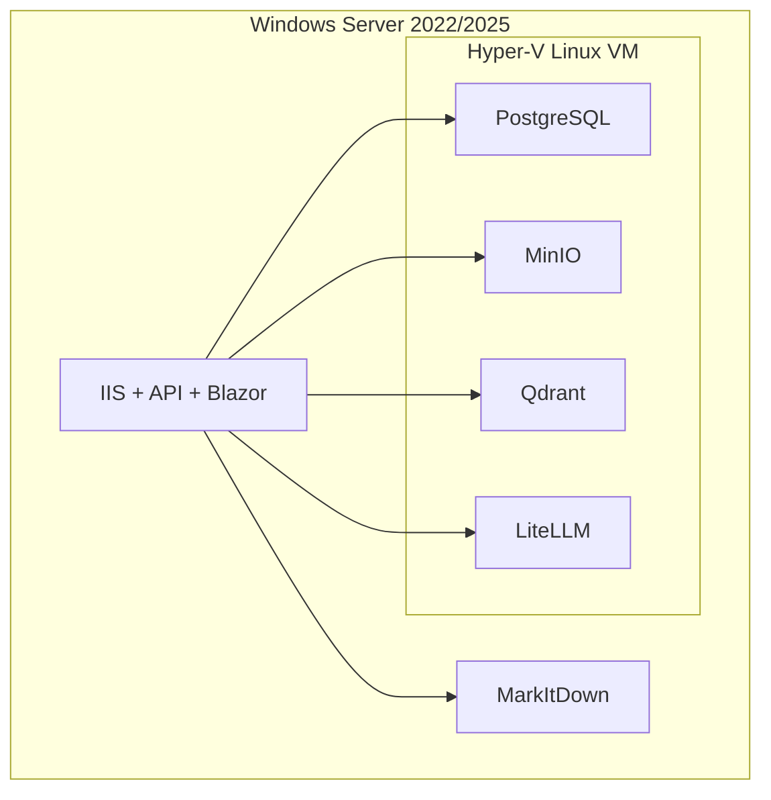

# KnowPulse Windows Server 正式部署与运维手册

- 版本：v1.0
- 日期：2026-07-18
- 适用代码基线：`684f9e8`
- 应用承载：Windows Server 2022/2025、IIS 10、.NET 10 Hosting Bundle
- 依赖承载：Linux VM、独立 Linux 主机或托管服务
- 通用生产基线：`docs/production-deployment-guide.md`
- 私有化配置基线：`docs/private-deployment-baseline.md`

## 1. 结论

KnowPulse 可以部署到 Windows，但需要区分“应用部署到 Windows”和“全部组件原生部署到 Windows”。

正式环境推荐：

- `KnowPulse.HttpApi.Host` 和 `KnowPulse.Blazor` 部署到 Windows Server，由 IIS 和 ASP.NET Core Module 承载。
- `KnowPulse.DbMigrator` 在每次发布时作为一次性命令运行。
- PostgreSQL、MinIO、Qdrant、LiteLLM 部署到 Linux VM、独立 Linux 主机或经过批准的托管服务。
- MarkItDown 可以安装在 Windows 应用服务器上，由 API 进程调用。

不推荐：

- 在 Windows Server 上安装 Docker Desktop 承载正式依赖。Docker 官方不支持 Windows Server 上的 Docker Desktop。
- 在 WSL2 或 Docker Desktop 的 Windows 文件系统挂载中保存正式 Qdrant 数据。Qdrant 官方明确提示这类挂载存在文件系统问题和数据丢失风险。
- 把 PostgreSQL、MinIO、Qdrant、LiteLLM 全部改造成 Windows 原生服务后直接上线。当前仓库没有对应的 Windows 服务编排、验证、备份和升级基线。
- 使用 NSSM、WinSW 或计划任务把 API/Web 包装成服务，作为当前首选方案。现有 ASP.NET Core 项目可直接由 IIS 承载，无需先增加第三方服务包装器。

如果只有一台物理 Windows Server，可使用 Hyper-V 创建一台长期运行的 Linux VM：

- Windows 宿主机：IIS、API、Blazor、MarkItDown。
- Linux VM：PostgreSQL、MinIO、Qdrant、LiteLLM。
- VM 使用固定内网 IP 和专用数据盘。
- Windows 防火墙和 Linux 防火墙只允许应用服务器访问依赖端口。

Windows 11 + Docker Desktop/WSL2 只适合开发、演示和发布前验证，不作为本文的正式生产方案。

## 2. 当前代码的 Windows 可部署性

仓库中的三个 .NET 入口均以 `net10.0` 为目标：

- `src/KnowPulse.HttpApi.Host`
- `src/KnowPulse.Blazor`
- `src/KnowPulse.DbMigrator`

已实际验证：

- `KnowPulse.HttpApi.Host` 可以生成 `win-x64` framework-dependent 发布产物和 IIS `web.config`。
- `KnowPulse.Blazor` 可以在干净代码副本中生成 `win-x64` 发布产物和 IIS `web.config`。
- 发布产生的 `web.config` 使用 `AspNetCoreModuleV2` 和 IIS in-process hosting。
- Blazor 发布前需要执行 `abp install-libs`。

当前工作目录直接发布 Blazor 时，项目目录下历史遗留的、被 Git 忽略的 `artifacts/` 产物会被 SDK 当成发布内容，导致 `NETSDK1152` 重复输出文件错误。正式构建必须满足以下任一条件：

1. 使用全新 clone、干净 worktree 或干净 CI runner 构建。
2. 保证 `src/KnowPulse.Blazor/artifacts` 和 `src/KnowPulse.Blazor.Client/artifacts` 不存在。
3. 后续修改项目文件，明确从 `Content`、`None` 和发布项中排除任意层级的 `artifacts/**`。

不要从长期使用、残留大量构建产物的开发目录制作正式发布包。

## 3. Windows 正式部署支持矩阵

| 组件 | Windows 正式方案 | 结论 |
| --- | --- | --- |
| KnowPulse API | Windows Server + IIS + Hosting Bundle | 支持 |
| KnowPulse Blazor | Windows Server + IIS + WebSocket | 支持 |
| DbMigrator | Windows 发布产物，一次性运行 | 支持 |
| MarkItDown | Windows Python venv，固定版本 | 支持，必须验证文档转换 |
| PostgreSQL | Linux/托管数据库优先 | 不建议为本项目临时改成 Windows 原生基线 |
| MinIO | Linux 节点或兼容 S3 对象存储 | 正式环境优先 Linux |
| Qdrant | Linux、Qdrant Cloud 或受支持的 Kubernetes | 不使用 Windows/WSL 文件挂载保存正式数据 |
| LiteLLM | Linux 容器或受控平台 | 不建议在 Windows Server 上临时拼装 Python 服务 |
| Docker Desktop | Windows 10/11 开发机 | Windows Server 不支持 |

## 4. 上线前强制门禁

以下门禁与 Linux 手册一致，并增加 Windows 特有要求。

| 级别 | 当前事实 | 上线要求 |
| --- | --- | --- |
| P0 | `global.json` 的 `rollForward` 为 `latestFeature`，当前构建机选择了预览 SDK | 使用批准的稳定 .NET 10 SDK 重新构建；禁止 preview SDK 发布正式包 |
| P0 | `Scriban 7.0.0`、`Microsoft.OpenApi 2.3.0` 存在 High 漏洞 | 升级到已修复版本，或完成安全风险接受 |
| P0 | API/Blazor 没有正式 `/health/live`、`/health/ready` | 补齐健康端点；补齐前只能做临时 HTTP 探测 |
| P0 | Swagger 在 API 中无条件启用 | 生产默认关闭，或由 IIS/WAF 仅允许管理员网段 |
| P0 | DbMigrator 使用默认管理员种子凭据 | 首次迁移后立即修改；更推荐改为 secret 注入 |
| P0 | Data Protection 未显式配置持久化目录和证书保护 | Windows 单机至少固定应用池身份和用户配置文件；多实例必须改代码使用共享、加密 key ring |
| P0 | 依赖服务与 Windows 应用跨主机通信 | 使用隔离内网、防火墙和批准的 TLS/VPN 方案，禁止依赖端口暴露公网 |
| P0 | 当前没有经过演练的 Windows 备份和恢复流程 | 正式切流前完成一次隔离恢复演练 |
| P0 | 当前工作区 Blazor 发布受历史 `artifacts/` 干扰 | 正式发布必须来自干净构建环境 |
| P1 | 应用日志为相对路径 `Logs/logs.txt`，没有滚动策略 | 日志目录独立持久化，并配置归档和保留 |
| P1 | 文件上传未发现完整的项目级查毒和大小限制 | 同时配置 IIS 请求限制、应用限制和恶意文件扫描 |
| P1 | MarkItDown 是外部可执行程序 | 固定版本、固定路径、按应用池身份完成真实文件转换验收 |

任何未关闭的 P0 都必须在上线审批中写明风险、临时控制、负责人和关闭时间。

## 5. 推荐拓扑

### 5.1 独立 Windows 应用服务器



### 5.2 单台物理 Windows Server



单物理机方案仍然没有主机级高可用。Windows 宿主机、Hyper-V、系统盘或物理数据盘故障都会影响全部服务。

## 6. 服务器、域名和网络规划

### 6.1 建议服务器

- Windows Server 2022 或 Windows Server 2025。
- x64，8 vCPU 起步。
- 32 GiB 内存起步；同机运行 Hyper-V Linux VM 时建议 64 GiB 起步。
- `C:` 仅放操作系统、IIS 和 Hosting Bundle。
- `D:` 放应用发布产物、工具、日志和临时备份。
- Linux VM 数据盘使用独立 SSD/NVMe，不和 Windows 日志盘争用。
- 启用 BitLocker 或企业等价磁盘加密。
- 加入企业补丁、EDR、NTP、备份和监控体系。

容量必须根据用户数、文档大小、每日上传量、向量规模、峰值并发和保留周期重新评估。

### 6.2 域名

推荐：

- Web：`https://knowpulse.example.com`
- API/Auth：`https://api.knowpulse.example.com`

两个域名指向 IIS、企业负载均衡器或 WAF。将全文中的 `example.com` 替换为正式域名。

### 6.3 Windows 入站端口

| 端口 | 来源 | 用途 |
| --- | --- | --- |
| 3389 | 堡垒机/管理员网段 | RDP；更推荐通过堡垒机或 JIT 开放 |
| 5986 | 受控运维网段 | 可选 WinRM HTTPS |
| 443 | 用户网络 | Web 和 API/Auth |
| 80 | 可选 | 只用于 ACME 或跳转 HTTPS；也可完全不开放 |

### 6.4 Windows 到依赖服务

| 端口 | 目标 | 用途 |
| --- | --- | --- |
| 5432 | PostgreSQL 私网地址 | KnowPulse 和 LiteLLM 数据库 |
| 9000 | MinIO 私网地址 | S3 API |
| 6333 | Qdrant 私网地址 | HTTP API |
| 6334 | Qdrant 私网地址 | gRPC，当前配置可能不需要 |
| 4000 | LiteLLM 私网地址 | 模型网关 |
| 443 | 模型供应商 | OpenAI、DeepSeek 或批准的模型服务 |

这些端口不得从公网直接访问。

测试连通性：

```powershell
$infraHost = "10.20.0.20"

Test-NetConnection $infraHost -Port 5432
Test-NetConnection $infraHost -Port 9000
Test-NetConnection $infraHost -Port 6333
Test-NetConnection $infraHost -Port 4000
```

连通性通过不代表认证、TLS、权限和数据恢复已经正确。

## 7. Linux 依赖层

### 7.1 推荐选择

按优先顺序选择：

1. 企业已经管理的 PostgreSQL、S3 兼容对象存储、Qdrant 和 LiteLLM 平台。
2. 独立 Linux 主机或 Linux VM。
3. Windows Server 上的 Hyper-V Linux VM。

Linux 依赖层沿用 `docs/production-deployment-guide.md` 中以下内容：

- 生产 Compose 与固定镜像。
- PostgreSQL 独立数据库和应用账号。
- MinIO bucket、应用账号和最小权限策略。
- Qdrant API key。
- LiteLLM master key、virtual key 和模型 alias。
- PostgreSQL、MinIO、Qdrant 的备份、恢复和升级。

### 7.2 Hyper-V

管理员 PowerShell 中安装 Hyper-V：

```powershell
Install-WindowsFeature `
  -Name Hyper-V `
  -IncludeManagementTools `
  -Restart
```

重启后创建受支持的 Ubuntu LTS 或企业批准 Linux VM：

- 使用 Generation 2 VM。
- 固定 vCPU、内存和数据盘。
- 使用固定内网 IP。
- 启用时间同步、备份、监控和安全更新。
- Docker Engine 和 Compose plugin 安装在 Linux VM 内。
- 不在 Windows Server 上安装 Docker Desktop。

### 7.3 VM 网络

示例：

- Windows 应用服务器：`10.20.0.10`
- Linux VM：`10.20.0.20`
- 子网：`10.20.0.0/24`

生产 Compose 中不能继续把依赖端口只绑定到 Linux VM 的 `127.0.0.1`，否则 Windows IIS 应用无法访问。应绑定 Linux VM 的私网 IP，并在 Linux 防火墙只允许 Windows 应用服务器：

```text
10.20.0.20:5432
10.20.0.20:9000
10.20.0.20:6333
10.20.0.20:4000
```

Linux 防火墙示意：

```bash
sudo ufw default deny incoming
sudo ufw allow from 10.20.0.10 to any port 5432 proto tcp
sudo ufw allow from 10.20.0.10 to any port 9000 proto tcp
sudo ufw allow from 10.20.0.10 to any port 6333 proto tcp
sudo ufw allow from 10.20.0.10 to any port 4000 proto tcp
sudo ufw enable
```

不要直接复制 Linux 单机手册中绑定 `127.0.0.1` 的端口配置而不调整。

跨物理主机时应启用服务端 TLS、mTLS、WireGuard、IPsec 或企业等价加密网络。仅依靠“这是内网”不能替代传输保护和访问控制。

## 8. 安装 IIS

在管理员 PowerShell 中执行：

```powershell
Install-WindowsFeature `
  Web-Server, `
  Web-Mgmt-Tools, `
  Web-Mgmt-Console, `
  Web-Static-Content, `
  Web-Http-Errors, `
  Web-Http-Logging, `
  Web-Request-Monitor, `
  Web-Filtering, `
  Web-AppInit, `
  Web-IP-Security `
  -IncludeManagementTools
```

验证：

```powershell
Get-WindowsFeature `
  Web-Server, `
  Web-AppInit, `
  Web-IP-Security |
  Select-Object Name, InstallState

Get-Service W3SVC, WAS
```

要求：

- `W3SVC` 和 `WAS` 为 Running。
- Application Initialization 已安装，用于应用池预热。
- IP and Domain Restrictions 已安装，用于限制 Swagger 等管理入口。

不需要安装 ASP.NET 4.x 应用功能来运行 ASP.NET Core。

当前 UI 使用 `InteractiveWebAssemblyRenderMode`，不是 Blazor Server，基础运行不依赖 IIS WebSocket。后续如果引入 SignalR、Interactive Server 或其他 WebSocket 功能，再安装 `Web-WebSockets` 并单独验收。

## 9. 安装 .NET 10 Hosting Bundle

在 IIS 安装完成后，从 Microsoft 官方 .NET 下载页面获取经过批准的稳定 .NET 10 Hosting Bundle x64：

1. 校验下载来源和签名。
2. 静默安装或通过企业软件分发系统安装。
3. 安装后重启服务器，或重启 WAS/W3SVC。

示意命令：

```powershell
Start-Process `
  -FilePath ".\dotnet-hosting-10.0.x-win.exe" `
  -ArgumentList "/install", "/quiet", "/norestart" `
  -Wait

net stop was /y
net start w3svc
```

验证：

```powershell
dotnet --list-runtimes

Import-Module WebAdministration
Get-WebGlobalModule |
  Where-Object Name -Like "AspNetCoreModule*"
```

必须看到稳定的：

- `Microsoft.NETCore.App 10.0.x`
- `Microsoft.AspNetCore.App 10.0.x`
- `AspNetCoreModuleV2`

生产服务器只需要 Hosting Bundle，不需要安装 SDK。SDK 应固定在构建机或 CI 镜像中。

如果 Hosting Bundle 先于 IIS 安装，安装 IIS 后应重新运行 Hosting Bundle 的 Repair。

## 10. Windows 目录规划

建议：

```text
D:\KnowPulse\
|-- packages\
|-- releases\
|   `-- <release-id>\
|       |-- api\
|       |-- web\
|       `-- migrator\
`-- tools\
    `-- markitdown\

D:\KnowPulseData\
|-- logs\
|   |-- api\
|   |-- web\
|   `-- migrator\
|-- backups\
`-- staging\
```

初始化：

```powershell
$paths = @(
  "D:\KnowPulse\packages",
  "D:\KnowPulse\releases",
  "D:\KnowPulse\tools\markitdown",
  "D:\KnowPulseData\logs\api",
  "D:\KnowPulseData\logs\web",
  "D:\KnowPulseData\logs\migrator",
  "D:\KnowPulseData\backups",
  "D:\KnowPulseData\staging"
)

foreach ($path in $paths) {
  New-Item -ItemType Directory -Force -Path $path | Out-Null
}
```

约束：

- 发布目录默认只读。
- API 只能写 API 日志目录和明确批准的临时目录。
- Web 只能写 Web 日志目录。
- secret 文件只允许 SYSTEM、Administrators 和对应应用池身份读取。
- 不允许应用池身份写入 `web.config`、DLL 或静态资源。

## 11. 正式构建

### 11.1 使用干净代码副本

正式构建机中：

```powershell
git clone https://github.com/253513374/KnowPulse.git
Set-Location .\KnowPulse
git checkout <APPROVED_TAG_OR_COMMIT>

git status --short
git rev-parse HEAD
```

`git status --short` 必须为空。

检查不存在嵌套发布产物：

```powershell
$unexpected = Get-ChildItem `
  -Path .\src `
  -Directory `
  -Recurse `
  -Filter artifacts `
  -ErrorAction SilentlyContinue

if ($unexpected) {
  $unexpected.FullName
  throw "项目目录内存在 artifacts，拒绝制作正式发布包。"
}
```

### 11.2 固定稳定 SDK

```powershell
$actualSdk = dotnet --version
$actualSdk

if ($actualSdk -match "preview|rc") {
  throw "禁止使用预览 SDK 生成正式发布包。"
}
```

当前仓库 `global.json` 允许滚动到更高 feature band。正式构建应在 CI 镜像中固定批准的 SDK，并将 `allowPrerelease` 设为 `false` 或收紧 `rollForward`。

### 11.3 依赖和静态资源

```powershell
dotnet restore .\KnowPulse.slnx

dotnet list `
  .\KnowPulse.slnx `
  package `
  --vulnerable `
  --include-transitive

abp install-libs
```

门禁：

- 正式运行项目不得有未接受的 High/Critical 漏洞。
- NuGet、NPM/Yarn 和 ABP CLI 版本必须固定。
- 包源必须经过批准。
- 不从开发者本地缓存拼装不可复现的发布包。
- 当前仓库没有 `packages.lock.json`，不能直接使用 `--locked-mode`；后续应补齐 NuGet lock file，再把 locked restore 纳入流水线。

### 11.4 回归检查

```powershell
pwsh -NoProfile `
  -File .\ops\verify-private-deployment-baseline.ps1

pwsh -NoProfile `
  -File .\ops\verify-mvp3.ps1 `
  -SkipRuntime
```

如果发布范围包含业务代码，还必须运行对应单元测试、集成测试和验收脚本。

### 11.5 发布 win-x64 产物

```powershell
$publishRoot = Join-Path $PWD "artifacts\publish\windows"

dotnet publish `
  .\src\KnowPulse.HttpApi.Host\KnowPulse.HttpApi.Host.csproj `
  -c Release `
  -r win-x64 `
  --self-contained false `
  -o "$publishRoot\api"

dotnet publish `
  .\src\KnowPulse.Blazor\KnowPulse.Blazor.csproj `
  -c Release `
  -r win-x64 `
  --self-contained false `
  -o "$publishRoot\web"

dotnet publish `
  .\src\KnowPulse.DbMigrator\KnowPulse.DbMigrator.csproj `
  -c Release `
  -r win-x64 `
  --self-contained false `
  -o "$publishRoot\migrator"
```

检查：

```powershell
$required = @(
  "$publishRoot\api\KnowPulse.HttpApi.Host.exe",
  "$publishRoot\api\KnowPulse.HttpApi.Host.dll",
  "$publishRoot\api\web.config",
  "$publishRoot\web\KnowPulse.Blazor.exe",
  "$publishRoot\web\KnowPulse.Blazor.dll",
  "$publishRoot\web\web.config",
  "$publishRoot\web\wwwroot\appsettings.json",
  "$publishRoot\migrator\KnowPulse.DbMigrator.exe",
  "$publishRoot\migrator\KnowPulse.DbMigrator.dll"
)

foreach ($file in $required) {
  if (-not (Test-Path -LiteralPath $file)) {
    throw "缺少发布文件：$file"
  }
}
```

保留 SDK 生成的 `web.config`。不要用 ASP.NET 4.x 模板覆盖其中的 `AspNetCoreModuleV2` 配置。

### 11.6 写入 Blazor 浏览器公开配置

`web\wwwroot\appsettings.json` 会被浏览器下载，里面只能放公开地址，不能放密码或 API key。

示例：

```json
{
  "AuthServer": {
    "Authority": "https://api.knowpulse.example.com",
    "ClientId": "KnowPulse_Blazor",
    "ResponseType": "code"
  },
  "RemoteServices": {
    "Default": {
      "BaseUrl": "https://api.knowpulse.example.com"
    }
  }
}
```

写入后检查：

```powershell
Get-Content `
  -Raw `
  -LiteralPath "$publishRoot\web\wwwroot\appsettings.json" |
  ConvertFrom-Json |
  Out-Null
```

### 11.7 打包和校验

```powershell
$version = "<VERSION>"
$shortSha = (git rev-parse --short HEAD).Trim()
$releaseId = "$version-$shortSha"
$package = "artifacts\knowpulse-$releaseId-win-x64.zip"

Get-ChildItem `
  -LiteralPath $publishRoot `
  -File `
  -Recurse |
  Get-FileHash `
    -Algorithm SHA256 |
  ForEach-Object {
    "$($_.Hash)  $($_.Path.Substring($publishRoot.Length + 1))"
  } |
  Set-Content `
    -Encoding ascii `
    -LiteralPath "$publishRoot\SHA256SUMS"

Compress-Archive `
  -Path "$publishRoot\*" `
  -DestinationPath $package `
  -Force

Get-FileHash `
  -Algorithm SHA256 `
  -LiteralPath $package
```

发布记录至少包含：

- Git commit SHA。
- 稳定 SDK 版本。
- NuGet/NPM/ABP CLI 版本。
- 发布包 SHA-256。
- 构建流水线编号。
- 测试和漏洞扫描结果。
- 审批人。

## 12. 安装 MarkItDown

在 Windows 应用服务器安装批准的稳定 Python x64，然后创建独立 venv：

```powershell
py -3 -m venv `
  D:\KnowPulse\tools\markitdown\.venv

& D:\KnowPulse\tools\markitdown\.venv\Scripts\python.exe `
  -m pip install `
  --upgrade pip

& D:\KnowPulse\tools\markitdown\.venv\Scripts\pip.exe `
  install `
  "markitdown[all]==<APPROVED_VERSION>"
```

验证：

```powershell
& D:\KnowPulse\tools\markitdown\.venv\Scripts\markitdown.exe `
  --help
```

API 配置：

```text
RagAI__Ingestion__MarkItDownExecutablePath=D:\KnowPulse\tools\markitdown\.venv\Scripts\markitdown.exe
```

权限：

```powershell
icacls `
  D:\KnowPulse\tools\markitdown `
  /grant `
  "IIS AppPool\KnowPulseApiPool:(OI)(CI)RX" `
  /T
```

应用池启用用户配置文件后，必须使用真实 PDF、DOCX、PPTX、XLSX 各测试一次。仅执行 `--help` 不代表文档转换依赖全部可用。

## 13. 部署发布包

将发布包和 SHA-256 通过受控渠道传入：

```powershell
$releaseId = "<VERSION>-<SHORT_SHA>"
$package = "D:\KnowPulse\packages\knowpulse-$releaseId-win-x64.zip"
$target = "D:\KnowPulse\releases\$releaseId"

if (Test-Path -LiteralPath $target) {
  throw "目标 release 已存在，禁止覆盖：$target"
}

New-Item `
  -ItemType Directory `
  -Path $target |
  Out-Null

Expand-Archive `
  -LiteralPath $package `
  -DestinationPath $target
```

不要覆盖正在运行的 release。每个版本使用独立目录。

验证发布文件：

```powershell
Get-Item `
  "$target\api\KnowPulse.HttpApi.Host.exe", `
  "$target\api\web.config", `
  "$target\web\KnowPulse.Blazor.exe", `
  "$target\web\web.config", `
  "$target\migrator\KnowPulse.DbMigrator.exe"
```

## 14. 生产配置

### 14.1 Secret 存储选择

仓库启动代码会加载 `appsettings.secrets.json`。Windows 基线使用：

- `appsettings.secrets.json` 在部署时生成，不进入 Git 和发布包。
- NTFS ACL 只允许 SYSTEM、Administrators 和对应应用池身份读取。
- 应用盘启用 BitLocker。
- secret 由 CI/CD secret store、密码库或人工双人控制注入。

NTFS ACL 不能防止本机管理员读取 secret。更高要求的环境应接入企业 secret provider，并修改应用启动配置。

不要使用：

- 源码中的 `appsettings.Production.json` 保存真实密码。
- 用户级 `dotnet user-secrets` 作为生产 secret store。
- 普通 PowerShell 历史、工单、聊天和邮件传递明文 secret。
- `setx` 长期写入机器级明文环境变量作为唯一 secret 管理方案。

### 14.2 API 配置

在 `$target\api\appsettings.secrets.json` 创建：

```json
{
  "App": {
    "SelfUrl": "https://api.knowpulse.example.com",
    "CorsOrigins": "https://knowpulse.example.com",
    "RedirectAllowedUrls": "https://knowpulse.example.com"
  },
  "ConnectionStrings": {
    "Default": "Host=postgres.knowpulse.internal;Port=5432;Database=KnowPulse;Username=knowpulse_app;Password=<KNOWPULSE_DB_PASSWORD>;SSL Mode=Require;"
  },
  "AuthServer": {
    "Authority": "https://api.knowpulse.example.com",
    "RequireHttpsMetadata": true
  },
  "StringEncryption": {
    "DefaultPassPhrase": "<GENERATE_RANDOM_LONG_PASSPHRASE>"
  },
  "BlobStoring": {
    "Minio": {
      "EndPoint": "minio.knowpulse.internal:9000",
      "AccessKey": "<MINIO_APP_ACCESS_KEY>",
      "SecretKey": "<MINIO_APP_SECRET_KEY>",
      "BucketName": "knowpulse-knowledge",
      "WithSSL": true,
      "CreateBucketIfNotExists": false
    }
  },
  "RagAI": {
    "VectorStore": {
      "Endpoint": "https://qdrant.knowpulse.internal:6333",
      "KnowledgeCollectionName": "knowledge_chunks_1536_mvp1",
      "VectorDimension": 1536,
      "ApiKeyEnvironmentVariable": "KNOWPULSE_QDRANT_API_KEY"
    },
    "LiteLlm": {
      "BaseUrl": "https://litellm.knowpulse.internal:4000",
      "ApiKeyEnvironmentVariable": "KNOWPULSE_LITELLM_API_KEY",
      "ChatModel": "knowpulse-chat-default",
      "EmbeddingModel": "knowpulse-embedding-default"
    },
    "Ingestion": {
      "MarkItDownExecutablePath": "D:\\KnowPulse\\tools\\markitdown\\.venv\\Scripts\\markitdown.exe"
    }
  }
}
```

说明：

- 示例使用内部 DNS 和 TLS；必须让内部域名、证书 SAN、Windows 信任链和服务监听地址保持一致。
- 如果使用 IPsec/WireGuard 保护整个 Hyper-V 私网、服务端暂未启用独立 TLS，应形成风险记录并调整对应 `https`、`WithSSL` 和 PostgreSQL SSL Mode，不能保留互相矛盾的配置。
- `StringEncryption.DefaultPassPhrase` 必须跨升级保持一致并加密备份。
- API 使用 MinIO 应用账号，不使用 root 账号。
- API 使用 LiteLLM virtual key，不使用 master key。
- Qdrant key 必须启用，并限制网络来源。
- `ApiKeyEnvironmentVariable` 保存的是环境变量名称，不是 key 本身；应用代码只会从进程环境读取两个真实 key。

当前应用代码读取：

```text
KNOWPULSE_QDRANT_API_KEY
KNOWPULSE_LITELLM_API_KEY
```

`QDRANT__SERVICE__API_KEY`/`QDRANT_SERVICE_API_KEY` 属于 Qdrant 服务端配置，不是 IIS 应用读取的业务 key 名称。

如果使用环境变量覆盖，层级键使用双下划线，例如：

```text
ConnectionStrings__Default
BlobStoring__Minio__SecretKey
RagAI__VectorStore__Endpoint
RagAI__LiteLlm__BaseUrl
RagAI__Ingestion__MarkItDownExecutablePath
```

### 14.3 Blazor 配置边界

当前 UI 是 hosted Blazor WebAssembly。浏览器实际使用的 Authority 和 RemoteServices 地址来自第 11.6 节的：

```text
web\wwwroot\appsettings.json
```

Web 宿主本身不需要数据库、MinIO、Qdrant 或 LiteLLM secret，因此不要为 Web 站点复制 API 的 `appsettings.secrets.json`。Web 应用池只注入 `Production` 环境值。

### 14.4 DbMigrator 配置

在 `$target\migrator\appsettings.secrets.json` 创建：

```json
{
  "ConnectionStrings": {
    "Default": "Host=postgres.knowpulse.internal;Port=5432;Database=KnowPulse;Username=knowpulse_app;Password=<KNOWPULSE_DB_PASSWORD>;SSL Mode=Require;"
  },
  "StringEncryption": {
    "DefaultPassPhrase": "<SAME_API_PASSPHRASE>"
  },
  "RagAI": {
    "VectorStore": {
      "Endpoint": "https://qdrant.knowpulse.internal:6333",
      "KnowledgeCollectionName": "knowledge_chunks_1536_mvp1",
      "VectorDimension": 1536,
      "ApiKeyEnvironmentVariable": "KNOWPULSE_QDRANT_API_KEY"
    },
    "LiteLlm": {
      "BaseUrl": "https://litellm.knowpulse.internal:4000",
      "ApiKeyEnvironmentVariable": "KNOWPULSE_LITELLM_API_KEY",
      "ChatModel": "knowpulse-chat-default",
      "EmbeddingModel": "knowpulse-embedding-default"
    }
  },
  "OpenIddict": {
    "Applications": {
      "KnowPulse_Blazor": {
        "ClientId": "KnowPulse_Blazor",
        "RootUrl": "https://knowpulse.example.com"
      },
      "KnowPulse_Swagger": {
        "ClientId": "KnowPulse_Swagger",
        "RootUrl": "https://api.knowpulse.example.com"
      }
    }
  }
}
```

### 14.5 设置 Secret ACL

创建应用池后执行：

```powershell
$apiSecret = "$target\api\appsettings.secrets.json"
$migratorSecret = "$target\migrator\appsettings.secrets.json"

icacls $apiSecret /inheritance:r
icacls $apiSecret /grant:r `
  "*S-1-5-18:F" `
  "*S-1-5-32-544:F" `
  "IIS AppPool\KnowPulseApiPool:R"

icacls $migratorSecret /inheritance:r
icacls $migratorSecret /grant:r `
  "*S-1-5-18:F" `
  "*S-1-5-32-544:F"
```

`S-1-5-18` 是 SYSTEM，`S-1-5-32-544` 是本机 Administrators 组，避免依赖系统显示语言。

## 15. 创建 IIS 应用池

管理员 PowerShell：

```powershell
Import-Module WebAdministration

if (-not (Test-Path "IIS:\AppPools\KnowPulseApiPool")) {
  New-WebAppPool -Name "KnowPulseApiPool"
}

if (-not (Test-Path "IIS:\AppPools\KnowPulseWebPool")) {
  New-WebAppPool -Name "KnowPulseWebPool"
}

$appcmd = "$env:windir\system32\inetsrv\appcmd.exe"

& $appcmd set apppool `
  /apppool.name:"KnowPulseApiPool" `
  /managedRuntimeVersion:"" `
  /startMode:AlwaysRunning `
  /processModel.identityType:ApplicationPoolIdentity `
  /processModel.loadUserProfile:true `
  /processModel.idleTimeout:00:00:00

& $appcmd set apppool `
  /apppool.name:"KnowPulseWebPool" `
  /managedRuntimeVersion:"" `
  /startMode:AlwaysRunning `
  /processModel.identityType:ApplicationPoolIdentity `
  /processModel.loadUserProfile:true `
  /processModel.idleTimeout:00:00:00
```

要求：

- API 和 Web 使用独立应用池。
- `.NET CLR Version` 为 `No Managed Code`。
- Identity 为 `ApplicationPoolIdentity`。
- Start Mode 为 `AlwaysRunning`。
- Load User Profile 为 `True`。
- Idle Time-out 为 `0`。
- 64 位应用保持启用。

当前发布产物使用 in-process hosting，两个应用不能放在同一个应用池。

## 16. 应用目录权限和日志

### 16.1 发布目录

```powershell
icacls "$target\api" /inheritance:r
icacls "$target\api" /grant:r `
  "*S-1-5-18:(OI)(CI)F" `
  "*S-1-5-32-544:(OI)(CI)F" `
  "IIS AppPool\KnowPulseApiPool:(OI)(CI)RX" `
  /T

icacls "$target\web" /inheritance:r
icacls "$target\web" /grant:r `
  "*S-1-5-18:(OI)(CI)F" `
  "*S-1-5-32-544:(OI)(CI)F" `
  "IIS AppPool\KnowPulseWebPool:(OI)(CI)RX" `
  /T
```

执行后再次应用第 14.5 节的 secret 文件 ACL，确保没有因递归 ACL 操作放宽权限。

### 16.2 日志目录

应用代码使用相对目录 `Logs/logs.txt`。在每个 release 中创建目录连接，把日志放到稳定数据目录：

```powershell
$apiLogs = "$target\api\Logs"
$webLogs = "$target\web\Logs"

if (Test-Path -LiteralPath $apiLogs) {
  throw "API Logs 路径已存在，先确认内容后再创建目录连接。"
}

if (Test-Path -LiteralPath $webLogs) {
  throw "Web Logs 路径已存在，先确认内容后再创建目录连接。"
}

New-Item `
  -ItemType Junction `
  -Path $apiLogs `
  -Target "D:\KnowPulseData\logs\api"

New-Item `
  -ItemType Junction `
  -Path $webLogs `
  -Target "D:\KnowPulseData\logs\web"

icacls D:\KnowPulseData\logs\api `
  /grant `
  "IIS AppPool\KnowPulseApiPool:(OI)(CI)M" `
  /T

icacls D:\KnowPulseData\logs\web `
  /grant `
  "IIS AppPool\KnowPulseWebPool:(OI)(CI)M" `
  /T
```

不要授予应用池对整个 release 的 Modify 权限。

Windows 不会自动轮转当前 Serilog 文件。至少使用计划任务或日志采集器：

- 按日期归档。
- 设置保留天数。
- 上传到集中日志平台。
- 对错误率、启动失败和磁盘空间告警。

长期建议修改代码，启用 Serilog rolling file 和保留策略。

## 17. 创建 IIS 站点和 HTTPS 绑定

### 17.1 导入证书

```powershell
$pfxPassword = Read-Host `
  "输入 PFX 密码" `
  -AsSecureString

$cert = Import-PfxCertificate `
  -FilePath "D:\SecureTransfer\knowpulse.pfx" `
  -CertStoreLocation "Cert:\LocalMachine\My" `
  -Password $pfxPassword `
  -Exportable:$false

$cert.Thumbprint
```

证书必须：

- 覆盖两个正式域名，或分别导入对应证书。
- 证书链完整。
- 私钥可供 IIS 使用。
- 到期监控和续期流程已配置。
- 不把 PFX 和密码留在普通目录。

### 17.2 创建站点

首次创建时使用临时 HTTP binding，随后立即删除并增加 HTTPS SNI binding：

```powershell
$apiSite = "KnowPulse API"
$webSite = "KnowPulse Web"
$apiHost = "api.knowpulse.example.com"
$webHost = "knowpulse.example.com"
$apiPath = "$target\api"
$webPath = "$target\web"

New-Website `
  -Name $apiSite `
  -PhysicalPath $apiPath `
  -ApplicationPool "KnowPulseApiPool" `
  -Port 80 `
  -HostHeader $apiHost

New-Website `
  -Name $webSite `
  -PhysicalPath $webPath `
  -ApplicationPool "KnowPulseWebPool" `
  -Port 80 `
  -HostHeader $webHost

Stop-Website $apiSite
Stop-Website $webSite

New-WebBinding `
  -Name $apiSite `
  -Protocol https `
  -IPAddress "*" `
  -Port 443 `
  -HostHeader $apiHost `
  -SslFlags 1

New-WebBinding `
  -Name $webSite `
  -Protocol https `
  -IPAddress "*" `
  -Port 443 `
  -HostHeader $webHost `
  -SslFlags 1
```

绑定证书：

```powershell
$apiBinding = Get-WebBinding `
  -Name $apiSite `
  -Protocol https `
  -Port 443 `
  -HostHeader $apiHost

$webBinding = Get-WebBinding `
  -Name $webSite `
  -Protocol https `
  -Port 443 `
  -HostHeader $webHost

$apiBinding.AddSslCertificate($cert.Thumbprint, "My")
$webBinding.AddSslCertificate($cert.Thumbprint, "My")

Remove-WebBinding `
  -Name $apiSite `
  -Protocol http `
  -Port 80 `
  -HostHeader $apiHost

Remove-WebBinding `
  -Name $webSite `
  -Protocol http `
  -Port 80 `
  -HostHeader $webHost
```

`SslFlags 1` 表示使用 SNI。旧客户端不支持 SNI 时需要独立 IP，不应关闭 TLS 安全基线解决。

### 17.3 应用池预热

```powershell
& $appcmd set app `
  "$apiSite/" `
  /preloadEnabled:true

& $appcmd set app `
  "$webSite/" `
  /preloadEnabled:true
```

在正式健康端点补齐后，应把 Application Initialization 的初始化 URL 指向 `/health/ready`。当前没有该端点时，只能使用首页或 OpenID 配置端点做临时启动探测。

### 17.4 生产环境变量

当前 Qdrant 和 LiteLLM 客户端使用 `Environment.GetEnvironmentVariable` 读取 key，因此仅把 key 写入 `appsettings.secrets.json` 不会生效。应由部署平台的 secret store 把以下变量注入 API 应用池：

```text
KNOWPULSE_QDRANT_API_KEY
KNOWPULSE_LITELLM_API_KEY
```

IIS 10 支持为单个应用池配置环境变量。下面命令中的真实 key 必须由 secret store 在运行时替换，不要把实际值保存到部署脚本、PowerShell 历史或工单：

```powershell
$appcmd = "$env:windir\system32\inetsrv\appcmd.exe"

& $appcmd set config `
  "-section:system.applicationHost/applicationPools" `
  "/+[name='KnowPulseApiPool'].environmentVariables.[name='ASPNETCORE_ENVIRONMENT',value='Production']" `
  "/commit:apphost"

& $appcmd set config `
  "-section:system.applicationHost/applicationPools" `
  "/+[name='KnowPulseApiPool'].environmentVariables.[name='DOTNET_ENVIRONMENT',value='Production']" `
  "/commit:apphost"

& $appcmd set config `
  "-section:system.applicationHost/applicationPools" `
  "/+[name='KnowPulseApiPool'].environmentVariables.[name='KNOWPULSE_QDRANT_API_KEY',value='<由 SECRET STORE 注入>']" `
  "/commit:apphost"

& $appcmd set config `
  "-section:system.applicationHost/applicationPools" `
  "/+[name='KnowPulseApiPool'].environmentVariables.[name='KNOWPULSE_LITELLM_API_KEY',value='<由 SECRET STORE 注入>']" `
  "/commit:apphost"

& $appcmd set config `
  "-section:system.applicationHost/applicationPools" `
  "/+[name='KnowPulseWebPool'].environmentVariables.[name='ASPNETCORE_ENVIRONMENT',value='Production']" `
  "/commit:apphost"

& $appcmd set config `
  "-section:system.applicationHost/applicationPools" `
  "/+[name='KnowPulseWebPool'].environmentVariables.[name='DOTNET_ENVIRONMENT',value='Production']" `
  "/commit:apphost"
```

AppCmd 的 `+` 操作用于首次添加。轮换 key 时，应先使用对应的 `/-[...]` 删除旧项，再添加新项；先在预发布环境验证转义和退出码。

这些值会保存在受管理员 ACL 保护的 `applicationHost.config` 中，但并不是密码学意义的 secret store。必须：

- Windows 系统盘使用 BitLocker。
- 限制本机管理员。
- IIS 配置备份二次加密。
- 更高安全等级接入企业 secret provider，并避免把真实 key 长期明文保存在 IIS 配置。
- 不把生成的 `applicationHost.config` 复制进仓库。

保留 SDK 生成的 `web.config`，不要删除其中的：

- `processPath`
- `arguments`
- `hostingModel`
- `AspNetCoreModuleV2` handler

注入后回收应用池：

```powershell
Restart-WebAppPool "KnowPulseApiPool"
Restart-WebAppPool "KnowPulseWebPool"
```

### 17.5 IIS 与 Forwarded Headers

IIS 通过 ASP.NET Core Module 与应用集成。直接由 IIS 终止 TLS 时，不需要照搬 Nginx 方案中的 `ASPNETCORE_FORWARDEDHEADERS_ENABLED=true`。

如果 IIS 前还有 WAF、ARR、云负载均衡器或多级代理：

- 入口必须传递真实 scheme、host 和 client IP。
- 代理到 IIS 的链路必须受控。
- 应在应用代码中显式配置可信代理和网段。
- 不要无条件信任来自任意客户端的 `X-Forwarded-*`。
- 必须测试 HTTPS 重定向、OIDC callback、注销 callback 和 CORS。

## 18. IIS 安全配置

### 18.1 请求大小

示例将 IIS 上限设置为 100 MiB：

```powershell
$maxBytes = 104857600

& $appcmd set config `
  "$apiSite" `
  -section:system.webServer/security/requestFiltering `
  /requestLimits.maxAllowedContentLength:$maxBytes `
  /commit:apphost
```

100 MiB 只是示例。必须与：

- 业务允许的单文件上限。
- ASP.NET Core 请求体限制。
- Blazor 上传实现。
- 反病毒扫描能力。
- MinIO 上传超时。

一起验证。

### 18.2 Swagger

当前 API 无条件启用 Swagger。首选修复是代码在 Production 默认不启用。

修复前至少：

- 在企业 WAF/网关限制 `/swagger`。
- 或使用 IIS IP and Domain Restrictions，仅允许管理网段。
- 验证 `/swagger/v1/swagger.json` 不能从普通用户网络访问。

不要仅隐藏 Swagger 首页而仍允许匿名访问 JSON 描述。

### 18.3 TLS

- 只允许企业批准的 TLS 版本和密码套件。
- 关闭旧协议。
- 启用证书到期告警。
- HSTS 只在正式域名和证书验证后启用。
- 不在生产探测中使用 `-SkipCertificateCheck`。

### 18.4 Windows 防火墙

只开放正式入口：

```powershell
New-NetFirewallRule `
  -DisplayName "KnowPulse HTTPS" `
  -Direction Inbound `
  -Action Allow `
  -Protocol TCP `
  -LocalPort 443
```

RDP/WinRM 规则必须限定堡垒机或管理员网段，不使用 `Any`。

## 19. Data Protection

ASP.NET Core 在 IIS 中默认把 key 持久化到应用池身份的：

```text
%LOCALAPPDATA%\ASP.NET\DataProtection-Keys
```

正式要求：

- `ApplicationPoolIdentity` 保持稳定。
- `loadUserProfile=true`。
- `setProfileEnvironment` 保持默认 `true`。
- 找到并确认实际 key ring 目录已经生成。
- key ring 纳入加密备份。
- 升级时不得更换应用池身份后直接丢弃旧 key。

当前仓库未显式设置 key ring。更可靠的生产方案是修改代码：

- 使用固定文件目录或共享文件路径。
- 使用 X.509 证书保护 key。
- 多实例使用所有节点可访问的共享存储。
- 证书私钥只允许对应应用池身份读取。

在未完成代码改造前，不要猜测 profile 路径后宣称已备份。必须实际确认 key 文件生成位置和恢复结果。

Data Protection key 丢失通常会导致现有 Cookie、临时令牌失效和用户重新登录。

## 20. 首次数据库迁移

### 20.1 迁移前

- 确认 PostgreSQL 已完成备份。
- 确认 `KnowPulse` 数据库和 `knowpulse_app` 账号存在。
- 确认网络和 TLS。
- 确认 Migrator 使用当前 release 的配置。
- 确认首次管理员密码处理方案。
- 停止 API 和 Web 应用池。

```powershell
Stop-WebAppPool "KnowPulseApiPool"
Stop-WebAppPool "KnowPulseWebPool"
```

### 20.2 执行

```powershell
$migratorPath = "$target\migrator"

Push-Location $migratorPath
try {
  $env:ASPNETCORE_ENVIRONMENT = "Production"
  $env:DOTNET_ENVIRONMENT = "Production"

  $requiredSecretVariables = @(
    "KNOWPULSE_QDRANT_API_KEY",
    "KNOWPULSE_LITELLM_API_KEY"
  )

  foreach ($name in $requiredSecretVariables) {
    if ([string]::IsNullOrWhiteSpace(
      [Environment]::GetEnvironmentVariable($name)
    )) {
      throw "发布平台尚未向 Migrator 进程注入环境变量：$name"
    }
  }

  & .\KnowPulse.DbMigrator.exe

  if ($LASTEXITCODE -ne 0) {
    throw "DbMigrator 执行失败，退出码：$LASTEXITCODE"
  }
}
finally {
  Pop-Location
}
```

两个 key 应由发布平台在启动 Migrator 进程前注入，并在进程结束后清除。不要把真实值写入这段脚本。

成功日志应包含：

```text
Successfully completed host database migrations.
Successfully completed all database migrations.
```

迁移失败时：

- 不启动新版本。
- 不反复执行来源不明的 SQL。
- 保留完整日志。
- 检查连接、权限、迁移版本和磁盘空间。
- 确认备份可恢复。

## 21. 启动和切流

### 21.1 首次启动

```powershell
Start-WebAppPool "KnowPulseApiPool"
Start-WebAppPool "KnowPulseWebPool"

Start-Website "KnowPulse API"
Start-Website "KnowPulse Web"
```

检查：

```powershell
Get-WebAppPoolState "KnowPulseApiPool"
Get-WebAppPoolState "KnowPulseWebPool"
Get-Website |
  Where-Object Name -Like "KnowPulse*"
```

### 21.2 启动失败诊断

临时启用 ASP.NET Core Module stdout 日志时：

1. 确认 `Logs` 目录可写。
2. 在 `web.config` 中把 `stdoutLogEnabled` 临时设置为 `true`。
3. 重现一次。
4. 收集 `Logs\stdout_*.log`。
5. 立即改回 `false`，避免无限增长。

同时检查：

```powershell
Get-WinEvent `
  -LogName Application `
  -MaxEvents 100 |
  Where-Object {
    $_.ProviderName -match "IIS|ASP.NET Core|IIS AspNetCore Module"
  } |
  Select-Object TimeCreated, LevelDisplayName, ProviderName, Message
```

## 22. 首次上线验收

### 22.1 TLS 和端点

```powershell
Invoke-WebRequest `
  -Uri "https://api.knowpulse.example.com/.well-known/openid-configuration" `
  -UseBasicParsing

Invoke-WebRequest `
  -Uri "https://knowpulse.example.com/" `
  -UseBasicParsing
```

要求：

- 证书链和主机名正确。
- 不使用跳过证书校验。
- OpenID issuer 为正式 API 域名。
- 页面没有重定向循环。
- API 和 Web 没有反复回收。

### 22.2 OpenIddict

检查注册：

- `KnowPulse_Blazor` RootUrl 为 `https://knowpulse.example.com`。
- 登录 callback 为 `/authentication/login-callback`。
- 注销 callback 为 `/authentication/logout-callback`。
- Swagger callback 如保留，为 API 正式域名下的 `/swagger/oauth2-redirect.html`。
- `AuthServer.RequireHttpsMetadata=true`。

### 22.3 登录和安全

- 首次管理员能登录。
- 立即修改默认管理员密码。
- 普通网络不能访问 Swagger。
- CORS 只允许正式 Web 域名。
- Cookie 标记和 HTTPS 行为正确。
- 生产异常页不暴露堆栈和 secret。
- Blazor WebAssembly 资源加载、API 调用和 OIDC 跳转稳定。

### 22.4 业务闭环

至少执行一次：

1. 创建或选择知识库。
2. 上传 PDF、DOCX、PPTX、XLSX。
3. 下载或预览附件。
4. 等待索引任务成功。
5. 在 Qdrant 确认向量和权限 payload。
6. 使用 RAG 提问并验证引用。
7. 验证无权限账号不能读取附件、知识内容和检索结果。
8. 验证 LiteLLM 模型 alias、virtual key、预算和错误处理。
9. 验证考试/题库等本次上线范围内的业务闭环。

## 23. 日志和监控

### 23.1 日志位置

| 日志 | 位置 |
| --- | --- |
| API Serilog | `D:\KnowPulseData\logs\api` |
| Web Serilog | `D:\KnowPulseData\logs\web` |
| Migrator | release 下 `Logs` 或独立 migrator 日志目录 |
| IIS access log | `%SystemDrive%\inetpub\logs\LogFiles` |
| ANCM/启动错误 | Windows Application Event Log |
| Linux 依赖 | Linux journal、Docker logs 和集中日志平台 |

### 23.2 最低监控

| 对象 | 指标 |
| --- | --- |
| Windows | CPU、内存、磁盘、补丁、时间同步、证书到期 |
| IIS | 站点状态、应用池状态、回收次数、5xx、请求队列 |
| API/Web | 外部 HTTPS 探测、响应时间、登录成功率 |
| Blazor | WASM 资源加载失败、浏览器错误、API 调用失败率 |
| PostgreSQL | 连接、容量、慢查询、备份和复制 |
| MinIO | 容量、错误、备份、对象增长 |
| Qdrant | `/healthz`、集合状态、snapshot、磁盘 |
| LiteLLM | liveliness、模型错误率、延迟、预算 |
| RAG | 待处理、失败、重试、死信、索引耗时 |
| 备份 | 最后成功时间、大小、异地副本、恢复演练 |

当前仓库没有正式 OpenTelemetry/Prometheus 基线。首发至少需要外部黑盒探测、IIS/Windows 状态、依赖状态和备份告警。

## 24. 备份

### 24.1 Windows 配置

创建 IIS 配置备份：

```powershell
$backupName = "KnowPulse-" + (Get-Date -Format "yyyyMMdd-HHmmss")
& "$env:windir\system32\inetsrv\appcmd.exe" `
  add backup `
  $backupName
```

备份：

- IIS applicationHost.config 备份。
- 站点和应用池配置。
- 加密后的 `appsettings.secrets.json` 副本。
- `StringEncryption.DefaultPassPhrase`。
- Data Protection key ring。
- TLS 证书和受控导出的私钥。
- MarkItDown 版本和依赖清单。
- 发布包和 SHA-256。
- Windows 防火墙规则导出。

Secret、证书私钥和 key ring 的备份必须二次加密，并限制恢复权限。

### 24.2 依赖数据

按通用生产手册备份：

- PostgreSQL `KnowPulse`。
- PostgreSQL `LiteLLM`。
- MinIO `knowpulse-knowledge`。
- Qdrant snapshot。
- LiteLLM 配置。

PostgreSQL 和 MinIO 应形成一致的恢复点。Qdrant 可重建，但保留 snapshot 能降低 RTO。

### 24.3 计划任务

可以使用 Windows Task Scheduler 调度：

- IIS 配置备份。
- 发布目录清理。
- 日志归档。
- 外部端点探测。
- 备份结果检查。

不要让任务脚本包含明文数据库密码。使用企业任务账号和 secret store。

## 25. 恢复

推荐顺序：

1. 恢复网络、DNS、证书和 IIS。
2. 恢复 PostgreSQL。
3. 恢复 MinIO。
4. 恢复 LiteLLM 数据和配置。
5. 恢复 Qdrant snapshot；不可用时触发重建。
6. 恢复 Data Protection key ring 和 StringEncryption pass phrase。
7. 恢复指定 release 和 secret。
8. 运行 DbMigrator。
9. 启动 API。
10. 启动 Web。
11. 执行登录、文档、RAG 和权限验收。

IIS 配置恢复示例：

```powershell
& "$env:windir\system32\inetsrv\appcmd.exe" `
  list backup

& "$env:windir\system32\inetsrv\appcmd.exe" `
  restore backup `
  "<BACKUP_NAME>"
```

恢复不能只验证页面能打开，还必须验证：

- 用户和权限。
- OpenID issuer/callback。
- 文档对象和元数据一致。
- RAG 权限过滤。
- LiteLLM key 和模型 alias。
- 新增数据可继续写入。

## 26. 升级

### 26.1 标准流程

1. 在干净 CI 构建新 release。
2. 完成测试、漏洞扫描和审批。
3. 传输并校验发布包。
4. 解压到新的 release 目录。
5. 生成 secret 文件和 ACL。
6. 创建日志目录连接。
7. 备份 PostgreSQL、MinIO、Qdrant 和 IIS 配置。
8. 停止 API/Web 应用池。
9. 运行新 release 的 DbMigrator。
10. 将 IIS 站点 physical path 切换到新 release。
11. 启动 API 和 Web。
12. 执行技术和业务验收。
13. 保留上一版 release，直到观察期结束。

切换 physical path：

```powershell
$newTarget = "D:\KnowPulse\releases\<NEW_RELEASE_ID>"

Stop-WebAppPool "KnowPulseApiPool"
Stop-WebAppPool "KnowPulseWebPool"

Set-ItemProperty `
  "IIS:\Sites\KnowPulse API" `
  -Name physicalPath `
  -Value "$newTarget\api"

Set-ItemProperty `
  "IIS:\Sites\KnowPulse Web" `
  -Name physicalPath `
  -Value "$newTarget\web"

Start-WebAppPool "KnowPulseApiPool"
Start-WebAppPool "KnowPulseWebPool"
```

切换前先确认新 release 的目录、secret、ACL、日志连接和 `web.config` 全部存在。

### 26.2 应用回滚

如果数据库迁移向后兼容：

```powershell
$previousTarget = "D:\KnowPulse\releases\<PREVIOUS_RELEASE_ID>"

Stop-WebAppPool "KnowPulseApiPool"
Stop-WebAppPool "KnowPulseWebPool"

Set-ItemProperty `
  "IIS:\Sites\KnowPulse API" `
  -Name physicalPath `
  -Value "$previousTarget\api"

Set-ItemProperty `
  "IIS:\Sites\KnowPulse Web" `
  -Name physicalPath `
  -Value "$previousTarget\web"

Start-WebAppPool "KnowPulseApiPool"
Start-WebAppPool "KnowPulseWebPool"
```

随后重新执行验收。

### 26.3 数据回滚

EF Core migration 不等于可靠的自动业务回滚。若新数据库结构与旧代码不兼容：

- 停止写流量。
- 从一致性备份恢复 PostgreSQL 和 MinIO。
- 按需要恢复 Qdrant snapshot。
- 恢复对应应用 release、secret、Data Protection key。
- 完成隔离验收后再切流。

未经演练，不要在正式库直接执行临时逆向 SQL。

## 27. 常见故障

| 现象 | 优先检查 | 处理 |
| --- | --- | --- |
| IIS 500.30 | Event Viewer、ANCM stdout、Hosting Bundle | 检查启动异常、Runtime 和配置 |
| IIS 500.31 | Hosting Bundle/Runtime | 安装匹配的稳定 .NET 10 Hosting Bundle |
| IIS 502.5 | 应用进程启动或退出 | 检查 executable、ACL、secret 和依赖连通性 |
| Blazor 页面打开但数据请求失败 | 浏览器控制台、CORS、API 地址、OIDC | 检查公开 `appsettings.json`、CORS 和 API 可达性 |
| HTTPS 重定向循环 | IIS/WAF scheme、Host、Forwarded Headers | 检查多级代理配置 |
| OIDC callback 错误 | 域名、证书、OpenIddict client、Authority | 重新核对正式 RootUrl 和 callback |
| API 连接数据库失败 | 防火墙、TLS、账号权限、连接串 | 从 Windows 测试端口和数据库认证 |
| MinIO 403 | bucket、应用账号、策略、TLS | 检查最小权限策略 |
| Qdrant 401 | API key、端点、网络 | 核对 key 和 header |
| LiteLLM 401/404 | virtual key、alias、BaseUrl | 验证 `/v1/models` 和 alias |
| MarkItDown 启动失败 | exe 路径、应用池 ACL、Python 依赖 | 使用真实文件从业务入口验证 |
| 上传 404.13/413 | IIS requestFiltering、应用限制 | 同步调整批准的上传上限 |
| 升级后用户全部退出 | Data Protection key ring | 检查应用池身份、profile 和 key 恢复 |
| Blazor publish NETSDK1152 | 项目内残留 `artifacts/` | 使用干净 clone/worktree 构建 |

## 28. 正式切流检查清单

### 28.1 发布物

- [ ] Git commit 已审批。
- [ ] 构建来自干净代码副本。
- [ ] 使用稳定固定的 .NET 10 SDK。
- [ ] `abp install-libs` 成功。
- [ ] API/Web/Migrator 的 `win-x64` 发布成功。
- [ ] API/Web 均包含生成的 IIS `web.config`。
- [ ] 发布包 SHA-256 已复核。
- [ ] High/Critical 漏洞已关闭或完成风险接受。

### 28.2 Windows/IIS

- [ ] Windows Server 已打补丁并纳入 EDR。
- [ ] IIS 和 Application Initialization 已安装。
- [ ] 稳定 .NET 10 Hosting Bundle 已安装。
- [ ] `AspNetCoreModuleV2` 存在。
- [ ] API/Web 使用独立 ApplicationPoolIdentity。
- [ ] 应用池为 No Managed Code、AlwaysRunning、Load User Profile。
- [ ] 发布目录只读，日志目录最小可写。
- [ ] HTTPS SNI binding 和证书链验证通过。
- [ ] Swagger 已关闭或限制管理员网段。
- [ ] Windows 防火墙只开放批准端口。

### 28.3 配置和 Secret

- [ ] 所有示例域名、IP 和占位符已替换。
- [ ] 开发默认密码和 key 已全部替换。
- [ ] secret 未进入 Git、发布包和普通日志。
- [ ] `appsettings.secrets.json` ACL 已复核。
- [ ] 应用盘已启用 BitLocker 或等价加密。
- [ ] `StringEncryption` pass phrase 已加密备份。
- [ ] Data Protection key ring 已定位、持久化和备份。
- [ ] CORS、redirect、Authority 和 client callback 一致。

### 28.4 依赖层

- [ ] PostgreSQL/MinIO/Qdrant/LiteLLM 不暴露公网。
- [ ] Windows 到依赖端口的防火墙最小化。
- [ ] 跨主机传输使用批准的加密方案。
- [ ] PostgreSQL 使用应用账号，不使用超级用户。
- [ ] MinIO 使用应用账号，不使用 root。
- [ ] Qdrant API key 已启用。
- [ ] LiteLLM 使用 virtual key 和固定模型 alias。
- [ ] MarkItDown 版本固定并完成真实文档转换。

### 28.5 数据和恢复

- [ ] PostgreSQL 备份成功。
- [ ] MinIO 备份成功。
- [ ] Qdrant snapshot 成功。
- [ ] LiteLLM 配置和数据库已备份。
- [ ] IIS 配置、证书、secret 和 key ring 已加密备份。
- [ ] 隔离恢复演练通过。
- [ ] RPO/RTO 已由业务负责人确认。

### 28.6 运行验收

- [ ] DbMigrator 成功。
- [ ] API/Web 站点和应用池稳定。
- [ ] HTTPS、证书、OpenID discovery 正常。
- [ ] 登录、注销和 callback 正常。
- [ ] 默认管理员密码已修改。
- [ ] Blazor WASM 资源、API 调用和 OIDC 流程稳定。
- [ ] 文档上传、预览、下载、索引和 RAG 成功。
- [ ] 权限隔离和跨租户隔离通过。
- [ ] 外部监控、日志和备份告警生效。
- [ ] 回滚负责人、命令和上一版 release 已确认。

## 29. Windows 11 开发/演示方案

Windows 11 可使用：

- Docker Desktop + WSL2 运行 PostgreSQL、MinIO、Qdrant、LiteLLM。
- `dotnet run` 或 IIS Express 运行 API/Web。
- 本地开发证书。

该方案只用于：

- 开发。
- 演示。
- 发布前功能验证。

不用于：

- 正式业务数据。
- 长期无人值守运行。
- 生产备份和恢复基线。
- 需要明确厂商支持的 Windows Server 环境。

特别注意：Qdrant 正式数据不要放在 Windows bind mount 或 WSL 文件系统映射中。

## 30. 当前仍需补充的生产化工作

在 Windows 或 Linux 正式上线前，建议按优先级继续完成：

1. 修复 High 级依赖漏洞。
2. 收紧 `global.json`，禁止 preview SDK。
3. 增加 `/health/live` 和 `/health/ready`。
4. Production 默认关闭 Swagger。
5. 初始管理员密码改为 secret 注入。
6. 显式配置 Data Protection 持久化和 X.509 保护。
7. 排除项目目录中的 `artifacts/**` 发布污染。
8. 增加应用级上传大小限制和恶意文件扫描。
9. Serilog rolling file、集中日志和结构化审计。
10. Windows 自动化部署脚本和恢复演练脚本。
11. OpenTelemetry/指标/告警。
12. 压测、容量模型和明确的 RPO/RTO。

## 31. 官方参考

- ASP.NET Core 10 发布到 IIS：<https://learn.microsoft.com/en-us/aspnet/core/tutorials/publish-to-iis?view=aspnetcore-10.0>
- ASP.NET Core IIS 高级配置：<https://learn.microsoft.com/en-us/aspnet/core/host-and-deploy/iis/advanced?view=aspnetcore-10.0>
- ASP.NET Core IIS `web.config`：<https://learn.microsoft.com/en-us/aspnet/core/host-and-deploy/iis/web-config?view=aspnetcore-10.0>
- IIS 10 应用池环境变量：<https://learn.microsoft.com/en-us/iis/configuration/system.applicationhost/applicationpools/add/environmentvariables/>
- ASP.NET Core 配置和环境变量：<https://learn.microsoft.com/en-us/aspnet/core/fundamentals/configuration/?view=aspnetcore-10.0>
- .NET Windows 安装：<https://learn.microsoft.com/en-us/dotnet/core/install/windows>
- .NET 版本支持周期：<https://learn.microsoft.com/en-us/dotnet/core/releases-and-support>
- IIS Application Initialization：<https://learn.microsoft.com/en-us/iis/configuration/system.webServer/applicationInitialization/>
- IIS HTTPS binding：<https://learn.microsoft.com/en-us/powershell/module/webadministration/new-webbinding?view=windowsserver2025-ps>
- Windows Server Hyper-V：<https://learn.microsoft.com/en-us/windows-server/virtualization/hyper-v/get-started/Install-Hyper-V>
- Docker Desktop Windows 支持边界：<https://docs.docker.com/desktop/setup/install/windows-install/>
- Qdrant 安装和 Windows 存储警告：<https://qdrant.tech/documentation/installation/>
- Qdrant Production Checklist：<https://qdrant.tech/documentation/production-checklist/>
- MinIO 生产软件检查：<https://min.io/docs/minio/windows/operations/checklists/software.html>
- LiteLLM：<https://docs.litellm.ai/>
- MarkItDown：<https://github.com/microsoft/markitdown>
